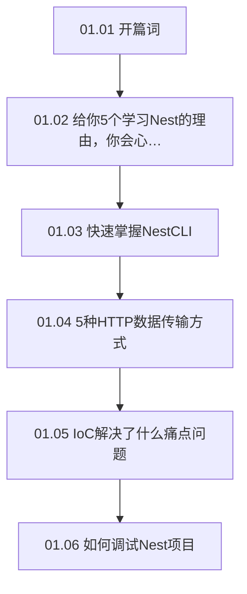

# 第 1 章 导学、CLI 与调试

> 第 1 部 · 6 节 · 约 7 学时 · 已写 6 节

## 这一章解决什么问题

把环境跑起来，知道 Nest 12 的脚手架、调试与工程约定长什么样。

## 知识地图

## 验收清单

- [ ] 能用 pnpm + Nest CLI 建一个 ESM 项目并在断点里走通一次请求。
- [ ] 能不看笔记复述本章核心机制与取舍
- [ ] 本章的命令/示例能独立跑通，并留下自己的验证记录

## 节清单

- ✅ [01.01 开篇词](01.01-开篇词.md)
- ✅ [01.02 给你5个学习Nest的理由，你会心动么](01.02-给你5个学习Nest的理由，你会心动么.md)
- ✅ [01.03 快速掌握NestCLI](01.03-快速掌握NestCLI.md)
- ✅ [01.04 5种HTTP数据传输方式](01.04-5种HTTP数据传输方式.md)
- ✅ [01.05 IoC解决了什么痛点问题](01.05-IoC解决了什么痛点问题.md)
- ✅ [01.06 如何调试Nest项目](01.06-如何调试Nest项目.md)

---

[返回教程目录](../../README.md) · [第 2 章 Nest 核心：模块、依赖注入与生命周期 →](../ch-02-核心概念/_chapter.md)
