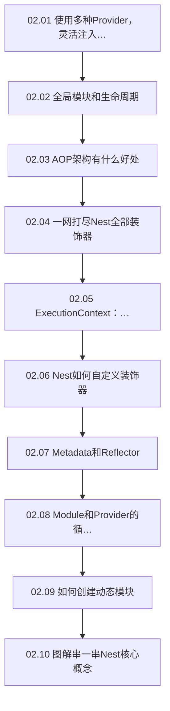

# 第 2 章 Nest 核心：模块、依赖注入与生命周期

> 第 1 部 · 10 节 · 约 12 学时 · 已写 10 节

## 这一章解决什么问题

建立 IoC 容器的心智模型，能解释一个请求从 main.ts 到 controller 之间发生了什么。

## 知识地图

## 验收清单

- [ ] 能自己写 Provider、动态模块，并能排查循环依赖与生命周期顺序问题。
- [ ] 能不看笔记复述本章核心机制与取舍
- [ ] 本章的命令/示例能独立跑通，并留下自己的验证记录

## 节清单

- ✅ [02.01 使用多种Provider，灵活注入对象](02.01-使用多种Provider，灵活注入对象.md)
- ✅ [02.02 全局模块和生命周期](02.02-全局模块和生命周期.md)
- ✅ [02.03 AOP架构有什么好处](02.03-AOP架构有什么好处.md)
- ✅ [02.04 一网打尽Nest全部装饰器](02.04-一网打尽Nest全部装饰器.md)
- ✅ [02.05 ExecutionContext：切换不同上下文](02.05-ExecutionContext：切换不同上下文.md)
- ✅ [02.06 Nest如何自定义装饰器](02.06-Nest如何自定义装饰器.md)
- ✅ [02.07 Metadata和Reflector](02.07-Metadata和Reflector.md)
- ✅ [02.08 Module和Provider的循环依赖怎么处理](02.08-Module和Provider的循环依赖怎么处理.md)
- ✅ [02.09 如何创建动态模块](02.09-如何创建动态模块.md)
- ✅ [02.10 图解串一串Nest核心概念](02.10-图解串一串Nest核心概念.md)

---

[← 第 1 章 导学、CLI 与调试](../ch-01-导学与CLI/_chapter.md) · [返回教程目录](../../README.md) · [第 3 章 请求链路：AOP、管道与过滤器 →](../ch-03-请求链路/_chapter.md)
