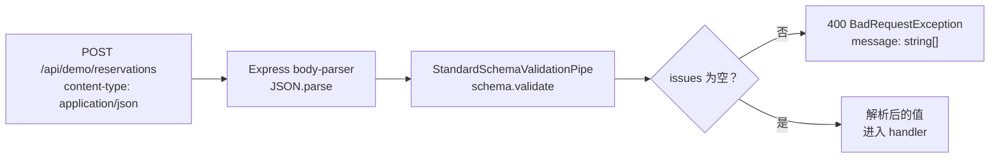

# 03.05 如何用StandardSchema校验post请求参数

## 包裹进了门，没人拆开看过

前端发来的请求体，是一包由客户端自己装好的东西。你在纸上写好了清单：房间号得是 UUID、标题最多 100 字、参会人至少一个。包裹到了服务端，如果没人拆开对一遍，它就被原样送进业务代码，一路写进数据库。

TypeScript 的类型标注在这件事上帮不上忙。它像快递单上那句「内有 3 件物品」——填单子的人自己写的，路上没人开箱数。`@Body() dto: ReservationInput` 只是给编辑器和编译器看的声明，编译成 JavaScript 后类型整段消失（第 3 章（03.04）讲过类型擦除）。客户端在 JSON 里多塞一个 `isAdmin: true`，或者把标题写成 5000 字，这行声明一个都拦不住。

**校验**就是包裹进 handler（真正处理这个接口的方法）之前，把它拆开，对照一份写死的清单逐项过：字段在不在、类型对不对、长度超没超、枚举值认不认。不合格的当场退回 400，合格的才放进去。

拿机场安检打比方最贴切。行李过传送带，机器只认「有没有超规物品」，既不关心你是谁，也不管你飞去哪儿。校验也一样：它只看这一包数据长得对不对，不看这个用户有没有权限。查权限是**守卫**的活——守卫站在更前面，回答「你能不能进这个接口」。**中间件**还要早，处理的是原始请求（第 3 章（03.02））；**拦截器**把 handler 和它的返回值包在中间（第 3 章（03.03））；**过滤器**在最后收错误（第 3 章（03.06））；校验本身由**管道**执行，一次只检查一个参数（第 3 章（03.04））。这五类组件的位置，第 2 章（02.03）那张表画过一遍。

没有它会卡在哪？三个地方：

- 多传的字段会一路穿到业务层。`isAdmin` 不在清单里，但没人删它，它就可能被当成「客户端想设置的值」存进去。
- 脏数据要等到更晚才炸。5000 字的标题可能撑到写库才报错，字符串类型的 `attendees` 可能撑到列表页渲染才 500——那时候已经很难判断是哪一层的问题。
- 每个 handler 都得手写一串 `if`，而且写不齐。十个接口十套规则，改一处漏九处。

Nest 12 里做这件事的标准写法是 **Standard Schema**：把规则写成一份 schema 对象，交给内置的 `StandardSchemaValidationPipe` 执行。schema 自带类型推导，写完规则类型跟着出来，不用再维护一份「长得一样但可能对不上」的类型声明。

官方文档（先看懂正文再点）：
- [Validation](https://docs.nestjs.com/application/validation)：官方校验章节，`StandardSchemaValidationPipe` 与 `ValidationPipe` 都在这里。
- [Standard Schema](https://standardschema.dev)：这份协议本身，Zod、Valibot、ArkType 都实现了它，`@nestjs/common` 只认协议不认库。

## 多出来的那个 isAdmin

给 `POST /api/demo/reservations` 多传一个 `isAdmin: true`，接口照样返回 201，响应里还把它原样回显了。三天后，有人把 `title` 改成 5000 字，把 `attendees` 传成字符串，列表页直接 500。

这两件事看着像「前端乱传」，根子上是同一个问题：JSON body 进来时只是一个普通对象，TypeScript 的 `interface` 编译完就没了，运行时没有任何人检查它。`@Body() dto: ReservationInput` 只是给编辑器看的，不会拦住 `isAdmin`，也不会拦住空标题。

这一章把 body 当成一份运行时契约：用一份 schema 写规则，用 `StandardSchemaValidationPipe` 在进入 handler 之前执行，让非法请求停在 400，而不是流进数据库。

## 400 是谁返回的

`StandardSchemaValidationPipe` 是 Nest 12 内置的管道，挂在路由匹配之后、handler 之前。它只做一件事：拿到参数上声明的 schema，调用协议的 `validate` 方法，拿到结果。

- 通过：把 `value` 交出去，默认是**解析后**的值（schema 里写过 `.trim()`、`.toLowerCase()`、`z.coerce`，handler 拿到的就是处理过的）；
- 不通过：把 issue 列表拼成 `BadRequestException`，每个 issue 的 `path` 前缀在消息里，响应就是 400。

管道做三件事，顺序不能反：

1. 从参数元数据里取出 schema（`@Body({ schema })` 存的就是它）。
2. 用 schema 解析原始值：校验 + 转换一步完成。
3. 有 issue 就抛 400；没问题把解析结果交给 handler。



> **图 03.05-1** 一个 JSON body 在进入 handler 之前经历的校验与转换。

为什么不能直接写 `interface`？看这段：

```ts
interface ReservationInput {
  roomId: string;
  title: string;
  attendees: { name: string; email: string }[];
}
```

编译成 JavaScript 之后，它只剩一个空壳。运行时你拿到的 `{ roomId: 'abc', title: '', isAdmin: true }` 完全符合这个「声明」，因为声明根本不存在了。schema 不一样，它是**运行时对象**，带一组可以真正执行的解析函数。

## 把 body 写成一份 schema

先装依赖：`pnpm add zod`。新建 `src/modules/demo/dto/reservation.schema.ts`：

```ts
import { z } from 'zod';

export const reservationSchema = z.object({
  roomId: z.uuid(),
  title: z.string().trim().min(2).max(100),
  startTime: z.iso.datetime({ offset: true }),
  endTime: z.iso.datetime({ offset: true }),
  attendees: z
    .array(
      z.object({
        name: z.string().min(2),
        email: z.email(),
      }),
    )
    .min(1)
    .max(20),
  equipment: z.array(z.enum(['PROJECTOR', 'WHITEBOARD', 'VIDEO'])).optional(),
  remark: z.string().trim().max(500).optional(),
});

export type ReservationInput = z.infer<typeof reservationSchema>;
```

注意 Zod 4 的写法：`z.email()`、`z.uuid()`、`z.iso.datetime()` 都是顶层函数，不是 `z.string().email()` 那种链式写法。`z.iso.datetime({ offset: true })` 接受带时区偏移的 ISO 时间，也会检查 `2026-02-30` 这种不存在的日期。`z.infer` 从 schema 反推类型，规则和类型是同一份东西，不会漂移。

schema 是纯数据、纯函数，没有装饰器，也不需要 `emitDecoratorMetadata`。这带来两个实际好处：一是它可以被前端直接 import 做表单校验，规则只写一遍；二是 swagger 能直接从它的 `~standard.jsonSchema` 生成请求体文档，不用再手写一堆 `@ApiProperty`。

需要跨字段比较时，schema 里也可以用 `.refine()`，但它只适合纯函数判断（比如两个时间的大小），要查库、要读配置的判断别放进来——schema 是同步的，异步校验会让管道变成瓶颈，还难定位。

## 控制器里怎么接

```ts
import { Body, Controller, Post } from '@nestjs/common';
import { Public } from '../../common/decorators/public.decorator.js';
import { reservationSchema, type ReservationInput } from './dto/reservation.schema.js';

@Public()
@Controller('demo')
export class DemoController {
  @Post('reservations')
  create(@Body({ schema: reservationSchema }) dto: ReservationInput): ReservationInput & { id: string } {
    return { id: randomUUID(), ...dto };
  }
}
```

差异只有三处：`@Body()` 多了 `{ schema }`、参数类型换成 `z.infer` 出来的 `ReservationInput`、并确认全局注册了 `StandardSchemaValidationPipe`：

```ts
import { StandardSchemaValidationPipe } from '@nestjs/common';

app.useGlobalPipes(new StandardSchemaValidationPipe());
```

`StandardSchemaValidationPipe` 的构造函数还有几个开关，需要时再动：`transform`（默认 `true`，设为 `false` 时把**原始输入**交给 handler）、`validateCustomDecorators`（默认 `false`，自定义参数装饰器要校验时打开）、`errorHttpStatusCode`（默认 400）、`exceptionFactory`（自己造异常）、`maxErrorMessagesLength`（默认 100 万字符，超长时截断并附提示，防止超长 issue 撑爆响应）。

## 严格与宽松：多出来的键怎么办

`z.object()` 默认会**剥掉**未声明的键，效果类似原来 `ValidationPipe` 的 `whitelist: true`。对上面那个 `isAdmin: true`，它进不了 handler，也就进不了数据库——这是默认行为，不需要额外配置。

两种例外：

- `z.strictObject({...})`：多一个键就报错，消息 `Unrecognized key: "isAdmin"`。适合「客户端传错字段名必须立刻发现」的接口。
- `z.looseObject({...})`：保留未声明的键，只做部分校验。适合透传第三方 payload 的场景，慎用。

嵌套对象同理：`z.object` 每一层都剥键，`z.strictObject` 每一层都拒绝。要不要严格，按「这个接口更怕脏数据还是更怕前端迭代时多传一个字段」来定。

## query 和 param：字符串进来，coerce 出去

URL 里的值永远是字符串。`?page=2` 到了 handler 是 `'2'`，不是 `2`。schema 这边用 `z.coerce` 完成转换，再校验：

```ts
import { z } from 'zod';

export const paginationSchema = z.object({
  page: z.coerce.number().int().min(1).default(1),
  pageSize: z.coerce.number().int().min(1).max(100).default(10),
});

export const queryRoomsSchema = paginationSchema.extend({
  keyword: z.string().max(100).optional(),
  minCapacity: z.coerce.number().int().min(1).optional(),
});
```

`.default()` 的作用是：字段缺省时补默认值，handler 拿到的就是数字，service 里不用再写 `query.page ?? 1`。`@Query({ schema: queryRoomsSchema })` 和 `@Body` 的用法完全一样。

path 参数同理，UUID 校验直接写进参数装饰器，不用再挂 `ParseUUIDPipe`：

```ts
@Get(':id')
findOne(@Param('id', { schema: z.uuid() }) id: string) {
  return this.roomsService.findOne(id);
}
```

`z.coerce.number()` 有一个坑：`z.coerce.number()` 会把 `''` 转成 `0`、把 `'abc'` 转成 `NaN`。前者被 `.min(1)` 拦下，后者被 `.int()` 拦下，所以校验链后面一定要有边界，别只写 `z.coerce.number()` 就收工。

## 跑一遍，看 400 长什么样

发一次坏数据：

```bash
curl -s -X POST http://localhost:3000/api/demo/reservations \
  -H 'content-type: application/json' \
  -d '{"roomId":"3f1c2a9e-7b4d-4c8e-9f10-2a6b7c8d9e0f","title":"x","startTime":"2026-02-30T09:00:00+08:00","endTime":"2026-11-20T10:00:00+08:00","attendees":[{"name":"张三","email":"not-an-email"}]}'
```

```json
{"statusCode":400,"message":["title: Too small: expected string to have >=2 characters","startTime: Invalid ISO datetime","attendees.0.email: Invalid email address"],"error":"Bad Request","requestId":"e4f6a8c0-3b5d-4e7f-9a1c-2b4d6f8a0c2e"}
```

> 示例输出（未实测）。Zod 的 issue 自带路径，`StandardSchemaValidationPipe` 把它拼成 `path: message`，前端能直接定位到字段。

再发一次带 `isAdmin` 的合法请求：返回 201，响应的 `data` 里不会有 `isAdmin`。多传的键被 schema 剥掉了，这是默认行为，不是 bug。

## 跨字段与查库规则，交给 service

schema 擅长「这一个值长得对不对」，不擅长「这两个值能不能同时成立」和「这个值在库里存不存在」。比如结束时间必须晚于开始时间、会议室这个时段有没有被占、用户余额够不够——这些要么跨字段、要么要查库，塞进 schema 会越来越难读，也不好写测试。

边界可以这样分：

- 字段类型、长度、格式、枚举、嵌套结构、字符串归一化（trim/lowercase）→ schema；
- 跨字段比较、状态机、唯一性、权限相关的条件 → service 或 handler，抛 `BadRequestException` / `ConflictException` / `ForbiddenException`，语义更准。

```ts
if (Date.parse(dto.endTime) <= Date.parse(dto.startTime)) {
  throw new BadRequestException('endTime 必须晚于 startTime');
}
```

好处是错误消息可以说人话，也能带上业务背景；代价是它不在 schema 的 issue 数组里，`message` 是一个字符串而不是数组。全局过滤器要同时接住这两种形状，下一章会处理。

## 自定义管道还能用吗

能。`PipeTransform` 的签名没变，而且 `ArgumentMetadata` 新增了 `schema` 字段——自定义管道可以像内置管道那样从参数装饰器里取到 schema。想复用同一份规则做别的转换（比如把 schema 校验过的入参映射成领域对象）时，这样写：

```ts
import { ArgumentMetadata, Injectable, PipeTransform } from '@nestjs/common';
import type { StandardSchemaV1 } from '@standard-schema/spec';

@Injectable()
export class ToReservationPipe implements PipeTransform {
  transform(value: unknown, metadata: ArgumentMetadata) {
    const schema = metadata.schema as StandardSchemaV1 | undefined;
    if (!schema) throw new Error('ToReservationPipe 需要 @Body({ schema })');
    const result = schema['~standard'].validate(value);
    if (result instanceof Promise) throw new Error('不支持异步 schema');
    if (result.issues) throw new BadRequestException(result.issues.map((i) => i.message));
    return result.value;
  }
}
```

大多数情况不需要自己写：内置管道已经把「校验 + 转换 + 400」做完了，自定义管道的价值在于**校验之后还要做别的动作**（加默认关联、注入上下文、把 DTO 变成领域对象）。

## 不止 body：query、param、header 也是同一套

schema 不绑定 body。四个取参装饰器都接受同一个 `schema` 选项，写法一致：

```ts
@Get('search')
search(
  @Query({ schema: queryRoomsSchema }) query: QueryRoomsInput,
  @Param('id', { schema: z.uuid() }) id: string,
  @Headers({ schema: z.object({ 'x-tenant-id': z.uuid() }) }) headers: { 'x-tenant-id': string },
) {
  return this.roomsService.search(id, query, headers['x-tenant-id']);
}
```

注意 `@Headers` 的 schema 里键名要写全小写：HTTP 头在 Node 里已经被小写化，写成 `X-Tenant-Id` 永远匹配不上。这类「协议层已经做过一次处理」的细节，靠 schema 是校验不出来的，只能靠对运行时的了解——校验能拦住脏数据，但拦不住错误的心智模型。

自定义参数装饰器同理：把 schema 放进装饰器选项，再在注册管道时打开 `validateCustomDecorators: true`，内置管道就会去读它。具体写法在第 2 章（02.06）自定义装饰器那节展开过。

## 那 class-validator 呢

Nest 12 之前的默认写法是 DTO 类加装饰器（`@IsUUID()`、`@MaxLength()`），配合 `class-validator` + `class-transformer` + `ValidationPipe`。这套东西在 Nest 12 里**没有被移除**：`@nestjs/common` 的 peerDependencies 里还写着这两个包（都标了 `optional: true`），`ValidationPipe` 里也还在运行时加载它们；你要用，装上班就能跑。

但本书和 `example/` 统一用 schema，原因有三个：

- 类型和规则同源：`z.infer` 反推类型，不会出现「DTO 改了类型声明忘了改校验」；
- 转换层更干净：不用再维护一个四年多没发版的 `class-transformer`（它最后一次发布是 2021 年 11 月）；
- 前后端复用：schema 是纯数据，前端表单校验可以直接 import。

老项目继续用 `ValidationPipe` 没问题，它是官方支持路径，不是废弃 API。新项目从 schema 起手，省掉一层转换依赖。

## 注册在哪一层：全局、控制器、单参数

管道可以挂在三个层级上，生效范围不同，选错了会出现「这个接口校验了、那个没校验」的错觉。

| 挂载方式 | 写法 | 生效范围 | 适合 |
| --- | --- | --- | --- |
| 全局 | `app.useGlobalPipes(new StandardSchemaValidationPipe())` | 所有路由的所有参数 | 默认选择，一次配好 |
| 控制器 / 方法 | `@UsePipes(new StandardSchemaValidationPipe())` | 该类或该方法的所有参数 | 某个模块要特殊处理（比如不同的错误码） |
| 参数级 | `@Body({ schema, pipes: [MyPipe] })` | 只这一个参数 | 单点补充逻辑 |

Nest 的解析顺序是：参数上声明的 pipe → 方法级 → 控制器级 → 全局级。同一个参数可能被多个管道处理，前一个的输出就是后一个的输入。所以**不要在两处重复注册同一个校验管道**：schema 会被解析两遍，浪费一次 parse，错误也容易出现两份。

`@Body({ schema })` 这种参数级写法还有一个好处：schema 跟着参数走，控制器代码读起来就是自解释的——不用跳到模块配置里找「这个接口到底校验了什么」。

## 错误消息怎么变成前端能用的字段错误

默认的 400 响应是 `message: ["title: Too small...", ...]`，前端要自己按冒号切字符串，很脆。更稳的做法是用 `exceptionFactory` 把 issue 列表转成 `{ field, message }` 结构，字段名由程序给出，不依赖文案：

```ts
import { BadRequestException, StandardSchemaValidationPipe } from '@nestjs/common';

const validationPipe = new StandardSchemaValidationPipe({
  exceptionFactory: (issues) =>
    new BadRequestException({
      message: '参数校验失败',
      errors: issues.map((issue) => ({
        field: issue.path?.map((seg) => String(typeof seg === 'object' ? seg.key : seg)).join('.') ?? '',
        message: issue.message,
      })),
    }),
});
```

注意两件事：`issue.path` 的每一段可能是字符串，也可能是 `{ key }` 对象（数组下标、联合类型分支都会出现对象段），拼之前要归一化；返回体形状变了以后，前端的错误处理要同步改，别只改后端。

## schema 的复用：pick、omit、extend、partial

一个资源通常有「创建、更新、查询、详情响应」四种形状，规则大量重叠。zod 的对象 schema 自带组合方法，没必要复制粘贴：

```ts
const roomBaseSchema = z.object({
  name: z.string().trim().min(2).max(100),
  capacity: z.coerce.number().int().min(1).max(500),
  location: z.string().trim().min(2).max(200),
});

export const createRoomSchema = roomBaseSchema;
export const updateRoomSchema = roomBaseSchema.partial();      // 全字段可选
export const queryRoomSchema = roomBaseSchema.pick({ capacity: true }).partial();
export const roomResponseSchema = roomBaseSchema.extend({
  id: z.uuid(),
  status: z.enum(['AVAILABLE', 'MAINTENANCE']),
});
```

`pick` / `omit` 挑字段，`extend` 加字段，`partial` 全变可选，`required` 反向操作。这正是原来 `PartialType`、`OmitType`、`PickType` 想解决的问题，现在不用再引入 `@nestjs/mapped-types`，因为类型是 `z.infer` 自动出来的。

有一个边界要注意：`updateRoomSchema` 允许全空对象（`{}` 也是合法的 partial），业务上「至少要改一个字段」属于 service 的判断，不在 schema 里。schema 管形状，service 管语义，这条线一直是这样。

再补一个单测视角：schema 是纯函数，校验规则可以脱离 Nest 直接测——`reservationSchema.safeParse({...})` 就能断言哪些字段会报错、默认值补成什么。不用起整个应用，也不用 mock 请求对象。这也是把规则从类装饰器挪到 schema 之后最直接的收益：规则本身变得可测了。

## 生产里真正会踩的坑

| 现象 | 原因 | 处理 |
| --- | --- | --- |
| 怎么传都不报错 | 只写了 `interface`、或忘了挂 schema | `@Body({ schema })` + 全局注册管道 |
| 多余字段被静默删掉 | `z.object` 默认剥键 | 想报错用 `z.strictObject`，想保留用 `z.looseObject` |
| handler 里还是字符串 | schema 没写 `.default()` 也没写 `z.coerce` | query 参数统一 `z.coerce.number()` |
| `page=abc` 变成 400 的奇怪消息 | `z.coerce` 把非法值转成 `NaN` | 后面接 `.int()` / `.min()`，别只写 coerce |
| `2026-02-30` 通过了 | 用了宽松的 `z.string()` | 用 `z.iso.datetime({ offset: true })` |
| 可选字段传了空串 | `.optional()` 只放过 `undefined` | 需要时 `.transform(v => v === '' ? undefined : v)` 或 `.nullable()` |
| 全局过滤器拿不到 `message` 数组 | 切了 `errorFormat` 或自定义 exceptionFactory | 过滤器同时支持 `string \| string[] \| Record<string, string[]>` |
| 大 body 直接 413 | Express `json()` 默认 100kb 上限 | 调 `app.use(json({ limit: '1mb' }))`，别靠 schema 兜底 |
| Swagger 里请求体是空的 | 响应/请求用了普通对象或 class | 请求走 `@Body({ schema })`，响应走 `@ApiOkResponse({ standardSchema })` |

三件事记住就够了：schema 决定「形状」，管道决定「什么时候执行、错了怎么返回」，service 决定「业务上允不允许」。现在参数错了会返回 400，但 401、403、404、500 还是 Nest 的默认形状，错误体里也没有 `requestId`。下一章把这些出口收成一个异常过滤器，让所有失败长一个样。

<!-- chapter-nav:start -->
---

← [03.04 内置Pipe和自定义Pipe](03.04-内置Pipe和自定义Pipe.md) · [本章目录](_chapter.md) · [03.06 如何自定义ExceptionFilter](03.06-如何自定义ExceptionFilter.md) →
<!-- chapter-nav:end -->
