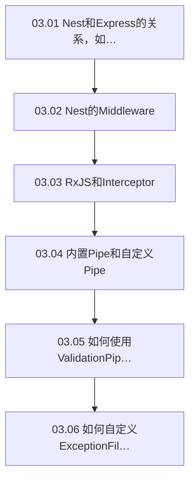

# 第 3 章 请求链路：AOP、管道与过滤器

> 第 1 部 · 6 节 · 约 7 学时 · 已写 6 节

## 这一章解决什么问题

掌握 Nest 的横切能力：Middleware / Guard / Interceptor / Pipe / Filter 各自该放在哪。

## 知识地图

## 验收清单

- [ ] 能写出带校验、统一响应、异常兜底的一条完整请求链路。
- [ ] 能不看笔记复述本章核心机制与取舍
- [ ] 本章的命令/示例能独立跑通，并留下自己的验证记录

## 节清单

- ✅ [03.01 Nest和Express的关系，如何切到fastify](03.01-Nest和Express的关系，如何切到fastify.md)
- ✅ [03.02 Nest的Middleware](03.02-Nest的Middleware.md)
- ✅ [03.03 RxJS和Interceptor](03.03-RxJS和Interceptor.md)
- ✅ [03.04 内置Pipe和自定义Pipe](03.04-内置Pipe和自定义Pipe.md)
- ✅ [03.05 如何使用ValidationPipe验证post请求参数](03.05-如何使用ValidationPipe验证post请求参数.md)
- ✅ [03.06 如何自定义ExceptionFilter](03.06-如何自定义ExceptionFilter.md)

---

[← 第 2 章 Nest 核心：模块、依赖注入与生命周期](../ch-02-核心概念/_chapter.md) · [返回教程目录](../../README.md) · [第 4 章 文件、日志与运行时诊断 →](../ch-04-文件与日志/_chapter.md)
