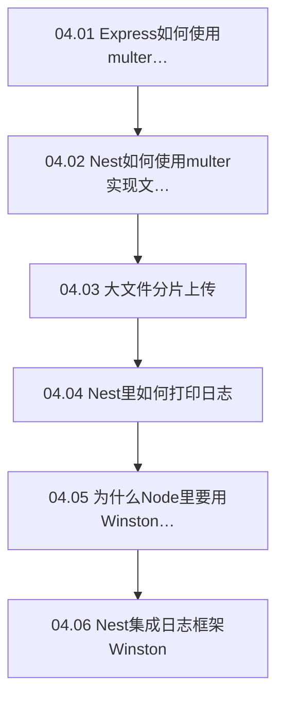

# 第 4 章 文件、日志与运行时诊断

> 第 1 部 · 6 节 · 约 7 学时 · 已写 6 节

## 这一章解决什么问题

把文件上传与日志这两件“线上必用”的事做对，并知道出问题时去哪儿看。

## 知识地图

## 验收清单

- [ ] 能实现分片上传，能把日志结构化输出并接入 Winston。
- [ ] 能不看笔记复述本章核心机制与取舍
- [ ] 本章的命令/示例能独立跑通，并留下自己的验证记录

## 节清单

- ✅ [04.01 Express如何使用multer实现文件上传](04.01-Express如何使用multer实现文件上传.md)
- ✅ [04.02 Nest如何使用multer实现文件上传](04.02-Nest如何使用multer实现文件上传.md)
- ✅ [04.03 大文件分片上传](04.03-大文件分片上传.md)
- ✅ [04.04 Nest里如何打印日志](04.04-Nest里如何打印日志.md)
- ✅ [04.05 为什么Node里要用Winston打印日志](04.05-为什么Node里要用Winston打印日志.md)
- ✅ [04.06 Nest集成日志框架Winston](04.06-Nest集成日志框架Winston.md)

---

[← 第 3 章 请求链路：AOP、管道与过滤器](../ch-03-请求链路/_chapter.md) · [返回教程目录](../../README.md) · [第 5 章 容器化与进程管理 →](../ch-05-容器化/_chapter.md)
