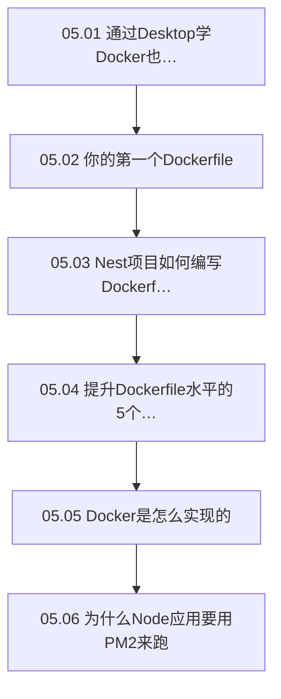

# 第 5 章 容器化与进程管理

> 第 1 部 · 6 节 · 约 7 学时 · 已写 6 节

## 这一章解决什么问题

从 docker run 走到 compose，理解容器网络与重启策略。

## 知识地图

## 验收清单

- [ ] 能为一套 Nest + PG + Redis 写出可复用的 compose，并说清为什么不再需要 PM2。
- [ ] 能不看笔记复述本章核心机制与取舍
- [ ] 本章的命令/示例能独立跑通，并留下自己的验证记录

## 节清单

- ✅ [05.01 通过Desktop学Docker也太简单了](05.01-通过Desktop学Docker也太简单了.md)
- ✅ [05.02 你的第一个Dockerfile](05.02-你的第一个Dockerfile.md)
- ✅ [05.03 Nest项目如何编写Dockerfile](05.03-Nest项目如何编写Dockerfile.md)
- ✅ [05.04 提升Dockerfile水平的5个技巧](05.04-提升Dockerfile水平的5个技巧.md)
- ✅ [05.05 Docker是怎么实现的](05.05-Docker是怎么实现的.md)
- ✅ [05.06 为什么Node应用要用PM2来跑](05.06-为什么Node应用要用PM2来跑.md)

---

[← 第 4 章 文件、日志与运行时诊断](../ch-04-文件与日志/_chapter.md) · [返回教程目录](../../README.md) · [第 6 章 PostgreSQL 与 SQL →](../ch-06-PostgreSQL与SQL/_chapter.md)
