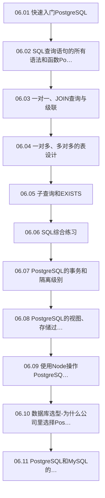

# 第 6 章 PostgreSQL 与 SQL

> 第 2 部 · 11 节 · 约 13 学时 · 已写 9 节

## 这一章解决什么问题

从 SQL 语法走到事务、隔离级别与执行计划。

## 知识地图

## 验收清单

- [ ] 能独立设计表、写 JOIN / 子查询 / 窗口函数，并读懂 EXPLAIN。
- [ ] 能不看笔记复述本章核心机制与取舍
- [ ] 本章的命令/示例能独立跑通，并留下自己的验证记录

## 节清单

- ✅ [06.01 快速入门PostgreSQL](06.01-快速入门PostgreSQL.md)
- ✅ [06.02 SQL查询语句的所有语法和函数PostgreSQL版](06.02-SQL查询语句的所有语法和函数PostgreSQL版.md)
- ✅ [06.03 一对一、JOIN查询与级联](06.03-一对一、JOIN查询与级联.md)
- ✅ [06.04 一对多、多对多的表设计](06.04-一对多、多对多的表设计.md)
- ✅ [06.05 子查询和EXISTS](06.05-子查询和EXISTS.md)
- ✅ [06.06 SQL综合练习](06.06-SQL综合练习.md)
- ✅ [06.07 PostgreSQL的事务和隔离级别](06.07-PostgreSQL的事务和隔离级别.md)
- ✅ [06.08 PostgreSQL的视图、存储过程和函数](06.08-PostgreSQL的视图、存储过程和函数.md)
- ✅ [06.09 使用Node操作PostgreSQL的两种方式](06.09-使用Node操作PostgreSQL的两种方式.md)
- ⬜ 06.10 数据库选型-为什么公司里选择PostgreSQL作为主库（待写）
- ⬜ 06.11 PostgreSQL和MySQL的区别（待写）

---

[← 第 5 章 容器化与进程管理](../ch-05-容器化/_chapter.md) · [返回教程目录](../../README.md) · [第 7 章 Prisma 8 与 ORM 选型 →](../ch-07-Prisma8与选型/_chapter.md)
