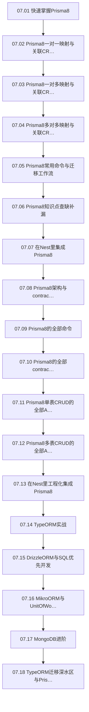

# 第 7 章 Prisma 8 与 ORM 选型

> 第 2 部 · 18 节 · 约 21.5 学时 · 已写 7 节

## 这一章解决什么问题

用 Prisma 8 的 contract 模型完成映射、迁移与集成，并能与 TypeORM/Drizzle 对比选型。

## 知识地图

## 验收清单

- [ ] 能在 Nest 里用 Prisma 8 完成 CRUD、事务与迁移流程，且说得清为什么不用 Prisma 7 写法。
- [ ] 能不看笔记复述本章核心机制与取舍
- [ ] 本章的命令/示例能独立跑通，并留下自己的验证记录

## 节清单

- ✅ [07.01 快速掌握Prisma8](07.01-快速掌握Prisma8.md)
- ✅ [07.02 Prisma8一对一映射与关联CRUD](07.02-Prisma8一对一映射与关联CRUD.md)
- ✅ [07.03 Prisma8一对多映射与关联CRUD](07.03-Prisma8一对多映射与关联CRUD.md)
- ✅ [07.04 Prisma8多对多映射与关联CRUD](07.04-Prisma8多对多映射与关联CRUD.md)
- ✅ [07.05 Prisma8常用命令与迁移工作流](07.05-Prisma8常用命令与迁移工作流.md)
- ✅ [07.06 Prisma8知识点查缺补漏](07.06-Prisma8知识点查缺补漏.md)
- ✅ [07.07 在Nest里集成Prisma8](07.07-在Nest里集成Prisma8.md)
- ⬜ 07.08 Prisma8架构与contract模型深入（待写）
- ⬜ 07.09 Prisma8的全部命令（待写）
- ⬜ 07.10 Prisma8的全部contract语法（待写）
- ⬜ 07.11 Prisma8单表CRUD的全部API（待写）
- ⬜ 07.12 Prisma8多表CRUD的全部API（待写）
- ⬜ 07.13 在Nest里工程化集成Prisma8（待写）
- ⬜ 07.14 TypeORM实战（待写）
- ⬜ 07.15 DrizzleORM与SQL优先开发（待写）
- ⬜ 07.16 MikroORM与UnitOfWork（待写）
- ⬜ 07.17 MongoDB进阶（待写）
- ⬜ 07.18 TypeORM迁移深水区与Prisma对照（待写）

---

[← 第 6 章 PostgreSQL 与 SQL](../ch-06-PostgreSQL与SQL/_chapter.md) · [返回教程目录](../../README.md) · [第 8 章 Redis、缓存与消息 →](../ch-08-Redis与缓存/_chapter.md)
