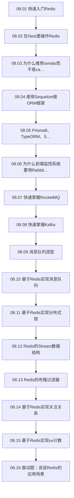

# 第 8 章 Redis、缓存与消息

> 第 2 部 · 16 节 · 约 19 学时 · 已写 3 节

## 这一章解决什么问题

把 Redis 用到生产级：数据结构、缓存模式、分布式锁与消息队列。

## 知识地图

## 验收清单

- [ ] 能在 Nest 里封装 Redis 客户端、做缓存与限流，并能用 BullMQ 处理异步任务。
- [ ] 能不看笔记复述本章核心机制与取舍
- [ ] 本章的命令/示例能独立跑通，并留下自己的验证记录

## 节清单

- ✅ [08.01 快速入门Redis](08.01-快速入门Redis.md)
- ✅ [08.02 在Nest里操作Redis](08.02-在Nest里操作Redis.md)
- ✅ [08.03 为什么推荐ioredis而不是cache-manager操作Redis](08.03-为什么推荐ioredis而不是cache-manager操作Redis.md)
- ⬜ 08.04 使用Sequelize做ORM框架（待写）
- ⬜ 08.05 Prisma8、TypeORM、Sequelize三大ORM框架对比（待写）
- ⬜ 08.06 为什么前端监控系统要用RabbitMQ（待写）
- ⬜ 08.07 快速掌握RocketMQ（待写）
- ⬜ 08.08 快速掌握Kafka（待写）
- ⬜ 08.09 消息队列选型（待写）
- ⬜ 08.10 基于Redis实现消息队列（待写）
- ⬜ 08.11 基于Redis实现分布式锁（待写）
- ⬜ 08.12 Redis的Stream数据结构（待写）
- ⬜ 08.13 Redis的布隆过滤器（待写）
- ⬜ 08.14 基于Redis实现关注关系（待写）
- ⬜ 08.15 基于Redis实现uv计数（待写）
- ⬜ 08.16 面试题：说说Redis的应用场景（待写）

---

[← 第 7 章 Prisma 8 与 ORM 选型](../ch-07-Prisma8与选型/_chapter.md) · [返回教程目录](../../README.md) · [第 9 章 认证、授权与安全 →](../ch-09-认证与安全/_chapter.md)
