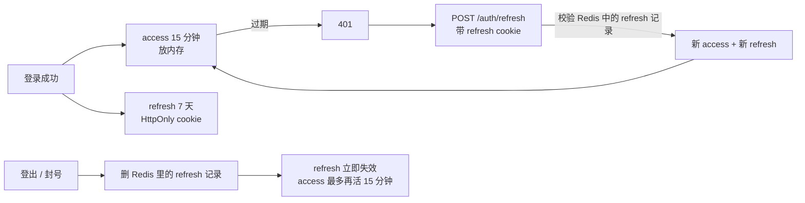

# 09.01 两种登录状态保存方式：JWT、Session

登录接口把邮箱和密码核对完，真正的问题才刚开始：下一次请求带着什么，服务端凭什么相信"这就是刚才那个人"？

多数教程把这里讲成"JWT vs Session 哪个更安全"，这是个误导性的问法。真正的分水岭只有一句话：**这份"已登录"的状态，你打算存在客户端，还是存在服务端**。后面所有的差异——能不能踢人、能不能水平扩容、每个请求多花几毫秒、令牌该放 cookie 还是 localStorage——都是从这一句长出来的。

## HTTP 天生不记得你是谁

每个 HTTP 请求都是独立的：连接可以复用，但协议本身不保存"上一位访客"的身份。这不是缺陷，是它能撑起整个 Web 的原因——服务器不需要为每个打开页面的人留一块内存。

登录要打破这个前提，只有两条路：

- **服务端记**：服务端维护一张表（session 表），客户端只拿一个编号（session id）。之后每次请求报编号，服务端查表。
- **客户端记**：服务端把身份信息签名后交给客户端（JWT），之后每次请求把整张"凭证"带回来，服务端验签即可，不查表。

两条路都得让客户端在请求里带上点东西。区别在于：带的是**钥匙**，还是**账本复印件**。

## Session：钥匙给客户端，账本留在服务端

一次完整的登录流程是这样的：

```mermaid
sequenceDiagram
  participant B as 浏览器
  participant A as API
  participant S as Redis（会话表）
  B->>A: POST /auth/login（邮箱 + 密码）
  A->>A: 校验密码，生成 sid
  A->>S: SET sid:{userId, roles,...} EX 604800
  A-->>B: Set-Cookie: sid=xxx; HttpOnly; SameSite=Lax
  B->>A: GET /bookings（Cookie: sid=xxx）
  A->>S: GET sid
  S-->>A: { userId, roles }
  A-->>B: 200 预订列表
```

关键在最后一跳：服务端每次都去查表。表里存什么由你决定，通常是 `userId`、角色、登录时间、设备标识。

还有几个上线前必须确认的点，它们都在代码外：

- **`app.set('trust proxy', 1)`**。部署在 Nginx 或 Cloudflare 后面时，`secure: true` 的 cookie 需要知道"外部是 HTTPS"，否则 Express 认为连接是明文，直接不种 cookie，表现为"登录成功但立刻又变未登录"。
- **cookie 名加 `__Host-` 前缀**（`__Host-sid`）。这个前缀是浏览器的硬约束：必须 `Secure`、必须从根路径、不能带 `Domain`，能从根上防住子域覆盖 cookie 的攻击。
- **`sid` 必须用密码学随机数**（`uid-safe`、`crypto.randomUUID()` 都行），长度 128 位以上。不要用自增 ID 或时间戳——那等于把会话表的主键公开。

它的三个好处都很实在：

1. **撤销是一条删除语句**。管理员点"强制下线"，`DEL sid` 就结束了；改权限也是改表，下一个请求立刻生效。
2. **客户端拿不到任何信息**。sid 只是一串随机数，就算被看到也读不出角色、邮箱、内部 ID。
3. **会话长度可以随时调整**。闲置 30 分钟过期、记住我 7 天、后台强制 8 小时重新登录，都是服务端配置。

代价同样明确：**每个受保护请求都要访问一次会话存储**。会话放内存（Express 默认的 `MemoryStore`）时，进程一重启全部掉线，多开一个副本又互不共享——所以生产上几乎必然是 Redis。

```ts
// src/main.ts（片段）：把 session 中间件挂上去
import session from 'express-session';
import { RedisSessionStore } from './infra/redis-session.store.js';

const app = await NestFactory.create(AppModule);
app.use(
  session({
    name: 'sid',
    secret: process.env.SESSION_SECRET!, // 至少 32 字节随机值
    resave: false,                       // 没有变化就不回写
    saveUninitialized: false,            // 未登录的访客不建会话
    cookie: {
      httpOnly: true,                    // JS 读不到
      sameSite: 'lax',                   // 跨站 POST 不带
      secure: process.env.NODE_ENV === 'production',
      maxAge: 7 * 24 * 60 * 60 * 1000,
    },
    store: new RedisSessionStore(redis), // 生产必须换掉 MemoryStore
  }),
);
```

这里有一个 2026 年才明显的变化：`connect-redis` 的最新版（11.x）把 peer 依赖换成了 `redis`（node-redis）客户端，而本项目统一用 `ioredis` 6。两者不通用，你只有三个选择——为 session 单独引入 node-redis、降级 `connect-redis` 到 6.x、或者自己实现一个 40 行的 store。

自己写反而最省心，接口只有五个方法：

```ts
// src/infra/redis-session.store.ts（骨架）
import session, { type SessionData, type Store } from 'express-session';
import type Redis from 'ioredis';

const TTL_SECONDS = 7 * 24 * 60 * 60;

export class RedisSessionStore extends session.Store implements Store {
  constructor(private readonly redis: Redis) {
    super();
  }

  private key(sid: string) {
    return `sess:${sid}`;
  }

  get(sid: string, cb: (err: unknown, data?: SessionData | null) => void) {
    this.redis
      .get(this.key(sid))
      .then((raw) => cb(null, raw ? (JSON.parse(raw) as SessionData) : null))
      .catch((err) => cb(err));
  }

  set(sid: string, data: SessionData, cb?: (err?: unknown) => void) {
    this.redis
      .set(this.key(sid), JSON.stringify(data), 'EX', TTL_SECONDS)
      .then(() => cb?.())
      .catch((err) => cb?.(err));
  }

  destroy(sid: string, cb?: (err?: unknown) => void) {
    this.redis
      .del(this.key(sid))
      .then(() => cb?.())
      .catch((err) => cb?.(err));
  }

  touch(sid: string, data: SessionData, cb?: (err?: unknown) => void) {
    this.redis
      .expire(this.key(sid), TTL_SECONDS)
      .then(() => cb?.())
      .catch((err) => cb?.(err));
  }
}
```

还有一个容易忽略的适配问题：**session 依赖中间件体系**。Express 适配器下是 `express-session`，Fastify 下换成 `@fastify/session`，而 Nest 12.3 起推荐的 NodeAdapter（`@nestjs/platform-node`）没有 Express 那套 `app.use` 中间件栈——在它上面只能用 JWT，或者改用 Fastify。选型时把这条算进去，能省掉一次重写。

## JWT：把账本签成一张纸

JWT 把身份信息编码进令牌本身，再用密钥签名。结构是三段用点分隔的 Base64URL：

```text
eyJhbGciOiJIUzI1NiIsInR5cCI6IkpXVCJ9.eyJzdWIiOiJ1c2VyXzEyMyIsInJvbGVzIjpbInVzZXIiXSwidHlwIjoiYWNjZXNzIiwiaWF0IjoxNzYzNTAwMDAwLCJleHAiOjE3NjM1MDA5MDB9.5m1o...
   header（算法）                            payload（数据）                                     signature
```

payload 只是 Base64URL，不是加密。拿到令牌的人不需要密钥就能读：

```bash
TOKEN='eyJhbGciOiJIUzI1NiJ9.eyJzdWIiOiJ1c2VyXzEyMyIsInJvbGVzIjpbInVzZXIiXX0.xxx'
node -e "console.log(JSON.parse(Buffer.from(process.argv[1].split('.')[1], 'base64url')))" "$TOKEN"
# { sub: 'user_123', roles: [ 'user' ] }
```

签名保证的是"没人改过这段内容"——改一个字符，验签就会失败。它不保证内容保密。所以**身份证号、手机号、内部金额这类东西一律不准塞进 payload**。

无状态的收益也实在：验签是纯 CPU 计算（HMAC-SHA256 或 EdDSA），不碰数据库；服务多开副本自动横向扩展，不用共享存储；跨服务、跨语言都能验（网关先验一次，下游再验一次也不贵）。

代价藏在一句话里：**令牌一旦签发，在过期之前你收不回来**。

- 用户改了密码，旧令牌还能用到 `exp` 为止；
- 管理员要封号，得等 15 分钟（如果按 15 分钟签）；
- 想立刻失效，就必须引入一张"黑名单"或"令牌版本号"，于是又变回有状态了。

这正是下面"短 access + 长 refresh"存在的原因：用短过期把"收不回来"的窗口压到可接受，用长 refresh 负责可撤销。

## 差异不在"谁更安全"，在这七行

| 维度 | Session | JWT |
| --- | --- | --- |
| 撤销 / 踢下线 | 删一条记录，立即生效 | 需黑名单、版本号，或等过期 |
| 水平扩容 | 必须共享 store（Redis） | 天然无状态，加副本就行 |
| 单请求开销 | 一次 store 查询（本地 Redis 约 0.1–0.5ms） | 一次验签（μs 级） |
| 客户端可见信息 | 只有随机 sid | payload 可被任何人解码 |
| CSRF 暴露面 | 高（cookie 自动携带） | 低（若放 Authorization header） |
| XSS 暴露面 | 低（HttpOnly） | 高（若放 localStorage） |
| 实现复杂度 | 低（中间件 + store） | 中（签发、刷新、轮换、时钟偏差） |

看完这张表会发现：**安全性不取决于选哪个，取决于细节做没做对**。Session 没配 `SameSite` 一样被 CSRF；JWT 密钥硬编码进仓库、不校验算法、把 `exp` 设成 30 天，一样能被伪造和重放。

## 三个常被忽略的配置错误

**错误一：密钥写进了仓库。** 一种常见做法是把 `JWT_SECRET: 'secret123'` 直接写进 `docker-compose.yml` 并提交，Git 历史里就永久留了一份。修复动作不是改环境变量，而是**轮换密钥**——因为拿到密钥的人可以自签任意用户的令牌，包括 `sub: 'admin'`。改完之后还要把所有已签发的令牌作废（换密钥即完成），代价是全员重新登录。

**错误二：payload 进了日志。** 一种常见做法是把手机号塞进 JWT payload 方便下游取用；只要网关把 `Authorization` 头原样打进访问日志、日志平台又对所有可读，payload 就等于明文外泄。JWT 的 payload 是 Base64URL，不是密文，**任何能看到令牌的人都能解出里面的全部字段**。

**错误三：sid 只配了一半。** 设了 `HttpOnly`、漏了 `SameSite`，从第三方页面构造表单 POST 到你的接口，浏览器照样带上 cookie，一次 CSRF 就完成了"以受害者身份下单"。修法是 `SameSite=Lax`（跨站 POST 不带）+ 关键写操作校验 CSRF token 或 `Origin` 头。

这三个错误有个共同点：**都不是选型问题**。换成另一种方案，同样的疏忽照样出事。

## 算法怎么选：HS256、RS256 还是 EdDSA

| 算法 | 密钥形态 | 验签侧是否持有密钥 | 适用 |
| --- | --- | --- | --- |
| HS256 | 对称共享密钥 | 是（能验也能签，泄露即失守） | 单体或同一信任域内的服务 |
| RS256 | RSA 公私钥 | 否（只拿公钥） | 多服务、第三方对接，配 JWKS 轮换 |
| EdDSA (Ed25519) | 公私钥，更短更快 | 否 | 新项目首选，Node 22+ 原生支持 |

我们这套项目是单体 API + 可能多副本，先用 HS256：配置简单，一个 `JWT_ACCESS_SECRET` 就够。规则只有两条：

- 验证时必须**显式指定算法白名单**（`algorithms: ['HS256']`）。不指定的话，某些实现会接受 `alg: none` 或把 HS256 当成 RS256 处理，历史上出过不止一次。
- 密钥轮换预留 `kid`（key id）：`JWT_ACCESS_SECRET` 旁边的 `JWT_ACCESS_SECRET_PREVIOUS` 只用于验签、不用于签发，过渡期一周后删除。没有这一步，轮换密钥就等于强制全员掉线。

## 令牌放哪里，比用什么令牌更容易出事

| 存放位置 | XSS 风险 | CSRF 风险 | 跨域 / 多端 | 适用 |
| --- | --- | --- | --- | --- |
| `localStorage` | 高：任何注入脚本都能读 | 无 | 需处理 CORS | 内部工具、纯 SPA 且 CSP 严格 |
| `HttpOnly` Cookie | 低：JS 读不到 | 有：需 `SameSite` + CSRF token | 同站最省事，跨站要配置 | 浏览器端首选 |
| `Authorization` header | 中：由前端代码保管 | 无 | 移动端 / 第三方调用标准做法 | App、开放 API |

我们这套项目选的是**第三种**：access token 放内存（前端内存变量，刷新页面用 refresh 换回来），refresh token 放 `HttpOnly` cookie。这样浏览器端天然免疫 XSS 偷 token，又因为 API 调用走 header 而不吃 CSRF——代价是前端要处理"刷新页面后重新换 token"这一步，正好在 059 讲。

## 短 access + 长 refresh：把无状态的代价压到最小



要点只有三个：

1. **refresh 记录存 Redis**，于是"撤销"重新变得便宜——删 key 即可，不用维护 JWT 黑名单。
2. **每次刷新都轮换（rotation）**：旧 refresh 用掉就作废，换发新的。如果同一个 refresh 被用第二次，说明它可能已泄漏，直接把这一族全部作废并要求重新登录。
3. **access 只带最小信息**：`sub`（用户 ID）、`typ: 'access'`、`exp`。角色不要塞进去——改权限要立刻生效，就得每次查一次用户角色缓存，这个查询比 15 分钟的权限滞后划算。

## 多端登录与"踢掉某一台设备"

一旦有了"多端登录"，会话表就得按设备维度建：`sess:{sid}` 存 `userId + deviceId + 最后活跃时间`，另建索引集 `user:{userId}:sessions` 存这个用户的所有 sid。这样三种操作都能实现：

- 踢单台：删 `sess:{sid}`，并从集合里移除；
- 全踢：遍历集合删除所有 sid（改密码后的标准动作）；
- 设备列表：读集合，展示"iPhone · 上海 · 3 小时前活跃"。

JWT 侧的做法对称：refresh 记录存 `refresh:{userId}:{jti}`，值里带 `deviceId`、`createdAt`。因为 access 只有 15 分钟，删除对应 refresh 就等于"15 分钟内彻底下线"，这个延迟对绝大多数业务可以接受；如果要求"立刻"，再加一层 `user:{userId}:tokenVersion` 校验——access 的 payload 里带 `ver`，与缓存里的版本号不一致就拒绝。代价是每个请求多一次内存/Redis 读取，是否值得要看业务对"立即"的定义。

## 别把选型当信仰：BFF 里的混合用法

真实系统里两种方案经常同时存在：

- **浏览器到 BFF**（Backend for Frontend）：用 Session。因为浏览器天然会带 cookie，HttpOnly 防 XSS，撤销也简单。
- **BFF 到内部微服务**：用 JWT。因为服务之间没有 cookie 概念，验签即可，不需要共享会话存储。

这种"边缘用 Session、内部用 JWT"的组合很常见，代价是多一层令牌转换（BFF 把 session 里的身份签成内部 JWT）。它的好处是每种方案都用在自己最擅长的位置，而不是为了"统一"把不合适的一方硬塞进去。

所以我们这套项目的结论不是"JWT 比 Session 好"，而是：**这个项目的约束（多副本、前后端分离、要能撤销、移动端）让 JWT 双 token 的手工成本最低**。约束变了，选择就该跟着变。

## 在 Nest 里最小可用的一套 JWT

先看签发和验证，这层与框架耦合最浅：

```ts
// src/auth/token.service.ts
import { Injectable, UnauthorizedException } from '@nestjs/common';
import { JwtService } from '@nestjs/jwt';

export interface AccessPayload {
  sub: string;
  typ: 'access';
}

@Injectable()
export class TokenService {
  constructor(private readonly jwt: JwtService) {}

  issueAccess(userId: string): Promise<string> {
    return this.jwt.signAsync({ sub: userId, typ: 'access' } satisfies AccessPayload, {
      expiresIn: '15m',
    });
  }

  async verifyAccess(token: string): Promise<AccessPayload> {
    try {
      const payload = await this.jwt.verifyAsync<AccessPayload>(token);
      if (payload.typ !== 'access') throw new Error('wrong token type');
      return payload;
    } catch {
      throw new UnauthorizedException('登录状态已失效，请重新登录');
    }
  }
}
```

`@nestjs/jwt` 12 的 `JwtModule.registerAsync` 里把密钥、过期时间、算法都配置好；密钥从 `@nestjs/config` 读取，不要写默认值——一旦部署时忘了传环境变量，带默认值的密钥就等于公开密钥。

守卫层只做两件事：解析 header、验签后挂到 `request.user`。

```ts
// src/auth/jwt-auth.guard.ts
import { CanActivate, ExecutionContext, Injectable, UnauthorizedException } from '@nestjs/common';
import type { Request } from 'express';
import { TokenService, type AccessPayload } from './token.service.js';

@Injectable()
export class JwtAuthGuard implements CanActivate {
  constructor(private readonly tokens: TokenService) {}

  async canActivate(context: ExecutionContext): Promise<boolean> {
    const req = context.switchToHttp().getRequest<Request & { user?: AccessPayload }>();
    const [scheme, token] = (req.headers.authorization ?? '').split(' ');
    if (scheme !== 'Bearer' || !token) throw new UnauthorizedException('缺少 Bearer 令牌');
    req.user = await this.tokens.verifyAccess(token);
    return true;
  }
}
```

这套写法不依赖 `passport`，够小、够透明。056 会换成 `passport-jwt` 的策略式写法——不是因为它更高级，而是因为它把"从 token 到 user 对象"的映射抽成了标准接口，后面加多策略（本地、JWT、OAuth）时不用改守卫。

## 我们这套项目为什么选 JWT 双 token

三条判断，按重要性排：

1. **服务要能水平扩**。compose 里 `api` 允许起多个副本，Session 方案必须额外维护一个共享 store 并保证它高可用；JWT 在这条上是零成本。
2. **既要"无感"，也要"能踢人"**。access 15 分钟保证撤销窗口可接受，refresh 存在 Redis 保证封号/登出能立即生效。
3. **前后端分离 + 移动端**。`Authorization` header 让同一套接口同时服务 Web（cookie 存 refresh）和 App（refresh 存安全存储），不需要为两端各写一套会话逻辑。

边界也要写清楚，否则 JWT 会被用坏：

- 角色、权限、余额不进 payload；
- 密钥 32 字节以上、只从环境变量读、dev/prod 两套，轮换时预留新旧双密钥过渡；
- 时钟偏差按 30 秒容忍，`iat`/`nbf` 不要用来做业务判断；
- 任何"立即封号"的需求，都走 refresh 撤销，不指望 JWT 自己过期。

下一章把两条路都写出可运行的代码——Session 版和 JWT 版各一套，登录、登出、受保护接口都跑通，然后再回来看这套选择是不是站得住。

<!-- chapter-nav:start -->
---

[本章目录](_chapter.md) · [09.02 Nest里实现Session和JWT](09.02-Nest里实现Session和JWT.md) →
<!-- chapter-nav:end -->
