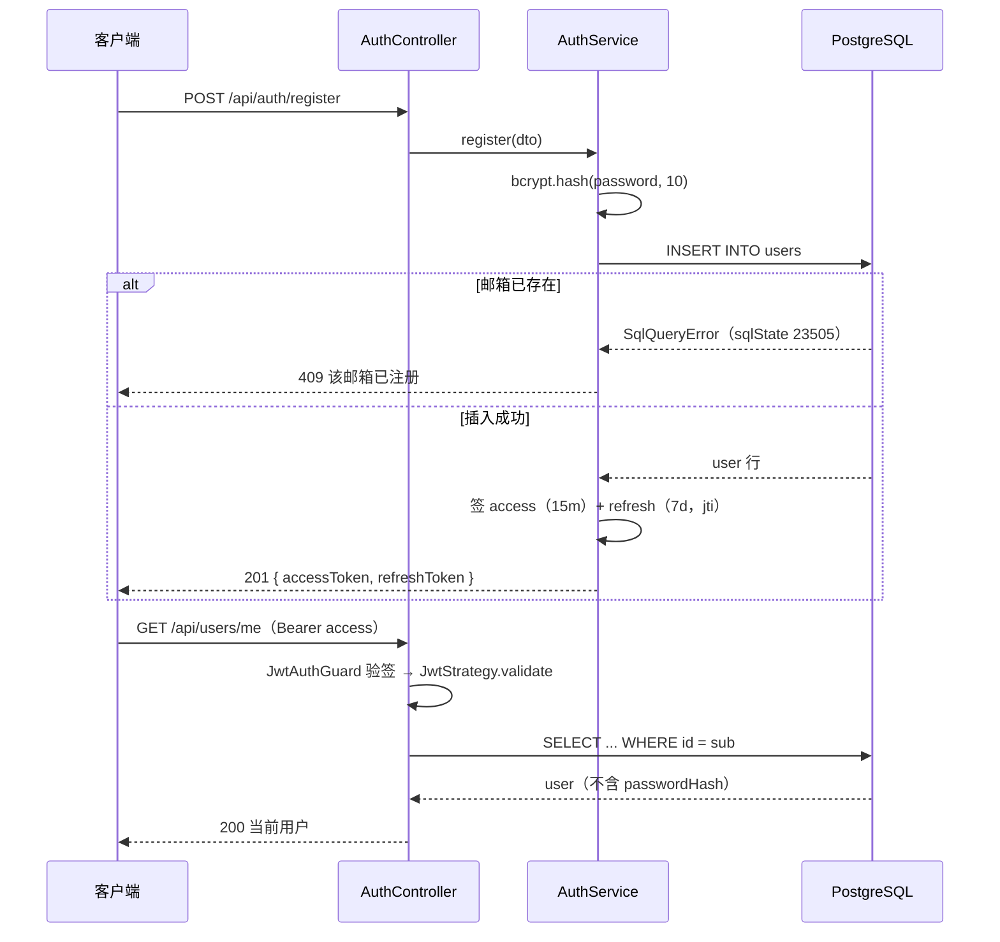

# 09.03 PostgreSQL+Prisma8+JWT实现登录注册

同一个邮箱在极短时间内提交两次注册，是并发问题里最小的一个样本：第一个请求 201，第二个 500。日志里只有一行 `duplicate key value violates unique constraint "users_email_key"`——代码写的是"先 `SELECT` 有没有、没有再 `INSERT`"，两个请求都执行了 `SELECT`，结果都是"没有"。

本地复现不出来：手动点两次至少隔几秒。但用户双击、前端重试、弱网重发，都能造出两个几乎同时到达的请求。**能被并发打破的检查，就不算检查。**

这一章从建表开始，把注册、登录、签发、受保护接口串成一条能跑的链，重点在三个只在并发与网络重试下才暴露的地方：并发注册怎么收场、登录的响应时间怎么不泄漏账号是否存在、密码进数据库时被截掉了什么。代码对应 prisma 8.0.0-rc.34 + @prisma/orm-postgres 8.0.0-rc.24、@nestjs/jwt 12.0.x、bcryptjs 3.x。

## 先把 users 表定下来

Prisma 8 的模型写在 `prisma/contract.prisma` 里，第一行必须是 `// use prisma-8`，否则 CLI 会按旧格式解析：

```prisma
// use prisma-8
enum Role {
  ADMIN
  USER
  @@type("pg/text@1")
}

model User {
  id           Uuid                    @id @onCreate(uuid())
  name         String
  email        String                  @unique
  passwordHash String                  @map("password_hash")
  role         Role                    @default(USER)
  avatarUrl    String?                 @map("avatar_url")
  createdAt    TimestamptzString       @default(now()) @map("created_at")
  updatedAt    temporal.UpdatedAtString @map("updated_at")

  @@map("users")
}
```

几个字段值得说清楚：

- `passwordHash` 而不是 `password`，列名也映射成 `password_hash`。命名是给以后读代码的人看的：看到 `password` 会下意识写 `WHERE password = ?`，看到 `passwordHash` 才知道这里只能做 `bcrypt.compare`。
- `email String @unique`。这条唯一约束是整章的地基——"同一邮箱只能有一条记录"由数据库原子地保证，注册时不再自己判断"有没有"，而是让 `INSERT` 去撞出 `23505`。应用层的检查只能降低概率，消不掉并发窗口。
- `id Uuid @id @onCreate(uuid())`：ID 由数据库生成。UUID 比自增号多占索引空间，但不泄漏用户量，将来分库也不用改号段。
- `createdAt` 用 `TimestamptzString`（带时区），`updatedAt` 用 `temporal.UpdatedAtString` 由 ORM 维护；别用不带时区的 `Timestamp`，跨时区部署后排序和"最近 7 天"统计都会错位。

改完契约，三步命令，顺序不能反：

```bash
pnpm db:emit                         # 契约 → 重新生成类型与产物
pnpm db:plan --name add-users-auth   # 生成迁移计划（SQL）但不执行
pnpm db:migrate                      # 应用到数据库
```

`db:emit` 只更新客户端类型，`db:plan` 只生成迁移文件，`db:migrate` 才改表。跳过 `plan` 用 `db:update` 直接推结构，本地快，但迁移目录里没有记录——别人拉代码、走发布流程时，没人说得出这张表怎么变成现在这样。**迁移文件是代码，要提交。**

## 别写成 Prisma 7 的代码

Prisma 8 没有 `PrismaClient`，也没有 `prisma.user.findUnique` 和 `$transaction`。契约编译出来的是按 schema / 模型分层的查询构建器，注入的 `Database` 类型上长这样：

```ts
// src/modules/users/users.service.ts
import { Inject, Injectable } from '@nestjs/common';
import { Role } from '../../common/enums.js';
import { PRISMA } from '../../database/database.constants.js';
import type { Database } from '../../database/prisma.js';

export interface UserRow {
  id: string;
  name: string;
  email: string;
  role: Role;
  avatarUrl: string | null;
  createdAt: string;
  updatedAt: string;
}

/** 对外可见的字段。passwordHash 故意不在里面。 */
const USER_PUBLIC_FIELDS = [
  'id', 'name', 'email', 'role', 'avatarUrl', 'createdAt', 'updatedAt',
] as const;

@Injectable()
export class UsersService {
  constructor(@Inject(PRISMA) private readonly db: Database) {}

  async findById(id: string): Promise<UserRow | null> {
    return this.db.orm.public.User.where({ id }).select(...USER_PUBLIC_FIELDS).first();
  }

  async findByEmail(email: string): Promise<UserRow | null> {
    return this.db.orm.public.User.where({ email }).select(...USER_PUBLIC_FIELDS).first();
  }

  /** 登录专用：只有这条查询会带出 password_hash。 */
  async findByEmailWithPassword(
    email: string,
  ): Promise<(UserRow & { passwordHash: string }) | null> {
    return this.db.orm.public.User.where({ email })
      .select(...USER_PUBLIC_FIELDS, 'passwordHash')
      .first();
  }

  async create(data: { name: string; email: string; passwordHash: string }): Promise<UserRow> {
    return this.db.orm.public.User.select(...USER_PUBLIC_FIELDS).create({
      name: data.name,
      email: data.email,
      passwordHash: data.passwordHash,
      role: Role.USER,
      avatarUrl: null,
    });
  }
}
```

四件事是刻意的：

**每条查询都写 `select(...USER_PUBLIC_FIELDS)`。** 响应拦截器、异常过滤器、日志、APM 都会序列化对象，只要有一条路径带出 `passwordHash`，哈希就进了日志平台，而日志保留期通常按月算。白名单是唯一不依赖"记得别打印"的做法。

**哈希只从 `findByEmailWithPassword` 出来。** grep `passwordHash` 只有契约定义和这一条查询命中，审计面一眼看完。要是所有查询都 `select *`，就得逐个确认哪个调用方会把它漏给客户端。

**`create` 显式挑字段，绝不 `...dto`。** DTO 是外部输入，字段是攻击者能加的；显式挑字段让"多传一个 `role: 'ADMIN'`"变成无效输入，而不是提权。

**`.first()` 返回 `T | null`，不抛异常。** "没查到"是正常分支，交给调用方决定 404、401 还是继续注册；Prisma 7 的 `findUniqueOrThrow` 在这里不存在。`@Inject(PRISMA)` 在第 7 章（07.07）搭好，不重复。

## 注册：让唯一约束当裁判

最直觉的注册是四步：查邮箱、算哈希、插库、签令牌。问题在第一步和第三步之间：`bcrypt.hash` 要算 10 轮，几十毫秒起步，两个请求在这段时间里都查到"没有"，然后都去 `INSERT`，数据库放行第一个、拒绝第二个。拒绝的异常没人接，就是 500。

有人会想加锁：进程内 `Map` 只挡单副本，两个 Pod 各有各的 `Map`；上 Redis 分布式锁能挡，但为一次注册引入锁服务、锁超时、锁泄漏，成本远高于让数据库拒绝。**唯一约束本身就是一把原子的、不会超时的锁**，也是唯一真正知道"并发"的组件。

那能不能用 `upsert` 或 `ON CONFLICT DO NOTHING`？不能，语义不对。注册是"要么建、要么拒"，`upsert` 是"冲突就更新"：只能写空 update，第二次请求返回 200 但密码没变，用户拿新密码登录失败。`DO NOTHING` 更隐蔽：插入被静默忽略，`create` 拿不到行，签发令牌时 `user` 是 `undefined`。

正确的做法是只留一条路径：直接插，撞了就接住：

```ts
// src/modules/auth/auth.service.ts（节选：注册）
const BCRYPT_ROUNDS = 10;
const EMAIL_UNIQUE_CONSTRAINT = 'users_email_key';

/** 只有"撞了 users_email_key"才算邮箱重复，别的唯一冲突照常抛。 */
const isEmailTaken = (error: unknown): boolean => {
  if (typeof error !== 'object' || error === null) return false;
  const { sqlState, constraint } = error as { sqlState?: string; constraint?: string };
  return sqlState === '23505' && constraint === EMAIL_UNIQUE_CONSTRAINT;
};

async register(dto: RegisterDto): Promise<AuthResponseDto> {
  const passwordHash = await bcrypt.hash(dto.password, BCRYPT_ROUNDS);

  let user: UserRow;
  try {
    user = await this.users.create({
      name: dto.name,
      email: dto.email,
      passwordHash,
    });
  } catch (error) {
    if (isEmailTaken(error)) {
      throw new ConflictException('该邮箱已注册');
    }
    throw error;
  }

  return this.issueTokens(user);
}
```

`try` 只包住 `create`，不把 `issueTokens` 包进去——范围越小，`catch` 的含义越明确。签名失败是另一个问题，不该落进"邮箱重复"的判断里。

`23505` 是 PostgreSQL 的 `unique_violation`。Prisma 8 把它包成 `SqlQueryError`，原始 SQLSTATE 留在 `sqlState` 上，约束名在 `constraint` 上。**这里最容易踩的坑是照着 Prisma 7 的教程写 `error.code === 'P2002'`**：P2002 是旧客户端的错误码，Prisma 8 走契约/SQL 层，这个分支永远不会命中，线上表现就是"偶发 500，日志里明明写着 unique constraint"。

为什么还要比对 `constraint`：`users` 表以后会有 `phone`、`username`，只认 `23505` 会把"手机号重复"也报成"该邮箱已注册"。`constraint` 是数据库直接告诉你撞了哪个键；哪天迁移把唯一约束改成 `CREATE UNIQUE INDEX`，这个字段会为空，那就退回匹配 `detail`。

最后是 409 的取舍。「该邮箱已注册」等于给撞库的人一个账号存在性探测器。但注册接口天生要给反馈：要么友好（409），要么彻底防枚举（永远 200 + 邮件确认信），后者要邮件通道和未验证账号状态机，超出这一章。登录必须统一文案，那才是撞库主战场。**知道自己选了哪个 tradeoff，比假装没有强。**

## 密码：bcrypt 的 10 轮，和 72 字节的暗礁

为什么不能用 MD5 或 SHA-256 加盐：这类哈希为速度设计，GPU 每秒几十亿次，盐只防彩虹表、不防算力。bcrypt 故意慢，`cost` 每加 1 计算量翻倍，盐自动生成并嵌在结果里——`$2b$10$...` 前 29 个字符就是版本、cost 和盐，`compare` 自己解析。

`cost = 10` 是工程取值，不是标准答案：bcryptjs 是纯 JS 实现，10 轮单次几十到一百多毫秒，登录能接受，离线爆破成本也够高。12 轮是 4 倍耗时，QPS 上千时 CPU 先于数据库成为瓶颈；8 轮偏薄。**它保护的是"数据库泄露之后"，代价付在"每次登录"上**，该跟着硬件和登录量调。

然后是 72 字节这个暗礁：bcrypt 只取密码的前 72 字节，超出部分静默丢弃。两个前 72 字节相同的长密码可以互相登录。DTO 里 `@MaxLength(72)` 数的是字符，中文一个字 3 字节，30 个汉字就是 90 字节——想真卡住，得在 service 里补 `Buffer.byteLength(dto.password) > 72` 的判断。多数产品直接限字符数，可接受。

```ts
// src/modules/auth/dto/register.dto.ts
import { Transform } from 'class-transformer';
import { IsEmail, IsString, Length, Matches, MaxLength } from 'class-validator';

export class RegisterDto {
  @IsString()
  @Length(2, 50)
  name: string;

  @Transform(({ value }) => (typeof value === 'string' ? value.trim().toLowerCase() : value))
  @IsEmail()
  @MaxLength(191)
  email: string;

  @IsString()
  @Length(8, 72)
  @Matches(/^(?=.*[A-Za-z])(?=.*\d)/, { message: '密码必须同时包含字母和数字' })
  password: string;
}
```

`@Transform` 在验证之前执行，`trim().toLowerCase()` 把 `ZhangSan@Example.com` 归一化成 `zhangsan@example.com`。PostgreSQL 的普通唯一索引区分大小写，不归一化能注册出 `A@x.com` 和 `a@x.com` 两个账号；更常见的事故是注册用大写、登录用小写，人直接查不到。**注册和登录两个 DTO 都要归一化**，只做一个就是"注册成功但登不上"。

`whitelist: true` 在 `main.ts` 的全局 `ValidationPipe` 上（第 7 章（07.07）配过）：DTO 没声明的字段会被剥掉。没有它，攻击者往注册体里塞 `role: 'ADMIN'`，而 service 里只要有一处 `...dto`，role 就进了 `INSERT`。Pipe 剥字段是第一道，service 显式挑字段是第二道，两道都要——DTO 会改，人也会忘。

## 登录：一句文案，一次假比较

如果"用户不存在"返回 404、"密码错"返回 401，攻击者拿泄露邮箱列表跑一遍，就能筛出哪些邮箱在本站注册过。所以文案统一成「邮箱或密码错误」，状态码统一 401。

但文案只是表面。下面这种写法你肯定见过：

```ts
if (!user || !(await bcrypt.compare(dto.password, user.passwordHash))) {
  throw new UnauthorizedException('邮箱或密码错误');
}
```

`user` 为 `null` 时 `||` 直接短路，后面那几十毫秒的 `bcrypt.compare` 根本不执行。响应体一模一样，但响应时间差了整整一个数量级——攻击者在同一网络里采样几十次取中位数，就能把"查无此人"和"密码不对"分开。这叫时序侧信道，它不读响应体，代理和日志都看不见。

修法是让两条路径都跑一次哈希比较：

```ts
// src/modules/auth/auth.service.ts（节选：登录）
private readonly dummyHash = bcrypt.hashSync(randomUUID(), BCRYPT_ROUNDS);

async login(dto: LoginDto): Promise<AuthResponseDto> {
  const user = await this.users.findByEmailWithPassword(dto.email);
  const passwordHash = user?.passwordHash ?? this.dummyHash;
  const passwordOk = await bcrypt.compare(dto.password, passwordHash);

  if (!user || !passwordOk) {
    throw new UnauthorizedException('邮箱或密码错误');
  }

  return this.issueTokens(user);
}
```

`dummyHash` 必须是真实有效的 bcrypt 结果：格式不对时 `compare` 立刻返回，反而更快，等于没修。启动时用 `randomUUID()` 算一个——用随机串而不是固定密码，避免有人拿恰好匹配的密码绕过去；代价是启动多几十毫秒，一次性。

诚实一句：这只把差距压到"噪声级"，bcryptjs 的 JIT、GC、CPU 调频都会抖动，数学上不可能完全消除。目标不是让时间相等，而是**不让响应时间成为可靠的判别信号**。

## 签发：两把钥匙、三个字段、一个 jti

过期时间从配置读：`jwt.accessExpiresIn` 是 `15m`，`jwt.refreshExpiresIn` 是 `7d`，不写死——不同环境、不同客户端的会话策略不一样，写死改一次要发版。

两把密钥的必要性在 055 提过一半：那里用 payload 的 `type` 区分两种令牌，属于应用层检查，忘了判断就破。这里再加一层密码学隔离：refresh 用 access 密钥验签必然失败，哪怕有人漏了 `type` 检查，也拿 refresh 进不来。两层都做才叫纵深防御。

```ts
// src/modules/auth/auth.service.ts（节选：签发）
type TokenUser = Pick<UserRow, 'id' | 'name' | 'email' | 'role' | 'avatarUrl'>;

private async issueTokens(user: TokenUser): Promise<AuthResponseDto> {
  const base = { sub: user.id, email: user.email, role: user.role };

  const accessToken = await this.jwt.signAsync(
    { ...base, type: 'access' },
    {
      secret: this.accessSecret,
      expiresIn: this.accessExpiresIn as JwtSignOptions['expiresIn'],
    },
  );

  const refreshToken = await this.jwt.signAsync(
    { ...base, type: 'refresh', jti: randomUUID() },
    {
      secret: this.refreshSecret,
      expiresIn: this.refreshExpiresIn as JwtSignOptions['expiresIn'],
    },
  );

  return {
    accessToken,
    refreshToken,
    tokenType: 'Bearer',
    expiresIn: this.accessExpiresIn,
    user: {
      id: user.id,
      name: user.name,
      email: user.email,
      role: user.role,
      avatarUrl: user.avatarUrl ?? null,
    },
  };
}
```

`sub` 是 JWT 规范里 subject 的标准位置，放用户 id；`email`、`role` 是给下游做粗粒度判断的；`type` 区分两种令牌；refresh 额外带 `jti`。**绝不放 `passwordHash`、手机号、身份证**——payload 只是 Base64URL，任何人拿到令牌都能解开，它是"签名的明文"，不是"加密的密文"（054 讲过，不重复）。

`role` 的边界：payload 里的 role 只够网关做粗路由或排障时看一眼；真正判断权限以数据库为准——策略每次 `findById` 用 DB 的 role 覆盖 payload。所以改了角色，旧 access 最多 15 分钟内仍是旧角色，这也是 access 必须短的理由之一。

`jti` 是撤销的抓手：要作废一条 refresh，得有一把指向它的键。没有 jti 只能按用户全撤（踢掉所有设备）或换密钥（所有人重登）。059 用它做 Redis 轮换和重放检测。

最后一个细节：`JwtModule.register({})` 故意不配默认密钥。默认密钥是"忘传就悄悄用"的温床——签 refresh 时漏了 `secret`，会拿 access 密钥签出一个能用的 refresh，测试环境发现不了，上线后两把钥匙混用，轮换一把就全乱。不配默认值，忘传会在第一次调用直接抛 `secretOrPrivateKey must have a value`——错在启动，而不是在事故之后。055 的 `registerAsync` 对单一密钥合理；这里签两种令牌，显式传更不容易错。

整条链路连起来是这样：



## 接线：controller 只做三件事

controller 只做三件事：把 HTTP 细节翻译成方法调用、标清哪些接口不用登录、标清成功状态码。业务在 service，校验在 DTO 和 Pipe，认证在 guard。

```ts
// src/modules/auth/auth.controller.ts
import { Body, Controller, HttpCode, Post } from '@nestjs/common';
import { Public } from '../../common/decorators/public.decorator.js';
import { AuthService } from './auth.service.js';
import type { AuthResponseDto } from './dto/auth-response.dto.js';
import { LoginDto } from './dto/login.dto.js';
import { RegisterDto } from './dto/register.dto.js';

@Controller('auth')
export class AuthController {
  constructor(private readonly auth: AuthService) {}

  @Public()
  @Post('register')
  register(@Body() dto: RegisterDto): Promise<AuthResponseDto> {
    return this.auth.register(dto);
  }

  @Public()
  @HttpCode(200)
  @Post('login')
  login(@Body() dto: LoginDto): Promise<AuthResponseDto> {
    return this.auth.login(dto);
  }
}
```

三个标注各有原因：

- `@Public()`：055 已经把 `JwtAuthGuard` 注册成全局守卫，默认全站要登录。注册和登录必须显式放行，忘了加就是"注册也需要登录"的死循环。
- 登录加 `@HttpCode(200)`：Nest 对 POST 默认返回 201。登录没有创建资源，201 会让客户端和网关按"新建"处理，部分 SDK 会去找 `Location` 头。注册保持默认 201，它确实创建了用户。
- 方法体只有一行 `return`。业务逻辑一旦混进 controller，第二个入口（管理后台邀请、CLI 建号）就得复制一遍。

```ts
// src/modules/auth/auth.module.ts
import { Module } from '@nestjs/common';
import { JwtModule } from '@nestjs/jwt';
import { PassportModule } from '@nestjs/passport';
import { UsersModule } from '../users/users.module.js';
import { AuthController } from './auth.controller.js';
import { AuthService } from './auth.service.js';
import { JwtStrategy } from './jwt.strategy.js';

@Module({
  imports: [
    PassportModule.register({ defaultStrategy: 'jwt' }),
    JwtModule.register({}), // 故意不配默认密钥，签发时显式传
    UsersModule,
  ],
  controllers: [AuthController],
  providers: [AuthService, JwtStrategy],
  exports: [AuthService],
})
export class AuthModule {}
```

`JwtStrategy` 沿用 055 那份，不用改：它先检查 `payload.type !== 'access'`，再 `users.findById(payload.sub)`，返回 `{ id, email, name, role }`。`UsersModule` 要在 exports 导出 `UsersService`，否则 auth 注入不进来。

密钥从哪来？`AuthService` 构造函数里读：

```ts
// src/modules/auth/auth.service.ts（节选：构造函数）
constructor(
  private readonly users: UsersService,
  private readonly jwt: JwtService,
  config: ConfigService,
) {
  this.accessSecret = config.getOrThrow<string>('jwt.accessSecret');
  this.accessExpiresIn = config.getOrThrow<string>('jwt.accessExpiresIn');
  this.refreshSecret = config.getOrThrow<string>('jwt.refreshSecret');
  this.refreshExpiresIn = config.getOrThrow<string>('jwt.refreshExpiresIn');
}
```

用 `getOrThrow` 而不是 `get`：`get` 拿到 `undefined` 也能启动，第一次签发才抛 `secretOrPrivateKey must have a value`——报错点离根因隔了半个系统，往往还发生在有流量之后。`getOrThrow` 把失败挪到启动，错误信息带配置路径，部署脚本第一时间就红。

它只保证"配置存在"，不保证"不是开发默认值"：配置校验给 `JWT_ACCESS_SECRET` 配了 `dev-access-secret-change-me` 兜底，生产忘配环境变量照样能启动。上线检查要单独加一条：`NODE_ENV=production` 时禁止 `dev-` 开头的密钥。

## 受保护接口：每个请求都问一次数据库

055 的策略已经在 `validate` 里查库，这里只说为什么愿意付这次查询：不查库也能验签，但删号、封号就要等 access 过期才生效——对"封号"来说 15 分钟是事故。主键命中在同机房零点几毫秒，跟 Session 每请求查 Redis 同一量级，**换"删号立刻 401"划算**。`request.user` 来自公共字段白名单，不会有 `passwordHash`，而这对象会进日志和下游。想比 15 分钟更快就上 055 的 `tokenVersion`。

## 跑一遍：注册、登录、访问 /api/users/me

前置条件：PostgreSQL 已启动、`DATABASE_URL` 已配、迁移跑过：

```bash
pnpm start:dev
# 预期：Nest application successfully started，没有 DATABASE_URL / JWT_* 相关报错
```

```bash
# 注册（邮箱故意用大写，验证归一化）
curl -s -X POST http://127.0.0.1:3000/api/auth/register \
  -H 'Content-Type: application/json' \
  -d '{"name":"张三","email":"ZhangSan@Example.com","password":"Passw0rd1"}' \
  -w '\nHTTP %{http_code}\n'
# 预期：HTTP 201；响应里 user.email 已经是 zhangsan@example.com
```

注册 201 就对了，再登一次、拿令牌访问受保护接口：

```bash
# 登录拿 accessToken（全局 ResponseInterceptor 会把成功响应包一层 data）
TOKEN=$(curl -s -X POST http://127.0.0.1:3000/api/auth/login \
  -H 'Content-Type: application/json' \
  -d '{"email":"zhangsan@example.com","password":"Passw0rd1"}' | jq -r '.data.accessToken')

# 带令牌访问受保护接口
curl -s -H "Authorization: Bearer $TOKEN" http://127.0.0.1:3000/api/users/me | jq
# 预期：200，data 里是 id/name/email/role/avatarUrl/createdAt/updatedAt，没有 passwordHash

# 错密码
curl -s -o /dev/null -w 'HTTP %{http_code}\n' -X POST http://127.0.0.1:3000/api/auth/login \
  -H 'Content-Type: application/json' \
  -d '{"email":"zhangsan@example.com","password":"WrongPass1"}'
# 预期：HTTP 401，message 是「邮箱或密码错误」

# 弱密码：DTO 在 controller 之前就拦下，不会进 service
curl -s -X POST http://127.0.0.1:3000/api/auth/register \
  -H 'Content-Type: application/json' \
  -d '{"name":"李四","email":"lisi@example.com","password":"12345678"}' | jq
# 预期：400，message 是 ["密码必须同时包含字母和数字"]

# 不带令牌
curl -s -o /dev/null -w 'HTTP %{http_code}\n' http://127.0.0.1:3000/api/users/me
# 预期：HTTP 401
```

成功响应体长这样。以下为预期输出，未在本机实测：

```json
{
  "data": {
    "accessToken": "eyJhbGciOiJIUzI1NiIs...",
    "refreshToken": "eyJhbGciOiJIUzI1NiIs...",
    "tokenType": "Bearer",
    "expiresIn": "15m",
    "user": {
      "id": "0b6f4f3e-6a1f-4d1e-9c2a-6b1c2d3e4f50",
      "name": "张三",
      "email": "zhangsan@example.com",
      "role": "USER",
      "avatarUrl": null
    }
  }
}
```

三个 checkpoint 都过了再往下走：注册 201 且邮箱归一化、带令牌访问 `/api/users/me` 得到 200、错误路径分别是 400 和 401。注册返回 500 时先看日志里是不是 `users_email_key`——那说明 `isEmailTaken` 没命中，多半是 `sqlState` 或 `constraint` 取错了字段。

## 上线前回头看的坑

| 现象 | 原因 | 修法 |
| --- | --- | --- |
| 并发注册偶发 500 | 先查后插，两个请求都查到"没有" | 删掉预检，靠 `@unique` 撞，catch `23505` |
| catch 到不了，重复注册仍 500 | 照抄 Prisma 7 的 `error.code === 'P2002'` | Prisma 8 看 `sqlState === '23505'` |
| 手机号冲突也报"邮箱已注册" | 只判断 23505，没看撞的是哪条约束 | 同时比对 `constraint === 'users_email_key'` |
| 换迁移写法后 catch 失效 | 唯一约束改成 `CREATE UNIQUE INDEX`，`constraint` 为空 | 退回匹配 `detail` 里的键名 |
| 登录耗时能看出账号是否存在 | `!user \|\|` 短路，跳过了 bcrypt | 不存在时也拿 dummy hash 跑一次 compare |
| 日志平台里出现密码哈希 | 查询没写 `select`，或把整个 user 交给日志 | 公共字段白名单，登录查询单独一条 |
| 大小写不同注册出两个账号 | PG 唯一索引区分大小写，入口没归一化 | 注册和登录的 DTO 都 `trim + toLowerCase` |
| 超长密码能互相登录 | bcrypt 只取前 72 字节 | DTO 限 72 字符；更严就按 `Buffer.byteLength` 校验 |
| 服务能启动，第一次登录才 500 | 用 `get` 读密钥，签发时才报错 | 构造函数 `getOrThrow`，启动即失败 |
| 生产用了 `dev-access-secret-change-me` | 配置校验给了开发默认值，`getOrThrow` 只看有没有 | 生产环境再加一条"禁止 `dev-*` 开头" |
| 登录返回 201 | Nest 对 POST 默认 201 | 非创建类接口加 `@HttpCode(200)` |
| 注册体里多传 `role: "ADMIN"` 生效了 | 没开 `whitelist`，或 service 里 `...dto` | Pipe 剥字段 + service 显式挑字段 |
| 登录接口被撞库没人挡 | 只做了密码校验 | 全局 `ThrottlerGuard`，按 IP 和账号双维度计数 |

<!-- chapter-nav:start -->
---

← [09.02 Nest里实现Session和JWT](09.02-Nest里实现Session和JWT.md) · [本章目录](_chapter.md) · [09.04 基于ACL实现权限控制](09.04-基于ACL实现权限控制.md) →
<!-- chapter-nav:end -->
