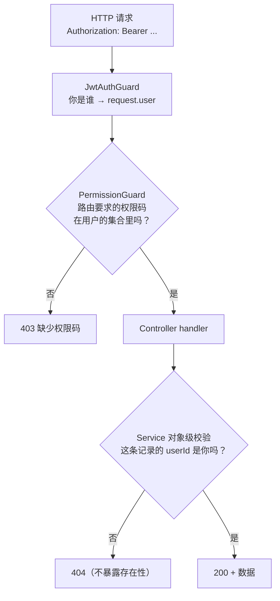
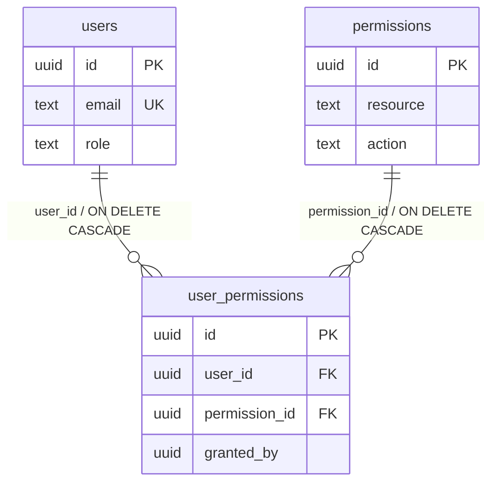

# 09.04 基于ACL实现权限控制

运营把需求发过来时，写的是一张表：

| 需求 | 现在能表达吗 |
| --- | --- |
| 部门管理员：审批本部门的预订，别的不动 | 不能，既没有"部门"，也没有"半个管理员" |
| 客服：能看任意预订的详情，但不能审批 | 不能，ADMIN 能审批，USER 看不到别人的 |
| 审计：只读全部数据 | 不能，给了 ADMIN 顺手把写权限也给了 |
| 实习生：只能看自己的预订 | 能，USER 本来就是这样 |

四行需求，三行做不到。这不是需求刁钻，是 `Role` 这个枚举的容量问题：它只有 `ADMIN` 和 `USER` 两个值，而"能做什么"的组合远不止两种。

## 角色回答的是"你是谁"，不是"你能做什么"

先看 example 里现在这个守卫：

```ts
// src/common/guards/roles.guard.ts（现有实现）
@Injectable()
export class RolesGuard implements CanActivate {
  constructor(private readonly reflector: Reflector) {}

  canActivate(context: ExecutionContext): boolean {
    const requiredRoles = this.reflector.getAllAndOverride<Role[]>(ROLES_KEY, [
      context.getHandler(),
      context.getClass(),
    ]);
    if (!requiredRoles || requiredRoles.length === 0) return true;

    const user = context.switchToHttp().getRequest<Request & { user?: AuthUser }>().user;
    if (!user) throw new UnauthorizedException('请先登录');

    if (!requiredRoles.includes(user.role)) {
      throw new ForbiddenException('权限不足，需要管理员角色');
    }
    return true;
  }
}
```

核心就一行 `requiredRoles.includes(user.role)`。它很短，但隐含了一个假设：**同一个角色里的所有人，能做的事完全一样**。

这个假设在只有两种角色时成立。一旦出现"客服"就破了：客服需要 ADMIN 的读能力，但绝不该有 ADMIN 的写能力。你可以加第三个角色 `SUPPORT`，可下一个需求是"只能看本部门"的部门管理员，再下一个是"能导出但不能删除"的审计——每出现一种权限组合就多一个角色，`@Roles()` 里的值越写越长，三个月后没人说得清 `AUDITOR` 和 `READONLY_ADMIN` 到底差在哪个动作上。

换个角度看，授权判定本来是一个三输入的查询：

`f(主体, 资源, 动作) → allow / deny`。

`Role` 只提供了第一个输入上的一个标签，"资源"和"动作"被扔掉了。ACL（Access Control List，访问控制列表）做的事就是把这个查询显式写出来：**明确列出某个主体对某个资源的某个动作有许可**，而不是靠角色名去暗示。

## 先把"动作"从 if 里搬出来

现在 example 里，动作判断和归属校验是混在 service 里的，而且同一个意思写了三遍：

```ts
// src/modules/bookings/bookings.service.ts（现有实现的三个位置）
// findAll：普通用户只看自己的
user.role === Role.ADMIN ? (query.userId ? row.userId.eq(query.userId) : all()) : row.userId.eq(user.id)

// findOne
if (user.role !== Role.ADMIN && booking.userId !== user.id) {
  throw new ForbiddenException('无权查看他人的预订');
}

// cancel
if (user.role !== Role.ADMIN && booking.userId !== user.id) {
  throw new ForbiddenException('无权取消他人的预订');
}
```

能跑，但只要出现"客服"就傻了：客服既不是 ADMIN，也不该像普通用户那样只看自己。改这里，`Role.ADMIN` 得换成 `role === ADMIN || role === SUPPORT`；明天再加"审计"，再改一遍；总有某个位置漏掉，那就是一个越权入口。

所以第一步不是加表，而是给每个受保护动作起一个名字。命名规则 `资源:动作`，超出"默认范围"的许可加 `:any` 后缀：

| 权限码 | 含义 | 默认范围 |
| --- | --- | --- |
| `booking:read:any` | 读任意预订（含详情） | 只能读自己的 |
| `booking:cancel:any` | 取消任意预订 | 只能取消自己的 |
| `booking:approve` | 审批预订 | 无，必须显式授予 |
| `room:write` | 新建/修改/删除会议室 | 无 |
| `stats:read` | 查看全局统计 | 无 |
| `user:read:any` | 查看用户列表 | 无 |

注意 `self` 没有对应的权限码。它不是一条"授予"，而是每个登录用户的**默认行为**——你天然只能读自己的。这条约定直接决定了后面那道对象级校验不能省。

## 两道闸，缺一不可

> **图 57-1** 一次请求要过两道闸：守卫判"这类动作你能不能做"，service 判"这条数据是不是你的"。



守卫手里只有两样东西：路由上的元数据，和 `request.user`。它看不到数据库里的那一行——除非把对象 id 从参数里抠出来再查一次库，那等于把业务查询搬进守卫。所以分工是死的：

- **路由级（守卫）**：你能不能调用这个接口，答案是"这类动作的许可"；
- **对象级（service）**：这条数据归不归你，答案是"逐行判断"。

有人会问：守卫里 `context.switchToHttp().getRequest().params.id` 不就能拿到对象 id 吗，为什么不顺手查一次库把归属也判了？技术上能，但那是把两条链焊在一起：守卫要懂每个资源的表结构，要区分"资源不存在"和"没权限"，还要让每个 `/:id` 路由多付一次查询——而这次查询在 handler 里本来就要做，等于查两遍。守卫保持"不认识任何业务表"是它能被全局注册的前提。

很多团队把两道闸压成一道，这就是下面那个越权事故的根。

## 给 example 加两张表

先说清楚边界：**下面是对第 7 章（07.07） example 的扩展，不是重写**。`users`、`rooms`、`bookings` 三张表和 `Role` 枚举原样保留，新增两个模型、给 `User` 加一行反向关系。命名沿用契约里的风格：`Uuid` 主键、`snake_case` 的 `@map`、`timestamptz` 时间戳、显式命名的索引。

改完契约按第 7 章（07.05）那套流程走：

```bash
pnpm db:emit
pnpm db:plan --name add_acl_permission_tables
pnpm db:migrate

# 预期：emit 通过；plan 里能看到 CREATE TABLE permissions / user_permissions
# 以及 uq_permissions_resource_action、uq_user_permissions_user_permission 两个唯一索引
# migrate 后 prisma 的 status 为 up
```

```prisma
/// 权限字典：一个「资源 + 动作」。这是对第 7 章（07.07） example 的扩展。
model Permission {
  id          Uuid   @id @onCreate(uuid())
  resource    String
  action      String
  description String?
  createdAt   TimestamptzString @default(now()) @map("created_at")

  userPermissions UserPermission[]

  @@unique([resource, action], map: "uq_permissions_resource_action")
  @@map("permissions")
}

/// ACL 条目：某个用户被允许执行某个动作。
model UserPermission {
  id           Uuid   @id @onCreate(uuid())
  userId       Uuid   @map("user_id")
  permissionId Uuid   @map("permission_id")
  grantedBy    Uuid?  @map("granted_by")   // 操作人，只做审计，不加外键
  createdAt    TimestamptzString @default(now()) @map("created_at")

  user       User       @relation(fields: [userId], references: [id], onDelete: Cascade)
  permission Permission @relation(fields: [permissionId], references: [id], onDelete: Cascade)

  @@unique([userId, permissionId], map: "uq_user_permissions_user_permission")
  @@index([permissionId], map: "idx_user_permissions_permission")
  @@map("user_permissions")
}
```

`User` 模型只加一行反向关系 `userPermissions UserPermission[]`，别的一个字不动——Prisma 要求关系两端都声明，缺了这一行 `db:emit` 会直接报错。

为什么不直接在 `user_permissions` 里存字符串 `"booking:read:any"`？因为拼错的代价是静默的：写成 `booking:reed:any` 不会报错，只是永远匹配不上，接口一直 403；反过来把 `booking:*` 手滑配成 `*`，就成了超级用户。字典表能让数据库外键兜住"权限码必须存在"，能喂给管理后台做下拉框，也能回答"这个高风险权限现在被几个人持有"——最后一个问题是审计最爱问的。

> **图 57-2** ACL 两张表与现有用户表的关系。



## @RequirePermission 与 PermissionGuard

装饰器只负责把权限码挂到路由元数据上，和 `@Roles()` 一个套路：

```ts
// src/common/decorators/require-permission.decorator.ts
import { SetMetadata } from '@nestjs/common';

export const PERMISSIONS_KEY = 'permissions';

/** 标记路由需要的权限码，多个码之间是「且」的关系。 */
export const RequirePermission = (...codes: string[]) =>
  SetMetadata(PERMISSIONS_KEY, codes);
```

守卫本身没有魔法，重点是三点：元数据没写就放行、`request.user` 缺失给 401、缺哪个码要说清。

```ts
// src/common/guards/permission.guard.ts
import {
  type CanActivate,
  type ExecutionContext,
  ForbiddenException,
  Injectable,
  UnauthorizedException,
} from '@nestjs/common';
import { Reflector } from '@nestjs/core';
import type { Request } from 'express';
import { PERMISSIONS_KEY } from '../decorators/require-permission.decorator.js';
import type { AuthUser } from '../types/auth-user.js';
import { PermissionService } from '../../modules/permissions/permission.service.js';

@Injectable()
export class PermissionGuard implements CanActivate {
  constructor(
    private readonly reflector: Reflector,
    private readonly permissions: PermissionService,
  ) {}

  async canActivate(context: ExecutionContext): Promise<boolean> {
    const required = this.reflector.getAllAndOverride<string[]>(PERMISSIONS_KEY, [
      context.getHandler(),
      context.getClass(),
    ]);

    // 没挂权限码 = 只要登录就能调用；对象归属由 service 再判。
    if (!required || required.length === 0) return true;

    const user = context.switchToHttp().getRequest<Request & { user?: AuthUser }>().user;
    if (!user) throw new UnauthorizedException('请先登录');

    const granted = await this.permissions.codesOf(user.id);
    const missing = required.filter((code) => !granted.has(code));
    if (missing.length > 0) {
      throw new ForbiddenException(`缺少权限：${missing.join(', ')}`);
    }
    return true;
  }
}
```

三个细节值得停一下：

- **多个码是"且"**。`@RequirePermission('booking:approve', 'room:write')` 要求两个都有。真需要"或"就写两个方法或自定义元数据，别把语义混进一个数组里。
- **401 和 403 分清楚**。没登录是 401（去登录），登录了但没权限是 403（别试了）。混用会让前端不知道该跳登录页还是弹提示。
- **错误信息里带权限码，不带资源 id**。`缺少权限：booking:approve` 对排障够用；把 `booking:8f3a...` 也吐出去，等于告诉攻击者你刚试的这条记录存在。

权限集合从哪来？这不是"读一次数据库就完事"的事——每个受保护请求都多一次三表关联查询，QPS 一上来数据库先顶不住。用 Redis 缓存一层，TTL 60 秒：

```ts
// src/modules/permissions/permission.service.ts
import { Inject, Injectable } from '@nestjs/common';
import { PRISMA } from '../../database/database.constants.js';
import type { Database } from '../../database/prisma.js';
import { RedisService } from '../../redis/redis.service.js';

const CACHE_TTL_SECONDS = 60;

@Injectable()
export class PermissionService {
  constructor(
    @Inject(PRISMA) private readonly db: Database,
    private readonly redis: RedisService,
  ) {}

  /** 用户的权限码集合；Redis 命中就完全不碰数据库。 */
  async codesOf(userId: string): Promise<Set<string>> {
    const key = `acl:user_perms:${userId}`;
    const cached = await this.redis.getJson<string[]>(key);
    if (cached) return new Set(cached);

    const rows = await this.db.orm.public.UserPermission.where({ userId })
      .include('permission')
      .all();
    const codes = rows.map((row) => `${row.permission.resource}:${row.permission.action}`);

    await this.redis.setJson(key, codes, CACHE_TTL_SECONDS);
    return new Set(codes);
  }

  async hasCode(userId: string, code: string): Promise<boolean> {
    return (await this.codesOf(userId)).has(code);
  }
}
```

Redis 挂掉时 `RedisService` 的 `getJson` 返回 `null`，于是回源查库——**缓存不可用时降级到数据库，而不是"查不到权限就放行"**。这个方向必须是 fail-closed 到 DB、而不是 fail-open 到 200，否则一次 Redis 抖动就是全站越权。

注册顺序和现有守卫一样，认证在前、授权在后：

```ts
// src/app.module.ts（节选）
providers: [
  // 顺序有讲究：先限流，再认证，最后鉴权。
  { provide: APP_GUARD, useClass: ThrottlerGuard },
  { provide: APP_GUARD, useClass: JwtAuthGuard },
  { provide: APP_GUARD, useClass: PermissionGuard },  // 替换原来的 RolesGuard
  // ...
]
```

`RolesGuard` 可以先留着，`@Roles()` 的老路由继续用；等所有路由都换成权限码再删。两者并存期间，谁在前谁后不影响结果，因为它们读的是不同的元数据，判的是不同的问题。

`@RequirePermission` 也可以挂在 controller 类上，守卫用 `getAllAndOverride` 按"方法 → 类"的顺序取，方法上的声明覆盖类上的。约定是：类上放这一组接口都要的码（比如整个 `/admin` 前缀都要 `stats:read`），方法上放例外。别在两处写同一个码指望"叠加"——override 的语义是覆盖，不是合并。

## 把 @Roles 换成 @RequirePermission

改造是逐路由的，一张表就能对完：

| 路由 | 现在 | 换成 |
| --- | --- | --- |
| `GET /bookings` | service 里按角色过滤 | 无权限码；service 按 `booking:read:any` 决定范围 |
| `GET /bookings/:id` | service 里判归属 | 无权限码；service 判归属 + `booking:read:any` |
| `POST /bookings` | 登录即可 | 登录即可，不能凭空造 `userId` |
| `PATCH /bookings/:id/approve` | `@Roles(ADMIN)` | `@RequirePermission('booking:approve')` |
| `PATCH /bookings/:id/cancel` | service 里判归属 | 无权限码；service 判归属 + `booking:cancel:any` |
| `POST/PATCH/DELETE /rooms` | `@Roles(ADMIN)` | `@RequirePermission('room:write')` |
| `GET /stats` | 登录即可 | `@RequirePermission('stats:read')` |

改完你会发现两件事：`@Roles()` 和 `@RequirePermission()` 表达力差了一个量级；但**读接口依然没有权限码**，因为它们的问题不是"能不能调"，而是"这条数据是不是你的"。这不是改造没做完，这是 ACL 的能力边界。
迁移顺序比改法更重要，顺序错了会制造一个「能登录、但全站 403」的窗口：

1. **先上表和数据**：迁移建 `permissions` / `user_permissions`，回填字典与初始授权，此时旧代码完全不受影响；
2. **再上守卫**：`PermissionGuard` 以「没挂权限码就放行」的姿态部署，所有老路由行为不变；
3. **逐路由换装饰器**：一个 PR 换一组路由，换完立刻验证 200 与 403 两侧，`@Roles()` 与 `@RequirePermission()` 并存期间互不干扰；
4. **最后删旧**：全站 grep 确认没有 `@Roles()` 残留，再单独一个 PR 删掉 `RolesGuard` 与 `users.role`。

每一步都能单独回滚，且回滚不需要改数据——这是「先加后删」相对「一步到位」唯一的、也是全部的好处。

## 一次真实的越权：换个 UUID 就读到别人的订单

改造的第二周，有人在 review 里提了一句：既然已经有 `PermissionGuard`，service 里那两行 `booking.userId !== user.id` 是不是重复逻辑？讨论的结果是删掉——理由是"该拦的守卫都拦了"。

`findOne` 变成了这样：

```ts
// src/modules/bookings/bookings.service.ts（被改坏的版本）
async findOne(id: string, user: AuthUser): Promise<BookingDetailRow> {
  const booking = await this.db.orm.public.Booking.where({ id })
    .include('room')
    .include('user', (relation) => relation.select(...BOOKING_USER_FIELDS))
    .first();
  if (!booking) throw new NotFoundException('预订不存在');
  return booking; // 归属校验被删了
}
```

攻击不需要任何工具，只要两个账号和一个 UUID：

```bash
# 1) 两个普通账号（注册接口见 056）
curl -s -X POST http://127.0.0.1:3000/api/auth/register -H 'Content-Type: application/json' \
  -d '{"email":"alice@example.com","password":"Passw0rd!","name":"Alice"}' > /dev/null
curl -s -X POST http://127.0.0.1:3000/api/auth/register -H 'Content-Type: application/json' \
  -d '{"email":"bob@example.com","password":"Passw0rd!","name":"Bob"}' > /dev/null

# 响应统一包在 data 里（ResponseInterceptor），所以取 .data.accessToken
ALICE=$(curl -s -X POST http://127.0.0.1:3000/api/auth/login -H 'Content-Type: application/json' \
  -d '{"email":"alice@example.com","password":"Passw0rd!"}' | jq -r .data.accessToken)
BOB=$(curl -s -X POST http://127.0.0.1:3000/api/auth/login -H 'Content-Type: application/json' \
  -d '{"email":"bob@example.com","password":"Passw0rd!"}' | jq -r .data.accessToken)

# 2) 随便取一间会议室，Alice 用它建一条预订（列表为空就先建一间）
ROOM_ID=$(curl -s http://127.0.0.1:3000/api/rooms | jq -r '.data[0].id')
BOOKING=$(curl -s -X POST http://127.0.0.1:3000/api/bookings -H "Authorization: Bearer $ALICE" \
  -H 'Content-Type: application/json' \
  -d '{"roomId":"'"$ROOM_ID"'","startTime":"2026-12-01T10:00:00+08:00","endTime":"2026-12-01T11:00:00+08:00","remark":"预算评审，材料在共享盘"}' \
  | jq -r .data.id)

# 3) Bob 用自己的令牌读 Alice 的预订
curl -s -H "Authorization: Bearer $BOB" http://127.0.0.1:3000/api/bookings/$BOOKING | jq '.data | {id, userId, remark, owner: .user.email}'
```

`jq` 的输出是这样的：

```json
{
  "id": "0b6f4f3e-...",
  "userId": "7c1d9a52-...",
  "remark": "预算评审，材料在共享盘",
  "owner": "alice@example.com"
}
```

**预期**：HTTP 200，`userId` 和 `owner` 都是 Alice 的——Bob 一个字段都没改，只是把 URL 里的 UUID 换成了别人的。

这就是 OWASP API 安全 Top 10 里的 BOLA（Broken Object Level Authorization，失效的对象级授权），也叫 IDOR。它在自己的系统里几乎必然出现，因为每个 `GET /xxx/:id` 都是一个候选入口，而"记录是不是你的"这件事只有业务代码知道。

这类漏洞上线后还很难从日志里发现：访问日志只有 `200 /bookings/<uuid>`，没有"这个 uuid 属于谁"，看起来和正常请求一模一样。能查出来的办法只有主动埋点——在 `findOne`、`cancel` 这类入口记一条 `(actorId, ownerId, resourceId, allow)` 的结构化日志，再配一条告警规则：同一个 actor 在短时间窗口里读到大量 ownerId 不同的记录。这不是为了抓内鬼，是为了"客服临时获得读全部权限"这种需求上线时，能立刻看到越权比例是不是从 0 变成了 30%。

根因不是守卫写错了，是**把上界当成了结论**。`booking:read:any` 的含义是"这个人最多能读到任意预订"，它是许可的上界；具体这一条能不能读，还要看归属。删掉 service 校验后，鉴权只剩下上界，于是每个登录用户都能读所有记录。

修复是把它加回去，并且用权限码而不是角色名来判断（`BookingsService` 构造函数里注入 `PermissionService`，和守卫共用同一个实例）：

```ts
// src/modules/bookings/bookings.service.ts（修复后）
async findOne(id: string, user: AuthUser): Promise<BookingDetailRow> {
  const booking = await this.db.orm.public.Booking.where({ id })
    .include('room')
    .include('user', (relation) => relation.select(...BOOKING_USER_FIELDS))
    .first();

  if (!booking) throw new NotFoundException('预订不存在');

  // 对象级授权：守卫只看到路由，看不到这一行属于谁
  if (booking.userId !== user.id && !(await this.permissions.hasCode(user.id, 'booking:read:any'))) {
    throw new NotFoundException('预订不存在');
  }
  return booking;
}
```

再跑一次同样的请求：

```bash
curl -s -o /dev/null -w '%{http_code}\n' -H "Authorization: Bearer $BOB" \
  http://127.0.0.1:3000/api/bookings/$BOOKING
# 预期：404
```

**注意返回的是 404 而不是 403。** 403 等于告诉对方"这个 id 存在，只是你没权限"，攻击者可以用它枚举有效 id，甚至按 id 的命中率推断业务量。预订这种带邮箱、备注的资源，统一按"不存在"处理；内部管理接口的调用方是可信的，那里用 403 更方便排障。

同样的原则要落到列表接口上：范围必须在查询条件里钉死，而不是取回来再过滤——`const scope = (await this.permissions.hasCode(user.id, 'booking:read:any')) ? all() : row.userId.eq(user.id)`。取回来再过滤会让分页的 `total` 泄露总量，也容易在后续改动里忘掉。

## ACL 的三条边界

直连表能表达"某人对某动作有许可"，但有三种东西它表达不了，正好对应三种常见的需求：

**第一，条目爆炸。** 20 个部门管理员，每人 30 个权限码，就是 600 行。给这个群体新增一个权限要插 20 行；有人转岗，得记得删他那 30 行，漏一行就是一条残留的高危授权，而且表里看不出"他为什么有这个权限"——只有一行孤零零的 `granted_by`。人数和权限数相乘，维护成本也是相乘的。

**第二，没有继承。** "ADMIN 应该天然拥有 USER 的全部权限"这句话，在直连表里只能靠复制行来表达：给每个 ADMIN 也插一遍 USER 的码。复制之后就有两份真相，USER 加一个新权限，ADMIN 那份不会自动跟上，于是管理员反而做不了普通用户能做的事——这种 bug 在后台系统里非常常见，而且测不出来，因为没人会用管理员账号去点普通用户的功能。

**第三，条件授权。** "只能审批本部门"、"金额超过 5000 要二次审批"、"只能在 9:00–18:00 操作"，这些判断的不是"资源 + 动作"，是记录上的属性。表里塞不进去，硬塞的结局是给每个部门建一个权限码 `booking:approve:dept_a`，最后权限码比用户还多。

所以 ACL 的正确定位是：**路由级的粗粒度开关**，负责回答"这类动作你能不能做"，再配一道 service 里的对象级校验回答"这条数据是不是你的"。它不适合承载"一批人应该拥有同样的权限"这种话——而这恰恰是后台权限系统里最高频的一句需求。

直连表真正的问题不是表结构丑，是它把"这 20 个人应该有同样的权限"拆成了 600 行互不相干的数据。下次要改这句话，你得把这 600 行重新想一遍，还得保证自己想得一样。058 要做的，就是把"这批人是谁"表达成一个可以复用的东西——角色。

<!-- chapter-nav:start -->
---

← [09.03 PostgreSQL+Prisma8+JWT实现登录注册](09.03-PostgreSQL+Prisma8+JWT实现登录注册.md) · [本章目录](_chapter.md) · [09.05 基于RBAC实现权限控制](09.05-基于RBAC实现权限控制.md) →
<!-- chapter-nav:end -->
