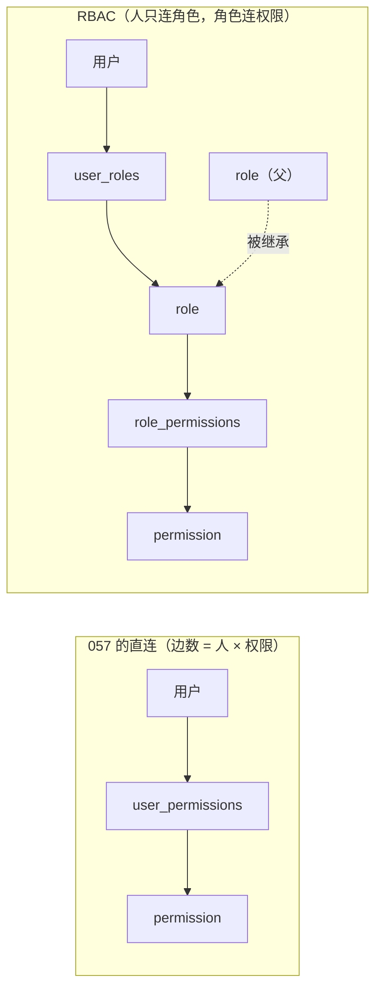
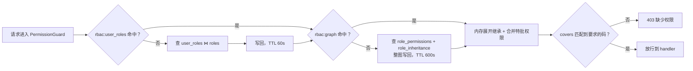

# 09.05 基于RBAC实现权限控制

057 的表格运行了两周，运维的抱怨变成了一句很具体的话：开一个部门管理员，要插 30 行。

给 20 个人开权限，就是 600 行 `INSERT`。两周后其中 3 人转岗，转岗流程里没有"删 `user_permissions`"这一步，于是某个已经去了别的部门的人，还能审批全公司的会议室。审计要一份"谁有审批权"的名单，你跑了一条三表 join，出来 34 个人，但没人能解释为什么是这 34 个——表里只有 `granted_by` 和一个时间戳。

问题不在 SQL，在数据模型。057 把权限直接挂在了"人"上，可需求的原话是"**部门管理员这个身份，拥有这些权限**"。人是会变的，身份是稳定的；把权限挂在会变的东西上，每次变化都要人工重算一遍。RBAC（Role-Based Access Control，基于角色的访问控制）就是把这句话拆成三层：**人 → 角色 → 权限**。

## 三层关系，和它省下的那个数量级

> **图 58-1** 同样是"谁能做什么"，直连和 RBAC 的边数差一个数量级。



算笔账。200 个用户、60 个权限码，最坏情况直连表要 12,000 行；RBAC 下是 200 条 `user_roles`，加 8 个角色各平均 25 个权限（200 行 `role_permissions`），一共 400 行，少了一个数量级。

但真正的收益不是行数，是**变更的单位变了**：给 20 个部门管理员加一个新权限，直连表是 20 行 `INSERT`，RBAC 是 1 行；一个人转岗，直连表要精确删掉他的 30 行（漏一行就是漏洞），RBAC 是删 1 条 `user_roles` 再插 1 条。前者是"每次都要重新想一遍"，后者是"改一个关系"。

## 给 example 换一套授权表

这是对 057 的改造，也是 example 的第二次扩展。改动有三处：新增 `roles`、`user_roles`、`role_permissions`、`role_inheritance` 四张表；保留 `user_permissions` 作为**特批通道**（个别人临时多一个权限，比如客服组长临时要导出）；判定时把角色权限和特批权限取并集。规则只有一条：**能用角色表达的，绝不直连**。

```prisma
/// 角色。code 是稳定标识（ADMIN / DEPT_MANAGER / SUPPORT），name 给后台显示。
model Role {
  id          Uuid   @id @onCreate(uuid())
  code        String @unique
  name        String
  description String?
  createdAt   TimestamptzString       @default(now()) @map("created_at")
  updatedAt   temporal.UpdatedAtString @map("updated_at")

  userRoles       UserRole[]
  rolePermissions RolePermission[]
  inherits        RoleInheritance[] @relation("child")   // 本角色继承谁
  inheritedBy     RoleInheritance[] @relation("parent")  // 谁继承了本角色

  @@map("roles")
}

/// 角色继承：child 继承 parent 的全部权限。
model RoleInheritance {
  id        Uuid @id @onCreate(uuid())
  parentId  Uuid @map("parent_id")
  childId   Uuid @map("child_id")
  createdAt TimestamptzString @default(now()) @map("created_at")

  parent Role @relation("parent", fields: [parentId], references: [id], onDelete: Cascade)
  child  Role @relation("child", fields: [childId], references: [id], onDelete: Cascade)

  @@unique([parentId, childId], map: "uq_role_inheritance_parent_child")
  @@index([childId], map: "idx_role_inheritance_child")
  @@map("role_inheritance")
}
```

方向要先说死，否则这条数据永远有人插反：**`parent_id` 是被继承的基础角色，`child_id` 是继承它的角色**。让 ADMIN 拥有 USER 的全部权限，就是一行 `parent=USER, child=ADMIN`。读法是"ADMIN 的 parents 里有 USER"，后面展开继承时按这个方向走。

两个关联表沿用 057 的写法，都是"两个外键 + 唯一约束 + 反向索引"：

```prisma
model UserRole {
  id        Uuid @id @onCreate(uuid())
  userId    Uuid @map("user_id")
  roleId    Uuid @map("role_id")
  createdAt TimestamptzString @default(now()) @map("created_at")

  user User @relation(fields: [userId], references: [id], onDelete: Cascade)
  role Role @relation(fields: [roleId], references: [id], onDelete: Cascade)

  @@unique([userId, roleId], map: "uq_user_roles_user_role")
  @@index([roleId], map: "idx_user_roles_role")
  @@map("user_roles")
}

model RolePermission {
  id           Uuid @id @onCreate(uuid())
  roleId       Uuid @map("role_id")
  permissionId Uuid @map("permission_id")
  createdAt    TimestamptzString @default(now()) @map("created_at")

  role       Role       @relation(fields: [roleId], references: [id], onDelete: Cascade)
  permission Permission @relation(fields: [permissionId], references: [id], onDelete: Cascade)

  @@unique([roleId, permissionId], map: "uq_role_permissions_role_permission")
  @@index([permissionId], map: "idx_role_permissions_permission")
  @@map("role_permissions")
}
```

别忘了 `User` 和 `Permission` 两边的反向字段：`User.userRoles UserRole[]`、`Permission.rolePermissions RolePermission[]`。Prisma 要求关系两端都声明，漏了 `db:emit` 直接报错。

`Role` 枚举改表是**改数据，不是加表**，别一步到位。老列 `users.role` 先留着，新表建好、回填、校验，再删列：

```bash
pnpm db:emit
pnpm db:plan --name add_rbac_role_tables
pnpm db:migrate
# 预期：plan 输出 CREATE TABLE roles / user_roles / role_permissions / role_inheritance
# 以及四个唯一索引；迁移后 prisma status 为 up
```

回填用一条 SQL 就够，关键是最后那条校验：

```sql
BEGIN;

INSERT INTO roles (id, code, name, created_at, updated_at)
VALUES (gen_random_uuid(), 'USER', '普通用户', now(), now()),
       (gen_random_uuid(), 'ADMIN', '系统管理员', now(), now())
ON CONFLICT (code) DO NOTHING;

-- 把枚举值翻译成 user_roles
INSERT INTO user_roles (id, user_id, role_id, created_at)
SELECT gen_random_uuid(), u.id, r.id, now()
FROM users u
JOIN roles r ON r.code = u.role
ON CONFLICT (user_id, role_id) DO NOTHING;

-- 校验：每个用户都必须有角色，结果为 0 才能进入下一步
SELECT count(*) AS orphan_users
FROM users u
LEFT JOIN user_roles ur ON ur.user_id = u.id
WHERE ur.id IS NULL;

COMMIT;
```

`orphan_users` 不为 0 就先别删 `users.role`——那说明回填漏了人，而漏掉的人在 RBAC 里等于"没有任何权限"，表现为登录成功但处处 403，比 500 更难查。等所有读写都切到 `user_roles`、观察一两天，再单独一个迁移删旧列；删列之前，回滚只值一条 `UPDATE`，删完之后就得重建数据了。
回滚要演练，不能只写在文档里：在副本库导入生产快照，跑一遍迁移，再按「停应用 → 恢复快照 → 起旧版本」的顺序走一遍，记录耗时。删列这种不可逆操作，「我们有备份」和「我们恢复过一次」是两件事。

## 多角色取并集、继承展开、通配符

数据模型只解决了"存"，判定规则还有三条：

1. **一个人可以有多个角色**，权限是这些角色的并集。部门管理员 + 审计，就同时拥有两组权限。
2. **角色可以继承**，ADMIN 继承 USER，意味着 USER 新增的权限 ADMIN 自动有，不会出现"管理员反而做不了普通用户能做的事"。
3. **权限码支持通配符**，`booking:*` 覆盖 `booking` 资源下的所有动作。它只解决写法，不是新的语义。

继承展开要防环。`A 继承 B、B 继承 A` 这种数据如果进了表，递归查询会直接打爆栈，或者更糟——把权限判成"永远有"。所以两头都要管：写入继承关系时检查 child 不是 parent 的祖先（这个检查可以直接复用下面的展开函数），读取时再用 `seen` 集合兜底。

```ts
// src/modules/permissions/permission-resolver.ts（片段）
export interface RoleNode {
  code: string;
  direct: string[];   // 直接授予该角色的权限码
  parents: string[];  // 被继承的角色 code
}

/** 展开继承链：返回该角色自己 + 所有祖先角色的 code。 */
export function expandRole(code: string, graph: Map<string, RoleNode>): string[] {
  const seen = new Set<string>();
  const stack = [code];
  while (stack.length > 0) {
    const current = stack.pop()!;
    if (seen.has(current)) continue;
    seen.add(current);
    stack.push(...(graph.get(current)?.parents ?? []));
  }
  return [...seen];
}

/** 持有 granted 是否覆盖要求 required，只支持「资源:*」这一种通配。 */
export function covers(granted: string, required: string): boolean {
  const [grantedResource, ...grantedRest] = granted.split(':');
  const [requiredResource, ...requiredRest] = required.split(':');
  if (grantedResource !== requiredResource) return false;

  const grantedAction = grantedRest.join(':');
  return grantedAction === '*' || grantedAction === requiredRest.join(':');
}
```

这里有两个很容易写错的地方。一是别用 `required.startsWith(granted.replace('*', ''))` 做前缀匹配：`booking-archive:read` 也以 `booking` 开头，会被 `booking:*` 误放行。二是必须把动作**剩下的整段**`join` 回去比较，不能只取 `split(':')[1]`——我们的码是三段式（`booking:read:any`），只取第二段的话 `booking:read:any` 和 `booking:read` 会被判成相等，"只能读自己的"就被当成"能读全部"。

另外，这个实现只支持 `资源:*` 一种通配，不支持 `booking:read:*`。不是做不到，是不值得：多一种通配就多一种匹配规则，配错的时候没人能从权限码本身看出到底覆盖了什么。真要细分到动作级，就老老实实把码列出来。

## 缓存：真正要回答的不是"多久"，而是"靠什么失效"

先看朴素做法有多贵：每个受保护请求都要走 `user_roles ⋈ role_permissions ⋈ role_inheritance` 三张表，再在内存里展开继承。单次几毫秒，QPS 200 就是每秒 600 次这样的查询，权限校验会先于业务查询把数据库打满。

加缓存能解决，但立刻引出那个绕不开的问题：**改完角色，多久生效？**

答案取决于缓存放什么。这里有一个很现实的取舍：如果把权限塞进 JWT，生效时间等于 access token 的剩余寿命（我们签的是 15 分钟），撤权最慢要 15 分钟，而且用户改密码前一直有效——054 已经说过角色不进 payload，RBAC 应该继续守这条。如果每次查库，生效是"下一个请求"，但性能付不起。缓存的位置必须选在"变更的最小单位"上，才能既有性能又有即时性。

我们的做法是两层，键按变更单位切：

- `rbac:graph`：整个角色图，包含每个角色的 `direct` 权限码和 `parents`，TTL 600 秒。角色总共几十个，整图 JSON 也就几十 KB，一次 GET 拿全。
- `rbac:user_roles:{userId}`：这个用户拥有的角色 code 列表，TTL 60 秒。

这样切的直接好处是**没有扇出**。如果缓存的是"用户 → 权限集合"，管理员改了 USER 角色的权限，你得找出所有 USER 用户逐个删缓存，几千个 key，还得维护一张"角色 → 用户"的反向索引，漏一个就是过期权限。缓存"角色 → 权限"之后，这个变更只影响 `rbac:graph` 一个 key，下一个请求自然读到新值——**生效与用户数无关**。

> **图 58-2** 一次权限判定的完整路径：两次缓存查询，加上内存里的展开。



```ts
// src/modules/permissions/permission-resolver.ts（续，缓存与回源）
const GRAPH_TTL_SECONDS = 600;
const USER_ROLES_TTL_SECONDS = 60;

@Injectable()
export class PermissionResolver {
  constructor(
    @Inject(PRISMA) private readonly db: Database,
    private readonly redis: RedisService,
  ) {}

  /** 用户的完整权限码集合：角色并集 + 继承展开 + 特批直连。 */
  async codesOf(userId: string): Promise<Set<string>> {
    const [roleCodes, direct] = await Promise.all([
      this.roleCodesOf(userId),
      this.directCodesOf(userId),
    ]);
    if (roleCodes.length === 0) return direct;

    const graph = await this.graph();
    const codes = new Set(direct);
    for (const roleCode of roleCodes) {
      for (const inherited of expandRole(roleCode, graph)) {
        for (const code of graph.get(inherited)?.direct ?? []) codes.add(code);
      }
    }
    return codes;
  }

  private async roleCodesOf(userId: string): Promise<string[]> {
    const key = `rbac:user_roles:${userId}`;
    const hit = await this.redis.getJson<string[]>(key);
    if (hit) return hit;
    const rows = await this.db.orm.public.UserRole.where({ userId }).include('role').all();
    const codes = rows.map((row) => row.role.code);
    await this.redis.setJson(key, codes, USER_ROLES_TTL_SECONDS);
    return codes;
  }

  private async directCodesOf(userId: string): Promise<Set<string>> {
    const rows = await this.db.orm.public.UserPermission.where({ userId })
      .include('permission')
      .all();
    return new Set(rows.map((row) => `${row.permission.resource}:${row.permission.action}`));
  }

  private async graph(): Promise<Map<string, RoleNode>> {
    const key = 'rbac:graph';
    const hit = await this.redis.getJson<RoleNode[]>(key);
    if (hit) return new Map(hit.map((node) => [node.code, node]));

    // 三张表各查一次，在内存里拼图。不要指望关系闭包里再 include ——
    // 书里 049 说过：闭包内可用的是 select / where / orderBy 这类收窄操作。
    const [roles, rolePermissions, inheritances] = await Promise.all([
      this.db.orm.public.Role.all(),
      this.db.orm.public.RolePermission.include('permission').all(),
      this.db.orm.public.RoleInheritance.all(),
    ]);

    const codeById = new Map(roles.map((role) => [role.id, role.code]));
    const directByRoleId = new Map<string, string[]>();
    for (const rp of rolePermissions) {
      const code = `${rp.permission.resource}:${rp.permission.action}`;
      const list = directByRoleId.get(rp.roleId) ?? [];
      list.push(code);
      directByRoleId.set(rp.roleId, list);
    }
    const parentsByRoleId = new Map<string, string[]>();
    for (const edge of inheritances) {
      const parentCode = codeById.get(edge.parentId);
      if (!parentCode) continue;
      const list = parentsByRoleId.get(edge.childId) ?? [];
      list.push(parentCode);
      parentsByRoleId.set(edge.childId, list);
    }

    const nodes: RoleNode[] = roles.map((role) => ({
      code: role.code,
      direct: directByRoleId.get(role.id) ?? [],
      parents: parentsByRoleId.get(role.id) ?? [],
    }));

    await this.redis.setJson(key, nodes, GRAPH_TTL_SECONDS);
    return new Map(nodes.map((node) => [node.code, node]));
  }
}
```

这里有个很容易漏的细节：`RoleInheritance` 里存的是 `parentId`，但展开时 `parents` 必须是一组 `code`（因为 `graph` 的 key 是 code）。所以要先查一次角色表建 `id → code` 的映射，再把 `parentId` 翻成 code；直接把 `parentId` 丢进 `parents` 不会报错，只会表现为继承静默失效——ADMIN 少了 USER 的权限，而且测不出来，因为没人会用管理员账号去点普通用户的功能。

`directCodesOf` 故意没加缓存：特批条目本来就少，而且授权和撤销都要求立刻生效。057 里那层 `acl:user_perms` 缓存到此可以删掉了，特批直接查库。

守卫本身不用改，把 057 里的 `PermissionService` 换成 `PermissionResolver` 就行——这就是把硬编码的角色判断收敛成数据驱动实现的意思：**守卫的逻辑没变，变的只是"权限集合从哪来"**。

权限缓存该失效多久，落到一张表里看：

| 方案 | 改某人角色后生效 | 改角色权限后生效 | 每请求开销 | 主要风险 |
| --- | --- | --- | --- | --- |
| 不缓存 | 下一个请求 | 下一个请求 | 1 次多表查询 | 权限校验先把 DB 打满 |
| 塞进 JWT | ≤ 15 分钟 | ≤ 15 分钟 | 0 | 撤权要等令牌过期，封号不即时 |
| 用户级缓存 + 纯 TTL 60s | ≤ 60 秒 | ≤ 60 秒 | 1 次 GET，miss 回源 | 存在 60 秒越权窗口 |
| 用户级缓存 + 写时删 | 立即 | 需要扇出找该角色全部用户 | 1 次 GET | 扇出易漏、要维护反向索引 |
| **角色图 + 用户角色两层缓存** | **立即** | **立即** | 2 次 GET + 内存展开 | key 设计错会把无关变更一起失效 |

那 TTL 还有意义吗？有，但它是**兜底，不是主机制**。一次失败的 `DEL`（Redis 抖动、代码分支漏调、DBA 直接改库）会让旧值留在缓存里，TTL 决定"错误权限最多还能活多久"。10 分钟对角色图、60 秒对用户角色，是按"变更频率 × 影响面"定的：角色结构是低频运维操作，可以容忍 10 分钟；用户角色变更高频且敏感，60 秒是上限。

如果业务允许延迟，还有个更省事的版本：只用 TTL，不做精确失效，代码少一半。但要接受一个不对称的代价——**授予可以延迟，撤销不可以**。"晚 60 秒拿到新权限"最多让人等一会儿；"晚 60 秒才失去权限"意味着被开除的人还能操作一分钟。所以最低限度是：撤权必须删缓存，授权可以等 TTL。

还有一个容易被忽略的点：这套缓存放 Redis，多副本天然共享，删一次全体生效，不需要广播。但如果你为了省掉那次网络往返，换成进程内 `Map` 或 LRU，就必须补一条 Redis pub/sub 广播——否则 A 副本删了、B 副本还拿着旧权限，"多久生效"就从"立即"变成了"广播什么时候到"。这属于优化，不属于默认配置；先按 Redis 跑通，测出来它真的是瓶颈再说。

`RedisService` 目前只有 `getJson` 和 `setJson`，得先补一个 `del`，写法和其他方法一致——不可用就直接返回，命令包在 `try/catch` 里，失败只打日志：`async del(key: string): Promise<void>` 内部 `if (!this.available || !this.client) return;` 然后 `await this.client.del(key)`。注意它也是**静默降级**：删失败不会抛给调用方，这正是前面说 TTL 是兜底的原因——精确失效尽力而为，过期时间保底。

写路径的顺序也要定死：**先写库、提交事务，再删缓存**。别在事务里删，也别先删再写——前者是外部 IO 进了事务（第 6 章（06.07）说过），后者会在"缓存已删、事务未提交"的窗口里让并发请求读到旧数据并重新写回缓存，旧值反而被续命。

```ts
// src/modules/permissions/role-admin.service.ts（节选）
async grantRole(userId: string, roleCode: string): Promise<void> {
  const role = await this.db.orm.public.Role.where({ code: roleCode }).first();
  if (!role) throw new NotFoundException('角色不存在');

  await this.db.transaction(async (tx) => {
    await tx.orm.public.UserRole.create({ userId, roleId: role.id });
  });

  // 事务提交后再失效；删缓存失败也不回滚授权，交给 TTL 兜底
  await this.redis.del(`rbac:user_roles:${userId}`);
}

async revokeRole(userId: string, roleCode: string): Promise<void> {
  const role = await this.db.orm.public.Role.where({ code: roleCode }).first();
  if (!role) throw new NotFoundException('角色不存在');

  await this.db.transaction(async (tx) => {
    await tx.orm.public.UserRole.where({ userId, roleId: role.id }).delete();
  });
  await this.redis.del(`rbac:user_roles:${userId}`);
}
```

`UserRole.create` 在重复授权时会撞唯一约束抛 `P2002`，管理接口应该把它翻译成 409 而不是 500——这种重复点击在后台非常常见。撤销同理，删 0 行返回 404 还是 204，取决于你希望这个接口是否幂等；我们的选择是幂等：删 0 行也返回 204，前端重复点不会看到红色报错。

## 认证和授权彻底分家

改到这里可以顺手把 054 那句"角色不进 payload"落实了：`AuthUser` 里不再有 `role`。

```ts
// src/common/types/auth-user.ts（改造后）
export interface AuthUser {
  id: string;
  email: string;
  name: string;
}
```

JWT 载荷只留 `sub`、`type`、`exp`，`JwtStrategy.validate` 按 `sub` 查库返回这个对象。已经签发的老 token 里可能还有 `role` 字段，直接忽略即可——策略不映射它，就不影响任何判断，也不需要强制全员重新登录。从这一刻起，"这个用户能做什么"只有一个来源：数据库里的角色关系加缓存，而不是那张 15 分钟前签发的令牌。

## RBAC 的三条边界

RBAC 解决的是"这类动作能不能做"，它仍然回答不了 057 留下的那一类问题：

- **本人资源**：`booking:read:any` 通过不代表能读这一条，对象级归属校验还得留在 service 里（057 那个越权事故的教训）。
- **数据范围**：部门管理员只能看本部门，这需要 `WHERE dept_id = ?`，是查询条件，不是权限码。
- **条件**：金额超过 5000 要二次审批、只能在工作时间操作、同一 IP 一小时最多导 3 次——这些依赖记录属性和环境，不是"角色"能承载的。

把它们硬塞进角色，结局是角色数量爆炸（`DEPT_A_MANAGER`、`DEPT_B_MANAGER`……）或者权限码爆炸（`booking:approve:dept_a`）。这一类属于 ABAC（Attribute-Based Authorization，基于属性的授权）和策略引擎的地盘，实现上通常是一个 `can(user, action, resource)` 的策略函数加一层条件 DSL；CASL 那一套库、企业 OIDC 的组映射，属于后续规划的内容，这里只点一句：**当你的需求开始出现"这条数据的某个字段"时，就该考虑策略层，而不是继续往角色表里加列。**

## checkpoint：撤权必须立刻生效

以下为预期输出，未在本机实测。管理接口是本章新增的两条路由——`POST /admin/users/:id/roles` 和 `DELETE /admin/users/:id/roles/:code`，分别调用上面的 `grantRole` 与 `revokeRole`；两个 handler 都要 `@HttpCode(204)`，否则一个回 201、一个回 200，下面的预期就对不上。先确认基线：

```bash
# Alice 是普通用户，审批接口应被拒
curl -s -o /dev/null -w '%{http_code}\n' -X PATCH \
  -H "Authorization: Bearer $ALICE" \
  http://127.0.0.1:3000/api/bookings/$BOOKING/approve
# 预期：403
```

授予角色，然后**立刻**重试，中间不要 sleep：

```bash
curl -s -o /dev/null -w '%{http_code}\n' -X POST \
  -H "Authorization: Bearer $ADMIN" -H 'Content-Type: application/json' \
  -d '{"role":"DEPT_MANAGER"}' \
  http://127.0.0.1:3000/api/admin/users/$ALICE_ID/roles
# 预期：204

curl -s -o /dev/null -w '%{http_code}\n' -X PATCH \
  -H "Authorization: Bearer $ALICE" \
  http://127.0.0.1:3000/api/bookings/$BOOKING/approve
# 预期：200（若仍是 403，说明 del 的 key 和读的 key 不一致，或删在了事务里之前）
```

撤销，同样立刻重试：

```bash
curl -s -o /dev/null -w '%{http_code}\n' -X DELETE \
  -H "Authorization: Bearer $ADMIN" \
  http://127.0.0.1:3000/api/admin/users/$ALICE_ID/roles/DEPT_MANAGER
# 预期：204

curl -s -o /dev/null -w '%{http_code}\n' -X PATCH \
  -H "Authorization: Bearer $ALICE" \
  http://127.0.0.1:3000/api/bookings/$BOOKING/approve
# 预期：403
```

最后验证缓存确实按设计存在、TTL 没被写错：

```bash
redis-cli GET rbac:user_roles:$ALICE_ID
# 预期：["DEPT_MANAGER"]（撤销后应为 []，或 key 不存在）

redis-cli TTL rbac:user_roles:$ALICE_ID
# 预期：0 < TTL ≤ 60

redis-cli TTL rbac:graph
# 预期：0 < TTL ≤ 600
```

`TTL` 返回 `-1` 说明这个 key 被写成了永久，那它永远不会过期——精确失效漏一次，就永久错下去。`TTL` 返回 `-2` 说明 key 不存在，如果你刚授权完就看到 `-2`，检查 `del` 是不是在 `grantRole` 返回之后又跑了一遍。

多角色并集和通配符的代价，各验一条：

```bash
# Alice 同时担任 SUPPORT 与 AUDITOR：权限取并集，不是覆盖
redis-cli --raw GET rbac:user_roles:$ALICE_ID
# 预期：["AUDITOR","SUPPORT"]

curl -s -o /dev/null -w '%{http_code}\n' -H "Authorization: Bearer $ALICE" \
  http://127.0.0.1:3000/api/bookings/$BOOKING
# 预期：200（SUPPORT 的 booking:read:any 生效，读的是别人的预订）

curl -s -o /dev/null -w '%{http_code}\n' -H "Authorization: Bearer $ALICE" \
  http://127.0.0.1:3000/api/stats
# 预期：200（AUDITOR 的 stats:read 生效；两组权限互不覆盖）

# 现在把 SUPPORT 的 booking:read:any 改成 booking:*，再看审批接口
redis-cli --raw GET rbac:graph | jq '.[] | select(.code == "SUPPORT")'
# 预期：{"code":"SUPPORT","direct":["booking:*"],"parents":[]}

curl -s -o /dev/null -w '%{http_code}\n' -X PATCH -H "Authorization: Bearer $ALICE" \
  http://127.0.0.1:3000/api/bookings/$BOOKING/approve
# 预期：200 —— 上一轮同一个请求是 403，只因为多给了一个通配符
```

最后这条 200 不是好消息，是本章最该记住的负面结果：`booking:*` 给出去，等于把该资源下**所有**动作都给了——包括本来只想给读、结果连审批一起给了，也包括半年后新增的那个"删除别人预订"。授通配符之前先问一句：这个资源下有没有我不想给的动作？有就把码拆细，别用一个 `*` 省事。

<!-- chapter-nav:start -->
---

← [09.04 基于ACL实现权限控制](09.04-基于ACL实现权限控制.md) · [本章目录](_chapter.md) · [09.06 基于access_token和refresh_token实现无感刷新登录状态](09.06-基于access_token和refresh_token实现无感刷新登录状态.md) →
<!-- chapter-nav:end -->
