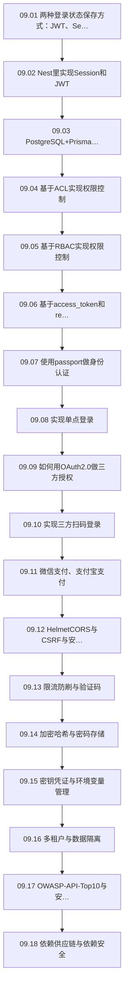

# 第 9 章 认证、授权与安全

> 第 2 部 · 18 节 · 约 21.5 学时 · 已写 6 节

## 这一章解决什么问题

从 Session/JWT 走到 ACL/RBAC，再补齐 OAuth2、CSRF、加密与常见漏洞。

## 知识地图

## 验收清单

- [ ] 能为一个多角色系统设计认证与权限模型，并写出可复现的越权测试。
- [ ] 能不看笔记复述本章核心机制与取舍
- [ ] 本章的命令/示例能独立跑通，并留下自己的验证记录

## 节清单

- ✅ [09.01 两种登录状态保存方式：JWT、Session](09.01-两种登录状态保存方式：JWT、Session.md)
- ✅ [09.02 Nest里实现Session和JWT](09.02-Nest里实现Session和JWT.md)
- ✅ [09.03 PostgreSQL+Prisma8+JWT实现登录注册](09.03-PostgreSQL+Prisma8+JWT实现登录注册.md)
- ✅ [09.04 基于ACL实现权限控制](09.04-基于ACL实现权限控制.md)
- ✅ [09.05 基于RBAC实现权限控制](09.05-基于RBAC实现权限控制.md)
- ✅ [09.06 基于access_token和refresh_token实现无感刷新登录状态](09.06-基于access_token和refresh_token实现无感刷新登录状态.md)
- ⬜ 09.07 使用passport做身份认证（待写）
- ⬜ 09.08 实现单点登录（待写）
- ⬜ 09.09 如何用OAuth2.0做三方授权（待写）
- ⬜ 09.10 实现三方扫码登录（待写）
- ⬜ 09.11 微信支付、支付宝支付（待写）
- ⬜ 09.12 HelmetCORS与CSRF与安全响应头（待写）
- ⬜ 09.13 限流防刷与验证码（待写）
- ⬜ 09.14 加密哈希与密码存储（待写）
- ⬜ 09.15 密钥凭证与环境变量管理（待写）
- ⬜ 09.16 多租户与数据隔离（待写）
- ⬜ 09.17 OWASP-API-Top10与安全审计（待写）
- ⬜ 09.18 依赖供应链与依赖安全（待写）

---

[← 第 8 章 Redis、缓存与消息](../ch-08-Redis与缓存/_chapter.md) · [返回教程目录](../../README.md) · [第 10 章 配置、Compose 与 Nginx →](../ch-10-配置与部署/_chapter.md)
