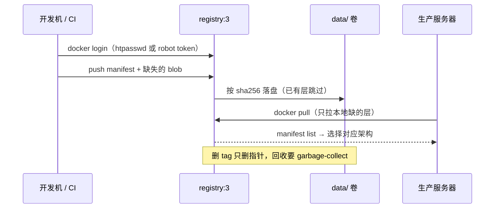

# 10.05 搭建私有Docker镜像仓库

镜像构建出来只是躺在你机器上的一堆层。要让 CI 构建、让服务器拉取，就得有一个「所有机器都能访问、并且只让自家人访问」的仓库。这一节把这件事从零走通：先用官方 `registry:3` 起一个五六十兆内存就能跑的最小私有仓库，把 TLS、认证、磁盘回收这些绕不开的问题逐个解决；再说明什么规模才值得升级到 Harbor。

> 本节的 Docker 命令没有在笔者的机器上实测（本机没有 Docker daemon），输出为预期结果；涉及具体版本的命令已对照 registry 3.1.x 与 Harbor 2.15.x 的文档核对。

## 一、先想清楚它要满足什么

私有镜像仓库的需求永远只有三条，但每条都容易被做错：

1. **私有**：不能让公网任何人 `docker pull` 到你的业务镜像（里面可能有源码、构建参数、甚至误打进层的密钥）。
2. **可认证**：CI 和服务器要能自动登录，而不是人工输密码。
3. **磁盘可控**：镜像层只增不减会吃满盘，得能删、能回收。

顺带一条隐性需求：**镜像地址要稳定**。`meeting-booking-api:latest` 这种名字只能在本机用，跨机器必须带仓库域名。

## 二、三条路，先选清楚

| 方案 | 起步成本 | 认证/权限 | 磁盘与带宽 | 适合 |
| --- | --- | --- | --- | --- |
| Docker Hub 私有仓库 | 0 | 账号 + token | 免费额度有限、匿名拉取有速率限制 | 个人玩具项目、公开镜像 |
| 云厂商托管（ACR / ECR / GHCR） | 低 | 云 IAM、临时凭证 | 按量计费、有内网加速 | 已在用该云、团队协作 |
| 自建 `registry:3` | 10 分钟 | htpasswd 单账号或反向代理接 OIDC | 自己的盘，几十 MB 内存 | 1–3 人、镜像几十个 |
| 自建 Harbor | 半天 | 项目级 RBAC、机器人账号、配额 | 官方建议 4C/8G 起 | 团队、需要审计与漏洞扫描 |

你的 VPS 是 6 核 5.8G、93G 可用盘：`registry:3` 是明显合适的起点，Harbor 能跑但会把内存吃到只剩 1–2G 给业务容器。按一个 Node 应用镜像 400 MB、每次发版一个 tag 估算，留 20 个历史版本就是 8 GB——**盘不是问题，问题是没人负责删**；后面第六、十四节给的就是删与搬的办法。**先用 registry 把流程跑顺，等真的需要「谁能推哪个项目」时再换 Harbor**——两者的镜像格式完全一样，迁移只是换个地址重新 push。

## 三、十分钟起一个 registry

目录结构（放在 `/srv/registry`，和业务 compose 分开，避免 `docker compose down` 把仓库也带下去）：

```bash
sudo mkdir -p /srv/registry/{data,auth,certs}
cd /srv/registry
```

第一步，造一个账号。`htpasswd` 不用额外装，借 `httpd` 镜像里的工具生成（`-B` 是 bcrypt，`-n` 输出到标准输出，`-b` 从参数取密码）：

```bash
docker run --rm --entrypoint htpasswd httpd:2 \
  -Bbn deploy '换成你的强密码' > auth/htpasswd
ls -l auth/htpasswd   # 应看到 deploy:$2y$05$... 这样一行
```

第二步，证书。仓库必须走 HTTPS，否则 Docker 默认拒绝推送。**没有域名、没有备案也能先跑**：用 IP 签一张自签证书，把这个 IP 写进 SAN。

```bash
cd /srv/registry/certs
openssl req -x509 -nodes -days 825 -newkey rsa:2048 \
  -keyout registry.key -out registry.crt \
  -subj "/CN=你的服务器IP" \
  -addext "subjectAltName=IP:你的服务器IP"
```

第三步，`compose.yaml`。注意两个挂载：`data` 是镜像层本体（**必须持久化**），`auth/htpasswd` 和证书是只读挂载。

```yaml
name: registry

services:
  registry:
    image: registry:3
    container_name: registry
    restart: unless-stopped
    ports:
      - "127.0.0.1:5000:5000"   # 先只监听本机，等反代配好再决定是否对外
    environment:
      REGISTRY_HTTP_ADDR: 0.0.0.0:5000
      REGISTRY_STORAGE_DELETE_ENABLED: "true"          # 允许删 manifest，GC 才有意义
      REGISTRY_AUTH: htpasswd
      REGISTRY_AUTH_HTPASSWD_REALM: "Registry Realm"
      REGISTRY_AUTH_HTPASSWD_PATH: /auth/htpasswd
      REGISTRY_HTTP_TLS_CERTIFICATE: /certs/registry.crt
      REGISTRY_HTTP_TLS_KEY: /certs/registry.key
    volumes:
      - ./data:/var/lib/registry
      - ./auth:/auth:ro
      - ./certs:/certs:ro
```

`REGISTRY_*` 环境变量和 `config.yml` 里的层级是一一对应的：`REGISTRY_HTTP_TLS_CERTIFICATE` 等于 `http.tls.certificate`，下划线换成点名、全大写。这些变量只是捷径，**真正生效的默认配置文件在镜像里的 `/etc/distribution/config.yml`**（Distribution 3 改为 `/etc/distribution/`，2.x 是 `/etc/docker/registry/`，抄旧文章时最容易错这里）。

```bash
docker compose up -d
docker compose logs -f registry   # 看到 "listening on [::]:5000" 即成功
curl -k https://127.0.0.1:5000/v2/   # 未登录返回 401，说明鉴权生效
```

`/v2/` 返回 401 是**好事**：它就代表「服务活着，但要凭证」。返回 200 反而是配置漏了认证。

## 四、push 与 pull 的完整链路

镜像名的结构是 `仓库地址/命名空间/仓库名:标签`，只有第一段是域名时才走远端，否则 Docker 默认当成 Docker Hub。

```bash
# 本机先让 Docker 信任这张自签证书（路径规则固定：/etc/docker/certs.d/<地址>/ca.crt）
sudo mkdir -p /etc/docker/certs.d/你的服务器IP:5000
sudo cp registry.crt /etc/docker/certs.d/你的服务器IP:5000/ca.crt
# macOS / Windows 桌面版：Settings → Docker Engine 里加 "insecure-registries"，或把 CA 导入系统钥匙串

docker login 你的服务器IP:5000 -u deploy
docker tag meeting-booking-api:1.0.0 你的服务器IP:5000/meeting/meeting-booking-api:1.0.0
docker push 你的服务器IP:5000/meeting/meeting-booking-api:1.0.0
```

第一次 push 会看到逐层 `Pushing` / `Layer already exists` 的输出——**后者说明层复用生效**：改了应用代码重新构建，只有变动的那一层被上传，这也是为什么 Dockerfile 要把「装依赖」放在「拷源码」之前。

服务器侧只需要 `docker login` 一次（凭证存在 `~/.docker/config.json`），之后 `docker compose pull` 即可。



## 五、不装 Docker 也能查仓库里有什么

仓库对外就是一个只读的 HTTP API，排障时用 `curl` 比 `docker images` 可靠得多：

```bash
# 一、仓库里有哪些镜像名
curl -k -u deploy:密码 https://你的服务器IP:5000/v2/_catalog

# 二、某个镜像有哪些 tag
curl -k -u deploy:密码 https://你的服务器IP:5000/v2/meeting/meeting-booking-api/tags/list

# 三、某个 tag 对应的 manifest 摘要（删镜像时要用这个 digest）
curl -k -u deploy:密码 \
  -H 'Accept: application/vnd.docker.distribution.manifest.v2+json' \
  -I https://你的服务器IP:5000/v2/meeting/meeting-booking-api/manifests/1.0.0
```

注意 `/v2/_catalog` 返回的是**仓库名**，不是 tag；tag 要再查一次。另外 `_catalog` 在生产环境建议关掉（`REGISTRY_STORAGE_...` 不提供开关时一般靠反代挡路径），否则等于把镜像清单暴露给任何拿到账号的人。

## 六、删掉镜像为什么盘没变小

这是自建仓库最高频的坑。**删 tag 只是删了一个指针**，层数据还在；要两层动作配合：

```bash
# 1) 删 manifest：先把 digest 查出来（见上一节第三条命令）
curl -k -u deploy:密码 -X DELETE \
  https://你的服务器IP:5000/v2/meeting/meeting-booking-api/manifests/sha256:xxxx

# 2) 离线回收未被引用的层；先 dry-run 看能省多少
docker compose stop registry
docker run --rm -v /srv/registry/data:/var/lib/registry registry:3 \
  garbage-collect --dry-run --delete-untagged /etc/distribution/config.yml
```

确认无误去掉 `--dry-run` 再跑一次，然后 `du -sh /srv/registry/data` 对比。**GC 期间必须停写**（官方要求只读或停机），所以放凌晨 cron，并把「停服务 → GC → 起服务」写成一个脚本，避免手工漏步。

```bash
# /srv/registry/gc.sh（用 crontab -e 加：30 3 * * * /srv/registry/gc.sh）
cd /srv/registry
docker compose stop registry
docker run --rm -v /srv/registry/data:/var/lib/registry registry:3 \
  garbage-collect --delete-untagged /etc/distribution/config.yml >> /var/log/registry-gc.log 2>&1
docker compose start registry
```

## 七、对外只用反向代理，外加两个必须调的参数

把 `5000` 端口直接暴露到公网不是好主意：TLS 证书轮换、限流、审计都得在仓库里做一遍。用 Nginx 在前面挡一层，仓库本身只监听 `127.0.0.1`。

```nginx
server {
    listen 443 ssl;
    http2 on;
    server_name registry.example.net;

    ssl_certificate     /etc/nginx/certs/registry.crt;
    ssl_certificate_key /etc/nginx/certs/registry.key;

    client_max_body_size 0;          # 0 = 不限制上传体积，镜像层动辄上百 MB
    proxy_request_buffering off;      # 边收边转，避免大层先落盘再转发
    chunked_transfer_encoding on;

    location / {
        proxy_pass http://127.0.0.1:5000;
        proxy_set_header Host $host;
        proxy_set_header X-Forwarded-Proto $scheme;
        proxy_set_header X-Real-IP $remote_addr;
    }
}
```

`client_max_body_size` 忘了改，症状是 push 到一半报 `413 Request Entity Too Large`；`proxy_request_buffering off` 忘了，症状是大镜像 push 时 Nginx 磁盘先被写满、速度还慢一半。

如果机器上还跑着 1Panel（它自带 Nginx，可能占着 80/443），**不要动它的配置**，单独在它管不到的端口或子域上开一个 server 块，否则一次面板升级就可能把你的反代覆盖掉。

## 八、什么时候该上 Harbor

`registry:3` 只有「一个账号、平铺所有仓库」。当出现下面任意一条，就该换 Harbor（当前稳定版 v2.15.x，发布产物从 v2.15.0 起带 Cosign 签名）：

- 要让「前端组只能推 `web/`、后端只能推 `api/`」；
- 要按项目设存储配额，防止某个人把盘塞满；
- 要镜像漏洞扫描（内置 Trivy）、保留策略（只留最近 10 个 tag）；
- 要让 CI 用**机器人账号**（`robot$ci`，可设过期时间与只推权限）而不是人的密码。

最小部署（`harbor.yml` 关键字段，其余按官方模板）：

```yaml
hostname: harbor.example.net
https:
  port: 443
  certificate: /data/cert/harbor.crt
  private_key: /data/cert/harbor.key
harbor_admin_password: 换成强密码
database:
  password: 换成另一个强密码
data_volume: /data/harbor
trivy:
  ignore_unfixed: false
```

解压离线安装包后 `sudo ./install.sh --with-trivy`，等容器起来用管理员登录建项目；机器人账号在「项目 → 机器人账户」里生成，登录名形如 `robot$ci`：

```bash
docker login harbor.example.net -u 'robot$ci' -p '生成的token'
docker tag meeting-booking-api:1.0.0 harbor.example.net/meeting/meeting-booking-api:1.0.0
docker push harbor.example.net/meeting/meeting-booking-api:1.0.0
```

注意 Harbor 对内存敏感：6G 的机器上跑 Harbor + Postgres + Redis + 业务 API，很容易在压测时被 OOM Killer 带走容器，**要么给业务留够余量，要么换 registry**。

## 九、接进 CI：构建机推、服务器拉

GitHub Actions 里用官方动作，把凭证放 Secrets，永远不要写进 workflow 文件：

```yaml
- uses: docker/login-action@v3
  with:
    registry: ${{ secrets.REGISTRY_HOST }}
    username: ${{ secrets.REGISTRY_USER }}
    password: ${{ secrets.REGISTRY_PASSWORD }}

- uses: docker/build-push-action@v6
  with:
    context: ./example
    push: true
    tags: ${{ secrets.REGISTRY_HOST }}/meeting/meeting-booking-api:${{ github.sha }}
```

镜像 tag 用 `github.sha`（或构建号）而不是 `latest`：`latest` 无法回滚，也无法判断线上跑的是哪次提交。服务器侧 compose 里写 `image: <仓库>/meeting/meeting-booking-api:${TAG}`，部署时只改 `TAG` 再 `docker compose up -d`——这也是 10.07 灰度发布的前置条件。

## 十、Checkpoint

按顺序做，三步都过再往下走：

```bash
# 1) 推送成功，且仓库 API 能看到
docker push 你的服务器IP:5000/meeting/meeting-booking-api:1.0.0
curl -k -u deploy:密码 https://你的服务器IP:5000/v2/_catalog
# 期望：{"repositories":["meeting/meeting-booking-api"]}

# 2) 换一台机器（或先 docker rmi 本地镜像）能拉下来并跑起来
docker rmi 你的服务器IP:5000/meeting/meeting-booking-api:1.0.0
docker pull 你的服务器IP:5000/meeting/meeting-booking-api:1.0.0
docker run --rm 你的服务器IP:5000/meeting/meeting-booking-api:1.0.0 node -e "console.log('ok')"

# 3) 删除 + GC 后磁盘真的变小
du -sh /srv/registry/data   # 记下数值
# 删 manifest → stop → garbage-collect → start（见第六节）
du -sh /srv/registry/data   # 期望明显小于上一次
```

## 十一、它到底存了什么：manifest、config 与 blob

理解这一点，前面所有「为什么」都能自己推出来。推送一个镜像，仓库里落的不是「一个文件」，而是三类东西：

- **blob**：真正的数据块，每一层文件系统差异一个 blob，以及一个 `config.json` blob。它们按内容寻址——文件名就是 `sha256(内容)`。
- **manifest**：一份 JSON，列出「config 的 digest + 各层 digest + 架构信息」。
- **tag**：一个可读名字，指向某个 manifest digest。

所以 `docker push` 时那句 `Layer already exists` 的真实含义是：本地先算好这一层的 sha256，拿 digest 去问仓库「你有吗」，有就跳过上传。这也解释了为什么**同一台机器上两个镜像共享基础层时，第二个镜像几乎瞬间推完**。

推论一：**改了业务代码只多一层**。`FROM node:24-bookworm-slim` 那几百 MB 是共享的，你改的 `dist/` 只产生几十 MB 的新层——前提是 Dockerfile 把「装依赖」放在「拷源码」之前，否则 `COPY . .` 一变动，后面的 `pnpm install` 层全部失效重建。

推论二：**删 tag 不等于删数据**。删 tag 只是删掉「名字 → manifest」的映射；manifest 和 blob 还躺在 `data/` 里，可能正被别的 tag 引用。GC 做的是从所有还存在的 manifest 出发做可达性分析，回收没人引用的 blob。这也是为什么 GC 必须停写：如果回收的同时有人正在 push，新写的 blob 还没被任何 manifest 引用，就会被当成垃圾删掉，镜像直接损坏。

推论三：**密钥进了层就永远在仓库里**。`config.json` 里记录了构建历史（`docker history` 能看到每一步命令），`ENV`、`ARG`、`COPY` 进去的文件都在层里。哪怕你下一个 commit 删掉了，旧层仍然可以被 `docker pull` 拉下来——所以密钥只能通过 `--mount=type=secret` 或运行时注入，`.dockerignore` 要挡住 `.env`、`*.pem`。

```bash
# 看一个镜像到底由几层、多大组成
docker manifest inspect 你的服务器IP:5000/meeting/meeting-booking-api:1.0.0 | head -40

# 看构建历史里有没有不该出现的命令（比如 ARG 传了密码）
docker history --no-trunc 你的服务器IP:5000/meeting/meeting-booking-api:1.0.0 | head
```

## 十二、多架构：Apple Silicon 构建、x86 服务器跑

这是新手最常撞的一堵墙：Mac M 系列上 `docker build` 出来的镜像是 `linux/arm64`，推到 amd64 的 VPS 上运行，容器一启动就 `exec format error: executable file not found`。错误信息完全不提架构，很容易查错方向。

正确做法是用 buildx 一次构建多架构，并让同一个 tag 携带一份 manifest list（OCI image index）——仓库原生存得下，客户端 `docker pull` 时按自己的架构自动挑对应镜像：

```bash
# 一次性构建 amd64 与 arm64，并直接推到私有仓库
docker buildx build \
  --platform linux/amd64,linux/arm64 \
  -t 你的服务器IP:5000/meeting/meeting-booking-api:1.0.0 \
  --push ./example

# 确认 tag 下确实有两种架构
docker manifest inspect 你的服务器IP:5000/meeting/meeting-booking-api:1.0.0 | grep -A2 '"architecture"'
```

跨架构构建需要 QEMU 模拟（只在本地 Mac 上需要，CI 里用 `docker/setup-buildx-action` 自带）：`docker run --privileged --rm tonistiigi/binfmt --install all`。注意模拟构建会慢 3–10 倍，如果只是要在服务器上跑，直接在 CI 里构建 amd64 更省事——**「在哪跑就在哪构建」永远是最省心的策略**。

## 十三、凭证：base64 不是加密

`docker login` 之后，凭证存在 `~/.docker/config.json`，形如 `"auth": "ZGVwbG95OjEyMzQ1Ng=="`。这只是 base64，**任何人拿到这个文件就等于拿到密码**。三个直接后果：

1. 不要把 `~/.docker/config.json` 拷进镜像、贴进 issue、提交到仓库；
2. 服务器上只放**只读账号**（能 pull、不能 push），CI 用**只推账号**，权限最小化；
3. 用 token 而不是主密码，泄露了可以单独吊销。

如果确认泄露，处置顺序是：改密码 → 吊销所有 token → 用 `_catalog` 拉全量清单，逐个检查 digest 是否被替换（陌生人推的同名镜像是最常见攻击）→ 检查 Nginx 访问日志里有没有异常 `PUT /v2/` 请求。

仓库暴露在公网时还要加限流，否则一个脚本就能把带宽打满：

```nginx
# http 段
limit_req_zone $binary_remote_addr zone=registry:10m rate=20r/s;

# location 段
limit_req zone=registry burst=40 nodelay;
```

镜像本身的安全性另说：Harbor 内置 Trivy 扫描，`registry:3` 没有，需要在 CI 里跑 `trivy image --exit-code 1 --severity HIGH,CRITICAL <镜像>`，把高危漏洞拦在推送之前。

## 十四、迁移、备份与拉取加速

**备份**只有一句话：**停写之后 tar 整个 `data/` 目录**。镜像层的写入不是原子的，运行中打包很可能得到损坏的 blob（恢复后 pull 报 `unexpected EOF` 或 digest 不匹配）。

```bash
cd /srv/registry
docker compose stop registry
tar -czf /backup/registry-$(date +%F).tar.gz data/
docker compose start registry
# 恢复后校验：清单能列出来、抽取一个镜像能 pull 下来
```

**迁移到 Harbor 或换机器**时，不要重新 build 一遍（构建结果不可复现，digest 会变）。用 `skopeo copy --all` 在仓库之间搬，`--all` 保留多架构：

```bash
skopeo copy --all \
  docker://你的服务器IP:5000/meeting/meeting-booking-api:1.0.0 \
  docker://harbor.example.net/meeting/meeting-booking-api:1.0.0 \
  --src-creds deploy:密码 --dest-creds 'robot$ci':token
```

**拉取加速**：VPS 在国内拉 Docker Hub 经常几十 KB/s 甚至超时。`registry:3` 可以配置成上游代理缓存（pull-through cache），第一次有人拉时它去 Docker Hub 取并落在本地盘，之后同机拉取走本地：

```yaml
# compose 里加一个只做缓存的实例，端口 5001
proxy:
  remoteurl: https://registry-1.docker.io
```

用的时候把镜像名写成 `你的服务器IP:5001/library/nginx:1.27`。代价是缓存也吃盘，并且**上游私有镜像不会给你缓存**（没凭证），它只适合公共基础镜像。

## 十五、坑表

| 现象 | 原因 | 处理 |
| --- | --- | --- |
| `http: server gave HTTP response to HTTPS client` | 仓库没开 TLS，但地址被当成 https | 配证书，或临时把地址加 `insecure-registries`（仅内网） |
| `x509: certificate signed by unknown authority` | 自签 CA 没装到客户端 | 复制 `ca.crt` 到 `/etc/docker/certs.d/<host>:<port>/` |
| push 报 `413` | Nginx `client_max_body_size` 太小 | 设 `0` |
| 删了 tag，盘没小 | 只删了指针，没做 GC | 删 manifest + `garbage-collect` |
| GC 后镜像坏了 / 502 | GC 时有并发写入 | GC 期间停写，脚本化 |
| 登录成功但 push 403 | htpasswd 里没有该用户，或仓库名未建 | 重新生成 htpasswd；registry 首次 push 会自动建仓库，Harbor 需先建项目 |
| `docker compose down` 后镜像全丢 | `data` 目录用了匿名卷或相对路径写错 | 确认 `./data:/var/lib/registry` 是宿主机真实目录 |
| 磁盘被镜像层吃满 | 没有保留策略 | 定时 GC + 只保留最近 N 个 tag |

仓库解决的是「镜像往哪放」，下一节解决「外部请求怎么进来」——Nginx 的两个核心用法。

<!-- chapter-nav:start -->
---

← [10.04 Docker支持重启策略，是否还需要PM2](10.04-Docker支持重启策略，是否还需要PM2.md) · [本章目录](_chapter.md) · [10.06 快速掌握Nginx的2大核心用法](10.06-快速掌握Nginx的2大核心用法.md) →
<!-- chapter-nav:end -->
