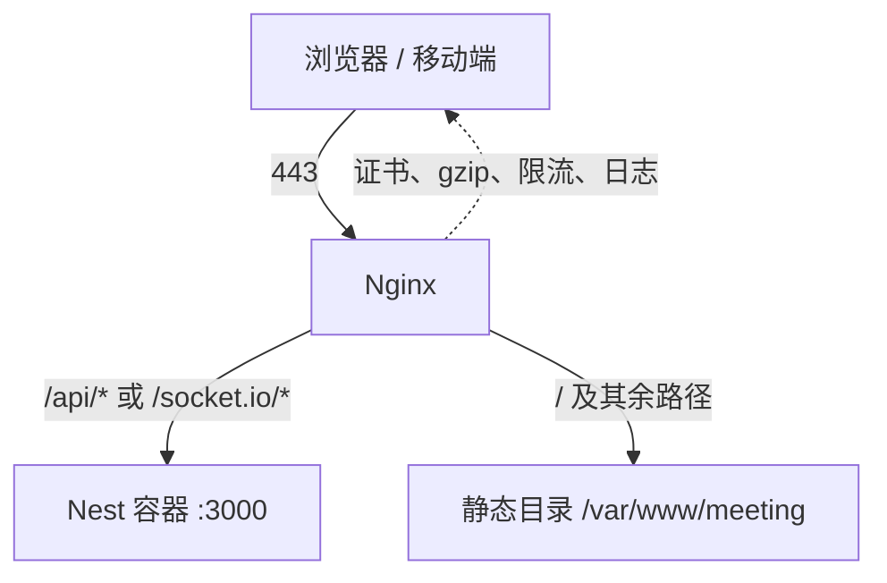

# 10.06 快速掌握Nginx的2大核心用法

上一节把镜像放进了仓库，这一节让请求能进得来。一个前后端分离的 Nest 应用上线后，公网只会开一个 80/443 端口，所有请求都先落到 Nginx：路径是 `/api/` 的转给 Node，其余的直接从磁盘读文件。所谓的「两大核心用法」，就是这两件事——**静态资源服务**与**反向代理**。其余上百个指令都是为它们服务的细节。

> 本节配置对照 Nginx 1.30（stable，2026 年当前稳定线；mainline 为 1.31.x）核对；没有在你的 VPS 上实测，标注了预期输出。

## 一、请求进来之后发生了什么



图中的三条分叉对应三个必须做的决定：

1. **哪些路径归 Node**：一般只有 `/api`、`/socket.io`、`/graphql`，越少越好——动态请求多绕一层都慢。
2. **静态文件放哪**：Vite 打包产物拷到宿主机目录，还是打进一个 Nginx 镜像？前者改一行 `COPY` 就能更新，后者要重新构建镜像。
3. **公共能力放谁**：TLS、压缩、限流、缓存头放 Nginx，Node 不管这些，省重复实现。

## 二、用法一：静态站点与 SPA 回退

装 Nginx 的方式现代只有两种：发行版包（`apt install nginx`）或容器。这里用容器，和前面几节的 compose 保持同一套心智，也方便你在没有域名的机器上先跑通。

```yaml
services:
  web:
    image: nginx:1.30-alpine
    container_name: meeting-web
    restart: unless-stopped
    ports:
      - "127.0.0.1:8080:80"          # 先只监听回环，TLS 交给外层
    volumes:
      - ./dist:/usr/share/nginx/html:ro
      - ./nginx/default.conf:/etc/nginx/conf.d/default.conf:ro
```

静态站点的最小 `server` 块只有三行有效配置，但每一行都能踩坑：

```nginx
server {
    listen 80;
    server_name _;
    root /usr/share/nginx/html;
    index index.html;

    location / {
        try_files $uri $uri/ /index.html;
    }
}
```

`try_files $uri $uri/ /index.html` 是 SPA 的命门。前端路由（`/rooms/42`）在服务器上没有对应文件，用户按 F5 就会 404——`try_files` 先试文件、再试目录、最后全部交给 `index.html`，由前端路由接管。少了这一行，表现是「点链接能跳，刷新就白屏」，后端同事查半天以为是接口问题。

顺带三个静态站点的细节：

```nginx
# 1) 带哈希的产物长缓存；index.html 绝对不能缓存
location ~* \.(js|css|woff2|png|svg)$ {
    expires 1y;
    add_header Cache-Control "public, immutable";
}
location = /index.html {
    add_header Cache-Control "no-store";
}

# 2) 文本压缩：gzip 内置；brotli 需要额外模块，官方 alpine 镜像没有
gzip on;
gzip_comp_level 5;
gzip_min_length 1024;
gzip_types text/plain text/css application/javascript application/json image/svg+xml;

# 3) 关掉目录列表，否则 /uploads/ 会被人翻出所有文件
autoindex off;
```

`root` 与 `alias` 的区别是另一个高频错：`root /usr/share/nginx/html` 会把 **URI 原样拼在后面**（`/a/b.css` → `/usr/share/nginx/html/a/b.css`）；`alias` 是**替换掉 location 匹配的那段**，且必须以 `/` 结尾：

```nginx
location /static/ {
    alias /data/static/;      # /static/a.png → /data/static/a.png
}
```

## 三、用法二：反向代理

静态资源只是配菜，真正需要小心的是 `/api` 那一段。一个「能用」的反代配置，和「生产可用」的配置差了七八行，差的每一行都对应一类线上事故。

```nginx
upstream api_upstream {
    server api:3000;        # compose 服务名；多副本就多写几行，自带轮询
    keepalive 32;           # 与后端保持长连接，省掉每次 TCP 握手
}

server {
    listen 80;
    server_name _;

    location /api/ {
        proxy_pass http://api_upstream;      # 注意结尾没有 /

        proxy_http_version 1.1;               # WebSocket 与 keepalive 都需要
        proxy_set_header Connection "";       # 配合 keepalive，必须清空
        proxy_set_header Host $host;
        proxy_set_header X-Real-IP $remote_addr;
        proxy_set_header X-Forwarded-For $proxy_add_x_forwarded_for;
        proxy_set_header X-Forwarded-Proto $scheme;

        proxy_connect_timeout 5s;
        proxy_send_timeout 30s;
        proxy_read_timeout 30s;               # 默认 60s，SSE/长任务要单独放开
        client_max_body_size 20m;             # 默认 1m，上传文件必踩 413
    }
}
```

几个必须理解的语义：

**`proxy_pass` 结尾的斜杠不是风格问题。** 写 `http://api_upstream` 会把原始 URI 整个转过去（`/api/users` → 后端收到 `/api/users`）；写 `http://api_upstream/` 会把 `location` 匹配到的 `/api/` 剥掉（后端收到 `/users`）。而 Nest 里 `app.setGlobalPrefix('api')` 已经声明了前缀，所以**这里要用不带斜杠的写法**，否则后端会 404——这是我们踩过的真实错误。

**`Host` 与 `X-Forwarded-*` 决定后端怎么看你。** 不传 `X-Forwarded-For`，Nest 里 `request.ip` 永远是 Nginx 的容器 IP，限流会把所有用户当成一个人；不传 `X-Forwarded-Proto`，应用生成的回调地址会变成 `http://`；同时服务端还得开 `app.set('trust proxy', 1)`（10.01 里的配置）才肯信任这些头。

**`keepalive` 要三件套。** 只写上 `keepalive 32` 不生效，必须同时 `proxy_http_version 1.1` 和 `proxy_set_header Connection ""`，否则 Nginx 仍然每个请求新建连接。

**上传体积与超时是两个独立的坑。** 413 是 `client_max_body_size`，504 是 `proxy_read_timeout`。一个 20 MB 的导入任务，两个都得改。

**多副本时选对均衡策略。** `upstream` 默认轮询，适合无状态接口；`least_conn` 把新请求给当前连接最少的节点，长任务多时更稳；`ip_hash` 让同一 IP 固定到同一副本，只在「会话存在进程内存」这种反模式里才需要——我们用的是 Redis 共享 session（10.09），所以不需要它。健康检查用 `max_fails=2 fail_timeout=10s`，Nginx 会在连续失败后把节点摘掉 10 秒，这是最便宜的「自动摘除」，比上 Consul 现实得多：

```nginx
upstream api_upstream {
    least_conn;
    server api:3000 max_fails=2 fail_timeout=10s;
    keepalive 32;
}
```

## 四、三种特殊流量：WebSocket、SSE、上传

普通的 HTTP 请求上面那套就够了，但实时通信和流式响应会绕过反向代理的默认假设。

**WebSocket** 需要把 `Upgrade` 头原样传过去，并让 Nginx 在下游断开时也断开：

```nginx
# http 段（与 server 同级）
map $http_upgrade $connection_upgrade {
    default upgrade;
    ''      close;
}

# location 段
location /socket.io/ {
    proxy_pass http://api_upstream;
    proxy_http_version 1.1;
    proxy_set_header Upgrade $http_upgrade;
    proxy_set_header Connection $connection_upgrade;
    proxy_read_timeout 3600s;     # 否则空闲 60s 后连接被掐
}
```

聊天应用「连上几秒就断、重连又断」，九成是这三行少了一行。SSE（`text/event-stream`）是另一种情况：它不需要 Upgrade，但**必须关掉缓冲**，否则事件全被 Nginx 攒着，前端一个都收不到：

```nginx
location /api/events {
    proxy_pass http://api_upstream;
    proxy_buffering off;
    proxy_cache off;
    proxy_read_timeout 3600s;
    chunked_transfer_encoding on;
}
```

应用侧配合发一个 `X-Accel-Buffering: no` 响应头，双保险。

## 五、location 匹配顺序：一条请求到底落在哪个块

Nginx 不是「从上到下第一个匹配就停」，顺序固定：

1. `location = /exact` 精确匹配，命中即停；
2. `^~` 前缀匹配，命中后**不再尝试正则**；
3. 正则 `~`（区分大小写）/ `~*`（不区分），按书写顺序第一个命中即停；
4. 普通前缀匹配，取**最长**的那个。

这解释了为什么「`/api` 被静态规则抢走」这类问题会出现：如果写了 `location ~* \.(png|js)$` 这种正则，它会抢在任何普通前缀之前命中。规则是**让动态路径用 `^~` 提权**：

```nginx
location ^~ /api/ { proxy_pass http://api_upstream; }
location ~* \.(js|css|png)$ { expires 1y; }
```

## 六、要不要让 Nginx 缓存接口

静态文件有 `expires` 就够了，但有些接口（公开的房间列表、统计概览）查询重、变化慢，在 Nginx 层缓存 10 秒能挡掉大半流量。Nginx 的 `proxy_cache` 是**按 URL 缓存完整响应**，配置不复杂，坑在「缓存了不该缓存的东西」：

```nginx
# http 段
proxy_cache_path /var/cache/nginx levels=1:2 keys_zone=api_cache:10m
                 max_size=1g inactive=10m use_temp_path=off;

# location 段
location ~ ^/api/(rooms|stats) {
    proxy_cache api_cache;
    proxy_cache_valid 200 10s;
    proxy_cache_key "$scheme$request_method$host$request_uri";
    proxy_cache_bypass $http_authorization;      # 带 token 的请求不走缓存
    add_header X-Cache-Status $upstream_cache_status;

    proxy_pass http://api_upstream;
}
```

`X-Cache-Status` 会返回 `HIT / MISS / BYPASS / EXPIRED`，上线后先观察它，确认 `BYPASS` 的只出现在带凭证的请求上。**只要响应里含用户私有数据且 URL 相同，就不要缓存**——`/api/bookings` 这种接口一旦被缓存，A 用户会看到 B 用户的预订列表，属于严重越权。安全做法是：只缓存明确标注为公开的路径，并且在应用侧发 `Cache-Control: private` 让 Nginx 有据可依。

## 七、为什么 reload 不会掐断用户

要理解 `nginx -s reload` 为什么能平滑生效，得知道它的进程模型：一个 **master** 进程只做管理（读配置、开端口、派生/回收 worker），若干 **worker** 进程真正处理连接（每个 worker 单线程、epoll 事件循环）。

reload 的动作序列是：master 读新配置 → 校验语法 → 启动一批新 worker（**共用已打开的监听 socket**）→ 给老 worker 发退出信号 → 老 worker 处理完手上的请求后退出。所以用户那边看到的是连接不中断，只有极少数正在处理的请求会跨版本。这也解释了两件事：

- **不要 `docker restart` 改配置**：那是把 master 杀掉重建，等于把所有长连接、WebSocket 全部掐断。
- **`worker_processes auto` + `worker_connections 1024`** 决定了单机并发上限（理论上限 ≈ worker 数 × connections，但每个反代连接占两个）。默认值对一台 6 核机器够用，别照抄网上的 `worker_connections 65535`。

```nginx
worker_processes auto;
events {
    worker_connections 4096;
    multi_accept on;
}
```

## 八、TLS 终止：证书、跳转与 HSTS

公网只开 443，HTTP 一律 301 到 HTTPS，证书只在 Nginx 这一层有——Node 容器里不要配证书，那会让应用和 TLS 的升级周期耦合在一起。

```nginx
server {
    listen 80;
    server_name meeting.example.net;
    return 301 https://$host$request_uri;
}

server {
    listen 443 ssl;
    http2 on;
    server_name meeting.example.net;

    ssl_certificate     /etc/nginx/certs/fullchain.pem;
    ssl_certificate_key /etc/nginx/certs/privkey.pem;
    ssl_protocols       TLSv1.2 TLSv1.3;
    ssl_session_cache   shared:SSL:10m;
    ssl_session_timeout 1d;

    add_header Strict-Transport-Security "max-age=15552000" always;

    location /api/ { proxy_pass http://api_upstream; }
    location /       { root /usr/share/nginx/html; try_files $uri $uri/ /index.html; }
}
```

三个容易漏的点：**`fullchain.pem` 必须是完整链**（只给叶子证书，安卓和部分 curl 会报 `unable to get local issuer certificate`）；**HSTS 一旦下发就撤不回**，先用短 `max-age` 观察一周再调长；**证书续期后要 reload**，否则 Nginx 还拿着内存里的旧证书。Let's Encrypt 的 `certbot renew --deploy-hook "nginx -s reload"` 就是干这个的。没有域名的阶段，自签证书足够跑通流程，浏览器点「继续访问」即可，不影响你验证反向代理本身。

## 九、日志：排障时最该先看的两列

默认 `combined` 格式只告诉你「请求了什么、返回了什么」，看不出**慢在哪里**。上线第一件事是把 upstream 的耗时加进日志：

```nginx
log_format main '$remote_addr - $remote_user [$time_local] "$request" '
                '$status $body_bytes_sent "$http_referer" '
                'rt=$request_time urt=$upstream_response_time ua=$upstream_addr '
                'rid=$request_id';
access_log /var/log/nginx/access.log main;
```

解读方法：`rt` 是 Nginx 视角的总耗时，`urt` 是后端耗时。`rt=0.003 urt=-` 说明请求根本没到后端（静态命中或 404）；`rt=3.010 urt=3.005` 说明慢在后端，去查 Node；`rt=3.010 urt=0.002` 说明 Nginx 在等客户端（大文件下载、客户端网络慢）。这三个组合能在一分钟内把「到底谁慢」定位清楚。

`$request_id` 是 Nginx 生成的 UUID，把它透传给后端（`proxy_set_header X-Request-ID $request_id`），前端报错时带上这个 id，就能在两边日志里对上同一条请求。上面 10.01 的 `summarizeConfig` 与项目里的 `x-request-id` 响应头就是同一套思路。

```bash
# 找出最慢的 10 个接口（假定日志已按 main 格式输出）
awk '{for(i=1;i<=NF;i++) if($i ~ /^urt=/) print $i, $7}' /var/log/nginx/access.log \
  | grep -v 'urt=-' | sort -t= -k2 -nr | head -10
```

## 十、限流与防刷：两层的分工

Nginx 的 `limit_req` 是**入口级**限流（按 IP、按自定义 key），Nest 的 `ThrottlerModule` 是**接口级**限流（按用户、按路由）。两层都要有：前者挡爬虫与暴力破解，后者实现业务配额。

```nginx
# http 段
limit_req_zone $binary_remote_addr zone=login:10m rate=5r/m;

# location 段
location = /api/auth/login {
    limit_req zone=login burst=3 nodelay;
    limit_req_status 429;
    proxy_pass http://api_upstream;
}
```

参数含义：`rate=5r/m` 是平均速率（每分钟 5 次），`burst` 是允许的突发桶，`nodelay` 表示突发请求立即处理而不是排队。**`burst` 设太大等于没限**，登录接口给 3 就够。`$binary_remote_addr` 比 `$remote_addr` 省内存，`10m` 大约能存 16 万个 IP 的计数状态。

再补一条连接数限制，防止单 IP 开几百个长连接拖垮 worker：

```nginx
limit_conn_zone $binary_remote_addr zone=perip:10m;
# location 段
limit_conn perip 20;
```

## 十一、改配置不重启：`nginx -t` 与 reload

容器里改完配置，别急着 `docker restart`（会掐断所有连接）。标准流程是「先测语法、再平滑重载」：

```bash
docker exec meeting-web nginx -t          # syntax is ok / test is successful
docker exec meeting-web nginx -s reload   # 新 worker 接管，老 worker 处理完存量请求再退
```

`nginx -t` 报 `unknown directive` 时先看是不是漏了 `;`，报 `host not found in upstream` 则是 `api` 这个容器还没起来——**Nginx 启动时会解析 upstream 域名，解析失败直接退出**，所以 compose 里要写 `depends_on`，或者改用 `resolver 127.0.0.11 valid=10s` 配合变量写法（10.03 讲过）。

## 十二、和 1Panel 共存

如果机器上装了 1Panel，它自带的 Nginx 可能已经占了 80/443，并且**面板升级会重写 `conf.d`**。三种处理，按推荐顺序：

1. **用它的网站功能**：把站点建在面板里，只在你自己的 `server` 块里加 `location`，不动全局配置；
2. **换端口**：你的 Nginx 监听 8080/8443，面板或外层反代再转发过来；
3. **独立实例**：自己的 `docker compose` 起 `nginx` 容器，绑定 `127.0.0.1:8081`，与面板完全不共享配置目录。

最不该做的是直接改面板的 `nginx.conf`——下次升级就没了。

## 十三、一次完整的发布演练

把前面所有零件串一遍：前端构建产物怎么从 CI 到服务器、后端镜像怎么换版本、两边怎么做到「随时可回滚」。

```bash
# 1) 前端：本地/CI 构建出 dist，同步到服务器（--delete 清掉旧文件，避免残留旧 chunk）
rsync -az --delete dist/ deploy@服务器:/srv/meeting/web/dist/

# 2) 后端：镜像已经推送（10.05），只需切换 tag
ssh deploy@服务器 'cd /srv/meeting && TAG=1.4.2 docker compose up -d api'

# 3) Nginx 只在配置变化时需要 reload；静态文件是目录挂载，天然生效
ssh deploy@服务器 'docker exec meeting-web nginx -s reload'

# 4) 验收：状态码、版本号、静态资源哈希
curl -sI https://meeting.example.net/ | head -3
curl -s https://meeting.example.net/api/health | jq .data
```

「随时可回滚」靠的不是 `git revert` 再发一次，而是**两个版本同时存在**：镜像保留最近 N 个 tag（`TAG=1.4.1 docker compose up -d api` 一条命令回退），前端产物按 release 目录 + `current` 软链切换：

```bash
ls -d /srv/meeting/web/releases/*
ln -sfn /srv/meeting/web/releases/20261122-1410 /srv/meeting/web/current
```

`root` 指向 `/srv/meeting/web/current`，切换软链就是原子发布；出问题把软链指回去，秒级恢复。注意软链 + `root` 在 Nginx 里是可以的（`root` 会跟随），但如果你用的是 `alias` 加正则 location，软链可能被解析成真实路径导致找不到——这也是宁可 `root` 不要 `alias` 的原因之一。

## 十四、Checkpoint

```bash
# 1) 语法与配置生效
docker exec meeting-web nginx -t
docker exec meeting-web nginx -T | grep -n 'proxy_pass'   # 打印合并后的完整配置

# 2) 静态站点：首页 200，SPA 深链刷新不 404
curl -sI http://127.0.0.1:8080/            | head -3
curl -sI http://127.0.0.1:8080/rooms/42    | head -3
# 期望两次都是 HTTP/1.1 200 OK（第二次是 index.html 接的）

# 3) 反代：接口通，且看到真实来源头
curl -s http://127.0.0.1:8080/api/health
curl -sI http://127.0.0.1:8080/api/health | grep -i 'x-'

# 4) WebSocket：101 Switching Protocols（需要 wscat 或浏览器控制台）
#    npx wscat -c ws://127.0.0.1:8080/socket.io/?EIO=4&transport=websocket
```

第三步如果返回 502，先 `docker compose logs api` 看后端是否在监听 `0.0.0.0:3000`（监听 `127.0.0.1` 的进程在容器网络里是连不上的）。

## 十五、上线前检查单

十二项，逐条打勾再放公网流量进来：

1. `nginx -t` 通过，且 `nginx -T` 里没有残留的 `server_name _` 测试块；
2. 80 端口只有 301，443 是唯一入口，HTTP/2 已开；
3. 证书链完整（`openssl s_client -connect 域名:443 -showcerts` 能看到中间证书）；
4. HSTS 的 `max-age` 从短值起步；
5. `/api/` 与静态目录的 location 前缀互不重叠，且动态路径用 `^~` 提权；
6. `client_max_body_size` 与业务上传上限一致；
7. `X-Forwarded-For/Proto` 透传，Node 侧 `trust proxy` 已开；
8. WebSocket 有 Upgrade 头，SSE 关了缓冲，两处 `proxy_read_timeout` 单独调过；
9. 登录/发信等敏感接口有 `limit_req` 且 `burst` 不为 0 以外的大值；
10. 访问日志带 `rt/urt` 与 `$request_id`，且 `/var/log/nginx` 有轮转（logrotate 或 Docker 日志驱动）；
11. 静态资源长缓存 + `index.html` 不缓存，产物带内容哈希；
12. 发布与回滚各演练一次（切 tag、切软链、观察 5 分钟）。

## 十六、坑表

| 现象 | 原因 | 处理 |
| --- | --- | --- |
| 首页正常，刷新子路由 404 | 缺 SPA 回退 | `try_files $uri $uri/ /index.html` |
| 接口 404，后端日志里路径少了一段 | `proxy_pass` 多写了结尾 `/` | 去掉斜杠，或让两边前缀一致 |
| 上传报 413 | 默认 `client_max_body_size 1m` | 调大并同时改后端校验 |
| 长任务 504 | `proxy_read_timeout` 默认 60s | 按接口调大，别全局调成 1h |
| WebSocket 连上就断 | 缺 `Upgrade`/`Connection` 头 | 加 `map` 两行 |
| SSE 前端收不到事件 | Nginx 缓冲 | `proxy_buffering off` + `X-Accel-Buffering: no` |
| 限流把所有用户当一个人 | 没传 `X-Forwarded-For` / 后端没 `trust proxy` | 两头都要配 |
| 后端连不上，502 | upstream 域名解析失败或端口没监听 0.0.0.0 | 查 `docker compose logs`、加 `depends_on` |

配好之后，Nginx 就成了「所有流量的唯一入口」——这也意味着它可以按比例把流量分给不同版本，下一节就用这一点做灰度。

<!-- chapter-nav:start -->
---

← [10.05 搭建私有Docker镜像仓库](10.05-搭建私有Docker镜像仓库.md) · [本章目录](_chapter.md) · [10.07 基于Nginx实现灰度系统](10.07-基于Nginx实现灰度系统.md) →
<!-- chapter-nav:end -->
