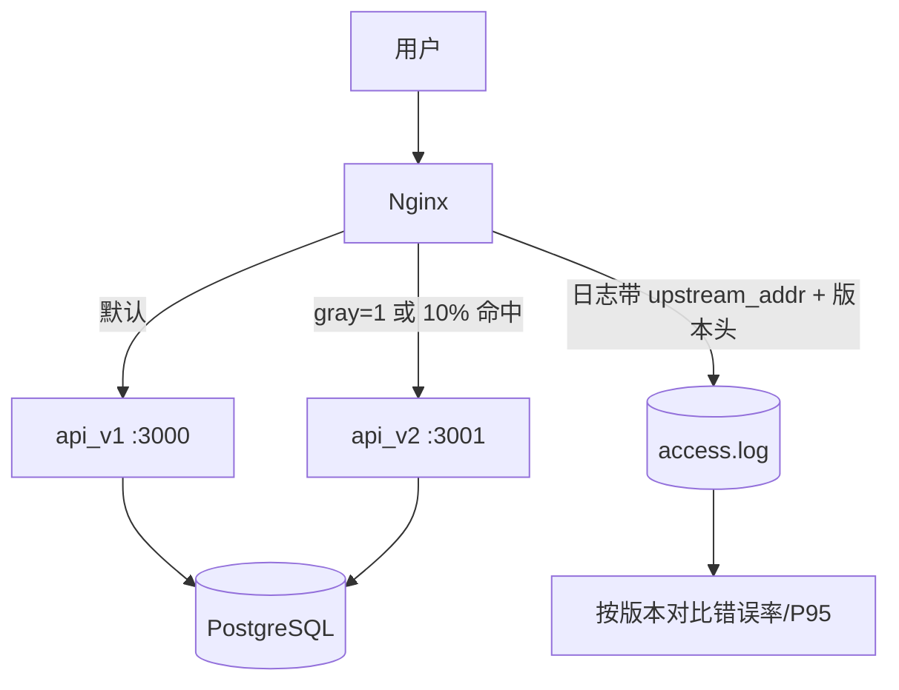

# 10.07 基于Nginx实现灰度系统

上一节的 `upstream` 里多写一行 `server`，Nginx 就会把请求轮询给两台机器——这是「同时上线两个版本」的基础设施。但真正的灰度不是「随机一半」，而是**可控地让一小部分人先用新版本，出问题时能在 30 秒内改回来**。这一节用 Nginx 原生能力做一个够用的灰度系统：按比例、按用户、按请求头三种分流方式，配上观测与回滚。

> 配置对照 Nginx 1.30 核对；没有在你的 VPS 上实测，涉及输出的地方给了预期结果。

## 一、灰度到底在解决什么

全量发布的风险不是「新代码有 bug」——那是必然的，而是**bug 的影响面**。灰度把「一次影响 100% 用户」变成「一次影响 5% 用户」，并且在指标变差时立刻收口。

一个能用的灰度系统必须回答四个问题：

1. **怎么分**：按比例随机、按用户固定、按内部员工/IP 白名单？
2. **会不会抖**：同一个用户这秒在新版本、下秒在老版本，购物车直接错乱。
3. **怎么看**：两个版本的错误率、P95、业务指标能不能分开看？
4. **怎么退**：回滚要多久？需要重新构建镜像吗？

Nginx 能干净地回答 1、2、4；第 3 个问题要靠日志里带上「这次请求被哪个版本服务」。

## 二、先看全景



两个版本**共享同一个数据库**，这是灰度的前提也是最大的约束：数据库必须同时兼容两个版本（新增列要有默认值、不能立刻删旧列、不能改名）。这件事在 07 章的迁移工作流里已经铺垫过，这里只强调结论：**灰度的成本大头在数据库兼容，不在 Nginx**。

## 三、三种分流方式

### 方式一：按请求头/参数指定（最适合内部先试）

```nginx
map $http_x_gray $gray_flag {
    default 0;
    "1"     1;
}
```

内部同学用浏览器插件或 `curl -H 'X-Gray: 1'` 打上新版本，外部用户拿不到这个头，自然走老版本。优点是零风险、可精确指定人；缺点是验证覆盖面窄，上线前只能验证「功能对不对」，验证不了「真实流量下会不会崩」。

### 方式二：按 cookie 固定用户（最适合对外放量）

```nginx
map $cookie_gray $gray_pool {
    default api_v1;
    "1"     api_v2;
}
```

`gray=1` 这个 cookie 一旦种下，这个用户后续所有请求都进 v2，刷新、跳转都不会变——**同一用户版本稳定**，这是灰度不抖的关键。种 cookie 有两种做法：运维手动给测试账号种；或者让 Nginx 在命中比例分流后 `add_header Set-Cookie` 写回去（下面比例分流里会用到）。

### 方式三：按比例随机（最适合真实流量验证）

```nginx
split_clients "${remote_addr}${http_user_agent}meeting-gray" $gray_bucket {
    10%     "1";
    *       "0";
}
```

`split_clients` 对字符串做 murmur2 哈希，按百分比分桶，**同一个输入永远落同一个桶**——所以用 `$remote_addr` 做输入时，同一 IP 的用户会稳定命中同一侧，不会刷新一次换一个版本。末尾那串 `meeting-gray` 是「盐」，不同项目用不同的盐，避免同一 IP 在所有系统里命中同一侧。

但注意它按 IP 分：同一公司出口 IP 相同，可能整栋楼一起进灰度；移动网络换基站又可能换 IP。所以真实项目里更常见的输入是**用户 ID**，而 Nginx 拿不到登录用户 ID——需要后端在登录时下发 cookie，或者用 `$cookie_uid` 做输入：

```nginx
split_clients "${cookie_uid}meeting-gray" $gray_bucket {
    10%     "1";
    *       "0";
}
```

未登录用户 `$cookie_uid` 为空，全部落 `*` 分支，行为可预期。

## 四、把分流接上 upstream

定义一个 map 把「标记」翻译成 upstream 组名，然后 `proxy_pass` 用变量：

```nginx
upstream api_v1 { server api:3000; keepalive 32; }
upstream api_v2 { server api:3001; keepalive 32; }

map $gray_flag $api_pool {
    default api_v1;
    "1"     api_v2;
}

server {
    listen 80;

    location /api/ {
        proxy_pass http://$api_pool;

        proxy_http_version 1.1;
        proxy_set_header Connection "";
        proxy_set_header Host $host;
        proxy_set_header X-Real-IP $remote_addr;
        proxy_set_header X-Forwarded-For $proxy_add_x_forwarded_for;
        proxy_set_header X-Forwarded-Proto $scheme;
        proxy_set_header X-Gray-Flag $gray_flag;   # 让后端知道自己在被灰度
    }
}
```

这里有一个必须知道的代价：**`proxy_pass` 带变量时，Nginx 不做 upstream keepalive 的连接复用**（变量使连接目标在运行期才确定）。对 QPS 不高的管理后台无所谓，对高并发接口就是每次请求一次 TCP 握手。三种取舍：

1. 接受它：灰度期间 QPS 通常不高，发布结束后把配置改回静态 `proxy_pass`；
2. 用 `if` + `set` 也不行，本质相同；
3. 上 OpenResty（`ngx.balancer` 在运行期选 upstream）或直接用 Ingress/Argo Rollouts，它们为此而生。

**别为了灰度把整个网关换成 OpenResty**，先用变量方案跑通流程，量大了再说。

## 五、让旧版本继续在线：两个容器怎么起

`docker compose` 里两个服务跑同一份代码的不同镜像 tag，端口错开：

```yaml
services:
  api:
    image: registry.example.net/meeting/meeting-booking-api:1.4.1
    environment:
      PORT: 3000
    expose: ["3000"]

  api-v2:
    image: registry.example.net/meeting/meeting-booking-api:1.4.2
    environment:
      PORT: 3001
      GRAY: "true"          # 应用内可据此开日志前缀、禁用定时任务
    expose: ["3001"]
```

要点：

- **不要给 v2 挂 `ports`**，它只该被 Nginx 访问（10.03 的桥接网络）；
- **定时任务、消息消费者只让一个版本跑**，否则两个版本同时消费会重复处理；用 `GRAY=true` 在应用里关掉 `@Cron()` 与消费者（或者在 compose 里用 `command` 覆盖启动参数）；
- 数据库连接池算总量：两个版本各 10 个连接，PostgreSQL `max_connections=100` 时最多 5 个版本（10.04 讲过这个乘法）。

## 六、观测：怎么知道新版本更差

灰度不配观测等于赌博。最小可用方案是**让日志带上版本，并按版本聚合**：

```nginx
log_format gray '$remote_addr [$time_local] "$request" $status '
                'rt=$request_time ua=$upstream_addr '
                'v=$upstream_http_x_app_version';
```

应用侧在响应头里回写自己的版本（Nest 里用拦截器或中间件加 `X-App-Version`），这样 `v=` 就是真实的镜像版本，不依赖你在 Nginx 里维护对照表。

```bash
# 按版本统计 5xx 比例（示例日志格式）
awk '{for(i=1;i<=NF;i++){if($i~/^v=/)ver=$i;if($i~/^status|^[0-9]{3}$/)code=$i};
      if(ver!=""){tot[ver]++; if(code>=500) err[ver]++}}
     END{for(k in tot) printf "%s 请求=%d 5xx=%d 比例=%.2f%%\n", k, tot[k], err[k]+0, 100*(err[k]+0)/tot[k]}' \
  /var/log/nginx/access.log
```

要达到生产可用，把这些指标送进 Prometheus 按 `version` 打标签（18 章会写），灰度决策看三样：**错误率、P95 延迟、核心业务成功率**（下单、支付回调）。任何一项比基线差 20% 以上，直接回滚，不要「再观察十分钟」。

## 七、回滚：改一行，reload 一次

这是 Nginx 灰度最大的优势——回滚不是重新发版，而是改分流规则：

```bash
# 把 10% 改成 0%，等价的还有把 map 里 gray_flag 的判断去掉
sed -i 's/10%/0%/' /etc/nginx/conf.d/gray.conf
docker exec meeting-web nginx -t && docker exec meeting-web nginx -s reload
# 生效时间：reload 是毫秒级，存量连接处理完即切换
```

回滚前先确认三件事：**新版本的数据库写入是否兼容旧版本**（新增列有默认值、没有语义变更）、**缓存里的数据格式是否兼容**（Redis 里的 JSON 结构变了，旧版本读会炸）、**消息格式是否兼容**（生产者升级而消费者没升级）。这三条任一不满足，「回滚 Nginx」也救不了你——数据已经被写坏了。

所以灰度的完整生命周期是：**先兼容（expand）→ 灰度 → 全量 → 清理（contract）**，而不是「先灰度，出问题回滚」。07 章迁移工作流里的 expand-contract 就是为这一步准备的。

还要把回滚当成一项**要演练的技能**而非配置能力：上线前在预发环境真做一次「放开 10% → 制造一个 500 → 回滚 → 确认指标恢复」，记录从决定回滚到指标恢复的耗时。这个数字（通常 1–3 分钟，其中大部分是人的判断时间）才是你能对业务承诺的 RTO；没演练过的回滚，等于没有回滚。

## 八、放量节奏与停止条件

灰度最常见的失败不是技术问题，而是**没有预设停止条件**：流量放出去了，看着「好像还行」，等用户投诉时已经影响一半人。放量节奏应当写死，按经验给一套可直接用的档位：

| 档位 | 流量比例 | 观察窗口 | 通过条件 |
| --- | --- | --- | --- |
| 内测 | 指定账号（header） | 半天到 1 天 | 功能验收通过、无 5xx 新增 |
| 小流量 | 5% | 30 分钟 | 5xx 比例 ≤ 基线 + 0.2pp；P95 ≤ 基线 + 10% |
| 中流量 | 25% | 1 小时 | 同上，且核心业务成功率无下降 |
| 大流量 | 50% | 2 小时 | 同上，且无新增告警 |
| 全量 | 100% | 持续观察 24 小时 | 无异常后清理老版本 |

**停止条件（任一命中立即回滚，不讨论）**：5xx 比例超过基线 3 倍、P95 超过基线 50%、出现数据不一致（对账差、重复下单）、核心链路失败率上升、任何资金相关错误。

观察窗口要覆盖**至少一个业务波峰**：凌晨 3 点放 50% 很安全，因为没人用；早上 9 点的 50% 才是真实考验。如果你只有一台机器、也没有流量，那就用**流量镜像**模拟（下一节）。

## 九、按用户分流：那个 cookie 从哪来

前面用 `$cookie_uid` 做哈希输入，前提是「登录后有个稳定的 uid」。最简单的实现是在登录响应里把 uid 种成 cookie（HttpOnly 之外再签个名更稳妥，这里只演示骨架）：

```ts
// auth.controller.ts（Nest 里下发灰度用的稳定标识）
@Post('login')
@HttpCode(200)
async login(@Body() dto: LoginDto, @Res({ passthrough: true }) res: Response) {
  const result = await this.auth.login(dto);
  // 1 年有效、SameSite=Lax；不需要 HttpOnly，它不含敏感信息
  res.cookie('uid', result.user.id, { maxAge: 365 * 24 * 3600 * 1000, sameSite: 'lax' });
  return result;
}
```

有了它，Nginx 侧就是一行：

```nginx
split_clients "${cookie_uid}meeting-gray" $gray_bucket {
    10%     "1";
    *       "0";
}
```

注意两个细节：**未登录用户 `$cookie_uid` 为空**，全部落默认分支（可预期，但意味着灰度只覆盖登录用户）；**cookie 被清掉后哈希输入变了**，用户可能从 v2 掉回 v1——这通常无害，但如果你在新版本里改了数据格式就会出问题，所以「同一用户」（同一个 uid 字符串）比「同一设备」更稳。

如果想验证分桶是否真的均匀，不用等线上流量，直接用同一批 uid 跑 curl 统计比例即可；`split_clients` 的精度是 1%，写 `10%` 实际会在 9%–11% 之间波动，做 A/B 实验时要意识到这一点。

## 十、流量镜像：不影响用户地试新版本

灰度好歹有 10% 的真实用户在用，如果新版本有严重问题，那 10% 就是受害者。更安全的做法是**复制请求**：真实用户仍然由 v1 服务，Nginx 把同一份请求再发一份给 v2，丢弃 v2 的响应，只看它的状态码与日志。

```nginx
location /api/ {
    mirror /mirror-api;
    mirror_request_body on;      # 带 body 的请求也要复制（默认只复制 header）

    proxy_pass http://api_v1;
}

# 内部 location，外部访问不到
location = /mirror-api {
    internal;
    proxy_pass http://api_v2$request_uri;
    proxy_set_header Host $host;
    proxy_set_header X-Mirror: "1";
}
```

`internal` 保证外部无法直接打这个路径；`$request_uri` 让镜像请求保持原路径。镜像流量的用途：**验证新版本在真实请求形态下会不会报错、变慢、OOM**，而不承担用户可见风险。

但它有两个硬约束：**只适合读接口**——POST 镜像过去会让 v2 也写一次数据库，直接产生重复数据；**v2 的副作用必须关掉**——发短信、扣库存、推消息这类操作要能通过 `X-Mirror: 1` 识别并跳过。做不到这两点的接口，就别镜像，老老实实灰度。

镜像跑上半天，观察 v2 的 5xx 与耗时，没问题再进入真正的 5% 灰度——这是把「灰度前验证」也做成一档的最便宜方式。

## 十一、Checkpoint

```bash
# 1) 默认流量走 v1，带标记走 v2
curl -sI http://127.0.0.1/api/health | grep -i x-app-version     # 期望 1.4.1
curl -sI -H 'X-Gray: 1' http://127.0.0.1/api/health | grep -i x-app-version  # 期望 1.4.2

# 2) 按比例分流稳定：同一 IP 连续 10 次结果一致
for i in $(seq 10); do curl -sI http://127.0.0.1/api/health | grep -i x-app-version; done | sort | uniq -c

# 3) 回滚立刻生效
sed -i 's/10%/0%/' /etc/nginx/conf.d/gray.conf && docker exec meeting-web nginx -s reload
curl -sI http://127.0.0.1/api/health | grep -i x-app-version     # 期望全部回到 1.4.1

# 4) 两个版本共享 session/登录态（否则灰度用户会被踢下线）
#    用同一账号分别在 v1/v2 上登录后访问受保护接口，都应 200
```

第 4 条是灰度最容易被忽略的失败模式：JWT 双 token 天然跨版本（10.09 之前讲的 session 版本则需要共享 Redis）。

## 十二、什么时候该换工具

Nginx 原生灰度适合「单机、两三个版本、按比例或按 cookie」的场景。出现下面任一情况，就该用专门的发布系统：

- 需要**按请求特征做多维分流**（用户等级 + 地区 + 设备）；
- 需要**自动化的指标驱动放量**（观察 5 分钟无异常自动加 5%）；
- Kubernetes 环境：用 **Ingress 的 canary 注解**（nginx-ingress）或 **Argo Rollouts**（自带 `setWeight`、`promote`、`abort` 与指标查询）；
- 需要**流量镜像**（把生产请求复制一份给新版本，不影响用户，专门用于压测新版本）。

它们的底层还是同一套「按权重分流 + 观测 + 回滚」，只是把手动 sed 换成了 API。

## 十三、坑表

| 现象 | 原因 | 处理 |
| --- | --- | --- |
| 同一用户刷新后版本跳来跳去 | 用 `random` 或按 IP 分且 IP 在变 | 用用户 ID / cookie 做 hash 输入 |
| 灰度期间接口大面积 401 | 两个版本会话不共享 | JWT 或共享 Redis session |
| 回滚后数据错乱 | 新版本写了旧版本不认识的数据 | 先 expand 再灰度，回滚前确认兼容 |
| 定时任务重复执行 | 两个版本都在跑 `@Cron` | 灰度副本用环境变量关掉消费者 |
| 数据库连接被打满 | 两版本连接池叠加 | 按副本数算总量，必要时上 PgBouncer |
| `proxy_pass` 变量导致延迟上升 | 变量模式禁用 upstream keepalive | 灰度期接受，或用 OpenResty |
| 日志里分不出谁是新版本 | 没有版本头 | 应用返回 `X-App-Version`，日志记录 |
| 改了配置没生效 | 只 `nginx -s reload` 没 `-t`，配错回滚 | 永远 `-t && reload` |

灰度解决「新版本怎么安全上线」，下一节解决「Nginx 的配置到底该长什么样」——把这一节和上一节的片段整理成一份可以放进仓库的完整配置。

<!-- chapter-nav:start -->
---

← [10.06 快速掌握Nginx的2大核心用法](10.06-快速掌握Nginx的2大核心用法.md) · [本章目录](_chapter.md) · [10.08 Nginx的全部配置](10.08-Nginx的全部配置.md) →
<!-- chapter-nav:end -->
