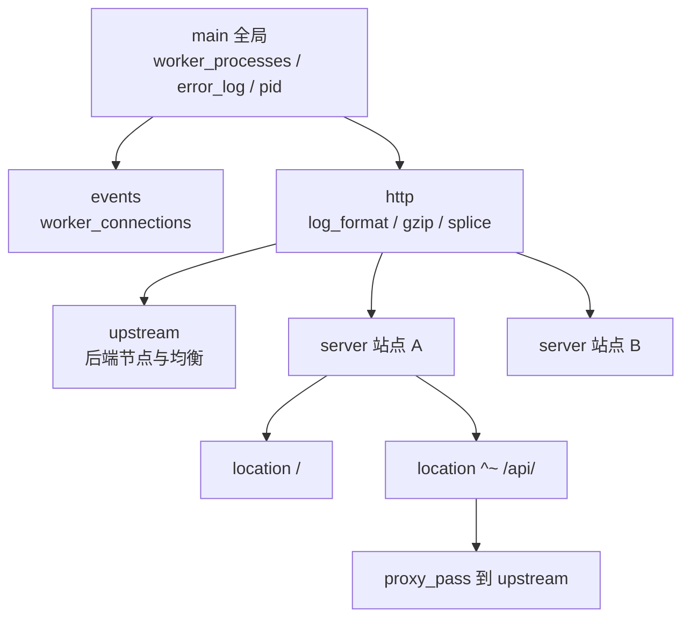

# 10.08 Nginx的全部配置

前四节里的配置都是一段一段贴的：为了静态站点贴三行，为了反代贴五行，为了灰度贴一个 `map`。真正维护一个站点时，这些片段必须落成**一份能放进仓库、能被 Code Review、能在机器上被 `nginx -T` 完整打印出来的配置**。这一节把 Nginx 配置的层级讲清楚，再给一份按层组织的完整配置，最后列常用指令的取值与默认值。

> 指令默认值对照 Nginx 1.30 文档；配置没有在你的 VPS 上跑过，`nginx -t` 的输出是预期结果。

## 一、配置是一棵树，不是一堆指令

Nginx 是**层级配置**：每层只能写该层允许的指令，写错层会直接报 `directive is not allowed here`。



记忆方法：**`http` 里的东西所有站点共享，`server` 里的东西只对一个域名生效，`location` 里的东西只对一类路径生效**。想「全局生效」又不想复制，Nginx 没有变量继承之外的机制——要么写在 `http`，要么用 `include` 片段。

## 二、main 与 events：进程、日志、连接上限

```nginx
user  nginx;
worker_processes auto;              # 等于 CPU 核数，别再手写 4
pid /run/nginx.pid;
error_log /var/log/nginx/error.log warn;

events {
    worker_connections 4096;        # 单 worker 并发连接上限
    multi_accept on;                # 一次 accept 多个连接，高并发下略快
    use epoll;                      # Linux 默认就是 epoll，显式写更清楚
}
```

三个经验值：`worker_processes auto` 覆盖绝大多数场景；`worker_connections` 每 1000 个大约占用几 MB 内存，4096 对 6 核机器是够的；`error_log` 级别平时用 `warn`，排障时临时调 `info`（但要记得改回来，info 会写海量日志）。

## 三、http 层：影响速度的六个默认值

这一层都是「一次配好、长期受益」的开关，除了 `gzip` 之外默认值大多已经合理，值得动的是这几行：

```nginx
http {
    include       /etc/nginx/mime.types;
    default_type  application/octet-stream;

    sendfile        on;      # 内核直接拷贝文件，静态资源必开
    tcp_nopush      on;      # 与 sendfile 配合，等包装满再发
    tcp_nodelay     on;      # 长连接上小包立即发，与 tcp_nopush 并不冲突

    keepalive_timeout  65s;  # 客户端连接空闲多久关闭
    keepalive_requests 1000; # 单连接最多处理多少请求

    types_hash_max_size 2048;
    server_tokens off;       # 不在响应头里暴露版本号

    client_max_body_size 20m;
    client_body_timeout  15s;
    send_timeout         15s;

    gzip on;
    gzip_comp_level 5;
    gzip_min_length 1024;
    gzip_vary on;
    gzip_types text/plain text/css application/javascript application/json
               application/xml image/svg+xml;
}
```

`sendfile + tcp_nopush` 是静态文件的组合拳，`tcp_nodelay` 则用于「小响应立即发出」——三者不是互斥，Nginx 在内部按场景切换。`server_tokens off` 只去掉版本号（仍会显示 `nginx`），要彻底隐藏得改源码或用第三方模块，安全扫描里一般只要求前者。

`gzip_static` 是另一个常被忽略的开关：如果构建时已经生成了 `.gz` 文件（Vite 插件、`gzip -k`），开它能省掉实时压缩的 CPU：

```nginx
gzip_static on;   # 需要 ngx_http_gzip_static_module，官方镜像已内置
```

## 四、server 层：域名怎么匹配

```nginx
server {
    listen 443 ssl;
    http2 on;
    server_name meeting.example.net www.meeting.example.net;

    listen 80 default_server;   # 可选：未匹配到任何域名的请求落到这里
    server_name _;
    return 444;                 # 直接断开，挡掉扫描器
}
```

`server_name` 的匹配顺序是：**精确名字 → 前缀通配 `*.example.net` → 后缀通配 `mail.*` → 正则 `~^www\d+\.`** → 都没命中则交给 `default_server`（没显式指定就是第一个 server 块）。

这就解释了「为什么我的域名指向了别的站点」：没配 `default_server` 时，**第一个 server 块**会吃掉所有未知域名的请求，包括别人拿 IP 直接访问、以及扫描器乱填 Host。给默认块 `return 444`（Nginx 特有，直接断连接、不回响应）是最省事的处理。

## 五、location 层：静态资源的四件套

```nginx
location / {
    root /usr/share/nginx/html;
    index index.html;
    try_files $uri $uri/ /index.html;
    expires 1h;                       # 没有哈希的 HTML 只给短缓存
    add_header Cache-Control "public";
}

location ^~ /assets/ {
    root /usr/share/nginx/html;
    expires 1y;
    add_header Cache-Control "public, immutable";
    access_log off;                   # 静态资源不写访问日志，省 IO
}

location = /favicon.ico { log_not_found off; access_log off; }
location = /robots.txt  { log_not_found off; access_log off; }
```

`open_file_cache` 是读多写少场景的隐藏加速项，把文件描述符与元数据缓存起来，静态站 QPS 高时能省掉大量 `stat` 系统调用：

```nginx
open_file_cache max=10000 inactive=60s;
open_file_cache_valid 60s;
open_file_cache_min_uses 2;
```

`error_page` 要放在 `server` 或 `location` 里，注意**自定义错误页自身不能再触发同一个 error_page**（否则 500 循环）：

```nginx
error_page 502 503 504 /50x.html;
location = /50x.html {
    root /usr/share/nginx/html;
    internal;                          # 只能内部跳转，外部访问 404
}
```

## 六、上游与代理：一组指令，按症状调

`proxy_*` 有几十个参数，真正需要理解的是这几类：

```nginx
upstream api_upstream {
    least_conn;
    server api:3000 max_fails=2 fail_timeout=10s;
    keepalive 32;
}

location /api/ {
    proxy_pass http://api_upstream;
    proxy_http_version 1.1;
    proxy_set_header Connection "";
    proxy_set_header Host $host;
    proxy_set_header X-Real-IP $remote_addr;
    proxy_set_header X-Forwarded-For $proxy_add_x_forwarded_for;
    proxy_set_header X-Forwarded-Proto $scheme;

    # 连接与响应超时
    proxy_connect_timeout 5s;
    proxy_send_timeout 30s;
    proxy_read_timeout 30s;

    # 缓冲：默认开启，响应先落盘再发给客户端
    proxy_buffering on;
    proxy_buffers 8 16k;
    proxy_buffer_size 32k;
    proxy_busy_buffers_size 64k;
}
```

排症状对照：**502** 多为后端没起来或端口不通；**504** 是后端在 `proxy_read_timeout` 内没返回（长任务、慢查询）；**上传 413** 是 `client_max_body_size`；**大响应被截断**是 `proxy_buffer_size` 太小（响应头放不下）；**SSE/流式无输出**是 `proxy_buffering` 没关。

`proxy_buffering` 默认开启是合理的：把慢客户端和快后端解耦，后端能尽快释放连接。只有流式接口要关掉。

## 七、安全与限流：写在 http 与 location 两层

```nginx
# http 层：按 IP 限速/限连接
limit_req_zone  $binary_remote_addr zone=api:10m rate=30r/s;
limit_conn_zone $binary_remote_addr zone=perip:10m;

# server 层：安全响应头
add_header X-Content-Type-Options nosniff always;
add_header X-Frame-Options SAMEORIGIN always;
add_header Referrer-Policy strict-origin-when-cross-origin always;
add_header Strict-Transport-Security "max-age=15552000" always;   # 仅 HTTPS
```

`always` 关键字很关键：不加它，**只有 2xx/3xx 响应才带这些头**，4xx/5xx 不带，扫描器会判你不合规。

限流要写在具体的 `location` 上才生效，`limit_req` 的 `burst` 与 `nodelay` 在上一节讲过，这里只补一条：`limit_req_status 429` 显式声明返回码，不要让它默认返回 503（503 会被监控当成服务不可用，触发误告警）。

## 八、配置文件怎么组织

**不要把 300 行全塞进 `nginx.conf`**。官方镜像和发行版都留了 `include` 钩子，按「一个站点一个文件」拆：

```
/etc/nginx/
  nginx.conf                      # main + events + http 公共部分 + include
  conf.d/*.conf                   # 站点配置（官方镜像默认只有 default.conf）
  snippets/proxy-common.conf      # 反复出现的 proxy_set_header 组
  snippets/ssl-common.conf
```

```nginx
# nginx.conf 的 http 段末尾
include /etc/nginx/conf.d/*.conf;
```

**include 的顺序就是文件名字典序**，`10-`、`20-` 这种前缀比 `a.conf`、`b.conf` 更可控。把公共的 `proxy_set_header` 抽成 snippet，能让每个站点的 `location` 只剩差异部分：

```nginx
# snippets/proxy-common.conf
proxy_http_version 1.1;
proxy_set_header Connection "";
proxy_set_header Host $host;
proxy_set_header X-Real-IP $remote_addr;
proxy_set_header X-Forwarded-For $proxy_add_x_forwarded_for;
proxy_set_header X-Forwarded-Proto $scheme;
```

```nginx
location /api/ {
    include snippets/proxy-common.conf;
    proxy_pass http://api_upstream;
}
```

配置进 Git 之后，机器上的 `/etc/nginx` 只是**部署产物**：改配置走「改仓库 → 同步 → `nginx -t` → reload」，而不是直接 `vim` 线上文件。这样才有 diff、有回滚、有 review。

**多环境配置**借官方镜像的模板机制就够了：把文件放在 `/etc/nginx/templates/` 下、以 `.template` 结尾，容器启动时会把其中的 `${VAR}` 替换成环境变量再落到 `/etc/nginx/conf.d/`。它只替换「确实定义了的环境变量」，所以配置里的 Nginx 变量（`$host`、`$uri`）不会被误伤：

```yaml
services:
  web:
    image: nginx:1.30-alpine
    environment:
      SERVER_NAME: meeting.example.net
      API_UPSTREAM: api:3000
    volumes:
      - ./nginx/templates:/etc/nginx/templates:ro
```

```nginx
# nginx/templates/default.conf.template
server {
    listen 80;
    server_name ${SERVER_NAME};
    location /api/ { proxy_pass http://${API_UPSTREAM}; }
}
```

这一招让「同一份配置跑在测试与生产」成为可能，代价是**不要把有默认语义的变量留空**：`${API_UPSTREAM}` 没定义时会原样留在配置里，`nginx -t` 直接失败——这反而是好事，比静默连到错误地址强。

## 九、变量与 map：Nginx 的「编程」能力

Nginx 没有函数，但有一套内置变量和一个 `map` 指令，两者组合能覆盖大部分「按条件改行为」的需求。

内置变量里最常用的十几个，记下来能少查一半文档：

| 变量 | 含义 | 典型用途 |
| --- | --- | --- |
| `$host` | 请求头 Host（不含端口） | 多域名分流、日志 |
| `$request_uri` | 原始 URI（含查询串，未解码） | 反代保路径、跳转 |
| `$uri` | 规范化后的路径（解码、去 `//`） | `try_files`、location |
| `$args` / `$query_string` | 查询串 | 拼接跳转 |
| `$remote_addr` | 客户端 IP（受 realip 模块影响） | 限流、日志 |
| `$http_*` | 任意请求头，如 `$http_user_agent` | 灰度、UA 判断 |
| `$cookie_*` | 任意 cookie，如 `$cookie_uid` | 灰度、区域偏好 |
| `$upstream_addr` | 本次请求命中的后端地址 | 排查到底哪台机器 |
| `$upstream_response_time` | 后端耗时 | 慢请求定位 |
| `$request_id` | 自动生成的唯一 ID | 全链路日志关联 |

`map` 的用途是**从已有变量派生新变量**，它是 Nginx 里唯一可以写「条件分支」的主流方式（`if` 不推荐在 location 里用，见下一节）：

```nginx
http {
    # 把 Host 映射成后端池
    map $host $api_pool {
        api.example.net   api_upstream;
        admin.example.net admin_upstream;
        default           api_upstream;
    }

    # 把 UA 映射成是否允许缓存
    map $http_user_agent $cache_ok {
        default        1;
        ~*(bot|spider) 0;
    }

    # 多值匹配与正则
    map $request_method $is_write {
        default 0;
        POST    1;
        PUT     1;
        DELETE  1;
    }
}
```

`map` 的三条硬规则：**只能写在 `http` 层**；**结果只在请求开始时计算一次**（同一请求内不变）；**不能给内置变量赋值**（想让 `$uri` 变只能用 `rewrite`）。理解第三条能省掉很多「我 map 了为什么没生效」的困惑。

## 十、rewrite 与 return：跳转要写对

`return` 用来「结束处理、直接返回」，`rewrite` 用来「改写 URI 再继续匹配」。跳转场景优先用 `return`，因为它不会重新走 location 匹配、语义最清楚：

```nginx
server {
    listen 80;
    server_name example.net;
    return 301 https://example.net$request_uri;   # 整站跳 HTTPS
}

location = /old-page {
    return 301 /new-page;                          # 单页跳转
}

location /legacy/ {
    rewrite ^/legacy/(.*)$ /v2/$1 permanent;      # 正则改写 + 301
}
```

`rewrite` 的标志位决定流程：`last`（改写后重新匹配 location，最常用）、`break`（改写后在本 location 继续处理）、`redirect`（302）、`permanent`（301）。**`permanent` 会被浏览器长期缓存**，路径试错阶段先用 302，确认稳定再换 301。

关于 `if` 的经典警告「if is evil」，准确的含义是：**`if` 写在 `location` 里会创建一个隐式嵌套的 location，只有少数指令（`return`、`rewrite`、`set`）行为符合直觉**。所以：

```nginx
# 不要这样（proxy_pass 写在 if 里，行为不可预期）
if ($cookie_gray = "1") { proxy_pass http://api_v2; }

# 应该这样（用 map 派生变量，proxy_pass 只写一次）
map $cookie_gray $api_pool { default api_v1; "1" api_v2; }
location /api/ { proxy_pass http://$api_pool; }
```

## 十一、出问题时先看哪

配置写对了也可能出问题，Nginx 的排障顺序是固定的四步：

1. **`nginx -t`**：语法与文件存在性。这一步不过，其余都别谈。
2. **`nginx -T`**：打印合并后的真实配置。用来确认「改的东西真的被加载了」，尤其是 `include` 与容器挂载。
3. **`error_log` 提到 `debug`**：临时改 `error_log /var/log/nginx/error.log debug;`，能看到请求匹配了哪个 location、走了哪个 upstream、命中了哪条 rewrite。抓完一轮立刻改回 `warn`，debug 日志量极大。
4. **`stub_status`**：想知道「现在到底有多少连接、有没有堆积」，开一个内部状态页：

```nginx
location = /nginx-status {
    stub_status;
    allow 127.0.0.1;
    deny all;
}
```

```bash
curl -s http://127.0.0.1/nginx-status
# Active connections: 12
# server accepts handled requests
#  1024 1024 5120
# Reading: 0 Writing: 1 Waiting: 11
```

`Waiting` 高说明是长连接空闲（正常，比如 keepalive 的客户端）；`Reading` 持续高说明请求头收不完（多半是慢客户端攻击）；`Writing` 高则是后端慢导致响应写不出去，这时去查 `urt`。

## 十二、TLS 与 HTTP/2 的几个补充

上一节给了 TLS 的最小配置，生产环境还值得加三行：

```nginx
ssl_session_tickets off;                 # 关闭会话票据，换取前向安全性
ssl_stapling on;                         # OCSP 装订，省掉客户端查询 CA 的往返
ssl_stapling_verify on;
resolver 223.5.5.5 1.1.1.1 valid=300s;   # OCSP 与变量 proxy_pass 都需要 resolver
```

`resolver` 是个容易漏的点：**只要配置里出现了运行时才解析的域名**（`proxy_pass http://$backend;`、OCSP、`auth_request`），就必须显式给 DNS 服务器，Nginx 启动时不会校验，只在运行时报 `no resolver defined to resolve ...`。

HTTP/2 已经用一行 `http2 on;` 开启（1.25 起取代了旧的 `listen 443 ssl http2` 写法）。HTTP/3 需要 `listen 443 quic reuseport;` 与 `add_header Alt-Svc`，还依赖编译时带 QUIC 模块，官方 `nginx:alpine` 镜像默认**不带**——想用就得换镜像或自编译，对本书的项目不是必需项，知道「有这回事、要单独编译」即可。

## 十三、常用指令速查：默认值，与建议值

维护配置时最耗时的不是写，而是「这个值默认是多少、我要不要改」。下表只列真正会被问到的：

| 指令 | 默认值 | 建议 | 原因 |
| --- | --- | --- | --- |
| `worker_processes` | `1` | `auto` | 吃满多核，反代/静态都受益 |
| `worker_connections` | `512` | `4096` | 每个反代连接占两个计数 |
| `keepalive_timeout` | `75s` | `65s` | 略低于常见负载均衡的空闲超时，避免被上游主动断开 |
| `sendfile` | `off` | `on` | 静态文件零拷贝 |
| `tcp_nopush` | `off` | `on` | 与 sendfile 配合，减少小包 |
| `client_max_body_size` | `1m` | 按业务（如 `20m`） | 上传必踩 413 |
| `client_body_timeout` | `60s` | `15s` | 慢客户端占连接 |
| `proxy_read_timeout` | `60s` | `30s`，长任务单独放开 | 默认值对长连接太长、对慢查询太短 |
| `proxy_buffering` | `on` | `on`，流式接口关 | 解耦慢客户端与快后端 |
| `server_tokens` | `on` | `off` | 不暴露版本号 |
| `gzip` | `off` | `on` | 文本类响应显著省带宽 |
| `add_header` | 仅 2xx/3xx | 加 `always` | 错误响应也需要安全头 |
| `error_log` | `logs/error.log` | 绝对路径 + `warn` | 容器里相对路径容易写错位置 |

这张表的用法不是「全改一遍」，而是**新站点上线前对照一遍改造项**：默认值大多是对的，改的都是与业务相关的四五个（体积、超时、压缩、缓存）。

## 十四、上线前的配置 Review 清单

配置写完后，用这十条自查，能挡掉绝大多数低级错误：

1. 每个 `server` 都有明确的 `server_name`，且存在一个 `default_server` 兜底；
2. 所有 `add_header` 都带 `always`；
3. `client_max_body_size` 与业务上传上限一致，且应用侧也校验；
4. 动态路径用 `^~` 或 `=` 提权，避免被静态正则抢走；
5. `proxy_set_header` 三件套（Host / X-Real-IP / X-Forwarded-For）齐全，应用开了 `trust proxy`；
6. 所有 `proxy_pass` 的结尾斜杠都确认过语义（保前缀还是剥前缀）；
7. 长连接/流式接口单独配了超时与 `proxy_buffering off`；
8. `error_page` 指向 `internal` 的静态页，不会递归；
9. 配置在 Git 里，机器上只是部署产物，`nginx -T` 与仓库一致；
10. 改完必须 `nginx -t && nginx -s reload`，并看 `error_log` 三分钟无新告警。

## 十五、一份可直接用的完整配置

把上面所有层拼起来（域名与路径换成你的）：

```nginx
user  nginx;
worker_processes auto;
error_log /var/log/nginx/error.log warn;
pid /run/nginx.pid;

events {
    worker_connections 4096;
    multi_accept on;
}

http {
    include /etc/nginx/mime.types;
    default_type application/octet-stream;

    sendfile on;
    tcp_nopush on;
    tcp_nodelay on;
    keepalive_timeout 65s;
    server_tokens off;

    client_max_body_size 20m;
    client_body_timeout 15s;
    send_timeout 15s;

    gzip on;
    gzip_comp_level 5;
    gzip_min_length 1024;
    gzip_vary on;
    gzip_types text/plain text/css application/javascript application/json image/svg+xml;

    log_format main '$remote_addr [$time_local] "$request" $status '
                    'rt=$request_time urt=$upstream_response_time '
                    'ua=$upstream_addr rid=$request_id';
    access_log /var/log/nginx/access.log main;

    limit_req_zone $binary_remote_addr zone=api:10m rate=30r/s;
    limit_conn_zone $binary_remote_addr zone=perip:10m;

    upstream api_upstream {
        least_conn;
        server api:3000 max_fails=2 fail_timeout=10s;
        keepalive 32;
    }

    server {
        listen 80 default_server;
        server_name _;
        return 444;
    }

    server {
        listen 80;
        server_name meeting.example.net;
        return 301 https://$host$request_uri;
    }

    server {
        listen 443 ssl;
        http2 on;
        server_name meeting.example.net;

        ssl_certificate     /etc/nginx/certs/fullchain.pem;
        ssl_certificate_key /etc/nginx/certs/privkey.pem;
        ssl_protocols       TLSv1.2 TLSv1.3;
        ssl_session_cache   shared:SSL:10m;
        ssl_session_timeout 1d;

        add_header X-Content-Type-Options nosniff always;
        add_header Referrer-Policy strict-origin-when-cross-origin always;

        root /srv/meeting/web/current;
        index index.html;

        location ^~ /api/ {
            limit_req zone=api burst=60 nodelay;
            limit_req_status 429;
            limit_conn perip 20;
            include snippets/proxy-common.conf;
            proxy_pass http://api_upstream;
            proxy_connect_timeout 5s;
            proxy_read_timeout 30s;
        }

        location ^~ /assets/ {
            expires 1y;
            add_header Cache-Control "public, immutable";
            access_log off;
        }

        location / {
            try_files $uri $uri/ /index.html;
            add_header Cache-Control "no-store";
        }

        error_page 502 503 504 /50x.html;
        location = /50x.html {
            root /usr/share/nginx/html;
            internal;
        }
    }
}
```

这份配置的每一段在前面都解释过，它的价值在于**层级正确**：全局开关在 `http`、站点在 `server`、路径在 `location`、公共片段在 `include`。

## 十六、Checkpoint

```bash
# 1) 语法通过
docker exec meeting-web nginx -t
# 期望：nginx: configuration file /etc/nginx/nginx.conf test is successful

# 2) 打印合并后的完整配置（含 include），确认自己的块真的生效
docker exec meeting-web nginx -T | grep -nE 'server_name|proxy_pass|limit_req'

# 3) 看编进了哪些模块（gzip_static、http2 是否可用）
docker exec meeting-web nginx -V 2>&1 | tr ' ' '\n' | grep -E 'gzip_static|http_v2|realip'

# 4) reload 后确认新 worker 接管
docker exec meeting-web nginx -s reload
docker exec meeting-web ps aux | grep 'nginx: worker'
```

`nginx -T` 是排查「我明明改了为什么没生效」的终极手段：它打印的是**合并后真正被加载的配置**，能立刻看出 include 路径写错、文件没挂进容器、或者被后面的块覆盖。

## 十七、坑表

| 现象 | 原因 | 处理 |
| --- | --- | --- |
| `directive is not allowed here` | 指令层级写错 | 对照层级：`proxy_*` 在 location/server，`log_format` 在 http |
| 改完不生效 | 改的是宿主文件但容器挂载路径不同 / 没 reload | `nginx -T` 查真实内容，再 `-t && reload` |
| 未匹配域名跑到别的站 | 没有 `default_server` | 加默认块 `return 444` |
| 4xx/5xx 缺安全头 | `add_header` 没加 `always` | 全部加 `always` |
| 静态 404 但文件确实在 | `root` vs `alias` 语义搞混 | 目录映射用 `root`，路径替换用 `alias`（带尾斜杠） |
| 大文件上传 413 | `client_max_body_size` | 调大并同步应用侧限制 |
| 503 告警误报 | 限流默认返回 503 | `limit_req_status 429` |
| 自定义 50x 页导致 500 循环 | 错误页自身又触发 error_page | 错误页 location 加 `internal`，不要指向代理路径 |

至此 ch10 的「配置 + 容器 + 发布」链路完成：10.05 镜像往哪放、10.06 请求怎么进来、10.07 新版本怎么安全放量、10.08 配置怎么长期维护。下一节开始处理「多实例下的会话」——同一份配置、多台后端的第一个真问题。

<!-- chapter-nav:start -->
---

← [10.07 基于Nginx实现灰度系统](10.07-基于Nginx实现灰度系统.md) · [本章目录](_chapter.md) · [10.09 基于Redis实现分布式session](10.09-基于Redis实现分布式session.md) →
<!-- chapter-nav:end -->
