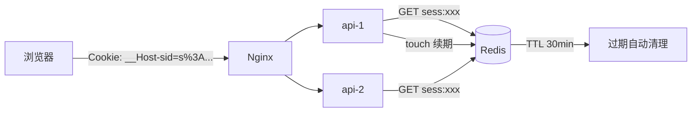

# 10.09 基于Redis实现分布式session

09.01 讲会话方案时留了一个伏笔：Session 存在进程内存里，单机没问题，**一旦 `--scale api=3`，用户就会「登录成功、刷新就掉线」**。这一节把这个问题彻底解决：让会话离开进程，落到 Redis，并处理随之而来的过期、并发、吊销与故障降级。

> 环境对照 `express-session` 1.19、`connect-redis` 11、`redis` 5（node-redis）、ioredis 6；本节命令没有在你的 VPS 上实测，输出为预期结果。

## 一、先复现故障

两个副本、Nginx 轮询（10.06 的 upstream 配置），登录后连续请求，现象是这样的：

```bash
for i in $(seq 6); do
  curl -s -o /dev/null -w '%{http_code} ' \
    -b "sid=$SID" http://127.0.0.1/api/me/profile
done
# 期望看到：200 401 200 401 200 401
```

因为两次请求可能落到不同容器，而 `req.session` 只存在于处理登录的那个进程内存里。三种「急救」方案各有硬伤：

| 方案 | 做法 | 问题 |
| --- | --- | --- |
| 粘性会话 | Nginx `ip_hash` / cookie 哈希 | 扩缩容时大量用户被重新分配；某实例挂掉，其上用户全部掉线 |
| 会话复制 | 实例间广播内存 | 实例一多就变成 O(n²) 流量，实现复杂，几乎没人用 |
| 集中存储 | Session 存 Redis/DB | 多一次网络往返（亚毫秒），换来无状态扩展——**正确解** |

## 二、结构先定：cookie 里放什么，Redis 里放什么



- **浏览器只拿到一个签名过的 session id**（`s:<sid>.<hmac>`），不含任何用户数据；
- **Redis 里存整份 session**（`userId`、`role`、`createdAt` 等），key 形如 `sess:<sid>`；
- 每次请求由后端用 sid 去 Redis 取，取不到就是未登录。

这个结构的直接好处：改权限、踢用户、强制下线，**删 Redis key 立刻生效**，不用等 JWT 过期——这也是 Session 相比无状态 JWT 唯一且重要的优势。

## 三、接入：express-session + connect-redis

Nest 没有官方 session 模块，直接挂 Express 中间件即可。注意 **ESM 下 `connect-redis` 是默认导出**，`RedisStore` 要解构：

```ts
// src/main.ts
import session from 'express-session';
import { RedisStore } from 'connect-redis';
import { createClient } from 'redis';
import { NestFactory } from '@nestjs/core';
import { AppModule } from './app.module.js';

const app = await NestFactory.create(AppModule);
app.set('trust proxy', 1);            // 10.06：不设它，secure cookie 与 IP 都是错的

const redis = createClient({ url: process.env.REDIS_URL });
await redis.connect();

app.use(
  session({
    store: new RedisStore({ client: redis, prefix: 'sess:', ttl: 1800 }),
    name: '__Host-sid',               // __Host- 前缀要求 Secure + Path=/ + 不带 Domain
    secret: process.env.SESSION_SECRET!,
    resave: false,                     // 没改动就不重写，减少 Redis 写入
    saveUninitialized: false,          // 未登录的访客不建 session（否则爬虫能撑爆 Redis）
    rolling: true,                     // 每次请求都续期，实现「30 分钟不操作才过期」
    cookie: {
      httpOnly: true,
      secure: true,                    // 本地调试用 http 时设为 false
      sameSite: 'lax',
      path: '/',
      maxAge: 30 * 60 * 1000,
    },
  }),
);

await app.listen(Number(process.env.PORT ?? 3000));
```

四个参数的取舍，每一条都对应一个坑：

- `saveUninitialized: false`：不开的话，每个未登录访客都会在 Redis 里建一个空 session，爬虫扫一遍就是几十万 key；
- `resave: false`：配合 `rolling` 时，express-session 只在 `touch` 时才续期，不会每个请求都全量写；
- `rolling: true` 会让**每个响应都带 `Set-Cookie`**，代价是响应头变大，换来「活跃用户不会中途掉线」；
- `name: '__Host-sid'`：`__Host-` 前缀是浏览器强制的安全约束（必须 Secure、Path=/、无 Domain），能挡掉子域覆盖 cookie 的攻击。

## 四、并发写：同一会话的两个请求谁赢

把会话搬到 Redis 只是解决了「哪台机器都能读到」，还有个更隐蔽的问题：**同一个 sid 的两个并发请求，后写的会覆盖先写的**。

典型场景：前端进入页面时并行发出 `/api/me` 和 `/api/stats`。express-session 在请求结束时才落盘，两个请求读到的都是旧 session，各自改完再写回，最后完成的那个把另一个的修改吞掉。如果 session 里只放 `userId`、`role` 这类**登录后不再变**的字段，这个问题不存在；一旦你把「购物车」「当前步骤」「上次访问时间」这类可变状态也放进去，就会出现「刚加的商品消失」这种玄学 bug。

结论是两条纪律：

1. **session 只放身份**（谁、什么角色、什么时候登录的），业务状态放数据库；
2. 必须放的可变状态，用**字段级合并**（读 → 改 → 写时只更新自己那个字段）或干脆独立 key（`sess:cart:<sid>`），不要共享一个 JSON 文档。

顺带一个实现细节：`connect-redis` 的 `set` 是整体覆盖（`SET key value EX ttl`），没有 merge 语义；自写 store 时如果想做「只续期不改内容」，就把这件事交给 `touch`（`EXPIRE`），不要每次请求都 `SET` 一遍——后者在 1,000 rps 下就是每秒一千次全量写，纯属浪费。

## 五、登录、登出与「会话固定」攻击

会话固定（session fixation）是最容易被忽略的漏洞：攻击者先拿到一个 sid，诱导受害者用这个 sid 登录，之后攻击者就能用同一个 sid 冒充受害者。防御只有一招——**登录成功后换一个全新的 sid**：

```ts
// auth.controller.ts
@Post('login')
@HttpCode(200)
async login(@Body() dto: LoginDto, @Req() req: Request) {
  const user = await this.auth.validate(dto);      // 校验邮箱密码

  await new Promise<void>((resolve, reject) =>
    req.session.regenerate((err) => (err ? reject(err) : resolve())),
  );                                                // ← 关键：换 sid，旧数据清空

  req.session.userId = user.id;
  req.session.role = user.role;
  req.session.createdAt = Date.now();
  await new Promise<void>((resolve, reject) =>
    req.session.save((err) => (err ? reject(err) : resolve())),
  );
  return { id: user.id, email: user.email };
}

@Post('logout')
@HttpCode(200)
async logout(@Req() req: Request, @Res({ passthrough: true }) res: Response) {
  await new Promise<void>((resolve) => req.session.destroy(() => resolve()));
  res.clearCookie('__Host-sid', { path: '/' });
  return { success: true };
}
```

`regenerate` 之后必须显式 `save()`，否则响应结束时才异步落盘，紧接着的下一个请求可能读不到新 session（表现为「登录成功但立刻 401」）。`destroy` 之后要 `clearCookie`，否则浏览器还留着旧 cookie，每次请求都带一个不存在的 sid。

## 六、不用 connect-redis：四十行自己写一个 store

09.01 已经给过骨架，这里补上为什么值得自己写：`connect-redis` 11 的 peer 依赖是 **node-redis**，而本书项目用 ioredis（10.11 与 10.05 的 Redis 客户端统一）。同时引入两个客户端不是不行，但你得维护两套连接、两套重连策略。自写 store 的接口只有四个方法：

```ts
// src/session/ioredis-session.store.ts
import type { SessionData, Store } from 'express-session';
import { Redis } from 'ioredis';

export class IoredisSessionStore extends Store {
  constructor(
    private readonly redis: Redis,
    private readonly prefix = 'sess:',
    private readonly ttlSeconds = 1800,
  ) {
    super();
  }

  private key(sid: string) {
    return `${this.prefix}${sid}`;
  }

  get(sid: string, cb: (err: unknown, session?: SessionData | null) => void) {
    this.redis
      .get(this.key(sid))
      .then((raw) => cb(null, raw ? (JSON.parse(raw) as SessionData) : null))
      .catch((err: unknown) => cb(err));
  }

  set(sid: string, session: SessionData, cb?: (err?: unknown) => void) {
    this.redis
      .set(this.key(sid), JSON.stringify(session), 'EX', this.ttlSeconds)
      .then(() => cb?.())
      .catch((err: unknown) => cb?.(err));
  }

  destroy(sid: string, cb?: (err?: unknown) => void) {
    this.redis
      .del(this.key(sid))
      .then(() => cb?.())
      .catch((err: unknown) => cb?.(err));
  }

  touch(sid: string, session: SessionData, cb?: () => void) {
    this.redis
      .expire(this.key(sid), this.ttlSeconds)
      .then(() => cb?.())
      .catch(() => cb?.());
  }
}
```

两个细节：**只存纯数据**（不要 `JSON.stringify` 一个带方法/Date 的对象，`Date` 会变成字符串，取回来类型就错了——存时间戳数字）；`touch` 失败不要抛错，否则 Redis 抖动一下整个请求就 500，续期失败最多是提前过期。

## 七、过期策略：滑动过期 + 绝对上限

`rolling: true` 是滑动过期：只要用户在操作，过期时间就一直续。这带来一个风险——**永不掉线**。安全上一般要加一个绝对上限（比如 7 天），超过就必须重新登录：

```ts
// 全局中间件：绝对过期检查
app.use((req, res, next) => {
  const createdAt = req.session.createdAt;
  const ABSOLUTE_MAX = 7 * 24 * 3600 * 1000;
  if (createdAt && Date.now() - createdAt > ABSOLUTE_MAX) {
    return req.session.destroy(() => {
      res.clearCookie('__Host-sid', { path: '/' });
      res.status(401).json({ message: '登录已过期，请重新登录' });
    });
  }
  next();
});
```

两套时间各自的作用要分清：Redis 的 `TTL` 决定**存储何时被清理**（省内存），cookie 的 `maxAge` 决定**浏览器何时丢弃**（前端体验），业务上的「绝对过期」决定**安全策略**。三者没对齐时会出现「Redis 里 key 还在但浏览器没 cookie」「浏览器有 cookie 但 Redis 已清」这类排查半天的问题，建议三处用同一组常量。

## 八、Redis 侧的三件事：内存、淘汰、观测

会话进了 Redis，Redis 就从「缓存」变成了「**有状态存储**」，配置口径要跟着变：

**内存估算**。一条 session 大约 0.5–1 KB（sid + userId + role + 时间戳）。10 万在线用户 ≈ 100 MB，100 万 ≈ 1 GB。这个量级对 Redis 很轻松，但必须心里有数，因为它决定 `maxmemory` 怎么设。

**淘汰策略**。缓存可以丢，会话不能丢。如果 Redis 和业务缓存共用一个实例、又配了 `allkeys-lru`，内存压力大时 Redis 会**按最近最少使用淘汰 session**——表现就是「部分用户莫名其妙掉线，且不可复现」。正确做法二选一：

- 会话专用实例（或至少专用 DB），`maxmemory-policy noeviction`；
- 共用实例时，会话 key 不设 TTL 之外的淘汰可能，并接受「缓存先死、会话保命」的优先级排序。

Redis 只支持实例级淘汰策略，不能按 key 前缀区分，所以严格来说只有「隔离」这一个干净答案。

**观测**。三个命令够用：

```bash
redis-cli INFO memory | grep -E 'used_memory_human|maxmemory_human'
redis-cli DBSIZE                              # 当前库 key 总数，近似在线会话数
redis-cli --bigkeys                           # 找出异常大的 session（不该超过几 KB）
redis-cli --scan --pattern 'sess:*' | wc -l   # 精确统计（生产用 --scan，别用 KEYS）
```

`KEYS sess:*` 在生产上是事故——单线程 Redis 会被它阻塞几百毫秒，所有请求一起超时。用 `SCAN` 系列（`--scan`、`SSCAN`、`HSCAN`）。

**安全**。Redis 里存的是「谁登录了」，它比缓存敏感得多：必须只监听内网（`bind 127.0.0.1` + 内网地址）、开 ACL 给独立账号最小权限、禁止 `requirepass` 那种共享口令；日志里打印 cookie 或 session 内容同样是泄露——`express-session` 的 sid 就等于密码。


**性能代价**。每个已登录请求都会多一次 `GET`（+`EXPIRE`）。同机房 RTT 约 0.1–0.3 ms，相比业务里一次数据库查询可以忽略；但要注意三点：连接必须复用（ioredis/node-redis 都是长连接池，别在每个请求里 `new Redis()`）；Redis 不可压缩成同步阻塞点，所以超时要短（`commandTimeout`/`connectTimeout` 各 1–2 s），失败就 fail-closed 快速返回；高并发下用 `pipeline` 把「GET session + 其他 Redis 读」合并成一次往返。想靠本地缓存减少 Redis 访问是行不通的——多实例之间会读到过期会话，踢人也不会立刻生效，那等于把分布式会话又做回了单机会话。

## 九、多端登录与踢人

Session 存 Redis 的一个隐藏福利：可以做「同一账号在线设备管理」。思路是**反向索引**——按 `userId` 维护一个 sid 集合：

```ts
// 登录成功后登记
await redis.sadd(`sess:user:${user.id}`, sid);
await redis.expire(`sess:user:${user.id}`, 7 * 24 * 3600);

// 踢掉某用户的全部会话（改密码、封号、异地登录告警）
const sids = await redis.smembers(`sess:user:${user.id}`);
if (sids.length) {
  await redis.del(...sids.map((s) => `sess:${s}`));
  await redis.del(`sess:user:${user.id}`);
}
```

要注意集合里会残留已过期的 sid（Redis 不会自动从 set 里清理），所以「踢人」时 `del` 不存在的 key 是正常操作，不用报错；定期用 `SSCAN` + 检查 TTL 清理一遍即可。

如果还要「只允许一个设备在线」，登录时先踢掉旧会话再登记新的即可——这种「后登录挤掉先登录」的策略比 JWT 好实现得多，JWT 只能等过期或维护一个黑名单。

## 十、Redis 挂了怎么办

集中存储把 Redis 变成了**单点**。这里必须做一个明确选择，而不是让它随机表现：

- **fail-closed**（推荐）：Redis 不可用 → 所有需要登录的接口返回 503/401。安全，但可用性下降；
- **fail-open**：Redis 不可用 → 当作未登录？那等于全员掉线；当作已登录？那是安全灾难。

正确做法是 fail-closed + 快速失败 + 健康检查：连接加 `maxRetriesPerRequest: 2`、`enableOfflineQueue: false`，避免请求在队列里堆积把内存吃爆；`/api/health` 里加一条 Redis `PING`（18 章的健康检查会展开）。同时给 Redis 开 AOF（`appendonly yes`，10.02 的 compose 里已经配了），机器重启后会话不丢——虽然大部分用户会重新登录，但正在支付、填表的人不会被打断。

## 十一、Checkpoint

```bash
# 1) 两个副本轮询，登录后连续请求全部 200（故障复现的反向验证）
for i in $(seq 6); do
  curl -s -o /dev/null -w '%{http_code} ' \
    -b "sid=$SID" http://127.0.0.1/api/me/profile
done
# 期望：200 200 200 200 200 200

# 2) Redis 里确实有这条会话，且 TTL 在递减
redis-cli --scan --pattern 'sess:*' | head -3
redis-cli TTL sess:你的sid          # 期望 < 1800 且 > 0

# 3) 登出后 key 消失，旧 cookie 立刻失效
curl -s -X POST -b "sid=$SID" http://127.0.0.1/api/auth/logout
redis-cli EXISTS sess:你的sid        # 期望 0

# 4) 重启一个副本，已登录用户不掉线
docker compose restart api
curl -s -o /dev/null -w '%{http_code}\n' -b "sid=$SID" http://127.0.0.1/api/me/profile
# 期望：200
```

第 4 条是这套方案的意义所在：**进程可以随时死，会话在 Redis 里活着**。

## 十二、什么时候干脆用 JWT

Session 不是银弹。判断标准只有一条：**你需不需要「即时吊销」**。

- 需要（后台管理、资金操作、封号要立刻生效）→ Session，或 JWT + 黑名单（本质又回到有状态）；
- 不需要（公开 API、第三方调用、跨域多端）→ JWT，无状态、易横向扩展、易跨语言。

两者也可以混用：Web 端用 Session（走 cookie，天然防 XSS 读取），App/开放平台用 JWT ——09.01 讲过 BFF 混合模式，这里不再展开。真正要避免的是「两个都上，各自维护一套登录态」，那是给自己造 bug。混用时守卫顺序也要明确：先认 cookie session，再认 `Authorization: Bearer`，两者都有时以显式 Bearer 为准并记录来源（`req.authSource`），方便排查「为什么同一个用户在两个页面上身份不同」。

## 十三、坑表

| 现象 | 原因 | 处理 |
| --- | --- | --- |
| 登录成功，下一秒 401 | 多副本 + 进程内存 session | 换 Redis store |
| 登录成功但立刻 401（单机） | `regenerate` 后没 `save()` | 显式 await save |
| 每个请求都写 Redis，CPU 高 | `resave: true` / `rolling` 全量写 | `resave:false`，只靠 `touch` 续期 |
| Redis 里出现几十万空 session | `saveUninitialized: true` | 改 false |
| 本地 http 调试登录不上 | `secure: true` 时 cookie 不发送 | 开发环境关掉，或上 mkcert |
| 重启后用户全掉线 | Redis 没开 AOF，或用了 `--save ''` | `appendonly yes` |
| 会话永不过期 | 只有滑动续期 | 加绝对上限中间件 |
| 踢人后对方还能操作 | 只删了数据库标志，没删 Redis key | 删 `sess:*` 并清 cookie |
| 灰度后一批用户 400/500 | 新旧版本 `SESSION_SECRET` 不一致，cookie 解签失败 | secret 同源；轮换用数组过渡 |
| 部分用户随机掉线、无法复现 | Redis 与缓存共用，`allkeys-lru` 淘汰了会话 | 会话独立实例，`noeviction` |
| 浏览器有 cookie 但后端不认 | `secure`/`domain`/`name` 三处属性不一致 | 对比 `Set-Cookie` 逐项核对 |

会话解决完，接下来两节离开「基础设施」，用 Redis 做两个真实业务：附近的充电宝（地理查询）与王者荣耀段位排行榜（有序集合）。

<!-- chapter-nav:start -->
---

← [10.08 Nginx的全部配置](10.08-Nginx的全部配置.md) · [本章目录](_chapter.md) · [10.10 Redis+高德地图，实现附近的充电宝](10.10-Redis+高德地图，实现附近的充电宝.md) →
<!-- chapter-nav:end -->
