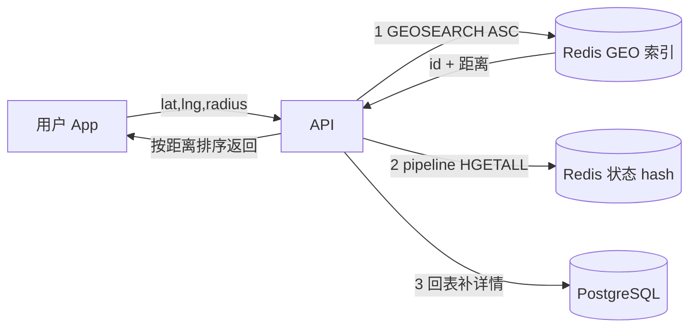

# 10.10 Redis+高德地图，实现附近的充电宝

「附近的充电宝」是地理查询最典型的形态：用户打开 App，要看到身边 1 公里内可借可还的柜机，按距离从近到远排。这一节用 Redis 的 GEO 能力做索引、用高德地图做地址与坐标处理，把它们拼成一个能上线的接口——中间有一个几乎所有人第一次都会踩的坑：**坐标系**。

> 环境对照 Redis 8（GEO 自 3.2 起内置，`GEORADIUS` 自 6.2 起废弃）、`ioredis` 6、高德开放平台 Web 服务 API（`restapi.amap.com/v3`）与 JS API 2.0；本节命令未在你的环境实测，输出为预期形状。

## 一、需求先拆成三个问题

产品说「附近的充电宝」，落到工程上是三件独立的事：

1. **空间索引**：给定一个坐标和半径，找出范围内有哪些柜机——这是 Redis GEO 的活；
2. **实时状态**：每台柜机还剩几个可借、几个空位可还——这是数据库/缓存的活，而且**变化很快**（每次借还都变）；
3. **展示信息**：地址文案、营业时间、图片、导航入口——静态数据，放在 PostgreSQL，按 id 回表。

三者混在一个结构里必然出问题：GEO 的底层是 `ZSET`，score 是编码后的 geohash，你没法在同一个集合里再存「库存」这种高频变化的字段。**索引、状态、详情分开存**，这是这一节最重要的一句话。



## 二、坐标系：第一版「附近」为什么偏了 500 米

中国的地图坐标有三套：

| 坐标 | 来源 | 用途 |
| --- | --- | --- |
| WGS-84 | GPS 原始输出、`navigator.geolocation` | 定位芯片、国际标准 |
| GCJ-02 | 高德、腾讯等国内地图 | 地图展示、导航 |
| BD-09 | 百度地图 | 只在百度生态内 |

GPS 拿到的是 WGS-84，高德地图显示的是 GCJ-02，两者在同一个城市相差约 **100–700 米**，而且方向不固定（不是简单加个偏移量，是加密算法）。所以第一版一定会出现「列表说 80 米，走过去隔了一条街」。

**唯一正确的做法是在写库那一刻就统一坐标系**，而不是在每次查询时转：

- 前端用高德 JS API 的 `AMap.Geolocation` 取坐标，它直接返回 GCJ-02 → 直接传给后端；
- 如果是硬件 GPS/第三方 SDK 给的 WGS-84，先转成 GCJ-02 再入库，转换的近似公式到处都有，但**不要自己写**，用成熟库，并且只在入库和一次性迁移时执行；
- 数据库和 Redis 里**只存 GCJ-02**，并在表注释/字段名里写死（`location_gcj02`）。混存是灾难的开始，因为没人知道某个 id 是不是漏转过。

顺带把「谁在哪一步转」写进接口契约：前端定位接口返回 `{ lat, lng, coordType: 'gcj02' }`，后端入库时断言 `coordType === 'gcj02'`，不匹配直接 400——让错误在写入时就暴露，而不是等用户投诉「位置偏了」。

## 三、Redis GEO 的底层与精度

`GEOADD` 不是魔改的数据类型，它就是 **`ZSET` + 52 位 geohash 编码**：经度、纬度各量化后拼成一个整数当 score。由此推出几条必须知道的事实：

- 距离误差约 **0.6 米**，街道级够用，室内/柜台级不够；
- 因为它就是 zset，`GEOADD`/`GEOSEARCH` 的复杂度是 O(log N + M)，百万级点位也没问题；
- 你可以对同一个 key 用 `ZRANGE`/`ZSCORE`，但**不要**用 `ZADD` 往里塞自己的 score——会破坏编码；
- 一个 key 里的点最好来自**同一区域**（城市/省），跨大洲的点放一起会让 geohash 前缀完全失去邻近性，查询退化。

## 四、写入：柜机点位怎么进 Redis

```ts
// 初始化时批量灌入（数据量小时）
await redis.geoadd(
  'geo:stations',            // key
  ...stations.flatMap((s) => [s.lng, s.lat, String(s.id)]),
);
// 注意参数顺序是 (longitude, latitude, member)，不是 (lat, lng)
```

坑点：`GEOADD` 的参数顺序是**经度在前**，而人的直觉和大多 GPS API 是「纬度在前」。写反了不会报错，只会在几公里外冒出一堆点位，非常迷惑。建议封装成 `addStation(id, lat, lng)`，在内部完成顺序交换。

点位变更（新增柜机、柜机撤走）用 `GEOADD` 覆盖或 `ZREM`；全量重建用临时 key + `RENAME`，避免查询看到空窗。

## 五、查询：GEOSEARCH 一次拿全

```ts
// 附近 3 公里内、按距离升序、最多 20 个、带距离
const rows = await redis.geosearch(
  'geo:stations',
  'FROMLONLAT', lng, lat,
  'BYRADIUS', 3, 'km',
  'ASC',
  'COUNT', 20,
  'WITHDIST',
);
// 返回形如 [[member, distanceString], ...]（不带 WITHCOORD 时没有坐标）
```

关键参数与取舍：

- `FROMLONLAT` 用于「用户临时位置」；`FROMMEMBER` 用于「以某个柜机为圆心查别的柜机」（如补货路径规划）；
- `BYRADIUS` 圆形半径，`BYBOX` 矩形范围（适合按其屏幕可视区域查，但车/用户移动时体验不如圆形）；
- `COUNT n` 是**硬上限**，`ASC` + `COUNT` 才是「最近的 n 个」；`COUNT` 也接受 `ANY`（拿到 n 个就返回，不排序），除非你要「随便给几个」，否则别加；
- 返回值里的距离是字符串（"1.2345"），要 `Number()` 再格式化「500 米」「1.2 公里」；
- **不要用它做分页**：地理查询没有稳定的 offset。常见的「伪分页」是 `COUNT (page*size)` 然后在内存里 `slice`，页数一深就变成拉几千条；更好的做法是「下拉刷新 / 地图视野移动时重新查」，或按距离分档（500m、1km、3km）而不是页码。

## 六、状态与详情：两次批量读，不要 N+1

GEO 只给 id。拿到 20 个 id 之后，还需要「可借/可还数量」和「地址、营业时间」：

```ts
const ids = rows.map(([id]) => id);

// 1) 实时状态：一次 pipeline 拿齐（hash: station:state:<id>）
const pipe = redis.pipeline();
ids.forEach((id) => pipe.hgetall(`station:state:${id}`));
const states = await pipe.exec();          // [[err, obj], ...]

// 2) 静态详情：一次 SQL（WHERE id = ANY($1)）或 MGET 缓存
const details = await this.stationRepo.findByIds(ids);

// 3) 内存里按 ids 的顺序组装，保证仍是「由近到远」
const byId = new Map(details.map((d) => [d.id, d]));
const list = ids
  .map((id, i) => ({ ...byId.get(id), ...states[i]?.[1], distance: Number(rows[i][1]) }))
  .filter((s) => s.status === 'OPEN' && (s.available > 0 || s.emptySlots > 0));
```

三个要点：

1. **过滤要在组装后做**（或至少在 SQL 里带上状态条件），不能先分页后过滤，否则「20 个里 15 个已满」会让用户看到空列表；
2. `hgetall` 每个 key 一次往返，20 个串行就是 20 次 RTT，必须 pipeline；
3. 状态如果放在 Redis，必须有**写入方**：每次借还成功后在事务提交后更新 hash（与 10.07 的缓存更新纪律一致：先落库、后删/更新缓存）。

## 七、高德能帮你做的两件事

**1. 逆地理编码**：用户允许定位后，把坐标变成「朝阳区望京 SOHO 附近」这种文案，用于列表标题与分享。

```
GET https://restapi.amap.com/v3/geocode/regeo?key={KEY}&location={lng},{lat}&extensions=base
```

注意 `location` 是 `经度,纬度`，并且**必须是 GCJ-02**；传 WGS-84 会偏到隔壁街区。这个接口有免费额度与 QPS 限制，逆地理结果可以按 `geohash 精度 7`（约 150 米）缓存一天——同一栋楼的用户返回同一文案，没必要每次都调。

**2. 地图展示**：JS API 2.0 加载时用 `AMap.Map` + `AMap.Marker`；2.0 起安全密钥（`securityJsCode`）必须配，且**不能明文放前端**——标准做法是在自己的服务端转发或用官方代理方案。移动端还可以用 `AMap.Geolocation` 拿定位（直接给 GCJ-02，省掉转换）。

一个省事的边界处理：**用户拒绝定位**时不要空列表。退化为按城市 + 热门柜机返回，并在 UI 上给「开启定位」的引导；后端接口把 `lat/lng` 设为可选，二者缺失就走 city 分支。

## 八、接口入参要挡住脏坐标

前端传上来的东西不能信。用一份 zod schema 把经纬度、半径和条数一起限死，顺手把可选性也标清：

```ts
// src/modules/stations/dto/nearby-query.schema.ts
import { z } from 'zod';

export const nearbyQuerySchema = z.object({
  lat: z.coerce.number().min(-90).max(90).optional(),
  lng: z.coerce.number().min(-180).max(180).optional(),
  radiusKm: z.coerce.number().min(0.2).max(10).default(1),   // 半径上限 10km
  limit: z.coerce.number().int().min(1).max(50).default(20), // 单次最多 50 条
});

export type NearbyQueryInput = z.infer<typeof nearbyQuerySchema>;
```

两个细节：查询参数永远是字符串，`z.coerce.number()` 在解析时把它转成数字，不用再靠装饰器；`limit` 不设上限的话，一个 `limit=10000` 就能把 Redis 和数据库一起拖垮——这是最常见的一类「前端能传我就敢查」漏洞。`lat`/`lng` 留成可选，是为了让「拒绝定位」的用户还能走城市分支（第七节末尾）。

## 九、数据量、分片与重建

按业务规模决定 key 怎么切，别一上来就想分片：

- **十万级点位以内**：单个 `geo:stations` 足够，`GEOSEARCH` 是 O(log N + M)，查询耗时在毫秒级；
- **百万级以上或全国多城**：按城市切 key（`geo:stations:110000` 北京），查询先由城市编码决定 key，这样 geohash 前缀的局部性最好，也方便单城重建；
- **Redis Cluster**：单 key 内所有点位落在同一 slot，天然没问题；但「多键操作」要小心——上面踢人那种 `DEL` 多个 key 的写法在 Cluster 下会报 `CROSSSLOT`，地理查询本身只读单 key，不受影响。

索引是可以丢的，所以一定要有重建脚本，并且能随时跑：

```bash
# 从 PostgreSQL 重建某城市的 GEO 索引（先写临时 key 再 RENAME，避免空窗）
psql "$DATABASE_URL" -Atc "SELECT id, lng, lat FROM stations WHERE city_code='110000'" \
 | awk -F'|' '{printf "GEOADD geo:stations:110000 %s %s %s\n", $2, $3, $1}' \
 > /tmp/geoadd.txt
redis-cli -n 0 --pipe < /tmp/geoadd.txt
redis-cli RENAME geo:stations:110000:tnew geo:stations:110000   # 若前面用了临时 key
redis-cli --scan --pattern 'geo:stations:*' | wc -l              # 与数据库计数对账
```

对账这一步别省：曾经出现过「数据库加了柜机、GEO 索引忘了写」的问题，用户永远搜不到那台机器，而所有监控都正常——因为接口没有报错。加一条「每小时比对 `ZCARD` 与 `SELECT count(*)`」的巡检，比事后排查便宜得多。

## 十、精度与容错：几个真实边界

- **半径上限**：`BYRADIUS 3 km` 在城里够用，但用户在郊区可能 10 公里内都没有柜机。做法是「先查 1km，结果不足 N 个就自动扩到 3km / 5km」，在响应里带上 `searchedRadius` 让前端提示「已扩大搜索范围」；
- **坐标非法**：`lat` 必须在 -90~90、`lng` -180~180，且要防「0,0」（大西洋上的空值）。schema 里的 `.min()/.max()` 挡住越界，`0,0` 得在组装前额外判一次——它不是越界值，是合法的空坐标；
- **限流**：附近接口是最高频的读接口（每次打开页面都调），务必挂 `@Throttle`，并按 IP/设备号限；
- **要不要缓存结果**：可以，但只缓存「GEO 查出来的 id 列表 + 距离」，按 `geohash7:radius` 做 key、TTL 5–10 秒；状态（可借/可还）必须实时读，否则用户看到「有 3 个可借」跑过去已经被借光。把「位置结果」与「库存状态」分开缓存，是这类 LBS 接口的标准分层；
- **Redis 挂掉**：地理索引丢了不可怕，可以从 PostgreSQL 重建（`SELECT id, lat, lng` 再批量 `GEOADD`），所以要有「重建脚本 + 定时校验数量」；但状态 hash 丢了会影响借还，需以数据库为准回填。

## 十一、完整接口形状

```ts
// stations.controller.ts
import { nearbyQuerySchema } from './dto/nearby-query.schema.js';
import type { NearbyQueryInput } from './dto/nearby-query.schema.js';

@Get('nearby')
@Throttle({ default: { limit: 30, ttl: 60_000 } })
async nearby(@Query({ schema: nearbyQuerySchema }) q: NearbyQueryInput) {
  const { lat, lng, radiusKm = 1, limit = 20 } = q;
  const geo = await this.geo.search(lng, lat, radiusKm, limit);
  const list = await this.assemble(geo);        // 状态 + 详情 + 过滤
  if (list.length === 0 && radiusKm < 5) {
    return this.nearby({ ...q, radiusKm: 5 });  // 自动扩半径一次
  }
  return { searchedRadius: radiusKm, list };
}
```

返回结构固定为 `{ searchedRadius, list: [{ id, name, address, distance, distanceText, available, emptySlots, lat, lng }] }`——**`lat/lng` 返回给前端时仍是 GCJ-02**，与高德地图共用，前端直接画 marker 不会再偏。

## 十二、Checkpoint

```bash
# 写两个点（注意经纬度顺序：lng, lat, member）
redis-cli GEOADD geo:stations 116.481488 39.990464 st-001
redis-cli GEOADD geo:stations 116.490000 40.000000 st-002

# 查 2 公里内、带距离、升序
redis-cli GEOSEARCH geo:stations FROMLONLAT 116.4814 39.9904 BYRADIUS 2 km ASC COUNT 10 WITHDIST
# 期望：st-001 距离接近 0，st-002 在其后

# 两点实际距离（单位 m）
redis-cli GEODIST geo:stations st-001 st-002 m

# 取坐标（验证写入顺序没反）
redis-cli GEOPOS geo:stations st-001
# 期望返回 116.4814… 39.9904…（经度在前）
```

接口侧：带 `${lng},${lat}` 请求 `/api/stations/nearby`，检查返回列表的 `distance` 单调递增、`lat/lng` 与高德地图上同一位置重合。

## 十三、坑表

| 现象 | 原因 | 处理 |
| --- | --- | --- |
| 列表距离都不对，整体偏几百米 | 坐标系混用（WGS-84 与 GCJ-02） | 入库统一 GCJ-02，字段名写死 |
| 附近冒出一堆几公里外的点 | `GEOADD` 经纬度顺序写反 | 封装 `addStation(id, lat, lng)` 内部交换 |
| `GEOSEARCH` 报语法错误 | 用了 `GEORADIUS` 老语法或参数顺序错 | Redis ≥6.2 用 `GEOSEARCH`，`FROMLONLAT` 在前 |
| 列表里全是已满的柜机 | 先取 20 再过滤 | 拉到更多（如 3×limit）或 SQL 带状态条件 |
| 接口 P99 很高 | 20 个 `HGETALL` 串行 | pipeline 批量读 |
| 深分页越翻越慢 | `COUNT page*size` 后 slice | 改为半径扩档/视野查询 |
| 逆地理调用量爆掉 | 每个请求都调高德 | 按 geohash-7 坐标缓存 1 天 |
| 地图上 marker 位置漂移 | 前端传的是 WGS-84、地图是 GCJ-02 | 后端只吐 GCJ-02，前端不再转 |

地理查询到这里就闭环了。最后一节换一个完全不同的 Redis 用法：用有序集合做王者荣耀段位排行榜——那里要解决的不是坐标，而是「同分怎么排、名次怎么实时查、榜单怎么分页」。

<!-- chapter-nav:start -->
---

← [10.09 基于Redis实现分布式session](10.09-基于Redis实现分布式session.md) · [本章目录](_chapter.md) · [10.11 基于Redis实现王者荣耀段位排行榜](10.11-基于Redis实现王者荣耀段位排行榜.md) →
<!-- chapter-nav:end -->
