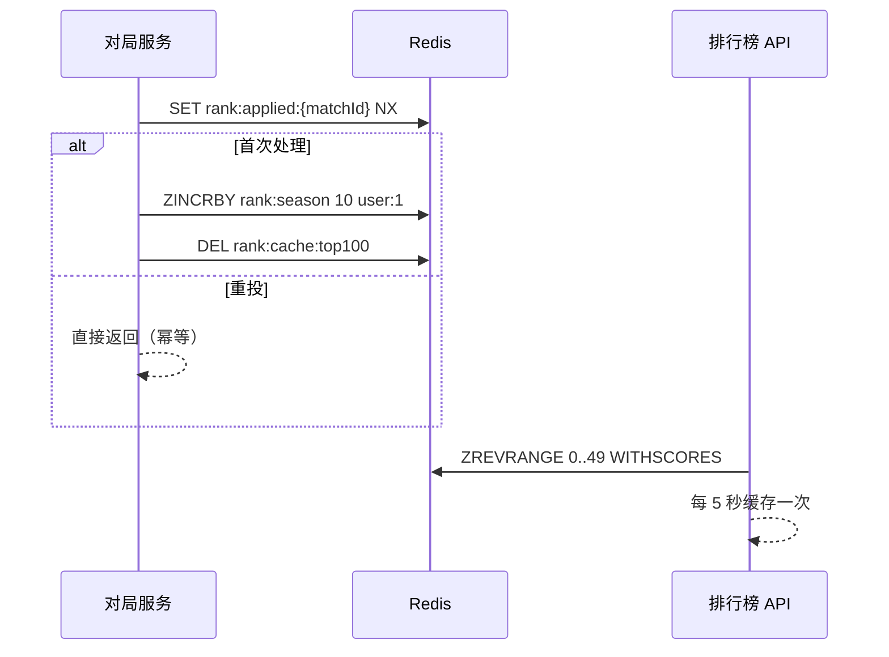

# 10.11 基于Redis实现王者荣耀段位排行榜

排行榜看起来简单——「按分数排个序」——但真做到产品和运营满意，要回答四个问题：段位不是数字怎么排、同分的人谁在前、我的名次怎么实时查、赛季怎么重置而不出事。这一节用一个段位排行榜把它讲透，顺便把 `ZSET` 这个 Redis 里最常用的结构用到熟练。

> 环境对照 Redis 8、`ioredis` 6；命令可直接在 `redis-cli` 里验证，接口代码沿用本书 `Database`/Redis 服务写法。

## 一、先用 SQL 写一版，看它死在哪

```sql
SELECT id, nickname, score,
       RANK() OVER (ORDER BY score DESC) AS rank
FROM players
ORDER BY score DESC
LIMIT 100 OFFSET 10000;
```

三个问题：

1. **深分页**：`OFFSET 10000` 要先把前一万行排出来再丢掉，翻到第 100 页时数据库开始喘；
2. **并发写**：每局结束都要 `UPDATE score = score + ?`，热门时段这一行会被反复锁；
3. **我的排名**：`SELECT COUNT(*) WHERE score > mine` 在百万行上是一次全表扫描，用户每刷新一次资料就扫一次。

Redis 的 `ZSET` 正好把这三件事都变成 O(log N)：`ZINCRBY` 原子自增、`ZREVRANGE` 按名次取区间、`ZREVRANK` 直接拿某人的排名。



## 二、把段位编码成一个整数

`ZSET` 的 score 是 double，只能排「一个数」。而段位是「段位 + 星数」两维，所以第一件事是**编码**：

```text
score = 段位基数 + 星数
青铜 1000 / 白银 2000 / 黄金 3000 / 铂金 4000 / 钻石 5000 / 星耀 6000 / 王者 10000+
```

- 段位基数之间留足间隔（1000），段内星数最多几十，不会溢出到下一档；
- 王者段位没有星数上限，把基数拉到 10000 并**允许无限叠加星数**，仍然单调；
- 所有分数用整数。**别用小数当尾数**（比如 `5000.12` 表示星数），double 的精度在百万级下会咬人，而且 `ZINCRBY 0.1` 累加十次不一定等于 1。

编码函数集中在一个地方，进数据库、进 Redis 都用它：

```ts
// rank/score.ts
const BASE = { BRONZE: 1000, SILVER: 2000, GOLD: 3000, PLATINUM: 4000, DIAMOND: 5000, STAR: 6000, KING: 10000 } as const;
export type Tier = keyof typeof BASE;

export function encodeScore(tier: Tier, stars: number, points = 0): number {
  if (stars < 0 || points < 0) throw new Error('stars/points 不能为负');
  return BASE[tier] + stars * 10 + Math.min(points, 9);   // 星内最多 9 分细节分
}

export function decodeScore(score: number): { tier: Tier; stars: number } {
  const tier = (Object.keys(BASE) as Tier[])
    .filter((t) => score >= BASE[t])
    .sort((a, b) => BASE[b] - BASE[a])[0] ?? 'BRONZE';
  return { tier, stars: Math.floor((score - BASE[tier]) / 10) };
}
```

这段代码同时说明了为什么不要用浮点：`stars * 10 + points` 保证星数和细节分各自占固定位，拆回来是精确的。

## 三、写入：ZINCRBY 是原子的，但「幂等」要自己做

一局结束后，赢家 +1 星、输家 -1 星：

```ts
await redis.zincrby('rank:season:2026S1', delta, `user:${playerId}`);
```

`ZINCRBY` 本身原子，多实例并发也安全。但**重放**不安全：消息队列重投、客户端重试、脚本重跑，都会把同一局加两次。这是排行榜最常见的线上事故——榜单前几名突然出现一个不该在的名字。

做法是**以对局为幂等键**，先标记再计分：

```ts
// 结算服务：同一 matchId 只处理一次
const key = `rank:applied:${matchId}`;
const first = await redis.set(key, '1', 'EX', 7 * 24 * 3600, 'NX');
if (first !== 'OK') return;                 // 已处理过，直接返回
await redis.zincrby(seasonKey, delta, member);
```

`SET NX EX` 是一个原子的「抢锁」，比「先 GET 再 SET」靠谱。另外要防「刷分」：结算接口必须由对战服务内部调用（服务间鉴权，不能暴露给客户端），分数变化必须有对局记录可回溯（`matchId` + 双方 id + 结算前后分数），影帝刷分、批量小号送分这类问题，事后对账时能一眼看出来——运营要的不是「防住」，而是「查得到」。如果结算还要落库，就把这个标记放进同一个事务/同一条 outbox（12 章会讲 outbox），避免「Redis 记了、数据库失败」的半截状态。

## 四、读取：排名、榜页、同分排序

**我的名次**：`ZREVRANK` 返回从 0 开始的排名（分数高的在前），加 1 才是人类看的「第几名」：

```ts
const rank = await redis.zrevrank(key, `user:${userId}`);
const myRank = rank === null ? null : rank + 1;   // null = 榜上还没有这个人
```

**榜页**：`ZREVRANGE key start stop WITHSCORES`，`start`/`stop` 是闭区间、0 基：

```ts
// 第 1 页（前 50 名）：0 ~ 49
const rows = await redis.zrevrange(key, 0, 49, 'WITHSCORES');
// 返回 [member, score, member, score, ...]，要两两配对
```

**同分怎么办**？`ZSET` 的规则是 score 相同则按 member 的字典序排——`user:100` 会排在 `user:9` 前面（字符串比较："1" < "9"）。产品通常要求「同分先到先得」，所以要把**达成时间**编码进 member 或 score：

```ts
// 方案 A：member 里带时间戳（可读性好，但 member 变长）
member = `user:${id}:${reachedAt}`;

// 方案 B：分数低位放时间（同一秒并列极罕见，需要精确排序时用）
score = encodeScore(...) * 10_000_000_000 + (2_000_000_000 - reachedAtSec);
```

注意 B 里的 `2_000_000_000 - reachedAtSec` 是**把「越早越大」翻转成「越早越靠前」**，因为分数是降序排的。编码一改，`decodeScore` 也要跟着去掉低位，别在展示时把时间戳当星数显示出来。

## 五、名次要「竞赛排名」还是「密集排名」

两个都常见，实现完全不同：

- **竞赛排名**（1、2、2、4）：同分并列占位。名次 = 比我分数高的人数 + 1。
- **密集排名**（1、2、2、3）：同分不占位。需要额外算「比我分数高的不同分数个数」。

`ZCOUNT` 一次就能算竞赛排名，不用拉全榜：

```ts
const score = await redis.zscore(key, member);
const higher = await redis.zcount(key, `(${score}`, '+inf');   // "(" 表示开区间
const rank = Number(higher) + 1;
```

`(score` 这种开区间写法容易忘，写成 `ZCOUNT key score +inf` 会把同分的人也算进去，名次整体 +1。密集排名则用 `ZREVRANGE ... WITHSCORES` 拉出分数序列去重计数，或者维护一个「不同分数」的辅助 `ZSET`——后者更划算，因为榜页本来就要拉数据。

## 六、排行榜的分区：什么时候该拆 key

一个 `rank:season:2026S1` 能撑多少？十万玩家、分数是整数，一个 zset 大约几 MB，`ZADD`/`ZREVRANGE` 都在毫秒级，完全够用。**不要因为「排行榜」三个字就提前分片**。

但有三种情况必须拆：

1. **多赛季并存**：key 天然按赛季分（`rank:season:2026S1`），新赛季换 key，旧 key 归档；
2. **多维度榜**：全国榜、省榜、好友榜。全国榜一个 key；省榜按省拆（`rank:province:110000`）；好友榜**不预先存**，查询时用 `ZINTERSTORE` 把「我的好友 id 集合」与总榜求交集：

```ts
// 好友榜：临时 key，用完即删（或短 TTL）
await redis.zinterstore('rank:tmp:friends:123', 2, 'rank:season:2026S1', 'friends:123');
await redis.zrevrange('rank:tmp:friends:123', 0, 9, 'WITHSCORES');
await redis.expire('rank:tmp:friends:123', 60);
```

`ZINTERSTORE` 的交集把 score 相加，做「好友榜」没问题；但如果你要「按好友的分数排序」，交集后 score 会被改写，得用 `WEIGHTS` 或改用 `ZUNIONSTORE` + 指定 `AGGREGATE MAX`。这一步很容易写错，写完必须拿三个人的数据手算一遍。

3. **超大 key 的维护窗口**：赛季结束要清空旧榜，`DEL` 一个几百万成员的 key 会阻塞 Redis 主线程。用 `UNLINK`（后台异步释放），或者干脆不删——旧 key 设个长 TTL 自然过期。

## 七、榜单缓存与前 100

前 100 名是最高频的读（首页每次都拉），但它也最稳定（一小时不变得很正常）。做法是**短 TTL 缓存序列化后的榜页**：

```ts
async top100(season: string) {
  const cached = await redis.get(`rank:cache:top100:${season}`);
  if (cached) return JSON.parse(cached) as RankRow[];

  const rows = await redis.zrevrange(`rank:season:${season}`, 0, 99, 'WITHSCORES');
  const list = pairWithId(rows);                       // 补昵称/头像
  await redis.set(`rank:cache:top100:${season}`, JSON.stringify(list), 'EX', 5);
  return list;
}
```

TTL 5 秒足够挡住首页的并发；个人名次**不要缓存**，`ZREVRANK` 本身就是 O(log N)，缓存反而制造「刚升段位却看不到」的错位。

## 八、赛季重置：换 key，不要清榜

赛季重置有三条硬约束：**不能停服、不能误删、旧数据可查**。

```ts
// 新赛季开始：写新 key，旧 key 设 30 天 TTL（留作发奖与申诉）
const newKey = `rank:season:${nextSeason}`;
await redis.zunionstore(newKey, 1, oldKey);      // 需要继承分数时
await redis.expire(oldKey, 30 * 24 * 3600);
```

如果规则是「段位继承」，就在 `ZUNIONSTORE` 时按比例降档（很多人写自定义 Lua，其实用「读出分数 → 计算新段位 → 批量 ZADD」更清楚，量级十万也就几百毫秒，放在低峰期跑）。

重置脚本必须满足：可重入（跑第二遍不重复降档，用 `SET NX` 标记）、可观测（记录处理条数、失败 id）、可回滚（旧 key 还在）。上赛季数据一删，运营要发奖励时找不到人，这种事故每年都有。

## 九、区间榜：靠编码天然支持「看某段位的人」

因为段位被编码进了 score，**按段位筛选不需要扫描**，直接用 `ZREVRANGEBYSCORE` 拿区间：

```ts
// 只看钻石段位（5000 ~ 5999）里的前 20 名
const rows = await redis.zrevrangebyscore(
  `rank:season:${season}`, 5999, 5000, 'WITHSCORES', 'LIMIT', 0, 20,
);
// 注意：ZREVRANGEBYSCORE 的 max 在前、min 在后，写反会返回空
```

这就是「编码成整数」带来的复利：如果当初用「段位字段 + 星数字段」分开存，按段位取榜单就得先查一批人再过滤。同样的技巧可以扩展出「省级榜」「战队榜」——只要维度能编码进分数或 key，就不需要额外的索引结构。

代价是可读性：段位区间是魔法数字（5000/5999），必须和 `BASE` 常量放在同一文件里，且加一条单元测试断言「编码后再解码能还原」。

## 十、Redis 挂了，排行榜怎么降级

排行榜是「锦上添花」的功能，不该让它拖垮主流程。分三档处理：

1. **读榜**：返回上一次缓存（`rank:cache:top100` 多存一份 `EX 3600` 的冷备），或直接返回空列表 + 「排行榜维护中」；**不要**回源数据库跑一次 `ORDER BY ... LIMIT 100`——那正是我们最初想避免的全表排序，Redis 挂的时候数据库通常也不轻松；
2. **写分**：不能丢。结算时把「待计分」写进数据库的 `rank_pending` 表（或本地 outbox），由补偿任务重放；`ZINCRBY` 是幂等的吗？不是——所以重放必须带 `matchId` 幂等标记，而幂等标记也在 Redis 里，Redis 挂了就临时把标记落到数据库唯一索引上一份；
3. **个人名次**：`null` + 「暂时无法获取」，前端灰色显示，别显示「第 0 名」。

这套降级能成立的前提是**计分与展示解耦**：展示随便降级，计分必须可靠。很多人把两者写在同一个接口里，Redis 一抖动就变成「用户打完这局没加分」，投诉量比榜单挂了严重得多。

## 十一、观测：榜单系统的四个指标

- **榜上人数**：`ZCARD`，与数据库玩家数对账（对不上说明写入路径漏了）；
- **前 100 读耗时**：P99 应在 5ms 内，超过就是缓存没命中或 key 太大；
- **名次查询耗时**：`ZREVRANK` 稳定在微秒级，变慢说明 key 过大（考虑拆省榜）；
- **结算幂等命中率**：`SET NX` 返回非 OK 的比例，正常应接近 0，突然升高说明上游重投。

再加一个「榜单漂移」巡检：每小时随机取 20 个玩家，用数据库 `score` 反算名次与 Redis 名次对比，不一致就告警——异步计分的系统一定要有这条对账，否则等到用户投诉「我明明是王者却显示星耀」时，已经错了几天。

## 十二、Checkpoint

```bash
# 造几个人（分数：黄金 3 星 = 3030，顺序注意 member 唯一）
redis-cli ZADD rank:season:2026S1 3030 user:1 3100 user:2 3030 user:3

# 榜页：前 3 名（降序）
redis-cli ZREVRANGE rank:season:2026S1 0 2 WITHSCORES
# 期望：user:2 3100、然后 user:3、user:1（同分按 member 字典序，3 在 1 前）

# 我的名次（0 基 → +1）
redis-cli ZREVRANK rank:season:2026S1 user:1        # 期望 2，即第 3 名

# 竞赛排名验证：比 3030 高的人数 + 1
redis-cli ZCOUNT rank:season:2026S1 '(3030' '+inf'  # 期望 1 → 第 2 名（并列）

# 加星并看幂等标记
redis-cli ZINCRBY rank:season:2026S1 10 user:1
redis-cli SET rank:applied:match-001 1 EX 604800 NX # 第一次 OK，第二次 nil

# 赛季归档
redis-cli EXPIRE rank:season:2026S1 2592000
```

接口侧：`GET /api/rank/top` 返回长度 ≤100 且分数单调不增；`GET /api/rank/me` 的 `rank` 与 `ZREVRANK+1` 一致；重复提交同一 `matchId` 后 `ZSCORE` 不变。

## 十三、坑表

| 现象 | 原因 | 处理 |
| --- | --- | --- |
| 名次整体差 1 | `ZREVRANK` 是 0 基 | 展示时 +1 |
| 同分的人总排在后面 | 同分按 member 字典序 | member 或 score 编码达成时间 |
| 同一局加了两次分 | 上游重投/客户端重试 | `SET NX` 幂等键 + outbox |
| 分数出现 3029.9999 | 用浮点做星数/细节分 | 全整数编码 |
| 赛季重置时接口卡住 | `DEL` 大 key 阻塞 | `UNLINK` 或 TTL 自然过期 |
| 好友榜分数变了 | `ZINTERSTORE` 交集求和 | 用 `AGGREGATE MAX` 或先取成员再查分 |
| 我的排名查不到 | 玩家还没写进榜 | 返回 `rank: null`，前端显示「未上榜」 |
| 榜单人数比玩家少 | 写入路径漏（注册用户未初始化） | 注册时 `ZADD 0` 或用对账巡检补齐 |

ch10 到这里结束：从配置、Compose、网络、进程模型，到镜像仓库、Nginx、灰度、分布式 session，再到两个 Redis 实战。ch11 进入工程化设施——lint/格式化/提交门禁、API 文档、配置校验、CI/CD 这些「不写业务但决定团队效率」的东西。

<!-- chapter-nav:start -->
---

← [10.10 Redis+高德地图，实现附近的充电宝](10.10-Redis+高德地图，实现附近的充电宝.md) · [本章目录](_chapter.md)
<!-- chapter-nav:end -->
