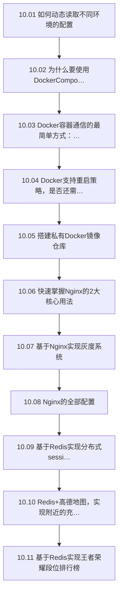

# 第 10 章 配置、Compose 与 Nginx

> 第 2 部 · 11 节 · 约 13 学时 · 已写 10 节

## 这一章解决什么问题

把“本地能跑”变成“换台机器也能跑”：配置分层、Compose 编排、反代与网关。

## 知识地图

## 验收清单

- [ ] 能用 compose 起整套服务，用 Nginx 做反代与静态资源，并完成一次可回滚的发布。
- [ ] 能不看笔记复述本章核心机制与取舍
- [ ] 本章的命令/示例能独立跑通，并留下自己的验证记录

## 节清单

- ✅ [10.01 如何动态读取不同环境的配置](10.01-如何动态读取不同环境的配置.md)
- ✅ [10.02 为什么要使用DockerCompose](10.02-为什么要使用DockerCompose.md)
- ✅ [10.03 Docker容器通信的最简单方式：桥接网络](10.03-Docker容器通信的最简单方式：桥接网络.md)
- ✅ [10.04 Docker支持重启策略，是否还需要PM2](10.04-Docker支持重启策略，是否还需要PM2.md)
- ✅ [10.05 搭建私有Docker镜像仓库](10.05-搭建私有Docker镜像仓库.md)
- ✅ [10.06 快速掌握Nginx的2大核心用法](10.06-快速掌握Nginx的2大核心用法.md)
- ✅ [10.07 基于Nginx实现灰度系统](10.07-基于Nginx实现灰度系统.md)
- ✅ [10.08 Nginx的全部配置](10.08-Nginx的全部配置.md)
- ✅ [10.09 基于Redis实现分布式session](10.09-基于Redis实现分布式session.md)
- ✅ [10.10 Redis+高德地图，实现附近的充电宝](10.10-Redis+高德地图，实现附近的充电宝.md)
- ⬜ 10.11 基于Redis实现王者荣耀段位排行榜（待写）

---

[← 第 9 章 认证、授权与安全](../ch-09-认证与安全/_chapter.md) · [返回教程目录](../../README.md) · [第 11 章 工程化设施 →](../ch-11-工程化/_chapter.md)
