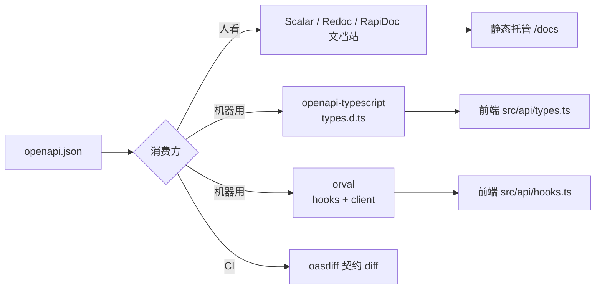

# 11.02 用 Scalar、Redoc 美化 API 文档与契约交付

11.01 把文档生成了出来，但那个 Swagger UI 只解决「能看」，解决不了「好用」：首屏慢、移动端排版挤、深色模式刺眼、代码示例区几乎没法读。这一节换掉 UI，并往前走一步——让同一份 `openapi.json` 同时产出**给人看的文档站**和**给前端用的类型与请求函数**，最后把契约差异卡在 CI 里。

> 环境对照：`@scalar/nestjs-api-reference` 1.2.40、`redoc` 3.2.0 / `@redocly/cli` 2.82.0、`rapidoc` 14.2.0、`@stoplight/elements` 9.0.30、`openapi-typescript` 7.13.0、`orval` 8.48.0（均为 2026-11 的 registry 实值）。

## 一、先承认 Swagger UI 的问题

不是它不好，是它 2015 年的设计目标（「把 OpenAPI 渲染出来」）和 2026 年的需求（「让前端与外部开发者愿意用」）不一样了。四个具体痛点：

| 问题 | 表现 | 影响 |
| --- | --- | --- |
| 首屏重 | 一次性加载全部接口，大项目 3–10 秒白屏 | 联调时没人愿意打开 |
| 布局固定 | 单栏、无响应式、移动端几乎不可用 | 手机上没法查接口 |
| 示例弱 | 请求/响应示例折叠在深层，复制体验差 | 每个字段都要手写 |
| 无「按用途组织」 | 只有 tag 折叠，没有导读、没有分组说明 | 新人找不到入口 |

所以这一节不是「换个皮肤」，是**按消费方拆成两套交付**：



## 二、Scalar：目前最像「现代文档」的选择

Scalar 是一个开源的 API 参考实现（渲染 `openapi.json`），特点是快、支持深色模式、带「代码示例多语言切换」和全局搜索。Nest 有官方风格的第一方包，装完一行挂载：

```bash
pnpm add @scalar/nestjs-api-reference
```

```ts
// src/main.ts
import { apiReference } from '@scalar/nestjs-api-reference';

// 前提：11.01 已经暴露了 /api/docs-json
app.use(
  '/api/reference',
  apiReference({
    url: '/api/docs-json',       // 指向文档 JSON，不要写死外部地址
    theme: 'kepler',              // 内置主题：default / kepler / mars / moon / purple ...
    metaData: { title: '会议室预订系统 API', description: '内部接口契约 v1' },
  }),
);
```

三个要点：

1. **`url` 用相对路径**。写 `http://localhost:3000/api/docs-json` 在测试环境就废了；相对路径让同一个容器在哪个域名下都能用；
2. **Fastify 要加 `withFastify: true`**，否则拿到的是 Express 的 `res` 重载，路由挂不上；
3. **它是中间件不是模块**：`app.use` 在 `listen` 之前调用；如果你用了全局前缀，注意中间件路径不受前缀影响（它挂在应用根上，`/api/reference` 要写全）。

**为什么这些新 UI 明显更快**：Swagger UI 是「把整份文档一次解析成 React 组件树」，1000 个接口的 JSON 往往 5–20 MB，浏览器光解析就要几秒；Scalar/Redoc 采用「先出静态骨架、正文按需渲染（懒加载 + 虚拟滚动）」，首屏只处理当前 tag。所以**文档体积才是真正的瓶颈**——如果你的 `openapi.json` 超过 5 MB，换 UI 只能缓解，根本解法是拆文档：

```ts
// 按模块生成多份文档：每份只含相关控制器
const publicDoc = SwaggerModule.createDocument(app, config, { include: [AuthModule, RoomsModule] });
const adminDoc  = SwaggerModule.createDocument(app, config, { include: [AdminModule] });
SwaggerModule.setup('api/docs/public', app, publicDoc);
SwaggerModule.setup('api/docs/admin', app, adminDoc);
```

对外只暴露 `public`，内部团队看 `admin`——既降体积，又顺手做了权限隔离。

Scalar 的价值在于「文档即产品」：搜索、深色模式、多语言示例、Try it out 的交互都比 Swagger UI 顺。代价是它默认从 CDN 加载渲染资源——**内网/离线环境**要么配 `proxyUrl` 走自己的代理，要么改用自托管方案（下面 Redoc 的静态化就是其一）。

## 三、Redoc：静态化、可离线、适合对外发布

Redoc 的思路完全不同：它渲染成一个**单页静态 HTML**，没有交互式调试面板，但排版是「阅读优先」，特别适合对外 API 文档和合同附件。

```bash
pnpm add -D @redocly/cli
```

```bash
# 1) 从运行中的应用导出 openapi.json（11.01 的 /api/docs-json）
curl -s http://localhost:3000/api/docs-json -o docs/openapi.json

# 2) 校验规范（能在 CI 里拦住非法 schema）
npx @redocly/cli lint docs/openapi.json

# 3) 生成静态单页（自包含，可直接丢给 Nginx）
npx @redocly/cli build-docs docs/openapi.json -o docs/api-reference.html

# 4) 本地预览
npx @redocly/cli preview-docs docs/openapi.json
```

`lint` 是这里最被低估的一步：它会告诉你「某个 200 响应没有 schema」「path 参数没有声明 required」「operationId 重复」。**文档的语法错误在生成阶段是静默的**，只有 lint 会喊出来。

如果不想装 CLI，也可以手写一个极简 HTML，用 CDN 版 Redoc 渲染——适合临时给外部看：

```html
<!doctype html>
<html>
  <head><meta charset="utf-8" /><title>API Reference</title></head>
  <body>
    <redoc spec-url="/api/docs-json"></redoc>
    <script src="https://cdn.redoc.ly/redoc/latest/bundles/redoc.standalone.js"></script>
  </body>
</html>
```

对外发布时把 `spec-url` 指向静态文件（`/docs/openapi.json`），并把 HTML 与 JSON 一起放进 Nginx 的静态目录，这样文档站不依赖后端进程存活。

## 四、RapiDoc 与 Stoplight Elements：嵌入式场景

这两个不是「更好」，是「更合适」：

- **RapiDoc**（14.2.0）：一个 Web Component，`<rapi-doc spec-url="...">` 一行嵌入，主题可深度定制（`theme="dark"`、`regular-font`、`schema-style="tree"`），适合已经有一个后台管理站点、要把 API 文档嵌进去的场景；
- **Stoplight Elements**（9.0.30）：提供 React 组件与 `elements-api` Web Component，可以和你的设计系统混排（左侧导航、右侧内容都是你自己的组件）。

```html
<!-- RapiDoc：嵌进现有的运维后台 -->
<rapi-doc spec-url="/api/docs-json" theme="dark" show-header="false" render-style="read"></rapi-doc>
<script type="module" src="https://unpkg.com/rapidoc/dist/rapidoc-min.js"></script>
```

这两个嵌入方案的共同代价是**要自己维护前端构建链**：RapiDoc 是纯 Web Component，最简单；Stoplight Elements 依赖 React 生态，和你项目里的 React/Next 版本要能对上，升级时容易互相绑架。所以嵌入式方案只在你「已经有一个持续维护的前端站点」时才划算，否则不如 Redoc 一个静态页。

选择顺序建议：**团队自用 → Scalar；对外发布 → Redoc 静态页；已有后台要嵌入 → RapiDoc/Elements**。别为了「好看」把四套都装上，维护成本比收益高。

## 五、Apifox / YApi：国内团队的现实选择

如果你的团队不是「文档跟着代码走」而是「产品/测试/前端一起在平台上协作」，那 Apifox、YApi 这类平台确实解决实际问题：接口集合、Mock、自动化测试、环境变量、成员权限。

接入方式很简单：**导入 `openapi.json`**（Apifox 支持 OpenAPI 3.0/3.1，YApi 对 3.1 支持较弱），设置「定时同步」或 CI 里推。

但要清楚代价：

- **单向同步的幻觉**：平台上的修改不会回到代码，时间一长就会出现「平台文档」与「代码文档」两个真相；
- **Mock 的漂移**：Mock 基于示例值生成，和真实逻辑无关，前端过度依赖 Mock 会掩盖接口设计问题；
- **锁定**：私有化部署要钱/要运维，导出的格式各家不完全兼容。

务实做法：**代码生成的 `openapi.json` 是唯一真相**，平台只作为「消费方」——每次发布把 JSON 推上去，禁止在平台上手工改结构。这条纪律写进团队规范，比选哪个平台重要得多。

这里顺便回答一个架构问题：**契约优先（design-first）还是代码优先（code-first）**？Nest 天然是代码优先（装饰器就是契约源），好处是永远不会「文档与实现不一致」；代价是文档质量取决于代码注释与 DTO 的规范程度。契约优先（先写 `openapi.yaml`、再生成服务端骨架）适合多方对接、需要严格评审接口的团队，但对单人/小团队是纯负担。本书立场很明确：**代码优先 + CI 校验**，别去维护第二份 yaml。

## 六、codegen：把文档变成前端的类型与请求函数

这才是 `openapi.json` 最大的价值。前端不用再手写 interface，也不会出现「后端改字段前端不知道」。

**方案 A：`openapi-typescript`（只生成类型）**

```bash
pnpm add -D openapi-typescript
npx openapi-typescript http://localhost:3000/api/docs-json -o src/api/schema.d.ts
```

产物是纯类型，配合 `openapi-fetch` 用起来很轻：

```ts
import createClient from 'openapi-fetch';
import type { paths } from './api/schema.js';

const client = createClient<paths>({ baseUrl: '/api' });
const { data, error } = await client.GET('/bookings/{id}', {
  params: { path: { id: bookingId } },
});
```

**方案 B：`orval`（生成类型 + hooks）**

```bash
pnpm add -D orval
```

```ts
// orval.config.ts
import { defineConfig } from 'orval';

export default defineConfig({
  meeting: {
    input: { target: './docs/openapi.json' },
    output: {
      mode: 'tags-split',            // 按 tag 拆文件，避免一个巨型文件
      target: './src/api/generated',
      client: 'react-query',          // 生成 TanStack Query 的 useQuery/useMutation
      mock: false,
    },
  },
});
```

```bash
npx orval            # 生成 hooks
npx orval --clean    # 清空重建
```

两种方案都有一批「生成出来的类型不对」的经典坑，先知道再选：

- **`nullable` 与可选**：后端 `field?: string` 在 3.0 里可能被生成成 `string | undefined`，在 3.1 里是 `string | null`，差一个 `null` 前端就要多判一次；DTO 上写清楚 `@ApiPropertyOptional({ nullable: true })`；
- **日期**：OpenAPI 的 `format: date-time` 是字符串，生成出来也是 `string`——别指望自动变 `Date`，要么前端自己转，要么用 `orval` 的 transformer 统一处理；
- **`additionalProperties` / 索引签名**：`Record<string, T>` 的 DTO 如果不加 `@ApiProperty({ type: 'object', additionalProperties: ... })`，会退化成 `{}`，前端拿到的类型是 `any`；
- **枚举命名**：`enumName` 缺失会导致多个同名枚举互相覆盖（11.01 的坑表里提过），codegen 之后表现为「状态类型少了几个值」。

对本书后端的项目一前端（Next.js + TanStack Query，见 ch19）来说，B 更省事：`useCreateBooking()`、`useBookings()` 直接用，缓存键和失效逻辑也一并生成。

两个方案都必须在 CI 里加一步「**生成结果与提交物一致**」，否则前端又会拿旧类型开发：

```bash
npx openapi-typescript ./docs/openapi.json -o src/api/schema.d.ts
git diff --exit-code src/api/schema.d.ts   # 有差异说明忘了提交 codegen
```

## 七、文档站怎么交付

三种形态，按场景选：

1. **跟着应用走**：Scalar 挂在 `/api/reference`，开发/测试环境直接用。优点是零额外部署，缺点是后端挂了文档也没了；
2. **静态站**：CI 里 `build-docs` 生成 HTML + JSON，推到 Nginx 的 `/docs` 或对象存储（COS/OSS）+ CDN。对外发布、可离线、不占后端资源——推荐至少对外用这种；
3. **版本化**：`/docs/v1`、`/docs/v2` 各存一份 JSON 与 HTML，前端/合作方按版本对接。**文档地址里带版本号**是契约管理的基本功，比在文档里写「最新版」强得多。

```nginx
# 静态文档：不经过后端，直接由 Nginx 提供
location /docs/ {
    alias /srv/api-docs/;
    add_header Cache-Control "no-cache";   # 文档要能及时更新
}
```

静态站有一个隐性风险：**CDN 缓存了旧文档**。前端照着「看起来是最新的」页面开发，实际后端已经改了两版。三种处理：文件名带内容哈希（`api-reference.<hash>.html`，每次发布换 URL，天然不缓存错版本）；或者保留固定 URL 但 `Cache-Control: no-cache` + 发布后主动 purge；或者干脆用「版本目录」——`/docs/v1.4.2/` 永不覆盖，`/docs/latest/` 做 302 跳到当前版本。第三种最适合对外：合作方锁定的版本不会被你的一次发布悄悄改掉。

## 八、把契约卡在 CI 里

11.01 讲了「提交 openapi.json 快照」，这里补完整门禁：

```yaml
# .github/workflows/contract.yml 摘要
- run: pnpm build && node dist/main.js &    # 起应用（无库也能出文档）
- run: curl -s localhost:3000/api/docs-json -o /tmp/new.json
- run: npx @redocly/cli lint /tmp/new.json          # 规范合法
- run: npx oasdiff breaking docs/openapi.json /tmp/new.json   # 破坏性变更即失败
- run: npx openapi-typescript /tmp/new.json -o /tmp/schema.d.ts
- run: diff -q /tmp/schema.d.ts src/api/schema.d.ts  # 前端类型不漂移
```

再加一条「变更可见」：让 CI 把 diff 摘要贴到 PR 评论（`oasdiff changelog` 或 `openapi-diff` 的 markdown 输出），并维护一份 `docs/API-CHANGELOG.md`——新增/修改/废弃各记一行，附版本号与日期。别小看这个动作：半年后有人问「`roomId` 什么时候从 number 变 string 的」，你能在三十秒内给出答案，而不是 `git log` 翻半天。

`oasdiff breaking` 的判定标准值得单独记一下：**删字段、改类型（`string`→`number`）、新增必填参数、收紧枚举**算破坏性；**新增可选字段、新增接口**不算。这条线划清楚，PR 里就不会再出现「前端说接口变了」的扯皮——CI 已经替你说了。

## 九、Checkpoint

```bash
# 1) Scalar 页能打开（200，且 HTML 里引用了 openapi 地址）
curl -s -o /dev/null -w '%{http_code}\n' http://localhost:3000/api/reference
curl -s http://localhost:3000/api/reference | grep -o 'docs-json' | head -1

# 2) Redoc 静态构建成功，文件可独立打开
npx @redocly/cli build-docs docs/openapi.json -o /tmp/api-ref.html && ls -lh /tmp/api-ref.html

# 3) lint 无 error（warning 可接受）
npx @redocly/cli lint docs/openapi.json | tail -3

# 4) codegen 幂等：再生成一次，git diff 应为空
npx openapi-typescript docs/openapi.json -o /tmp/schema.d.ts && diff -q /tmp/schema.d.ts src/api/schema.d.ts
```

## 十、坑表

| 现象 | 原因 | 处理 |
| --- | --- | --- |
| Scalar 页面空白 | 浏览器跨域/`url` 写成绝对地址但环境不同 | 用相对路径 `/api/docs-json` |
| Fastify 下 Scalar 404 | 缺 `withFastify: true` | 配置项打开 |
| Redoc 里没有 Try it out | Redoc 本身不带调试面板 | 要调试就留 Scalar/Swagger UI |
| `redocly lint` 报一堆 error | 响应缺 schema、参数缺 required | 补 `@ApiResponse({ type })` 与 DTO |
| codegen 类型里字段全 optional | 3.1 的 `nullable` 或未标 `required` | 检查 DTO 与版本 |
| 生成文件每次 diff 都变 | 生成器版本/排序不稳定 | 锁版本，或固定 `sort` 选项 |
| 前端 hooks 请求路径少了 `/api` | OpenAPI 的 servers 与实际部署前缀不一致 | `addServer()` 或 codegen 配 `baseUrl` |
| 文档站生产环境暴露内部接口 | 整份 JSON 都给了 | 分环境挂载 + `include` 限制模块 |

到这里「文档」这条线就闭环了：生成（11.01）→ 换 UI 与 codegen（11.02）→ CI 卡契约。下一节 11.03 换一个完全不同的对象：用 compodoc 从源码生成「代码文档」——给后来维护这个 Nest 项目的人看模块、控制器、Provider 的关系图。

<!-- chapter-nav:start -->
---

← [11.01 用Swagger自动生成api文档](11.01-用Swagger自动生成api文档.md) · [本章目录](_chapter.md) · [11.03 使用compodoc生成文档](11.03-使用compodoc生成文档.md) →
<!-- chapter-nav:end -->
