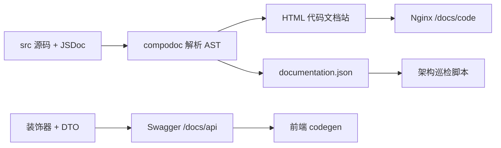

# 11.03 使用 compodoc 生成文档

11.01 和 11.02 解决的是「接口长什么样」，这一节解决另一个问题：**「这个项目内部长什么样」**——半年后接手的人（很可能是你自己）打开 `src/`，面对 200 个文件、几十个模块，怎么快速知道「谁依赖谁、某个 Service 有哪些方法、哪些参数是可选的」。答案是 compodoc：它从 TypeScript 源码和 JSDoc 注释生成一套离线可查的代码文档站。

> 环境对照 `@compodoc/compodoc` 2.0.0（engines：Node `^20.19 || ^22.12 || >=24`）、Nest 12 + ESM + `nodeNext`。

## 一、它和 Swagger 的分工

| | Swagger / OpenAPI | compodoc |
| --- | --- | --- |
| 对象 | HTTP 接口（路径、参数、响应） | 源码结构（模块、类、方法、注释） |
| 数据来源 | 装饰器 + DTO | TypeScript AST + JSDoc |
| 消费者 | 前端、联调方、外部合作方 | 后端同事、接手的人、代码评审 |
| 变更频率 | 每次接口变化 | 每次代码结构变化 |
| 产物 | 可交互文档 + JSON 契约 | 静态 HTML 站 + 依赖图 |

两者不重复。**接口文档是契约，代码文档是地图**。有地图，新人不需要靠「全局搜索类名」来理解模块关系。



## 二、最小可用

```bash
# 一次性执行（不污染项目依赖）
pnpm dlx @compodoc/compodoc -p tsconfig.json -d docs/code

# 起本地服务预览
pnpm dlx @compodoc/compodoc -p tsconfig.json -d docs/code --serve --port 8080
```

跑完打开 `http://localhost:8080`，你会看到：

- **Overview**：项目统计（模块数、控制器数、Provider 数、注释覆盖率）；
- **Modules**：每个 Nest 模块的 imports/providers/controllers 清单；
- **Controllers / Providers / Classes**：按类归档的成员与方法；
- **Dependencies（graph）**：模块/文件之间的依赖关系图；
- **Search**：全局搜索类名与方法名。

对 Nest 项目，`-p tsconfig.json` 是关键：compodoc 需要一份能覆盖 `src/**/*.ts` 的 tsconfig 才能解析装饰器与类型。项目里如果 `tsconfig.json` 只做「references 到 tsconfig.app.json」，就要显式传 `-p tsconfig.app.json`。

## 三、不加注释，生成出来就是空壳

compodoc 的文档质量**完全取决于 JSDoc**。它不会把装饰器「翻译」成人话，只会把注释原样搬过去。所以真正的工作量在这：

```ts
/**
 * 会议室预订服务。
 *
 * 负责创建/取消/审批预订，并保证同一会议室的时间段不重叠。
 * 冲突检测在数据库层用排他约束兜底，service 里的检查只是为了给出友好错误。
 */
@Injectable()
export class BookingsService {
  /**
   * 创建预订。
   *
   * @param dto 预订参数（时间必须是 ISO 8601 且为未来时间）
   * @param user 当前登录用户
   * @returns 新预订记录
   * @throws ConflictException 时间段与已有预订重叠
   * @example
   * await service.create({ roomId, startTime, endTime }, user);
   */
  async create(dto: CreateBookingDto, user: AuthUser): Promise<Booking> { /* ... */ }
}
```

四类注释收益最高：

1. **类级说明**：这个 Service 的职责边界、它不负责什么（避免职责蔓延）；
2. **方法级的 `@throws`/`@returns`**：文档里直接能看到异常语义，比读代码快；
3. **`@deprecated`**：老方法标上，compodoc 会打删除线，新人不会误用；
4. **`@example`**：一段最小可运行示例，胜过三行描述。

注释的正确写法是**写「为什么」而不是「做什么」**——「做什么」代码已经说了：

```ts
// 差：把代码翻译成中文
/** 创建预订。 */

// 好：写出约束与代价，代码里看不出来的信息
/**
 * 创建预订。
 *
 * 冲突检测用「先查后写」+ 数据库排他约束双保险：查是为了友好报错，
 * 约束是为了并发下不双订。因此这里的检查不能省，也不能只靠约束（报错文案太差）。
 *
 * @throws ConflictException 时间段重叠（由 DB 约束 lt/gt 触发后翻译）
 */
```

判断标准很简单：**删掉这段注释，读者会不会做错事**。会，就留；不会，就删。

**怎么让注释真的写下去**？靠自觉的项目最后都是 5% 覆盖率。两个可落地的约束：

- ESLint 的 `eslint-plugin-jsdoc` 开 `jsdoc/require-jsdoc`（只对 `export` 的类与方法生效，`contexts` 里配 `ExportNamedDeclaration > ClassDeclaration` / `MethodDefinition`），CI 里 lint 不过就合并不了；
- 评审清单加一条：「新公开方法必须有一句话说明 + `@throws` 如果有异常语义」。评审时顺口就能查，比事后补文档便宜。

反过来，**不要写「构造器」「获取属性」这种废话注释**——那是噪音，把注释覆盖率刷到 100% 但没人看。

## 四、拿着这份文档怎么读一个陌生项目

compodoc 生成的是「零件清单」，读陌生项目要有顺序，否则会被几百个类淹掉。实际顺序是：

1. **从 `AppModule` 的 imports 看顶层切分**：一个模块通常对应一个业务领域或一类基础设施，先记住这 8–12 个名字，项目的骨架就有了；
2. **挑一个业务模块，从 Controller 往下读**：Controller 是入口（谁调这个功能），顺着注入找 Service（怎么实现），再看它用了哪些 Repository/Prisma model（数据从哪来）——这就是一条完整链路；
3. **看依赖图找「意外连接」**：如果 `BookingsModule` 直接依赖了 `AuthModule` 的内部类，说明模块边界漏了，这种图上一眼就能看出来；
4. **最后看 Provider 列表里的「工具类」**：它们通常承载了隐性复杂度（缓存、锁、事务、时钟），比读业务代码更能理解「这套系统怕什么」。

配合 Swagger 一起看效果最好：Swagger 回答「对外暴露了什么」，compodoc 回答「内部怎么拼起来的」。

## 五、配置进项目：`.compodocrc.json` + npm scripts

每次手敲一长串参数不现实，放进配置文件：

```json
{
  "tsconfig": "tsconfig.app.json",
  "output": "docs/code",
  "includes": "docs/code-includes",
  "name": "会议室预订系统（后端）",
  "theme": "material",
  "hideGenerator": true,
  "coverageTest": 60,
  "coverageTestThresholdFail": true,
  "disableGraph": false,
  "watch": false
}
```

```json
// package.json
{
  "scripts": {
    "docs:code": "compodoc -p tsconfig.app.json -d docs/code",
    "docs:code:serve": "compodoc -p tsconfig.app.json -d docs/code --serve --port 8080",
    "docs:code:json": "compodoc -p tsconfig.app.json -d docs/code --exportFormat json"
  }
}
```

两个参数值得解释：

- **`coverageTest: 60` + `coverageTestThresholdFail: true`**：注释覆盖率低于 60% 时**命令以非 0 退出**，可以直接进 CI 当门禁。阈值别一上来定 90——没人写注释的项目会立刻红，先把「公开方法必须有注释」做到，再慢慢提高；
- **`exportFormat: json`**：除了 HTML，还能导出结构化 JSON，供你自己做二次加工（比如画一张「模块 → 依赖」的 Mermaid 图塞进 README，或者做一个「未注释的公开方法」清单）。

## 六、Nest + ESM 项目的三个实际坑

**1. tsconfig 要「能解析到源文件」**。用 `tsconfig.json` 做 references 的项目，compodoc 解析不到 `src/`，产物是空站点（页面能开、列表全空）。用 `tsconfig.app.json` 或单独建一个 `tsconfig.docs.json`：

```json
{
  "extends": "./tsconfig.json",
  "include": ["src/**/*.ts"],
  "exclude": ["node_modules", "dist", "test", "**/*.spec.ts"]
}
```

**2. ESM 与 `nodeNext` 的边界**。compodoc 内部走 TypeScript 的 AST 解析，不执行你的代码，所以 ESM 本身不影响；但 `import type`、路径别名（`@/`）如果 tsconfig 里 `paths` 没配全，跨文件类型会退化成 `any`，文档里就只剩名字没有类型。检查方法：随便点开一个 Service 的方法，参数类型显示 `any` 就是没解析对。

**3. 测试文件与 e2e 混进来**。默认会扫 `include` 的所有文件，`*.spec.ts` 被纳入后，providers 列表里会出现一堆 mock。用 `exclude` 排掉，文档立刻干净。

**4. monorepo / 多包**。如果 `apps/api` 依赖 `libs/common`，compodoc 只解析 `-p` 指定的那个 tsconfig 的 `include` 范围，`libs` 里的类不会出现在文档中，跨包引用会显示成 `any`。做法是给 monorepo 建一个 `tsconfig.docs.json`，把 `apps/*/src` 与 `libs/*/src` 一起 `include` 进来——代价是生成慢一些，但换来的是一份完整文档。

**5. 它不会解析「路由」。** compodoc 能列出 `BookingsController` 有哪些方法，但**不会**告诉你这些方法对应 `GET /api/bookings/:id` ——它不做 Nest 装饰器的路由语义解析。所以「这个接口在哪实现」仍然要查 Swagger（点开接口看 operationId）或直接搜方法名。这不是缺陷，是分工：路由归 OpenAPI，结构归 compodoc。

还有一个「不算坑但要知道」的限制：compodoc 最初是给 Angular 做的，**对 Nest 的 DI 图支持有限**——它能列出模块里声明了什么，但不能画出「谁注入了谁」的完整关系图。想要那种图，得靠 `Dependencies` 文件级图 + 自己补一张手画架构图（或用 11.04 之后的工具）。

## 七、和 TypeDoc / Docusaurus 的分工

同类工具不止 compodoc，选错会白折腾：

| 工具 | 擅长 | 不适合 |
| --- | --- | --- |
| compodoc | 类/模块/依赖图 + 注释覆盖率，Nest 项目开箱可用 | 想做「门户站/手写章节」很别扭 |
| TypeDoc | 纯 TS API 文档（函数签名、类型推导），输出干净 | 不画模块依赖图，不管注释覆盖门禁 |
| Docusaurus / VitePress | 手写指南 + 版本化 + 搜索，适合「书」 | 从源码自动生成结构文档要插件 |
| Swagger UI | 接口调试 | 完全不看内部结构 |

本书的定位决定选择：**教程/文档站用 Markdown（你正在读的这套），接口契约用 OpenAPI，内部结构用 compodoc**。三者各司其职，没必要强行统一成一个工具。

如果你只想要「函数签名速查」，TypeDoc 更轻；如果你要的是「新人能看懂这个模块在干什么」，compodoc 的模块列表 + JSDoc 更直观。都试一次，半小时就能判断。

## 八、发布：和接口文档放一起

```bash
# CI 里生成
pnpm docs:code
# 产物是纯静态目录：docs/code/index.html
```

```nginx
# 与 API 文档并列，一个端口下有两个站
location /docs/api/  { alias /srv/api-docs/; }
location /docs/code/ { alias /srv/code-docs/; }
```

安全上要注意：**代码文档比接口文档更敏感**。接口文档泄露的是「有什么接口」，代码文档泄露的是「内部实现、字段名、甚至注释里的历史事故」。所以它只放在内网，或者加一层 HTTP Basic / SSO；别顺手把 `docs/code` 打进生产镜像又不设访问控制——那等于给攻击者一份带注释的地图。

这样做的好处是**新人入职只要一个链接**：接口文档看怎么调，代码文档看内部结构。两者都由 CI 从源码生成，不存在「文档是上个月导出的」问题。

一个务实建议：代码文档**不必每次提交都重新发布**，按天/按合并到 main 触发即可——它不是契约，晚一天没关系；而接口文档（11.01）必须跟着每次接口变更走。

## 九、把 JSON 用成「架构巡检」

`--exportFormat json` 的产物（`documentation.json`）比 HTML 更有价值：它可以进脚本，做趋势统计与规则检查。三个马上能用的检查：

```python
# scripts/audit-architecture.py（CI 里跑，输出到 job summary）
import json, sys
doc = json.load(open('docs/code/documentation.json', encoding='utf-8'))

modules = doc.get('modules', [])
controllers = doc.get('controllers', [])
providers = doc.get('providers', [])

# 1) 规模趋势：超过阈值就提醒拆分
print(f'modules={len(modules)} controllers={len(controllers)} providers={len(providers)}')
if len(modules) > 40:
    print('::warning::模块数超过 40，考虑按领域拆分')

# 2) 未注释的公开方法（粗略：没有 description 的方法）
missing = [
    f"{c['name']}.{m['name']}"
    for c in controllers + providers
    for m in c.get('methods', [])
    if not (m.get('description') or '').strip()
]
print(f'未注释方法 {len(missing)} 个：{missing[:10]}')

# 3) 控制器过胖（>15 个端点）通常是「一个 Controller 干太多」
fat = [f"{c['name']}({len(c.get('methods', []))})" for c in controllers if len(c.get('methods', [])) > 15]
if fat:
    print('::warning::控制器端点过多：' + ', '.join(fat))
```

这条脚本放在 PR 流水线里，比「架构评审会」有效得多——数字不会说谎，而且不针对人。

## 十、Checkpoint

```bash
# 1) 生成成功，且 index.html 存在
pnpm docs:code && test -f docs/code/index.html && echo OK

# 2) 页面里能搜到你的模块名与控制器名
grep -o 'BookingsController' docs/code/index.html | head -1

# 3) 注释覆盖率门禁生效（故意把阈值调到 99 验证会失败）
pnpm dlx @compodoc/compodoc -p tsconfig.app.json -d /tmp/compo-test --coverageTest 99
echo $?   # 期望非 0

# 4) 导出 JSON 并检查结构
pnpm docs:code:json && python3 -c "
import json; d=json.load(open('docs/code/documentation.json'))
print('modules:', len(d.get('modules', [])), 'controllers:', len(d.get('controllers', [])))"
```

## 十一、坑表

| 现象 | 原因 | 处理 |
| --- | --- | --- |
| 站点能打开但列表全空 | tsconfig 没包含 `src/`（references 结构） | 传 `tsconfig.app.json` 或建 `tsconfig.docs.json` |
| 参数类型全是 `any` | `paths` 别名未解析、或跨包引用 | 补全 tsconfig `paths`，或改用相对导入 |
| providers 里混入测试 mock | `*.spec.ts` 未被排除 | `exclude` 加测试目录 |
| 注释覆盖率门禁总是失败 | 阈值定太高 | 先 40–60，只卡公开方法 |
| 依赖图太乱看不出结构 | 文件级图本来就不等于架构图 | 配合手画模块图，图只用于查找 |
| ESM 项目里 `import type` 丢失类型 | 类型未参与解析 | 关键类型改成显式导出并写 JSDoc |
| CI 生成很慢（>2 分钟） | 每次全量解析、还带 graph | 只在 main 分支跑，或 `--disableGraph` |
| 文档里方法参数类型是 `string \| undefined` 但代码是可选 | 解析的是声明而非推导 | 以源码为准，文档只作导航 |
| monorepo 里 libs 的类不出现 | tsconfig include 范围不够 | 建 `tsconfig.docs.json` 覆盖所有包 |
| 2.0 升级后命令报错 | 2.0 起 engines 要求 Node 20.19+/22.12+ | 升级 CI 的 Node 版本 |
| 生成物进了 git、每次提交都巨大 | `docs/code` 未忽略 | `.gitignore` 加 `docs/code/`，只在 CI 产出 |

接口文档（11.01/11.02）和代码文档（11.03）都齐了，下一节 11.04 开始换一个方向：**让后端主动发消息**——用 Node 发邮件，为 11.05 的「邮箱验证码登录」打基础。

<!-- chapter-nav:start -->
---

← [11.02 用Scalar、Redoc美化API文档与契约交付](11.02-用Scalar、Redoc美化API文档与契约交付.md) · [本章目录](_chapter.md) · [11.04 Node如何发邮件](11.04-Node如何发邮件.md) →
<!-- chapter-nav:end -->
