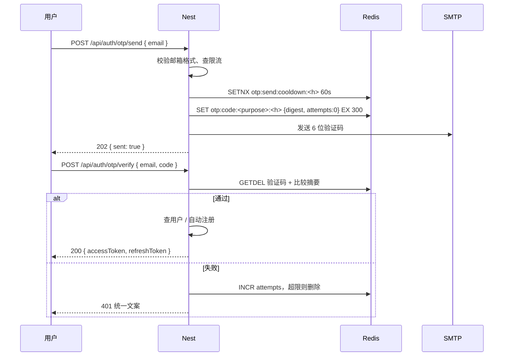

# 11.05 实现基于邮箱验证码的登录

密码登录有三笔固定成本：用户要记住一个不重复的密码、系统要存一份可被拖库的哈希、忘了还要做一套重置流程。验证码登录把这笔成本换了个位置——不再验证「你知道什么」，而是验证「这个邮箱现在归你控制」。代价是它把一部分安全边界交给了邮箱服务商，也把「发信」变成了登录链路上的强依赖。

这一节把这条链路完整落地：生成、限流、存、校验、签发会话、失败兜底。上一节已经把信发出去的问题解决了，这一节只关心**验证码本身**。

## 一、两条流程，一个岔路口

先理清产品形态，代码才有地方放。



岔路口只有一个问题：**没注册过的邮箱能不能直接登录**。

| 策略 | 体验 | 代价 |
| --- | --- | --- |
| 仅已注册用户 | 注册与登录分离，语义清晰 | 新用户要先注册，多一步 |
| 验证码即注册 | 一步进入，转化率高 | 任何人都能往任意邮箱「注册」，需要更强的限流与审计 |

本文按第二种写，因为它更难——要处理「邮箱已被占用」「并发同时注册同一个邮箱」。如果选第一种，把 `findOrCreate` 换成 `findByEmail` + 不存在就返回统一文案即可。

## 二、验证码要防的不是猜，是复制

6 位数字的空间是 10⁶。单个验证码 5 分钟有效、只允许试 5 次，命中概率是 5/10⁶，低到可以忽略；真正要防的是另外三件事：

- **明文存储**：Redis 被读走（备份泄露、误开公网、同实例的其他租户）就等于批量接管邮箱，所以存的必须是摘要，不是验证码本身；
- **重放**：验证码校验成功一次就必须消失，且同一码不能为两个请求各签一次会话；
- **无限重发**：不限速的话，攻击者可以用你的域名给任意邮箱发信，把发信额度耗光、把域名信誉打穿。

这三件事分别对应：摘要存储、`GETDEL` 一次性取走、冷却 + 小时 + 每日三层限流。下面逐个落。

## 三、生成：用 `crypto.randomInt`，不要 `Math.random`

```ts
import { randomInt } from 'node:crypto';

/** 生成定长数字验证码，前导零不丢。 */
export function createNumericCode(length = 6): string {
  const max = 10 ** length;
  return String(randomInt(0, max)).padStart(length, '0');
}
```

`Math.random` 是可预测的伪随机，V8 的 xorshift128+ 状态可以被反推；`crypto.randomInt` 走 CSPRNG，且直接返回整数、没有取模偏差（`randomInt` 内部做了拒绝采样）。长度 6 是体验与空间的折中：4 位在 5 次尝试下也不安全，8 位用户输入成本明显上升。

## 四、摘要为什么必须带密钥

验证码只有 10⁶ 种，这个空间对攻击者来说太小了：拿到 Redis 快照的人可以在几秒钟内把 100 万个候选全部哈希一遍，反查出对应验证码。所以存储时不能只做 `sha256(code)`，必须把**服务端密钥**混进去做 HMAC——没有 `OTP_SECRET`，离线爆破就无从谈起。

同一个道理要求摘要绑上邮箱和用途：`HMAC(secret, email|purpose|code)`。不绑的话，A 邮箱的摘要可以被搬到 B 邮箱的键上复用（Redis 里能写到别人的键就能冒用），用途也一样——「登录」的码不该能当「重置密码」的码用。

密钥的三条纪律：只从环境注入、与 JWT 密钥分开、轮换时接受新旧两把（校验先新后旧，和 11.01 讲的 `secret` 轮换同一个套路）。

## 四、存：三个键，一个摘要

```ts
import { createHash, createHmac } from 'node:crypto';

/** 邮箱不落明文键，避免 Redis 里出现一堆可用的邮箱地址。 */
export function hashEmail(email: string): string {
  return createHash('sha256').update(email.trim().toLowerCase()).digest('hex').slice(0, 32);
}

/** 验证码摘要：绑上邮箱与用途，拿到 Redis 内容也无法在别的邮箱上复用。 */
export function digestCode(email: string, purpose: string, code: string): string {
  return createHmac('sha256', process.env.OTP_SECRET ?? '')
    .update(`${email.toLowerCase()}|${purpose}|${code}`)
    .digest('hex');
}
```

键的设计：

| 键 | 类型 | 值 / 作用 | TTL |
| --- | --- | --- | --- |
| `otp:code:<purpose>:<h>` | Hash | `digest`、`attempts`、`sentAt` | 300s |
| `otp:send:cooldown:<h>` | String | `1`，`SET NX` 抢冷却 | 60s |
| `otp:send:hour:<h>` | String | 小时计数 | 3600s |
| `otp:send:day:<h>` | String | 日计数 | 86400s |
| `otp:fail:ip:<ip>` | String | 单 IP 失败次数 | 3600s |

`OTP_SECRET` 不进代码、不进镜像，和 JWT 密钥分开——泄露一个不能连坐另一个。

## 五、发送：先限流，再发信

顺序不能反。先发信再限流，等于每次请求都真的消耗了一次发信额度。

```ts
async send(email: string, purpose: OtpPurpose, ip: string): Promise<void> {
  const h = hashEmail(email);

  // 1) 冷却：同邮箱 60 秒内只发一封
  const cooled = await this.redis.set(`otp:send:cooldown:${h}`, '1', 'EX', 60, 'NX');
  if (cooled === null) throw new HttpException('发送过于频繁，请稍后再试', 429);

  // 2) 小时与日上限：INCR 之后补 EXPIRE，只有第一次设置成功
  const hourKey = `otp:send:hour:${h}`;
  const hour = await this.redis.incr(hourKey);
  if (hour === 1) await this.redis.expire(hourKey, 3600);
  if (hour > 5) throw new HttpException('发送次数已达上限', 429);

  const dayKey = `otp:send:day:${h}`;
  const day = await this.redis.incr(dayKey);
  if (day === 1) await this.redis.expire(dayKey, 86400);
  if (day > 20) throw new HttpException('今日发送次数已达上限', 429);

  // 3) 生成并落库，再发信；发信失败要回滚冷却，让用户能立刻重试
  const code = createNumericCode();
  const key = `otp:code:${purpose}:${h}`;
  await this.redis
    .multi()
    .del(key)
    .hset(key, { digest: digestCode(email, purpose, code), attempts: 0, sentAt: Date.now() })
    .expire(key, 300)
    .exec();

  try {
    await this.mail.sendOtp(email, code, purpose);
  } catch (error) {
    await this.redis.del(`otp:send:cooldown:${h}`);
    throw new ServiceUnavailableException('验证码发送失败，请稍后再试');
  }
}
```

几个容易写错的地方：

- `SET ... NX` 返回 `null` 表示没抢到，用 `=== null` 判断，别用 `!result`——空字符串也是假值，这里恰好不冲突，但习惯要统一；
- `INCR` 不设过期就会永久累积，必须在「第一次」时补 `EXPIRE`，或者用 Lua 保证原子；
- 冷却键在发信失败时要删掉，否则用户被自己的失败卡 60 秒；
- IP 维度只做失败计数（下一节），不做发送上限——办公室共用出口 IP，按 IP 限发信会误伤。

## 六、校验：一次取走，失败也算数

校验的核心是原子性。先 `GET` 再 `DEL` 会给并发留窗口：两个请求同时读到正确的码，都能通过，签出两套会话。

```ts
private readonly verifyScript = `
local key = KEYS[1]
local expected = ARGV[1]
local maxAttempts = tonumber(ARGV[2])
local raw = redis.call('HMGET', key, 'digest', 'attempts')
if not raw[1] then
  return -1                     -- 不存在或已过期
end
if raw[1] == expected then
  redis.call('DEL', key)
  return 1                      -- 通过，码作废
end
local attempts = tonumber(raw[2] or '0') + 1
if attempts >= maxAttempts then
  redis.call('DEL', key)
else
  redis.call('HSET', key, 'attempts', attempts)
end
return 0                        -- 失败
`;
```

```ts
async verify(email: string, purpose: OtpPurpose, code: string): Promise<OtpResult> {
  const key = `otp:code:${purpose}:${hashEmail(email)}`;
  const result = await this.redis.eval(
    this.verifyScript,
    1,
    key,
    digestCode(email, purpose, code),
    5,
  ) as number;

  if (result === 1) return { ok: true, exhausted: false };
  if (result === -1) return { ok: false, reason: 'expired' };
  const left = await this.redis.ttl(key);
  return { ok: false, reason: left > 0 ? 'mismatch' : 'exhausted' };
}
```

为什么失败也要计数、超限还要删键：

- 只计数不删：攻击者可以一直试到 `attempts` 上限，但如果上限判断有 bug 就成无限尝试；
- 超限直接删：把「继续猜」的机会彻底拿掉，用户重新发一封即可；
- 成功后删：这是幂等与防重放的关键，同一封验证码只能换一次会话。

`eval` 里的 `KEYS[1]` 必须是完整键名，不能把 `<h>` 拼在 Lua 里——Cluster 模式下由客户端算 slot，拼在脚本里会跨槽失败。

### `GETDEL` 够不够

Redis 6.2 起有 `GETDEL`，一条命令「取出并删除」，看起来正好解决并发窗口。但它只能做「取走」这一件事，取走之后的比较发生在应用层：比错了，码已经没了，用户只能重发；想「错了保留、计数、还能再试」，`GETDEL` 就做不到。

所以两条路的取舍很清楚：

- 只允许试一次：`GETDEL` + 应用层比较，代码最少，安全性也够（一次错就得重发）；
- 允许试几次：必须用 Lua 把「比较 → 计数 → 删除」做成一个原子操作，否则并发下计数会丢。

生产里后者更常见，因为用户输错一位是常态。写 Lua 时还要注意：脚本里不要用 `KEYS` 动态拼键，Redis Cluster 按脚本声明的 `KEYS` 算 slot；脚本要短小、无循环，长脚本会阻塞主线程。

## 七、签发会话：复用密码登录那一套

验证通过后不要另写一套 token 逻辑，直接调 09.03 里的 `issueTokens`，这样 refresh、吊销、`jti` 黑名单全都自动复用。

```ts
async loginWithOtp(email: string, code: string): Promise<AuthResponse> {
  const verified = await this.verify(email, 'login', code);
  if (!verified.ok) throw new UnauthorizedException('验证码无效或已过期');

  const user = await this.users.findByEmail(email);
  if (user) return this.auth.issueTokens(user);

  // 自动注册：passwordHash 用不可用的随机值占位，避免出现「空密码可登录」
  const passwordHash = await bcrypt.hash(randomUUID(), BCRYPT_ROUNDS);
  const created = await this.users.create({
    name: email.split('@')[0] ?? 'user',
    email,
    passwordHash,
  });
  return this.auth.issueTokens(created);
}
```

「自动注册」并发时会撞唯一约束（09.03 讲过：`sqlState === '23505'`、`constraint === 'users_email_key'`）。这里捕获它，回落到一次查询即可，不要把这个错误直接丢给用户：

```ts
try {
  return await this.users.create({ name, email, passwordHash });
} catch (error) {
  if (isUniqueViolation(error, 'users_email_key')) {
    const existing = await this.users.findByEmail(email);
    if (existing) return existing;
  }
  throw error;
}
```

自动注册的 `passwordHash` 必须是「永远验不过」的值，不能写成空串或固定值。用 `bcrypt.hash(randomUUID(), 10)` 得到的是一个没人知道原文的哈希，密码登录路径自然失效，而用户想设密码时再走「设置密码」流程覆盖掉。

## 八、不泄露「这个邮箱有没有注册」

接口响应不要暴露用户是否存在：

- `/otp/send` 一律返回 `202 { sent: true }`，即使该邮箱已被封禁也照常返回（内部记录原因）；
- `/otp/verify` 的失败文案统一为「验证码无效或已过期」，不要区分「验证码错」和「用户不存在」；
- 冷却与上限的 429 是例外——它暴露的是「这个邮箱最近被请求过」，但这是必要的可用性保护，且不区分注册状态。

## 九、多实例、热点与容量

验证码的键天然按邮箱散列，单机 Redis 的 QPS 上限通常在十万级；真正会先撞上的不是 Redis，而是**发信通道**：第三方 SMTP 有每日额度与连接数限制，突发登录高峰会把额度打光。

两条工程约束：

- 限流键必须共享：多副本各自在内存里计数等于没限流，所以计数器只能放 Redis；`INCR` + `EXPIRE` 已经够，不需要额外的分布式锁；
- 发信异步化：`send` 接口只负责「生成 + 落库 + 入队」，由消费者发信。同步发信会把 SMTP 的抖动直接传给用户，超时还会让用户重试、触发重复发送。队列里的任务要带 `jobId`（用邮箱哈希 + 分钟窗口），重复入队时去重。

容量估算用最基本的乘法：日活 10 万的系统，假设 5% 走验证码登录、每人每天发 1.2 封，就是 6000 封/天；按这个量级选发信服务，而不是按「感觉」。

## 九、审计与指标

验证码链路是账号安全的第一现场，日志要能回答三个问题：谁在什么时候请求了、发没发出去、验证结果如何。

```ts
this.logger.log({
  event: 'otp.send',
  email: maskEmail(email),      // a***@example.com
  purpose,
  ip,
  result: 'ok',
});
```

- **绝不记录验证码本身**，也不记录摘要——日志会被采集、会被转发到第三方平台；
- 邮箱脱敏：保留域名（排障有用），用户名只留首字符；
- 指标：发送成功率、发送到校验的转化率、429 比例、单 IP 失败次数。前两个掉下来通常是发信通道问题，后两个涨起来是被刷。

## 十、Redis 挂了怎么办

验证码只能存 Redis，不能用数据库兜底——每秒钟几千次读写落库就是自找故障。所以策略只能是 **fail-closed**：

- 发送时 Redis 不可用 → 返回 `503`，告诉用户稍后再试，不要「静默成功」；
- 校验时 Redis 不可用 → 一律拒绝；
- 依赖的 `ioredis` 配置 `maxRetriesPerRequest: 2`、`enableOfflineQueue: false`，让失败快速返回，而不是把请求挂在队列里等到超时；
- 真正需要「发不出信也能登录」的场景，是另一条通道（短信、TOTP），不是把验证码降级到数据库。

## 十一、验证码不能只服务登录

有了这套东西，注册验证、找回密码、换绑邮箱都会想复用它。复用可以，但**用途必须隔离**：

- 键里带 `purpose`（`login` / `reset` / `bind` / `unbind`），不同用途的码互不通用；
- 换绑邮箱是唯一需要「双验证」的场景：旧邮箱收一个确认码、新邮箱收一个验证码，两个都通过才生效——否则邮箱一旦被接管，攻击者可以直接把账号绑到自己的地址上，原主人连找回入口都没有；
- 「重置密码」的码只能换一次密码，换完立刻删掉该用户的所有 refresh token（09.03 的 `revoke` 逻辑），把已被盗用的会话一起清掉。

这三条不是「顺手加的功能」，而是同一套验证码在不同威胁模型下的边界。写的时候把 `purpose` 当参数传，不要复制三份代码。

## 十一、跑一遍

```bash
# 1) 发码（60 秒内第二次应 429）
curl -s -X POST localhost:3000/api/auth/otp/send \
  -H 'content-type: application/json' \
  -d '{"email":"alice@example.com"}' -i | head -3

# 2) 看 Redis 里的键与 TTL
redis-cli --scan --pattern 'otp:*' | head
redis-cli TTL "otp:code:login:$(printf 'alice@example.com' | shasum -a 256 | cut -c1-32)"

# 3) 输错 5 次后键应消失，第 6 次仍是 401
for i in $(seq 1 6); do
  curl -s -o /dev/null -w "%{http_code}\n" -X POST localhost:3000/api/auth/otp/verify \
    -H 'content-type: application/json' \
    -d '{"email":"alice@example.com","code":"000000"}'
done

# 4) 用正确验证码换 token，再用 accessToken 访问受保护接口
curl -s -X POST localhost:3000/api/auth/otp/verify \
  -H 'content-type: application/json' \
  -d '{"email":"alice@example.com","code":"<收到的码>"}' | jq '.data.accessToken' -r
```

## 十二、坑表

| 写法 | 后果 |
| --- | --- |
| `Math.random()` 生成验证码 | 状态可被预测，等于没有验证码 |
| Redis 存明文验证码 | 一次 Redis 泄露就是批量账号接管 |
| 先 `GET` 再 `DEL` | 并发下同一个码签出两套会话 |
| 校验失败不计数 | 10⁶ 空间可以被脚本慢慢试穿 |
| 只按邮箱限流 | 攻击者换邮箱刷发信额度，域名信誉被打穿 |
| `INCR` 不补 `EXPIRE` | 计数永不过期，用户被永久拉黑 |
| 发送失败不回滚冷却 | 用户被自己的失败卡 60 秒，体验极差 |
| 验证码写进日志 | 日志平台成了第二个验证码仓库 |
| Redis 不可用时「放行」 | 故障期间任何人都能登录任意邮箱 |
| 自动注册用空密码哈希 | 密码登录路径被绕过或直接崩溃 |

<!-- chapter-nav:start -->
---

← [11.04 Node如何发邮件](11.04-Node如何发邮件.md) · [本章目录](_chapter.md)
<!-- chapter-nav:end -->
