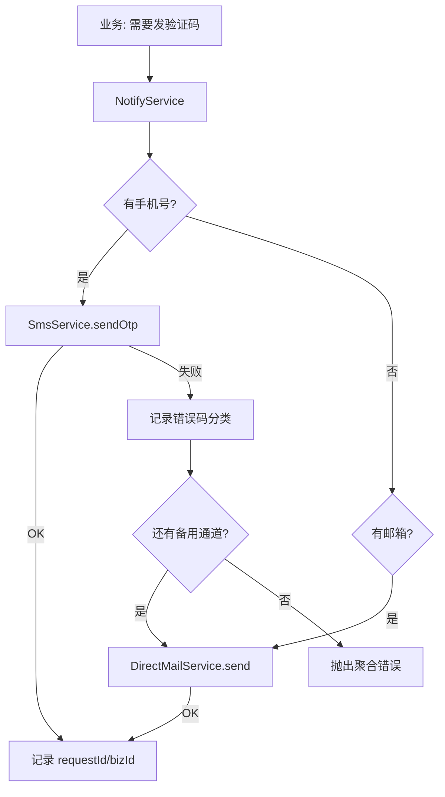

# 11.06 使用阿里云的邮件和短信服务

上一节把发信的抽象做完了，也留了 HTTP API 这条路。到了国内环境，问题会变得具体：邮件要用能过 SPF/DKIM 的发信域名，短信要用审核过的签名和模板，两者都要求「发信主体」可追溯。这一节把阿里云的邮件推送（Direct Mail）和短信服务（SMS）接到 Nest 里，顺带讲清楚它们和国外服务在**审核、限速、回执**上的差别。

## 一、邮件和短信不是同一种通知

两者常被放在一个 `NotifyService` 里，但它们的约束完全不同：

| | 邮件 | 短信 |
| --- | --- | --- |
| 单价 | 极低（万封级才几块钱） | 高（几分钱一条） |
| 前置审核 | 域名验证（SPF/DKIM），一般无需逐条审核 | 签名 + 模板都要审核，内容不能改一个字 |
| 送达判定 | 服务商回执 + webhook，可能进垃圾箱 | 运营商回执，基本是确定性的 |
| 失败原因 | 退信（地址不存在、被拒）、进垃圾箱 | 号码非法、模板参数不匹配、被流控 |
| 长度 | 几乎不限 | 70 字一条，超了按多条计费 |
| 到达速度 | 秒级到分钟级，可能延迟 | 秒级 |

所以「验证码」这类场景，短信是主通道、邮件是兜底；而「账单」「周报」这类，邮件是主通道、短信只发一句「有新的账单，请登录查看」。把两者混在一个方法里、用同一个模板参数，是最常见的写错方式。

## 二、先准备四样东西

在写代码之前，账号里要有这四样，缺一样都会在运行时才炸：

1. **RAM 用户的 AccessKey**，不要用主账号；
2. **短信签名**（`SignName`），审核通过才能用；
3. **短信模板**（`TemplateCode`），模板里的变量用 `${code}` 这种占位；
4. **邮件发信域名**，验证 SPF/DKIM 之后才有发信地址（`AccountName`）。

RAM 权限给到最小：只给短信与邮件推送的发送权限，别图省事挂 `AliyunDysmsFullAccess` 这类全量策略——那个策略连「删除模板」「查询所有发送记录」都包含。

```json
{
  "Version": "1",
  "Statement": [
    { "Effect": "Allow", "Action": ["dysms:SendSms", "dysms:QuerySendDetails"], "Resource": "*" },
    { "Effect": "Allow", "Action": ["dm:SingleSendMail", "dm:BatchSendMail"], "Resource": "*" }
  ]
}
```

密钥只从环境变量或密钥管理服务注入，绝不写进代码、不进镜像：

```bash
ALIYUN_ACCESS_KEY_ID=...
ALIYUN_ACCESS_KEY_SECRET=...
ALIYUN_SMS_SIGN_NAME=会议室预订
ALIYUN_SMS_TEMPLATE_CODE=SMS_123456789
ALIYUN_DM_ACCOUNT=noreply@notify.example.com
```

## 三、短信：三个参数决定成败

短信 SDK 是 `@alicloud/dysmsapi20170525`（当前 4.6.0），配合 `@alicloud/openapi-client` 的 `Config` 使用。它是 CommonJS 包，ESM 项目里用默认导入拿到 Client，命名空间导入拿到模型类：

```ts
// src/notify/sms.service.ts
import { Injectable, Logger } from '@nestjs/common';
import { ConfigService } from '@nestjs/config';
import Dysmsapi20170525, * as $Dysmsapi from '@alicloud/dysmsapi20170525';
import * as $OpenApi from '@alicloud/openapi-client';

@Injectable()
export class SmsService {
  private readonly logger = new Logger(SmsService.name);
  private readonly client: Dysmsapi20170525;

  constructor(private readonly config: ConfigService) {
    this.client = new Dysmsapi20170525(
      new $OpenApi.Config({
        accessKeyId: this.config.getOrThrow<string>('aliyun.accessKeyId'),
        accessKeySecret: this.config.getOrThrow<string>('aliyun.accessKeySecret'),
        endpoint: 'dysmsapi.aliyuncs.com',
      }),
    );
  }

  async sendOtp(phone: string, code: string): Promise<void> {
    const response = await this.client.sendSms(
      new $Dysmsapi.SendSmsRequest({
        phoneNumbers: phone,                                  // 国内号码不用带 +86
        signName: this.config.getOrThrow<string>('aliyun.smsSignName'),
        templateCode: this.config.getOrThrow<string>('aliyun.smsTemplateCode'),
        templateParam: JSON.stringify({ code }),               // 必须是 JSON 字符串
        outId: `otp-${Date.now()}`,                            // 同一手机号每日 10 条内、5 分钟内有效，仍靠 Redis 防重试
      }),
    );

    // 短信接口 HTTP 200 不代表发送成功，要看 Body.Code
    if (response.body?.code !== 'OK') {
      this.logger.error(
        { code: response.body?.code, message: response.body?.message, requestId: response.body?.requestId },
        'sms send failed',
      );
      throw new Error(`sms: ${response.body?.code}`);
    }

    this.logger.log({ requestId: response.body.requestId, bizId: response.body.bizId }, 'sms accepted');
  }
}
```

四个容易踩的点：

- **`templateParam` 是 JSON 字符串**，不是对象。传对象进去，服务端会报 `isv.INVALID_JSON_PARAM`；
- **`Code === 'OK'` 才算成功**。这个接口无论成功失败都返回 HTTP 200，错误信息在 Body 里；
- **签名和模板必须与审核通过的内容完全一致**，换个标点都算不匹配；
- **`bizId` 存下来**，它和 `requestId` 是查回执（`QuerySendDetails`）的唯一入口。

短信按条计费，验证码又天然带来「重发」，所以成本模型要算清楚：一条验证码短信按几分钱算，日活十万、5% 走短信登录、平均 1.3 次发送，一天就是 6500 条；如果被刷（脚本换号码批量请求），一晚上能烧掉一个月的预算。这也是为什么限流必须做在**发信之前**，而不是等平台报错再补救。

邮件便宜到几乎不用算成本，但有自己的额度：发信地址有日限额，新域名有「预热期」，一上来猛发容易把域名信誉打低。两种通道的额度都建议在监控面板上画一条线，用量的 70% 就告警，别等撞墙。

模板和签名是最容易卡住的一步，规则不复杂但很硬：

- **签名**一般是企业名或产品名（2–12 个字），个人开发者能申请到的签名很少，验证码类通常要求企业认证；
- **模板**里的变量只能是 `${code}` 这种形式，变量外的文字一个都不能改，换行、空格、标点都算「不一致」；
- 验证码模板必须让用户在短信里看到「验证码」三个字，并写清有效期；
- 模板不能带 URL、不能诱导下载，否则审核直接驳回。

提交模板前先在控制台「发送测试」里跑一遍，看到短信再写代码——比写完代码再调错误码快得多。

## 四、错误码按「该不该重试」分三类

短信和邮件的错误码都不少，但工程上只需要分三类：

| 类别 | 典型错误码 | 处理 |
| --- | --- | --- |
| 配置错了（重试无用） | `isv.SMS_TEMPLATE_ILLEGAL`、`isv.SMS_SIGNATURE_ILLEGAL`、`isv.AMOUNT_NOT_ENOUGH`、`isv.PRODUCT_UN_SUBSCRIPT` | 打日志、告警，直接失败 |
| 用户侧问题（重试无用） | `isv.MOBILE_NUMBER_ILLEGAL`、`isv.TEMPLATE_MISSING_PARAMETERS`、`isv.SMS_CONTENT_ILLEGAL` | 返回 400/422，提示用户换号码或稍后再试 |
| 限流（可重试） | `isv.BUSINESS_LIMIT_CONTROL`、`isv.DAY_LIMIT_CONTROL`、`isv.MONTH_LIMIT_CONTROL` | 退避重试或直接返回 429 |

```ts
function classifySmsError(code: string): 'config' | 'user' | 'throttle' {
  if (code.startsWith('isv.') && code.includes('LIMIT_CONTROL')) return 'throttle';
  if (code === 'isv.MOBILE_NUMBER_ILLEGAL' || code === 'isv.TEMPLATE_MISSING_PARAMETERS') return 'user';
  return 'config';
}
```

`isv.BUSINESS_LIMIT_CONTROL` 特别容易被误判成代码 bug——它其实是**平台侧流控**，按手机号、签名、模板等多个维度分别计数。看到它先查自己是不是发太快，而不是去改模板。

## 五、平台默认限速比想象中严格

同一签名对同一手机号发验证码，平台默认是 **1 条/分钟、5 条/小时、10 条/天**（[短信发送限制](https://help.aliyun.com/zh/sms/user-guide/message-rules)）。这个额度对企业认证账号可以调，但对个人开发者基本就是这个数。

这意味着：**你自己的限流必须比平台更严，而且要更早返回**。11.05 里的 Redis 冷却（60 秒）、小时 5 封、日 20 封，套在短信上就要改成小时 5 条、日 10 条，与平台对齐。否则用户点第 3 次时平台报 `isv.BUSINESS_LIMIT_CONTROL`，用户看到的是「发送失败」，而不是「请稍后再试」——同一个事实，两种体验。

前端也要配合：倒计时不要从 0 开始数 60 秒就允许再点，因为平台的小时/日额度是累计的；按钮旁边写「今日还能接收 N 条」比单纯倒计时更诚实。

## 六、邮件：SMTP 与 SDK 两条路

阿里云邮件推送既提供 SMTP 中继（可以继续用 11.04 的 nodemailer），也提供 `SingleSendMail` API。

**SMTP 路线**改动最小，换个 host 与账号：

```ts
import nodemailer from 'nodemailer';

const transporter = nodemailer.createTransport({
  host: 'smtpdm.aliyuncs.com',
  port: 465,
  secure: true,
  auth: {
    user: process.env.ALIYUN_DM_ACCOUNT,        // 控制台里的发信地址
    pass: process.env.ALIYUN_DM_PASSWORD,       // 控制台设置的 SMTP 密码
  },
});
```

端口的选择有讲究：阿里云 ECS 上不勾 SSL 用 80、勾 SSL 用 465；公网环境优先 465（SMTPS）。25 端口在很多网络里被封，不要作为默认值（[SMTP 服务地址](https://help.aliyun.com/zh/direct-mail/smtp-endpoints)）。

**SDK 路线**更贴近 API，能拿到 `RequestId` 与更细的错误码：

```ts
// src/notify/dm.service.ts
import { Injectable } from '@nestjs/common';
import { ConfigService } from '@nestjs/config';
import Dm20151123, * as $Dm from '@alicloud/dm20151123';
import * as $OpenApi from '@alicloud/openapi-client';

@Injectable()
export class DirectMailService {
  private readonly client: Dm20151123;

  constructor(private readonly config: ConfigService) {
    this.client = new Dm20151123(
      new $OpenApi.Config({
        accessKeyId: this.config.getOrThrow<string>('aliyun.accessKeyId'),
        accessKeySecret: this.config.getOrThrow<string>('aliyun.accessKeySecret'),
        endpoint: 'dm.aliyuncs.com',
      }),
    );
  }

  async send(html: string, text: string): Promise<void> {
    const response = await this.client.singleSendMail(
      new $Dm.SingleSendMailRequest({
        accountName: this.config.getOrThrow<string>('aliyun.dmAccount'),
        addressType: 1,                    // 1 = 用上面的发信地址；0 = 随机地址
        replyToAddress: false,
        toAddress: 'alice@example.com',
        subject: '【会议室预订】登录验证码',
        htmlBody: html,
        textBody: text,
      }),
    );

    // 邮件 SDK 失败同样看 Code，成功时通常是 200 或 OK
    if (response.body?.code && response.body.code !== 'OK') {
      throw new Error(`dm: ${response.body.code}`);
    }
  }
}
```

发信地址不是随便填的：先在控制台把**发信域名**加进去，按提示配好 SPF、DKIM、MX 记录，验证通过后 `accountName` 才能发信。这一步和 11.04 讲的 DNS 配置是同一件事，只是入口换成了云厂商控制台。

## 七、封成统一的 NotifyService

短信和邮件的调用点应该只有一个，业务代码不关心走哪条通道：



```ts
// src/notify/notify.service.ts
import { Injectable } from '@nestjs/common';
import { SmsService } from './sms.service.js';
import { DirectMailService } from './dm.service.js';

@Injectable()
export class NotifyService {
  constructor(
    private readonly sms: SmsService,
    private readonly mail: DirectMailService,
  ) {}

  /** 验证码：短信优先，邮件兜底；两类都失败才抛错。 */
  async sendOtp(input: { phone?: string; email?: string; code: string }): Promise<void> {
    const errors: string[] = [];

    if (input.phone) {
      await this.sms.sendOtp(input.phone, input.code).catch((error: Error) => errors.push(error.message));
    }
    if (input.email) {
      await this.mail.send(`<p>你的验证码是 <b>${input.code}</b>，5 分钟内有效。</p>`, `你的验证码是 ${input.code}，5 分钟内有效。`)
        .catch((error: Error) => errors.push(error.message));
    }

    if (errors.length === (input.phone ? 1 : 0) + (input.email ? 1 : 0)) {
      throw new Error(`all notify channels failed: ${errors.join('; ')}`);
    }
  }
}
```

「有任何一个通道成功就不抛错」是关键：短信通道被流控时，邮件已经发出去了，此时返回失败会让用户以为没收到、反复点重发，把两个通道的额度一起打光。

## 八、观测：RequestId、BizId 与回执

云服务的排障全靠这两个 ID：

- `RequestId`：一次 API 调用的身份，甩给工单最有说服力；
- `BizId`（短信）/ `RequestId`（邮件）：发送记录的身份，用来查回执。

```ts
// 短信回执：发送后 24 小时内可查
const detail = await client.querySendDetails(
  new $Dysms.QuerySendDetailsRequest({
    phoneNumber: '13900000000',
    sendDate: '20261122',          // 格式 yyyyMMdd
    pageSize: 10,
    currentPage: 1,
  }),
);
```

指标至少四个：发送成功率（按通道分）、失败码 Top N（配置类要立刻告警）、流控触发次数、验证码「发出→校验成功」转化率。最后一个最能说明问题：发信成功但转化率骤降，多半是短信被手机助手拦截，或者邮件的验证码进了垃圾箱。

回执查询有两个现实限制：一是**时间窗口**（短信一般只保留 24 小时内记录），二是**分页**（要按天查、逐页翻）。所以别把它当实时监控用，它是「用户投诉时回溯」的工具。实时成功率应该由你自己的发送日志算，回执只用来解释个别失败。

退信同理：邮件的 `bounced` 只说明「没送到」，具体是地址不存在还是对方拒收，要看退信内容或服务商的事件详情。维护一张抑制名单（`email_suppressions`），把硬退信、投诉的地址记进去，发信前先过滤——重复给不存在地址发信，会持续拉低域名信誉。

## 九、别让发信拖慢请求

发信是外部调用，延迟从几十毫秒到几秒不等，还可能超时。放在请求链路里同步执行，等于把云厂商的抖动变成你接口的 P99。

更稳的做法是「入队 + 消费者发送」：接口只做校验、落库、入队，立刻返回 `202`；消费者负责调用短信/邮件 SDK、重试、写回执。这样即使云厂商限流，也只是队列积压，用户仍然能收到「已发送」的确认，重试也不会重复发信——队列里的任务用 `outId` 或业务键做去重即可。

同步发送只在一处可以接受：内部管理后台的「手动补发」，那里本来就要等结果。

## 十、测试环境怎么发

上线前总要验证一遍，但短信没法「假发」——平台返回成功就是真发出去、真扣钱。所以测试阶段要主动收窄：

- 控制台里可以绑定**测试手机号**，只允许给这几个号码发；
- 用「发送测试」功能在控制台直接发，不经代码，先确认签名与模板没问题；
- 代码里用 `SMS_TEST_MODE=true` 把收件人替换成固定测试号，避免测试数据流出真实用户；
- 邮件更简单：把 `toAddress` 指向自己的邮箱，或用 11.04 里讲的 Mailpit 本地接收。

CI 里不要跑真实发送。把发送调用抽到一个接口后面，测试环境注入「记录到内存」的实现，断言「调用了、参数对」即可；真正需要发给真实号码的验证，放在发布前的人工清单里。

## 十一、Checkpoint

没有阿里云账号也能先验证接线是否正确（真实发信需要账号，这一步未实测）：

```bash
# 1) 只做参数构造与配置校验，不真正发送
node -e "
  const cfg = ['ALIYUN_ACCESS_KEY_ID','ALIYUN_ACCESS_KEY_SECRET','ALIYUN_SMS_SIGN_NAME','ALIYUN_SMS_TEMPLATE_CODE'];
  const missing = cfg.filter((k) => !process.env[k]);
  if (missing.length) { console.error('missing:', missing.join(',')); process.exit(1); }
  console.log('config ok');
"

# 2) 启动后打一枪，观察响应里的 requestId / bizId 是否写进日志
curl -s -X POST localhost:3000/api/auth/otp/send \
  -H 'content-type: application/json' -d '{"phone":"13900000000"}'

# 3) 确认 Redis 里的限流键与冷却生效（60 秒内第二次应 429）
redis-cli --scan --pattern 'otp:*'
```

## 十二、坑表

| 写法 | 后果 |
| --- | --- |
| 用主账号 AccessKey | 泄露即全账号沦陷，无法最小权限 |
| `templateParam` 传对象 | `isv.INVALID_JSON_PARAM`，模板变量全空 |
| 看到 HTTP 200 就当成功 | 失败被静默吞掉，用户收不到码 |
| 自己的限流比平台松 | 用户看到的是云厂商错误码，不是「稍后再试」 |
| 签名/模板内容自己改一字 | 与审核版本不匹配，直接报非法 |
| 邮件 25 端口当默认 | 公网大量网络封锁，连接超时 |
| `accountName` 未验证域名 | 发信被拒，错误码指向发信地址 |
| 两个通道「全失败才退回」写成「任一失败就抛错」 | 已发出的验证码被当成失败，用户重复点 |
| 不记 `RequestId`/`BizId` | 出问题只能猜，无法向云厂商举证 |

<!-- chapter-nav:start -->
---

← [11.05 实现基于邮箱验证码的登录](11.05-实现基于邮箱验证码的登录.md) · [本章目录](_chapter.md) · [11.07 定时任务+Redis实现阅读量计数](11.07-定时任务+Redis实现阅读量计数.md) →
<!-- chapter-nav:end -->
