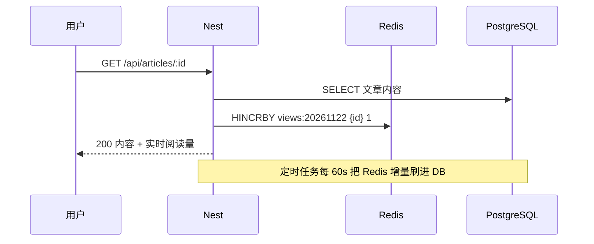

# 11.07 定时任务+Redis实现阅读量计数

阅读量看起来是最简单的功能：`UPDATE articles SET view_count = view_count + 1 WHERE id = $1`。写着写着就会发现它有两个问题：一是**写放大**，热门文章每被看一次就更新同一行，行锁把并发写全排成一条队；二是**计数器变成业务表的一部分**，一旦这行被别的事务锁住，阅读请求也跟着卡住。

这一节把阅读量从「写库」改成「先累加、后刷盘」，核心是三件事：Redis 怎么存、什么时候刷、刷丢了怎么办。

## 一、先看清楚「一次浏览」写了几次库

朴素写法的问题不在那条 SQL 本身，而在于它落在请求链路上：



如果把 `HINCRBY` 换成 `UPDATE ... view_count = view_count + 1`，这条 SQL 就变成全站最热的写操作：同一篇文章的所有请求都抢同一行的行锁，锁等待会把连接池占满，最后影响的是下单、登录这些真正的核心链路。

所以计数必须**离开主写路径**，并且允许最终一致。

## 二、键设计：用日期做前缀，让刷盘和过期变简单

计数键有两种常见形状：

| 形状 | 示例 | 优点 | 问题 |
| --- | --- | --- | --- |
| 每篇一个 key | `views:{articleId}` | 定位简单 | 刷盘要 `SCAN` 全库，过期时间难以统一 |
| 每天一个 Hash | `views:20261122`，field 是文章 id | 一次刷一天的增量，`HDEL` 精确取走，TTL 好设 | 单 key 可能变大，需要控制分片 |

选第二种。它把「刷盘」变成「读一个 Hash、取走、批量 UPDATE」，也天然带上时间窗口——某天的计数刷完就该消失，不会留一堆永不清理的 key。

```ts
// src/views/views.constants.ts
export const viewsKey = (date = new Date()): string =>
  `views:${date.toISOString().slice(0, 10).replaceAll('-', '')}`;

export const uvKey = (articleId: string, viewerId: string, date = new Date()): string =>
  `uv:${date.toISOString().slice(0, 10).replaceAll('-', '')}:${articleId}:${viewerId}`;
```

Hash 的 field 用文章 id，value 是增量。**不要**在 field 里塞用户 id，那样 key 会膨胀到百万级，刷盘和删除都会变慢。

## 三、PV 和 UV：口径先定，别事后改

「阅读量」至少有两种口径，产品说「阅读量」时一定要问清楚：

- **PV**：每次打开算一次，同一个人刷新 10 次是 10；
- **UV**：同一个人（按登录 `userId` 或匿名 `cookieId`）在当天算一次。

PV 用 `HINCRBY` 就够；UV 必须去重，用 `SET NX EX` 抢一个标记，抢到才计数：

```ts
// src/views/views.service.ts
@Injectable()
export class ViewsService {
  constructor(@Inject(REDIS_CLIENT) private readonly redis: Redis) {}

  /** 记录一次浏览：PV 无条件 +1，UV 靠 SETNX 去重。 */
  async record(articleId: string, viewerId: string): Promise<void> {
    const pipeline = this.redis.pipeline();
    pipeline.hincrby(viewsKey(), articleId, 1);

    const fresh = await this.redis.set(uvKey(articleId, viewerId), '1', 'EX', 86_400, 'NX');
    if (fresh === 'OK') {
      pipeline.hincrby(`${viewsKey()}:uv`, articleId, 1);
    }
    await pipeline.exec();
  }
}
```

两个提醒：匿名用户的 `viewerId` 用 cookie 里的随机 id，别用 IP——同一个出口 IP 背后可能是整栋楼；`SET NX EX` 的过期时间要比日切晚一点（比如 26 小时），否则跨零点前后会重复计数。

## 四、累加时别忘了给 key 设过期

`HINCRBY` 对不存在的 key 会直接创建，但**不会设 TTL**。如果你只在「第一次创建」时设过期，就要判断返回值；更稳的是用 Lua 把「累加 + 补过期」做成一个原子操作：

```ts
const HINCRBY_WITH_TTL = `
local n = redis.call('HINCRBY', KEYS[1], ARGV[1], 1)
if n == 1 then
  redis.call('EXPIRE', KEYS[1], ARGV[2])
end
return n
`;

await this.redis.eval(HINCRBY_WITH_TTL, 1, viewsKey(), articleId, 172_800);
```

`if n == 1` 是关键：只有这个 field 第一次被创建时才设过期，后面的累加不刷新 TTL。设 48 小时是为了给刷盘失败留重试窗口——一天两次刷盘都没成功，数据才真的丢。

如果直接在 `record()` 里写 `EXPIRE`，高并发下会有大量重复的过期命令；用 Lua 只有第一次生效，成本最低。

## 五、刷盘：定时任务只做一件事

定时任务用 `@nestjs/schedule`（12.0.4，依赖 `cron` 4.4.0）：

```ts
// src/views/views-flush.service.ts
import { Injectable, Logger } from '@nestjs/common';
import { Cron, CronExpression } from '@nestjs/schedule';

@Injectable()
export class ViewsFlushService {
  private readonly logger = new Logger(ViewsFlushService.name);

  constructor(private readonly views: ViewsService) {}

  // 每分钟刷一次；上一轮没跑完就不再启动新的一轮
  @Cron(CronExpression.EVERY_MINUTE, { waitForCompletion: true, name: 'views-flush' })
  async flush(): Promise<void> {
    const moved = await this.views.takeAndFlush();
    if (moved > 0) this.logger.log({ moved }, 'views flushed');
  }
}
```

`waitForCompletion: true` 很重要：刷盘慢的时候（比如数据库抖了），下一分钟的触发会直接跳过，而不是叠加执行。默认 `threshold` 是 250ms，超过这个延迟的错过触发会被丢弃并打警告——对「每分钟一次」的任务来说这是好事。

`name` 让任务可以在别处通过 `@InjectCronRef` 拿到引用做动态启停，这是 v12 的用法。

## 六、「取走」必须原子，失败要能回补

刷盘最怕的是「取了没写成功」。顺序有三种，只有一种是对的：

| 顺序 | 崩溃点 | 结果 |
| --- | --- | --- |
| 先 `DEL` 再 UPDATE | DEL 之后崩 | 增量永久丢失 |
| 先 UPDATE 再 `DEL` | UPDATE 之后崩 | 下次重复累加 |
| Lua 原子取走，失败再回补 | 任意点 | 最多丢一个窗口，可观测 |

用 Lua 把 `HGETALL` 和 `DEL` 合成一个操作：

```ts
const TAKE_HASH = `
local data = redis.call('HGETALL', KEYS[1])
if #data == 0 then return {} end
redis.call('DEL', KEYS[1])
return data
`;
```

拿到 `[field1, value1, field2, value2, …]` 之后批量写库；写失败就把这批数用 `HINCRBY` 回补到当前分钟的 key 里，等下一轮再来。

```ts
async takeAndFlush(): Promise<number> {
  const key = viewsKey();
  const flat = (await this.redis.eval(TAKE_HASH, 1, key)) as string[];
  if (flat.length === 0) return 0;

  const deltas = new Map<string, number>();
  for (let i = 0; i < flat.length; i += 2) {
    deltas.set(flat[i], Number(flat[i + 1]));
  }

  try {
    await this.repository.addViewCounts(deltas);
    return deltas.size;
  } catch (error) {
    // 回补：失败不能静默吞掉，否则这一分钟的浏览就没了
    const restore = this.redis.pipeline();
    for (const [id, delta] of deltas) restore.hincrby(key, id, delta);
    await restore.exec();
    this.logger.error({ err: error, articles: deltas.size }, 'views flush failed, restored');
    throw error;
  }
}
```

注意回补写回的 key 可能已经过期（极端情况下），回补时顺手补一个 `EXPIRE` 更稳。

## 七、批量写库：一条 SQL，不要循环 update

几百篇文章的增量逐条 `UPDATE` 就是几百次往返。用 `unnest` 把数组拆成行，一条语句搞定：

```sql
UPDATE articles AS a
SET view_count = a.view_count + d.delta
FROM unnest($1::uuid[], $2::bigint[]) AS d(id, delta)
WHERE a.id = d.id;
```

```ts
// src/views/views.repository.ts
@Injectable()
export class ViewsRepository {
  constructor(@Inject(PG_POOL) private readonly pool: Pool) {}

  async addViewCounts(deltas: Map<string, number>): Promise<void> {
    const ids = [...deltas.keys()];
    const values = [...deltas.values()];
    await this.pool.query(
      `UPDATE articles AS a
         SET view_count = a.view_count + d.delta
         FROM unnest($1::uuid[], $2::bigint[]) AS d(id, delta)
        WHERE a.id = d.id`,
      [ids, values],
    );
  }
}
```

这里直接走 `pg` 的 `Pool`，而不是 Prisma 8 的链式 API：批量更新是几百行一条语句的场景，ORM 的逐条 `update` 只会更慢。Prisma 8 的 `postgres()` 恰好支持传入外部连接池（`postgres({ contract, pg: pool })`），所以两个客户端可以共用同一个池，不必多开一份连接。

顺便说清一个反直觉的点：**文章被删除了，UPDATE 就影响 0 行**。此时这批增量应当丢弃（文章都没了），而不是回补——回补会让 key 永远删不掉。判断方法很简单：看 `rowCount`，如果远小于 `deltas.size` 记一条日志即可。

## 八、读的时候要不要实时

用户打开文章时，页面上的阅读量应该是「库里已刷的 + Redis 里没刷的」：

```ts
async readCount(articleId: string, dbValue: number): Promise<number> {
  const pending = await this.redis.hget(viewsKey(), articleId);
  return dbValue + Number(pending ?? 0);
}
```

这次 `HGET` 是一次额外的读，但它很便宜，而且不会失败——Redis 挂了就退回 `dbValue`，页面显示稍旧的数字，比接口 500 好得多。

如果产品要求「精确实时」，那就得在写入路径同步更新 `view_count`，前面所有优化都白做。先确认需求，再选架构。

## 九、热点与容量

单篇文章刷屏时，`views:20261122` 这个 Hash 的一个 field 会被反复 `HINCRBY`，单 key 的写入能力就是 Redis 单线程的上限（十万级 QPS，通常够用）。真正要提前准备的是两件事：

- **大 key**：一天的 Hash 可能积累几十万 field，`HGETALL` 会阻塞主线程。超过一万 field 就该考虑按小时切 key（`views:2026112213`），或者按文章 id 取模分桶（`views:20261122:{id % 8}`），刷盘时分别取、汇总后写库；
- **热 key**：某篇文章瞬时百万 PV，单 key 会打到单分片。分桶同样能解决——`views:20261122:{hash(articleId) % 8}`，八个小 key 分摊写入。

分桶的代价是刷盘要多读几个 key、代码要处理「同一篇文章的增量分散在多个桶」，换来的是写入不被单分片卡住。十万级日活以下不必上，先量再改。

## 十、多副本下只有一台该刷盘

`@nestjs/schedule` 是进程内的定时器：起了 4 个副本，就是 4 个任务同时跑。它们会同时 `HGETALL` 同一个 key——Lua 保证只有一个能取到数据，其余拿到空数组，结果是对的，但白白多了三次 Redis 往返；更糟的是「回补」逻辑：A 取走、写库失败回补，B 同时取走又刷成功，增量会被算两次。

两种处理方式，按规模选：

- **分布式锁**：任务开头 `SET views:flush:lock <instanceId> NX EX 55`，抢不到就退出。锁的过期时间要略小于任务间隔，避免下一轮被死锁挡住；释放时用 Lua 比对 `instanceId` 再删，防止误删别人的锁。这是单机 Redis 最省事的做法；
- **独立 worker**：刷盘任务从 API 进程里拿出来，单独起一个只跑定时任务的进程（`nest start --entryPoint worker` 或独立部署）。它天然只有一个实例，不需要锁，还能按需扩容而不影响 API。

小项目用锁，中大型直接拆 worker。别指望「反正 Lua 是原子的」——原子的是取走，不是「取走 + 写库」这一整段。

## 十一、刷盘间隔怎么定

间隔是一个三边权衡：**丢失窗口**、**数据库写入量**、**Redis 内存**。

- 每分钟：崩溃最多丢 1 分钟的量；一天 1440 次 UPDATE，每次几百行，数据库完全扛得住；
- 每 5 分钟：写入次数降到 288 次，但崩溃丢 5 分钟，Redis 里攒的 field 也更多；
- 每小时：适合超大规模（文章数千万），但丢失窗口和内存都要另做保障。

不管选哪个，都要保证「刷盘耗时 < 间隔」。如果一轮要跑 90 秒、却配了 60 秒的 cron，`waitForCompletion` 会让它每隔一轮才执行一次，实际间隔变成 2 分钟——这不是 bug，是保护，但你得知道自己实际的间隔是多少。

监控上加两个指标：**待刷增量的 field 数**（超阈值说明刷不过来）、**刷盘耗时**（接近间隔就要调大间隔或分片）。

## 十二、防刷与对账

阅读量是最容易被刷的指标：脚本循环请求，一分钟就能刷出十万。三层防护，按成本从低到高：

1. **同一 viewer 同一文章 60 秒内只记一次**：`SET view:throttle:{articleId}:{viewerId} 1 NX EX 60`，抢不到就跳过计数。这一层几乎零成本；
2. **同一 IP 每分钟上限**：`INCR view:ip:{ip}:{minute}`，超过 30 次直接不计数（或降级为只记 PV 不记 UV）；
3. **异常检测**：某篇文章 5 分钟内增量超过历史同时段 10 倍，告警并人工确认，必要时临时把该文章的计数切到「只信登录用户」。

对账则是另一件事：刷盘是「增量累加」，一旦某次回补或重复写导致数字漂移，只能靠日终对账发现。最简单的做法是每天凌晨用数据库的历史快照加当天的 PV 数重算一遍，和 `view_count` 比对，差异超过千分之一就记日志、人工处理——不要自动覆盖，因为覆盖会把你还没查到的问题一起抹掉。

## 十三、Checkpoint

```bash
# 1) 模拟三次浏览，看 Hash 里的增量
for i in 1 2 3; do curl -s -o /dev/null localhost:3000/api/articles/$ID; done
redis-cli HGETALL "views:$(date +%Y%m%d)"

# 2) 看 TTL 是否在（应该接近 48 小时）
redis-cli TTL "views:$(date +%Y%m%d)"

# 3) 手动触发一次刷盘（如果暴露了管理接口），再看库里是否增加
psql "$DATABASE_URL" -c "SELECT id, view_count FROM articles WHERE id = '$ID';"

# 4) 刷完之后 key 里的 field 应该被取走；库里数字与第 1 步看到的一致
redis-cli HGETALL "views:$(date +%Y%m%d)"
```

## 十四、坑表

| 写法 | 后果 |
| --- | --- |
| 每次浏览 `UPDATE view_count = view_count + 1` | 热门行锁竞争，写链路被拖垮 |
| `HINCRBY` 后不设 TTL | 计数器 key 永不过期，内存只增不减 |
| 先 `DEL` 再 UPDATE | 中间崩溃，这一分钟的浏览永久丢失 |
| 先 UPDATE 再 `DEL` | 中间崩溃，下次重复累加，数字虚高 |
| 刷盘失败静默吞掉 | 数据丢了也没人知道，只能靠用户反馈发现 |
| 逐条 update 刷盘 | 几百次往返，刷盘时间超过刷盘间隔 |
| UV 用 IP 去重 | 整栋楼算一个人，或者一个人算十个 |
| `HGETALL` 一天的大 Hash | 阻塞 Redis 主线程，所有请求一起变慢 |
| 阅读量要求强一致 | 和「先累加后刷盘」的架构直接冲突，必须二选一 |

<!-- chapter-nav:start -->
---

← [11.06 使用阿里云的邮件和短信服务](11.06-使用阿里云的邮件和短信服务.md) · [本章目录](_chapter.md)
<!-- chapter-nav:end -->
