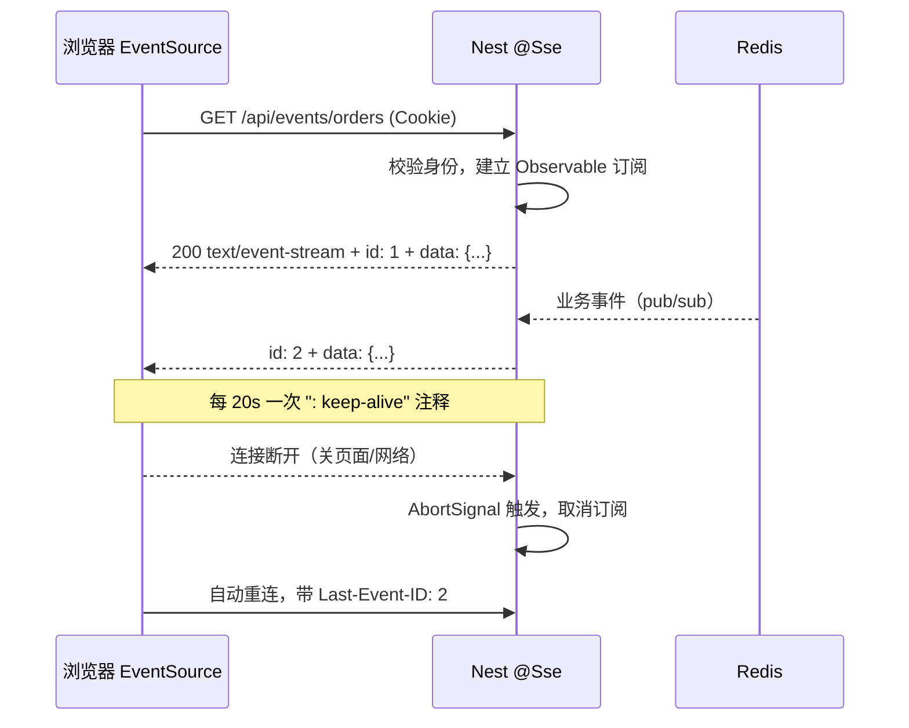

# 11.10 Nest实现ServerSentEvent数据推送

需要「服务器主动把新数据推给页面」时，很多人第一反应是 WebSocket。但很多场景——订单状态、通知数、构建日志、AI 逐字输出——其实只需要**服务器 → 浏览器单向**，用 SSE（Server-Sent Events）更省事：它就是一条不结束的 HTTP 响应，走 80/443，穿代理，浏览器自带重连。

这一节讲 Nest 里怎么用 SSE，以及 Nest 12 已经替你处理了哪些事（很多人还在手写响应头，其实不用了），再讲清楚上线才会遇到的：多副本广播、慢客户端、反向代理、鉴权。

## 一、先判断：SSE 还是 WebSocket

| 维度 | SSE | WebSocket |
| --- | --- | --- |
| 方向 | 服务器 → 客户端单向 | 双向 |
| 协议 | 普通 HTTP（`text/event-stream`） | 握手升级协议 |
| 代理/防火墙 | 友好，几乎不用配置 | 需要 `Upgrade` 支持，部分代理会断 |
| 断线重连 | 浏览器 `EventSource` 自带（含 `Last-Event-ID`） | 自己实现 |
| 数据格式 | 文本（UTF-8） | 文本或二进制 |
| 连接数限制 | HTTP/1.1 下同域约 6 条 | 不受此限 |
| 适用 | 通知、进度、日志、AI 流式输出 | 聊天、协同编辑、游戏 |

判断标准很简单：**需要客户端随时往服务器发消息吗？** 不需要就用 SSE。需要双向、需要二进制，才上 WebSocket。



这张图里有两个容易被忽略的点：连接建立时要做一次身份校验和快照（不然重连后中间丢了什么谁也不知道），以及断开时的清理必须和建立时的资源一一对应。

## 二、最小实现：一个装饰器 + 一个 Observable

```ts
import { Controller, MessageEvent, Sse } from '@nestjs/common';
import { Observable, interval, map } from 'rxjs';

@Controller('events')
export class EventsController {
  @Sse('tick')
  tick(): Observable<MessageEvent> {
    return interval(1000).pipe(
      map((i) => ({ data: { seq: i, at: new Date().toISOString() } })),
    );
  }
}
```

`MessageEvent` 有五个字段，正好对应 SSE 协议：

| 字段 | 作用 |
| --- | --- |
| `data` | 事件内容；传对象会被 `JSON.stringify`（Nest 12 自动做） |
| `type` | 事件名，客户端用 `addEventListener(type, ...)` 监听 |
| `id` | 事件 id，断线重连时浏览器通过 `Last-Event-ID` 头带回来 |
| `retry` | 建议的重连间隔（毫秒） |
| `comment` | 注释行（`: ...`），常用来做心跳 |

返回值必须是 `Observable`，不能是 `Promise`——这是 SSE 和普通接口最大的差别。

## 三、Nest 12 已经替你做的事

网上很多 SSE 教程会让你手写这些响应头：

```ts
res.setHeader('Content-Type', 'text/event-stream');
res.setHeader('Cache-Control', 'no-cache');
res.setHeader('Connection', 'keep-alive');
res.setHeader('X-Accel-Buffering', 'no');
```

**在 Nest 12 里不需要。** `SseStream` 会自己 `writeHead` 并设置：`Content-Type: text/event-stream`、`Cache-Control: private, no-cache, no-store, must-revalidate, max-age=0, no-transform`、`Pragma: no-cache`、`Expires: 0`、`X-Accel-Buffering: no`（这一条是给 Nginx 的，避免它缓冲响应），HTTP/1.1 下还会加 `Connection: keep-alive`（HTTP/2 下这个头非法，框架会跳过）；同时设置 socket 的 `setKeepAlive(true)`、`setNoDelay(true)`、`setTimeout(0)`。

还有两个细节：如果事件没有给 `id`，Nest 会自动递增一个 id（注释型心跳除外）；响应头是在第一条消息写出时才提交的，所以你在拦截器里还能改状态码和额外头。

第三个细节和错误处理有关：**Observable 抛错会直接结束响应**。客户端看到的是连接断开，然后浏览器按 `retry` 重连——如果错误是「数据库暂时不可用」，重连风暴会把问题放大。稳妥的写法是在流内部 `catchError` 转成一条业务事件，而不是让流结束：

```ts
return this.source.pipe(
  catchError((err) => {
    this.logger.error({ err }, 'sse source failed');
    return of({ type: 'error', data: { message: 'stream paused' } });
  }),
);
```

这样客户端能看到「流暂停了」，服务端也保住了连接，恢复后继续推。

也就是说，**你只需要产出 Observable**。手写响应头反而可能和框架冲突。

顺带说清楚一个常见疑问：SSE 要不要手动 `res.flushHeaders()`、要不要 `setInterval` 发注释保活？前者框架在提交头时已经调用，后者是你的业务选择（见第五节），框架不会替你心跳。

## 四、数据从哪来：别把单播 Observable 发给多个订阅者

`interval(1000)` 这种冷 Observable，每个订阅者都会独立起一个定时器——两个用户连上来，就是两个定时器、两套序列。业务数据通常是「一份数据源，多个连接」，要用 `Subject` 多播：

```ts
// src/events/events.service.ts
@Injectable()
export class EventsService implements OnModuleDestroy {
  private readonly orders = new Subject<MessageEvent>();
  private readonly stop$ = new Subject<void>();

  /** 业务侧调用：某订单状态变了 */
  publishOrderStatus(orderId: string, status: string): void {
    this.orders.next({ type: 'order', data: { orderId, status } });
  }

  /** 某个连接的事件流 */
  orderStream(): Observable<MessageEvent> {
    return this.orders.asObservable().pipe(takeUntil(this.stop$));
  }

  onModuleDestroy(): void {
    this.stop$.next();
    this.stop$.complete();
    this.orders.complete();
  }
}
```

```ts
@Controller('events')
export class EventsController {
  constructor(private readonly events: EventsService) {}

  @Sse('orders')
  orders(): Observable<MessageEvent> {
    return this.events.orderStream();
  }
}
```

`Subject` 有一个必须知道的特性：**没有订阅者时，`next` 出去的消息直接丢弃**。所以「用户刚连上，之前 3 秒的状态变化要不要补」这类需求，不能只靠 Subject，要在连接建立时先查一次当前状态（快照 + 增量）。

## 五、心跳：让代理和浏览器都知道连接还活着

空闲的 SSE 连接很容易被中间层判定为「卡死」而断开——Nginx 默认 `proxy_read_timeout` 60 秒，云厂商的 LB 也各有超时。心跳用注释行，不触发客户端的 `message` 事件，最干净：

```ts
@Sse('orders')
orders(): Observable<MessageEvent> {
  return merge(
    this.events.orderStream(),
    interval(20_000).pipe(map(() => ({ comment: 'keep-alive' }))),
  );
}
```

20–25 秒一次比较稳：小于常见 60 秒超时，又不会太吵。`retry` 字段可以在第一条事件里给出（比如 3000），告诉浏览器断线后多久重连。

## 六、断点续传：Last-Event-ID 怎么用

浏览器自动重连时会带上 `Last-Event-ID` 头，值是它收到的最后一个事件的 `id`。你可以用它补发断线期间错过的事件——但前提是**你的事件 id 是有序、可定位的**。

最简单的做法是给每条事件一个单调递增的 id，并在 Redis 里保留最近 N 条：

```ts
private seq = 0;

publish(event: unknown): void {
  const id = String(++this.seq); // 多副本时要用 Redis INCR
  this.redis.zadd('events:buffer', Date.now(), JSON.stringify({ id, event }));
  this.redis.zremrangebyrank('events:buffer', 0, -1001); // 只留最近 1000 条
  this.subject.next({ id, data: event });
}

async replay(lastEventId: string | undefined): Promise<MessageEvent[]> {
  if (!lastEventId) return [];
  const raw = await this.redis.zrange('events:buffer', 0, -1);
  const all = raw.map((item) => JSON.parse(item) as { id: string; event: unknown });
  const index = all.findIndex((item) => item.id === lastEventId);
  return index === -1 ? [] : all.slice(index + 1).map((item) => ({ id: item.id, data: item.event }));
}
```

controller 里把 `@Headers('last-event-id')` 取出来，先 `replay` 再 `merge` 实时流：

```ts
@Sse('orders')
orders(@Headers('last-event-id') lastEventId?: string): Observable<MessageEvent> {
  return from(this.events.replay(lastEventId)).pipe(
    concat(this.events.orderStream()),
  );
}
```

三个现实约束：**缓冲区有上限**（错过太多就只能给「已过期，请刷新」）、**id 必须跨副本唯一**（用 Redis `INCR` 或时间戳+实例 id）、**补发可能重复**（客户端要按 id 去重，或接受「至少一次」语义）。

如果业务不允许丢事件，别用 SSE 的补发机制硬扛，改用「连上先拉一次全量快照，再收增量」——和前端状态同步是一个套路。

## 七、断开与资源回收

客户端关页面时，连接就断了，但你的 Observable 里的定时器、Redis 订阅、数据库游标不会自动清理——除非你在 `unsubscribe` 里动手。Nest 12 提供了 `@SseSignal()`，注入一个和这条 SSE 响应同生命周期的 `AbortSignal`：

```ts
@Sse('chat/:roomId')
async chat(
  @Param('roomId') roomId: string,
  @SseSignal() signal: AbortSignal,
): Promise<Observable<MessageEvent>> {
  const session = await this.chat.openSession(roomId);
  if (signal.aborted) {
    await session.close();
    return EMPTY;
  }
  return new Observable<MessageEvent>((subscriber) => {
    const sub = session.messages$.subscribe(subscriber);
    signal.addEventListener('abort', () => session.close(), { once: true });
    return () => {
      sub.unsubscribe();
      session.close(); // 幂等，重复关闭要能承受
    };
  });
}
```

注意装饰器文档里的提醒：这个 signal **在流正常结束时也会 abort**，所以 `signal.aborted` 只在「返回 Observable 之前」能用来判断客户端是否已经走了；清理逻辑要写成幂等的。

另一个保护的参数是 `maxPendingDataLength`（默认 4MB 字符）：慢客户端读不过来时，事件在内存里堆积，超过上限框架会直接断开连接并打警告。给「日志流」这类高吞吐场景可以调大：

```ts
@Sse('build-logs', { maxPendingDataLength: 64 * 1024 * 1024 })
```

## 八、鉴权：EventSource 不能带自定义头

浏览器的 `EventSource` 不支持设置 `Authorization` 头，这是 SSE 最不方便的地方。三个选择：

1. **Cookie**：最推荐。同域下浏览器自动带上，配合 `withCredentials: true` 和服务端 CORS 白名单；用 `09` 章讲的 session/JWT cookie 都能直接复用；
2. **短时 query token**：`/events/orders?token=xxx`，token 必须短期（30–60 秒）、一次有效、只用于 SSE。缺点是会进访问日志和 Referer，所以要短期；
3. **先 POST 换票，再用票连 SSE**：流程最干净，前端多一次请求。

不管哪种，都要在服务端校验**这个连接能看哪些数据**——SSE 长连接很容易漏掉「按用户过滤」这一步，变成越权广播：用户 A 连上后收到了用户 B 的订单事件，这类事故在 SSE 里比在普通接口里更常见，因为连接建立后不再有请求级别的鉴权。

## 九、反向代理与部署

SSE 穿 Nginx 要确认三件事：

```nginx
location /api/events/ {
    proxy_pass http://api;
    proxy_http_version 1.1;
    proxy_set_header Connection "";
    proxy_buffering off;          # 关键：不缓冲，事件立即下发
    proxy_cache off;
    proxy_read_timeout 3600s;     # 长连接别 60 秒就断
    chunked_transfer_encoding on;
}
```

Nest 已经带了 `X-Accel-Buffering: no`，但 Nginx 侧显式 `proxy_buffering off` 更保险（有些配置会忽略响应头）。另外别在 SSE 路由上开 gzip：压缩需要攒数据，会把「实时」变成「批量」。

HTTP/2 下 SSE 工作正常，而且没有 6 连接数限制——这是升级到 HTTP/2 的一个实际收益。

还有一个容易被忽略的细节：**SSE 连接会占用一个并发连接**。HTTP/1.1 下浏览器对同域只开 6 个连接，用户同时开了 6 个标签页看日志，第 7 个页面连普通接口都会被排队。这不是服务端能修的，要么上 HTTP/2，要么把多个数据流复用成一条连接、按 `type` 区分事件（推荐后者，前端也更好管理）。

## 十、多副本：Subject 只在当前进程

这是上线后必踩的坑：起了 3 个副本，用户 A 的 SSE 连在副本 1，业务事件在副本 2 产生，调用 `Subject.next` 之后——A 什么都没收到。

SSE 的广播必须跨进程。两种做法：

- **Redis pub/sub**：`publish` 到 `events:orders`，每个副本订阅并转成自己的 `Subject`。简单、实时，但 Redis 不持久化，断线期间的消息就丢了；
- **Redis Stream / BullMQ**：需要可靠投递时用，消费者组按连接或按用户分流，支持断点续传（把 `Last-Event-ID` 映射到 stream id）。

```ts
// 副本启动时订阅，收到后转成本地 Subject
await this.subscriber.subscribe('events:orders', (message) => {
  this.events.deliver(JSON.parse(message));
});
```

两种方案的取舍：

| 方案 | 延迟 | 可靠性 | 复杂度 | 适用 |
| --- | --- | --- | --- | --- |
| Redis pub/sub | 毫秒级 | 最多一次，断线即丢 | 低 | 通知数、在线状态、进度 |
| Redis Stream | 毫秒级 | 至少一次，可回放 | 中（要处理重复） | 订单状态、支付回调结果 |
| BullMQ | 毫秒到秒级 | 至少一次，带重试 | 中高 | 需要重试和延迟的业务事件 |

反过来说，如果业务量小、可以接受「用户挂在哪个副本就只收哪个副本的事件」，也可以不做广播——但要把「哪些事件必须跨副本」在评审时明确写下来，否则后面加副本就会出问题。

## 十一、客户端怎么写

浏览器端只有十几行，但有两个坑：`onerror` 会先触发、然后浏览器自己重连；如果服务端返回 401，浏览器也会无限重试，所以鉴权失败要能区分。

```ts
const es = new EventSource('/api/events/orders', { withCredentials: true });

es.addEventListener('order', (e) => {
  const payload = JSON.parse((e as MessageEvent).data);
  console.log('order changed', payload);
});

es.onerror = (e) => {
  // readyState: 0=CONNECTING（浏览器在重连）, 2=CLOSED（不会再重连）
  if (es.readyState === EventSource.CLOSED) {
    console.warn('SSE closed permanently', e);
  }
};
```

要主动关闭时记得 `es.close()`——组件卸载不关会累积连接，尤其在 SPA 里来回切页面时。

## 十二、Checkpoint

```bash
# 1) 看响应头：Content-Type 必须是 text/event-stream
curl -sI localhost:3000/api/events/tick -H 'accept: text/event-stream' | head -8

# 2) 持续接收，观察每秒一条、data 是 JSON
curl -N localhost:3000/api/events/tick

# 3) 心跳：20 秒左右应该出现一行以 ": " 开头的注释
curl -N localhost:3000/api/events/orders | grep --line-buffered '^:'

# 4) 断线重连带 Last-Event-ID（curl 模拟）
curl -N -H 'Last-Event-ID: 42' localhost:3000/api/events/orders
```

## 十三、坑表

| 写法 | 后果 |
| --- | --- |
| 返回 `Promise` 而不是 `Observable` | 路由不按 SSE 处理，响应直接结束 |
| 每个连接 `new Subject()` | 每个用户只收到自己的，广播失效 |
| 多副本直接用进程内 Subject | 事件只到同副本的连接，其它用户收不到 |
| 没有心跳 | 代理 60 秒超时断连，前端看起来「随机掉线」 |
| 手写 SSE 响应头 | 可能和框架冲突（重复头/HTTP2 非法头） |
| 忘记清理订阅/定时器 | 连接断了资源还在，内存随时间上涨 |
| 用 `EventSource` 传 Authorization 头 | 浏览器不支持，鉴权永远失败 |
| 长连接建立后不再校验数据归属 | 越权广播，A 收到 B 的数据 |
| SSE 路由开 gzip | 数据被攒着，实时性消失 |
| `maxPendingDataLength` 太小 + 慢客户端 | 连接被反复断开，用户看到「加载失败」 |

<!-- chapter-nav:start -->
---

← [11.09 短链服务自己写一个](11.09-短链服务自己写一个.md) · [本章目录](_chapter.md)
<!-- chapter-nav:end -->
