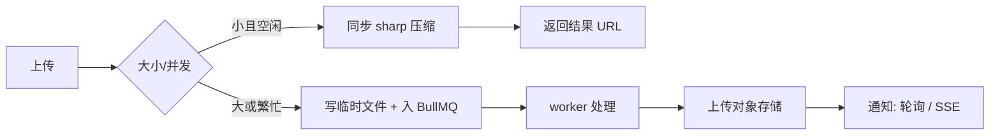

# 11.11 基于sharp实现gif压缩工具

GIF 是互联网上最不该继续变大的格式之一：它每帧都是完整画面、最多 256 色、还没有现代编码的帧间预测。一个十秒的录屏 GIF 轻松几十 MB，而同样内容用 MP4 可能只有几百 KB。

但「换成 MP4」在很多场景不现实（微信、论坛、文档站都更认 GIF），所以压缩工具仍然是刚需。这一节用 `sharp` 做一个可用的 GIF 压缩服务：上传、压、下载，再讲清楚它的能力边界——`sharp` 不能做的事，得交给别的工具。

## 一、先搞清楚 GIF 为什么大

三个原因，对应三种压缩手段：

| 原因 | 表现 | 手段 |
| --- | --- | --- |
| 每帧全画 | 10 秒 15fps = 150 帧，每帧都存 | 减帧率、删重复帧 |
| 尺寸大 | 1080p 的 GIF 一帧就 2MB+ | 缩小宽高 |
| 256 色调色板 | 渐变变成色块，为了不色块就加抖动噪点 | 减色、去抖动、调色板复用 |

`sharp` 能做的是后两条（缩尺寸、减色调色板、去掉抖动噪点），加上一点帧间冗余优化（`interFrameMaxError` 做有损帧间压缩）。**它不能改帧率**——这是新手最容易走错的地方，后面第八节专门说。

先给个量级感受：一个 10 秒、1080p、30fps 的录屏 GIF，原始可能 60MB；缩到 480px 宽、12fps、64 色之后通常在 3–6MB。体积的下降主要来自「缩尺寸」和「减帧」，减色只贡献其中一部分——所以先做前两步，别一上来就死磕调色板参数。

## 二、sharp 的动画模型

处理 GIF 之前必须先建立正确的「动画 = 多页」心智模型：

```ts
import sharp from 'sharp';

const meta = await sharp(buf).metadata();
// meta.format = 'gif'
// meta.pages = 帧数
// meta.pageHeight = 每帧高度
// meta.width / height = 整张「长图」的宽高（height = pageHeight * pages）
// meta.delay = 每帧延迟数组（毫秒）
// meta.loop = 循环次数，0 表示无限
```

要读全部帧，构造函数必须传 `{ animated: true }`——它等价于 `pages: -1`。不传的话只读第一帧，输出的 GIF 就变成静态图了，这是第二个高频 bug。

```ts
const output = await sharp(input, { animated: true })
  .resize({ width: 480, withoutEnlargement: true })
  .gif({ effort: 7, dither: 0 })
  .toBuffer();
```

`resize` 会自动作用到每一帧，不用自己循环。

还有一个语义要记住：`metadata()` 读到的 `height` 是**所有帧叠起来的总高度**，不是单帧高度。想算单帧尺寸用 `pageHeight`，想算总像素量用 `width × pageHeight × pages`——后者才是你判断「这个文件会不会把内存打爆」的依据。

## 三、GIF 输出参数逐个说

`gif()` 的参数不多，但每一个都直接影响体积和观感：

| 参数 | 默认 | 说明 |
| --- | --- | --- |
| `reuse` | `true` | 复用输入的调色板；设 `false` 会重新计算，慢但更准 |
| `colours` / `colors` | `256` | 调色板颜色数，2–256；**减到 64 通常能省 20–40%** |
| `effort` | `7` | 编码努力程度 1–10，越高越慢、体积略小 |
| `dither` | `1.0` | Floyd–Steinberg 抖动强度 0–1；**设 0 去噪点、体积更小** |
| `interFrameMaxError` | `0` | 帧间有损容差 0–32；**设 8 左右能明显减体积** |
| `interPaletteMaxError` | `3` | 调色板复用容差 0–256 |
| `keepDuplicateFrames` | `false` | 默认合并重复帧（省体积），设 true 保留 |
| `loop` | `0` | 循环次数，0 = 无限 |
| `delay` | 沿用输入 | 每帧延迟，可传数组 |

默认值就是「无损优先」，所以直接 `.gif()` 往往压不下来——要显式给 `dither: 0`、`interFrameMaxError`、`colours`。

## 四、一个能用的压缩服务

```ts
// src/media/gif.service.ts
import { Injectable, BadRequestException } from '@nestjs/common';
import sharp from 'sharp';

export interface GifPreset {
  width: number;
  colours: number;
  effort: number;
  dither: number;
  interFrameMaxError: number;
}

const PRESETS: Record<'chat' | 'web' | 'hd', GifPreset> = {
  chat: { width: 320, colours: 32, effort: 5, dither: 0, interFrameMaxError: 12 },
  web: { width: 480, colours: 64, effort: 7, dither: 0, interFrameMaxError: 8 },
  hd: { width: 720, colours: 128, effort: 8, dither: 0, interFrameMaxError: 4 },
};

@Injectable()
export class GifService {
  async compress(input: Buffer, presetName: keyof typeof PRESETS = 'web') {
    const preset = PRESETS[presetName];
    if (!preset) throw new BadRequestException('未知的预设');

    const meta = await sharp(input).metadata();
    if (meta.format !== 'gif') throw new BadRequestException('只支持 GIF');
    if (!meta.pages || meta.pages < 2) throw new BadRequestException('这不是动图');

    const before = input.length;
    const output = await sharp(input, {
      animated: true,
      limitInputPixels: 40_000_000, // 约 40MP，防解压炸弹
    })
      .resize({ width: preset.width, withoutEnlargement: true })
      .gif({
        colours: preset.colours,
        effort: preset.effort,
        dither: preset.dither,
        interFrameMaxError: preset.interFrameMaxError,
        reuse: true,
      })
      .toBuffer();

    return { before, after: output.length, buffer: output, frames: meta.pages };
  }
}
```

controller 用 `FileInterceptor` 收内存文件：

```ts
@Post('gif/compress')
@UseInterceptors(FileInterceptor('file'))
async compress(
  @UploadedFile(new ParseFilePipe({
    validators: [new MaxFileSizeValidator({ maxSize: 10 * 1024 * 1024 })],
  })) file: Express.Multer.File,
  @Query('preset') preset: 'chat' | 'web' | 'hd' = 'web',
) {
  const result = await this.gifs.compress(file.buffer, preset);
  return {
    before: result.before,
    after: result.after,
    ratio: +(1 - result.after / result.before).toFixed(3),
    frames: result.frames,
    data: result.buffer.toString('base64'),
  };
}
```

生产环境不要用 base64 返回（体积膨胀 33%），把结果写到对象存储、返回 URL 更合适。如果要立刻展示，可以用 `GET /media/:id` 返回 `image/gif` 并带 `Cache-Control: public, max-age=31536000, immutable`——压缩结果按内容哈希命名，天然可以长缓存。

## 五、预设不是拍脑袋：写个脚本量一遍

三个预设的数字（320/32 色、480/64 色、720/128 色）不是标准答案，不同素材差异很大：卡通分数线稿减色几乎无损，实拍视频一减就出色带。定预设的方法是拿自己的素材量一遍：

```bash
# 批量压一个目录，输出对比表
node - <<'EOF'
const fs = require('node:fs/promises');
const path = require('node:path');
const sharp = require('sharp');

const PRESETS = {
  chat: { width: 320, colours: 32, effort: 5, dither: 0, interFrameMaxError: 12 },
  web:  { width: 480, colours: 64, effort: 7, dither: 0, interFrameMaxError: 8 },
  hd:   { width: 720, colours: 128, effort: 8, dither: 0, interFrameMaxError: 4 },
};

const dir = process.argv[2] ?? './samples';
for (const name of await fs.readdir(dir)) {
  if (!name.endsWith('.gif')) continue;
  const buf = await fs.readFile(path.join(dir, name));
  const meta = await sharp(buf).metadata();
  const row = { file: name, kb: Math.round(buf.length / 1024), frames: meta.pages };
  for (const [key, p] of Object.entries(PRESETS)) {
    const out = await sharp(buf, { animated: true })
      .resize({ width: p.width, withoutEnlargement: true })
      .gif({ colours: p.colours, effort: p.effort, dither: p.dither, interFrameMaxError: p.interFrameMaxError })
      .toBuffer();
    row[key] = Math.round(out.length / 1024) + 'KB';
  }
  console.log(row);
}
EOF
```

把这张表发给产品/设计看，让他们选档位——比你自己决定「压缩到什么程度」靠谱，因为观感是可接受性的最终标准。

量的时候还要固定一个容易忽略的变量：**同一份文件压两次，输出必须字节一致**。`sharp` 的 GIF 编码是确定性的，如果不一致，说明你的参数里有随机源（比如随机调色板），上线后缓存和去重都会出问题。

## 六、GIF 的三个历史包袱

`sharp` 重编码时，下面三件事会影响结果，值得单独说：

**1. 帧处置方式（disposal method）。** GIF 每帧可以声明「保留上一帧」「恢复背景」等。有些编辑器生成的文件依赖「只画变化区域」，如果你重编码时把每帧都当完整帧处理，体积会变大；反过来，某些帧处置在重编码后可能失效，导致残影。`sharp` 会按输入处理，但你要在压缩后**逐帧对比关键帧**（尤其是带透明区域、鼠标轨迹的录屏）。

**2. 透明色与调色板。** GIF 的透明是「调色板里留一个索引」，不是真正的 alpha 通道。`colours` 设得太小，透明区域可能被挤掉，边缘出现黑边或白边。把 `colours` 从 32 提到 64 通常就能救回来，代价是体积。判断方法是压完看「有没有一圈黑边」，而不是只看文件大小。

**3. 帧延迟精度。** GIF 的延迟单位是 1/100 秒，且很多浏览器对 <2cs 的延迟做特殊处理。原图 30fps（33ms）转成 GIF 会变成 3cs（30fps 近似），但如果你手动改了 `delay` 数组，很容易出现「加速/减速」。**除非产品明确要变速，不要改 `delay`**。

## 七、什么时候别用 GIF

压缩只能治标，格式才是治本。2026 年的浏览器支持情况：

| 格式 | 体积 | 透明 | 动画 | 兼容性 |
| --- | --- | --- | --- | --- |
| GIF | 大 | 二值 | 支持 | 全平台 |
| 动画 WebP | 小 30–70% | 真 alpha | 支持 | 现代浏览器全支持，老 IE/部分 App 内嵌不支持 |
| 动画 AVIF | 更小 | 真 alpha | 支持 | 较新浏览器 |
| MP4/H.264 | 最小 | 不支持 | 支持（`<video>`） | 全平台，但不支持「像图片一样」右键保存 |

实践中的做法是「**双输出**」：压好的 GIF 给兼容性场景，同内容再出一个 WebP 给现代浏览器，`<picture>` 里按支持度回退。多存一份的成本，通常小于带宽省下来的钱。

WebP 的输出只要换一行：

```ts
const webp = await sharp(input, { animated: true })
  .resize({ width: 480, withoutEnlargement: true })
  .webp({ quality: 70, effort: 4, loop: 0 })
  .toBuffer();
```

动画 WebP 的 `quality` 对体积影响远大于 GIF 的调色板参数，70 左右通常肉眼无差；`effort` 是 0–6 的编码努力。同一个 5MB 的 GIF，转成 WebP 常在 800KB 上下——这也是为什么「压缩」这件事，最后的答案往往是「换格式」。

## 八、sharp 不能改帧率：抽帧要交给别人

这是必须说清的边界：`gif()` 没有 `fps` 参数，`resize` 也不管时间轴。想从 30fps 降到 12fps，只有两条路：

**路线 A：先抽帧再合成。** 用 `ffmpeg` 把 GIF 解成 PNG 序列，按帧率挑帧，再用 `sharp` 的 `join` 合成：

```bash
# 30fps -> 12fps，并生成调色板（避免直接转 GIF 的色带）
ffmpeg -i input.gif -vf "fps=12,scale=480:-1:flags=lanczos,palettegen" -y palette.png
ffmpeg -i input.gif -i palette.png -lavfi "fps=12,scale=480:-1:flags=lanczos [x]; [x][1:v] paletteuse" -y out.gif
```

路线 A 的代价是「要装 ffmpeg」，镜像多 80MB 左右；如果只是偶尔压一压，用 `ffmpeg-static` 这类预编译包也能跑，但生产镜像建议单独做成一个 worker，不要塞进主 API。

**路线 B：用 `gifsicle` 做后处理。** 它对帧和调色板更专业：

```bash
npx gifsicle -O3 --lossy=80 --colors 64 --resize-width 480 input.gif -o output.gif
```

`gifsicle`（npm 包 7.0.1，自带二进制）的 `-O3` 是帧间优化，`--lossy` 是有损压缩，`--colors` 减色，`--resize-width` 缩尺寸。三个叠起来通常比单纯用 sharp 压得更小。

所以真实工具链是「`ffmpeg` 控时间轴 + `sharp` 控尺寸和输出 + `gifsicle` 做最后瘦身」，`sharp` 只是其中一环，不是全部。

## 九、安全与资源：GIF 是解压炸弹的重灾区

GIF 的 LZW 压缩比可以做到上百倍，一个 2MB 的文件解成几 GB 像素是常见攻击。三道防线：

1. **文件大小上限**：`MaxFileSizeValidator` 卡 10MB；nginx 侧 `client_max_body_size` 卡在更外层；
2. **像素上限**：`limitInputPixels` 默认 268402689（约 2.68 亿像素，0x3FFF²），自己再收紧到 4000 万；
3. **并发与超时**：`sharp.concurrency(2)` 限制线程，外层用队列控制同时处理数；单次处理超过 20 秒直接杀。

还有两个容易漏的点：处理大 GIF 时内存是「帧数 × 单帧像素 × 4 字节」，150 帧 1080p 就是 GB 级，**容器内存限制要留足**；处理失败或客户端断开时，临时文件必须清理。

线上一般这样收口：

```ts
// main.ts 里限制上传体量（比 multer 更靠外一层）
app.useBodyParser?.('json', { limit: '2mb' });

// sharp 全局线程数：容器 2 核就给 2，别让它把 CPU 抢光
sharp.concurrency(2);
// 关掉 libvips 内部缓存，处理大文件时内存峰值更可控
sharp.cache(false);
```

`sharp.cache(false)` 会让重复处理同一图片变慢（没有缓存复用），但换来了内存可预测——批量转码服务里值得，单次工具类接口可以不开。

再加一条业务兜底：**压缩结果比原图大就返回原图**。某些已经优化过的 GIF（比如 `gifsicle -O3` 处理过的）再经 sharp 重编码会变大 5–10%，直接返回原文件既省 CPU 又不会让用户骂人。

## 十、同步还是异步

小文件（<2MB）同步处理没问题；大文件或高峰期就该入队：



异步方案里，进度通知可以直接复用 11.10 的 SSE——任务 id 当频道名，worker 每压完一帧推一次百分比。判据是「用户愿不愿意等 10 秒」：表单上传场景愿意，聊天发图场景不愿意。

队列方案还要处理「任务失败」和「重复提交」：失败要有可见的错误（而不是永远转圈），重复上传同一文件应该命中内容哈希直接返回已有结果——这和 11.09 短链的「先查缓存」是同一个思路。

## 十一、Checkpoint

```bash
# 1) 压一个 GIF，看体积比
curl -s -F "file=@demo.gif" "localhost:3000/api/gif/compress?preset=web" | head -c 200

# 2) 本地对比帧数是否保留（不装 ImageMagick 就用 sharp 读 metadata）
node -e "const s=require('sharp');s('out.gif').metadata().then(m=>console.log(m.pages,m.pageHeight,m.width))"

# 3) gifsicle 看文件信息（帧数、尺寸、颜色数）
npx gifsicle --info out.gif | head -12

# 4) 传一个非 GIF 文件，应该 400
curl -s -F "file=@package.json" localhost:3000/api/gif/compress
```

判断压缩是否「成功」不只看体积：帧数不能少、总时长不能变、第一帧不能花。这三条写进自动化测试，比人眼看靠谱。

再补两个命令行小技巧。看两个 GIF 的体积差可以直接 `ls -l`，但看「谁更省」要同一素材对比；`gifsicle --info` 输出的 `logical screen`、`colors`、`loop` 三行能快速判断对方是不是已经优化过。用 `sharp` 读帧数是最轻的方式，不用装 ImageMagick：

```bash
node -e "const s=require('sharp');s(process.argv[1]).metadata().then(m=>console.log({format:m.format,pages:m.pages,w:m.width,h:m.height,delay:m.delay?.slice(0,5)}))" out.gif
```

输出的 `delay` 数组前几项如果全是 `10`（10cs = 100ms = 10fps），说明原图本来就是低帧率，再怎么压也压不出花来。

## 十二、坑表

| 写法 | 后果 |
| --- | --- |
| 忘记 `{ animated: true }` | 输出变成静态图，只剩第一帧 |
| 直接用 `.gif()` 不给参数 | 默认无损，几乎压不下来 |
| 想靠 sharp 降帧率 | 没有这个能力，得用 ffmpeg 抽帧 |
| 只设 `colours: 32` 不去抖动 | 色带明显，观感差且体积未必小 |
| 不设 `limitInputPixels` | 解压炸弹可打满内存 |
| 同步处理大文件 | 事件循环/内存被打满，接口雪崩 |
| base64 返回 | 响应体积多 33%，大文件直接超时 |
| 压缩完不校验帧数 | 可能因为输入损坏输出只剩一帧 |
| 临时文件不清理 | 磁盘慢慢被写满 |
| 输出不设上限 | 某些 GIF 越压越大，要有「压不小就返回原图」的兜底 |

<!-- chapter-nav:start -->
---

← [11.10 Nest实现ServerSentEvent数据推送](11.10-Nest实现ServerSentEvent数据推送.md) · [本章目录](_chapter.md)
<!-- chapter-nav:end -->
