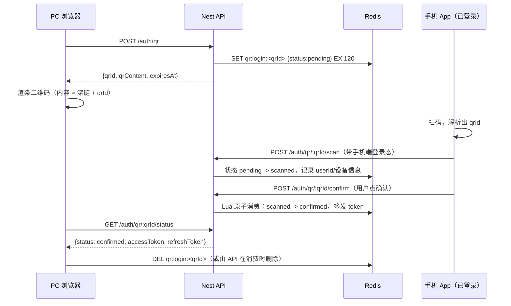

# 11.12 实现扫二维码登录

扫二维码登录（扫码登录）已经成了 PC 站的标配：微信、钉钉、企业后台、云控制台都是这个交互。它的本质不是「二维码里存了账号密码」，而是**一次跨设备的授权委托**——PC 端拿到一个一次性凭证，手机端在已登录的前提下确认「我同意这台设备登录」。

这一节把这个流程拆开，用 Redis 存状态，给出可用的实现，并重点讲清楚它最容易出的安全问题：二维码钓鱼。

## 一、先把「传什么」想清楚

二维码里**只能放一次性标识**，绝不能放 token、密码、用户 id。原因很简单：二维码是公开的，谁都能扫。

给个数字：二维码在 320px 下用 M 级容错大概能装 1.2KB，但内容越长越密、越难扫。把 qrId（36 字符的 UUID）和域名拼起来约 80 字节，二维码又疏又好扫；如果塞进 JWT（几百字节），扫码失败率会明显上升——这是「别把 token 放进去」的工程理由，不只是安全理由。



关键点：**PC 端从头到尾没有输入过密码**，它拿到的凭证是手机端「授权」的结果。这也意味着登录态的安全性完全取决于手机端那一步。

## 二、状态机：五个状态，一条单向路

```text
pending ──scan──> scanned ──confirm──> confirmed
   │                  │
   ├──timeout──> expired
   └──cancel──> cancelled
```

四条规则：

1. **只能前进，不能回退**。`confirmed` 之后不能再 `scan`，`expired` 之后不能再 `confirm`；
2. **`confirmed` 是一次性的**。PC 取走 token 后立刻删除该 key，重复轮询拿到 `expired`；
3. **TTL 兜底**。二维码 120 秒过期，靠 Redis TTL，不靠定时清理；
4. **取消是显式动作**。用户点「刷新二维码」时把旧 key 删掉，避免旧二维码还能用。

这张状态机还要配三个时间/数量约束，否则会被刷：同一 IP 每分钟最多创建 5 个二维码；同一用户每分钟最多 scan 10 次；单个二维码最多被 scan 3 次（多于 3 次说明多台设备在抢扫，直接作废）。

状态迁移必须用 Lua 做「检查 + 修改」的原子操作，否则两个请求同时 confirm 会各签发一套 token：

```lua
-- KEYS[1] = qr key, ARGV[1] = 期望的旧状态, ARGV[2] = 新状态
local status = redis.call('HGET', KEYS[1], 'status')
if status ~= ARGV[1] then
  return 0
end
redis.call('HSET', KEYS[1], 'status', ARGV[2])
return 1
```

## 三、Redis 里存什么

```ts
// 创建时写入，TTL 120 秒
await redis.hset(`qr:login:${qrId}`, {
  status: 'pending',
  createdAt: String(Date.now()),
  ip: requestIp,
  userAgent: userAgent.slice(0, 200),
});
await redis.expire(`qr:login:${qrId}`, 120);

// 手机端 scan 时补充
await redis.hset(`qr:login:${qrId}`, {
  status: 'scanned',
  userId: user.id,
  deviceName: 'iPhone 15 / App 3.2.1',
});

// confirm 时写入一次性结果（token 只在内存/短 TTL 中停留）
await redis.hset(`qr:login:${qrId}`, {
  status: 'confirmed',
  issuedAt: String(Date.now()),
});
```

不要把 `accessToken` 直接写进 Redis 的二维码 key——多一层泄漏面。更稳的做法是「PC 轮询到 confirmed 后，用 qrId + 一次性 secret 换 token」，或者干脆由 confirm 请求同步签发、放进只存活 10 秒的结果 key。

命名上建议分三个前缀，别混在一个 key 里：`qr:login:<qrId>`（状态机）、`qr:result:<qrId>`（一次性结果，10 秒）、`qr:rate:<ip|userId>`（限流计数）。分开之后，清理和监控都简单——`qr:login:*` 的数量就是「当前等待中的登录数」，能直接做成看板指标。

还有一个 fail-closed 的决定：**Redis 不可用时要让扫码登录直接失败并提示「稍后再试」，不要降级到数据库轮询**。降级路径会带来状态不一致（数据库里没有 TTL 语义），而扫码登录不是核心路径，失败几十秒比登录错乱安全得多。

## 四、服务层实现：一个可用的骨架

把状态机、Lua 迁移和签发串起来，核心就这几个方法：

```ts
// src/modules/auth/qr-login.service.ts
@Injectable()
export class QrLoginService {
  private static readonly TTL = 120;
  private static readonly TRANSITION = `
    local status = redis.call('HGET', KEYS[1], 'status')
    if status ~= ARGV[1] then return 0 end
    redis.call('HSET', KEYS[1], 'status', ARGV[2])
    return 1`;

  constructor(
    @Inject(REDIS) private readonly redis: Redis,
    private readonly jwt: TokenService,
  ) {}

  private key(qrId: string) {
    return `qr:login:${qrId}`;
  }

  async create(ctx: { ip?: string; userAgent: string }) {
    const qrId = randomUUID();
    await this.redis
      .multi()
      .hset(this.key(qrId), {
        status: 'pending',
        createdAt: String(Date.now()),
        ip: ctx.ip ?? '',
        userAgent: ctx.userAgent.slice(0, 200),
      })
      .expire(this.key(qrId), QrLoginService.TTL)
      .exec();
    return {
      qrId,
      qrContent: `https://app.example.com/qr-login?qr=${qrId}`,
      expiresAt: Date.now() + QrLoginService.TTL * 1000,
    };
  }

  private async transition(qrId: string, from: string, to: string) {
    const ok = await this.redis.eval(
      QrLoginService.TRANSITION, 1, this.key(qrId), from, to,
    );
    if (ok !== 1) throw new ConflictException(`二维码状态已变化（期望 ${from}）`);
  }

  async scan(qrId: string, user: AuthUser) {
    const exists = await this.redis.exists(this.key(qrId));
    if (!exists) throw new GoneException('二维码已过期，请刷新');
    await this.transition(qrId, 'pending', 'scanned');
    await this.redis.hset(this.key(qrId), { userId: user.id });
  }

  async inspect(qrId: string) {
    const data = await this.redis.hgetall(this.key(qrId));
    if (!data.status) throw new GoneException('二维码已过期');
    return {
      status: data.status,
      deviceName: this.describeDevice(data.userAgent ?? ''),
      createdAt: Number(data.createdAt),
    };
  }

  async confirm(qrId: string, user: AuthUser) {
    const data = await this.redis.hgetall(this.key(qrId));
    if (!data.status) throw new GoneException('二维码已过期');
    if (data.userId !== user.id) throw new ForbiddenException('这不是你的登录请求');
    await this.transition(qrId, 'scanned', 'confirmed');
    const tokens = await this.jwt.issueForUser(user);
    // 结果单独放 10 秒，避免 token 长期躺在 Redis
    await this.redis.set(`qr:result:${qrId}`, JSON.stringify(tokens), 'EX', 10);
  }

  async poll(qrId: string) {
    const result = await this.redis.get(`qr:result:${qrId}`);
    if (result) {
      await this.redis.del(`qr:result:${qrId}`, this.key(qrId));
      return { status: 'confirmed', ...JSON.parse(result) };
    }
    const data = await this.redis.hgetall(this.key(qrId));
    if (!data.status) return { status: 'expired' };
    return { status: data.status };
  }

  async cancel(qrId: string) {
    await this.redis.del(this.key(qrId));
  }
}
```

这里有两个设计决定值得解释。

第一，**token 不放二维码 key，而在 confirm 时单独写 `qr:result:<qrId>` 并只存活 10 秒**。这样即便有人 dump 了 Redis，拿到的也是已过期的结果；PC 取走后立刻删除，天然一次性。

第二，**`userId` 在 scan 时写入，confirm 时校验**。防止 A 扫码、B 确认的串号——虽然看起来不可能，但在「同一台手机切换账号」的场景里真的会发生。

## 五、接口设计

```ts
@Controller('auth/qr')
export class QrLoginController {
  // PC：创建二维码
  @Post()
  async create(@Req() req: Request): Promise<QrCreateResult> {
    return this.qrLogin.create({ ip: req.ip, userAgent: req.headers['user-agent'] ?? '' });
  }

  // 手机：扫码（必须已登录）
  @Post(':qrId/scan')
  @UseGuards(JwtAuthGuard)
  async scan(@Param('qrId') qrId: string, @CurrentUser() user: AuthUser) {
    return this.qrLogin.scan(qrId, user);
  }

  // 手机：确认登录（必须已登录）
  @Post(':qrId/confirm')
  @UseGuards(JwtAuthGuard)
  async confirm(@Param('qrId') qrId: string, @CurrentUser() user: AuthUser) {
    return this.qrLogin.confirm(qrId, user);
  }

  // PC：轮询状态
  @Get(':qrId/status')
  async status(@Param('qrId') qrId: string) {
    return this.qrLogin.poll(qrId);
  }

  // PC：取消/刷新
  @Delete(':qrId')
  async cancel(@Param('qrId') qrId: string) {
    return this.qrLogin.cancel(qrId);
  }
}
```

`qrContent` 用深链：`myapp://qr-login?qr=<qrId>` 或 `https://app.example.com/qr-login?qr=<qrId>`。前者体验好（直接拉起 App），后者兼容性好（没装 App 也能打开网页引导）。两个都生成、二维码里放 https 链接、页面里再尝试拉起 App，是更常见的折中。

## 六、生成二维码

```ts
import QRCode from 'qrcode';

const dataUrl = await QRCode.toDataURL(qrContent, {
  errorCorrectionLevel: 'M', // L/M/Q/H，二维码被遮挡时的容错
  margin: 2,
  width: 320,
});
// dataUrl 形如 data:image/png;base64,...，直接给 
```

`qrcode`（1.5.4，纯 JS）适合服务端生成；终端调试用 `qrcode-terminal`（0.12.0）直接打印到控制台。`errorCorrectionLevel` 选 `M`（约 15% 容错）够用，选 `H` 二维码会更密、更难扫。容错的意义是「二维码被遮住一部分还能不能扫」——贴了 logo 的二维码建议用 `Q` 或 `H`，纯白底的用 `M` 就够。

内容长度要控制：URL 加 qrId 一般在 80–120 字节，二维码不会太密。**不要把设备信息、时间戳塞进二维码内容**——那些放 Redis。

## 七、安全核心：二维码钓鱼

这是扫码登录最经典的攻击：

1. 攻击者自己打开目标站点的扫码登录，拿到 qrId A；
2. 把 A 的二维码发给受害者（「帮我扫个码领个会员」）；
3. 受害者在自己的手机上扫了 A，如果系统「扫了就自动确认」，攻击者的 PC 就登录了受害者的账号。

防法只有一条：**扫码之后必须让用户在手机上确认，并且确认界面要显示「正在登录的设备」信息**。

```ts
// confirm 之前，手机端先拿到 landing 设备信息
@Get(':qrId/landing')
@UseGuards(JwtAuthGuard)
async landing(@Param('qrId') qrId: string) {
  const info = await this.qrLogin.inspect(qrId);
  // { deviceName: 'Chrome on macOS', ip: '1.2.3.4', createdAt }
  return info; // 手机端弹窗：确认在「Chrome on macOS」上登录？
}
```

用户看到「Chrome on macOS / 上海」而自己并没有在电脑上操作，就知道是钓鱼，点取消即可。PC 端也要显示「已扫码，请在手机上确认」，让两端信息对称。

这里有个反直觉的结论：**扫码登录的安全性不取决于二维码本身，而取决于手机端确认界面的信息量**。二维码可以被转发、被截图、被贴到群里，你无法控制；但「确认页显示目标设备信息 + 需要用户主动点确认」这一步，是攻击者拿不到的。所以产品评审时，宁可少做「一键扫完自动登录」的便利，也别省掉这一步。

另外三条：`qrId` 用 `crypto.randomUUID()`（128 位，不可猜）；`scan/confirm` 必须带手机端登录态；确认动作要限流，防止脚本刷。

## 八、轮询还是推送

PC 端每 1–2 秒轮询一次 `status`，实现最简单，但 QPS 是「在线等待数 × 0.5」。量大时用 SSE 更好——`GET /auth/qr/:qrId/stream` 返回事件流，状态一变就推一条：

```ts
@Sse(':qrId/stream')
stream(@Param('qrId') qrId: string): Observable<MessageEvent> {
  return this.qrLogin.watch(qrId).pipe(
    map((state) => ({ data: state })),
    takeWhile((state) => state.status === 'pending' || state.status === 'scanned', true),
  );
}
```

SSE 的细节（心跳、代理、多副本广播）都在 11.10 讲过，这里直接复用。轮询方案要注意「轮询本身也要限流」，否则被刷成 DDoS。

两者的取舍很实际：轮询实现 20 行、兼容所有环境，代价是「平均 1 秒的延迟 + 无谓的请求」；SSE 实时、省请求，但要处理代理和连接管理。用户量在一万以内，轮询完全够用；超过之后，SSE 省下的机器成本才明显。先上轮询、量大了再换，是合理的演进路径——**接口形状设计成最终态**，换实现时前端不用改。

## 九、刷新、多标签页与深链

三个产品细节，不做的话用户会以为「坏了」：

**刷新二维码。** 用户在 PC 上停留超过 2 分钟，二维码就失效了。前端要有倒计时 + 「点击刷新」，刷新动作是 `DELETE` 旧的 + `POST` 新的，两个 qrId 各自独立，旧的不影响新的。

**多标签页。** 用户开了三个标签页，每个都有自己的 qrId 和二维码。手机扫了其中一个，另外两个应该继续等待而不是互相干扰——因为 qrId 不同，天然隔离。不要用「一个用户一个二维码」的设计，那样标签页之间会抢状态。

**深链与 App 拉起。** 二维码内容用 https 链接（兼容没装 App 的人），落地页用 `location.href = 'myapp://qr-login?qr=...'` 尝试拉起，2 秒后还没跳走就显示「打开 App 扫码」引导。注意微信内置浏览器会拦截自定义 scheme，需要引导用户「右上角在浏览器打开」——这是运营细节，但会直接影响扫码成功率。

```ts
// 落地页脚本：尝试拉起，失败则展示引导
const timer = setTimeout(() => showGuide(), 2000);
window.location.href = `myapp://qr-login?qr=${qrId}`;
document.addEventListener('visibilitychange', () => {
  if (document.hidden) clearTimeout(timer); // 已经跳走了
});
```

还有一点：**二维码图片本身不要带缓存头**（`Cache-Control: no-store`）。有些 CDN 会把带 qrId 的图片缓存住，用户刷新后看到的还是旧图。

## 十、风控与审计：扫码登录也是「新设备登录」

对风控系统来说，扫码登录就是一次**新设备、新 IP 的登录**，只不过凭证是从手机端流转过来的。所以要接的钩子和密码登录完全一样：

- 登录成功后记一条 `login_events`：`userId`、`method='qr'`、`ip`、`userAgent`、`deviceName`、`qrId`（脱敏后 8 位）、时间；
- 如果是该用户从没出现过的设备/IP 段，发一条通知（短信或 App 内）：「你的账号刚刚在 Chrome on macOS 登录」；
- 连续多次「二维码过期才确认」或「scan 后不 confirm」，说明可能有脚本在探测，按用户维度限流；
- 失败指标至少四个：创建数、扫码率、确认率、过期率。扫码率突然下降通常是深链失效或 App 版本不兼容；确认率下降通常是钓鱼攻击被用户识破（这反而是好事）。

审计日志里**不要存二维码原文或 qrId 全量**——qrId 在有效期内就是一把钥匙，日志泄漏等于凭据泄漏。

## 十一、上线检查单

- [ ] `qrId` 随机不可猜，长度 ≥128 位
- [ ] 二维码 TTL 120 秒，过期后 scan/confirm 都返回过期
- [ ] 状态迁移用 Lua 原子操作，`confirmed` 只能消费一次
- [ ] 二维码内容里没有任何 token/用户信息
- [ ] 手机端确认页显示 PC 设备信息，防钓鱼
- [ ] confirm 需要手机端有效登录态
- [ ] 轮询/SSE 接口独立限流，qrId 不存在与已过期返回不同错误码
- [ ] 取消/刷新会删除旧 key
- [ ] 登录成功的风控事件（新设备、异地）有记录和通知
- [ ] 日志里 qrId 脱敏（只记前 8 位）

## 十二、Checkpoint

```bash
# 1) 创建二维码
curl -s -X POST localhost:3000/api/auth/qr | tee /tmp/qr.json
# 拿到 qrId 和 dataUrl，把 dataUrl 存成 png 看一眼

# 2) 模拟手机扫码（需要手机端 token）
curl -s -X POST -H "Authorization: Bearer $PHONE_TOKEN" \
  localhost:3000/api/auth/qr/$QR_ID/scan

# 3) 确认
curl -s -X POST -H "Authorization: Bearer $PHONE_TOKEN" \
  localhost:3000/api/auth/qr/$QR_ID/confirm

# 4) PC 轮询：应返回 confirmed + token；再次轮询应变成 expired
curl -s localhost:3000/api/auth/qr/$QR_ID/status

# 5) 直接看 Redis 状态与 TTL
redis-cli HGETALL qr:login:$QR_ID && redis-cli TTL qr:login:$QR_ID
```

## 十三、坑表

| 写法 | 后果 |
| --- | --- |
| 二维码里直接放 accessToken | 任何人扫到就拿到账号 |
| scan 后自动 confirm | 二维码钓鱼一击即中 |
| 用自增 id / 时间戳当 qrId | 可枚举，攻击者能猜别人的会话 |
| 状态迁移不用 Lua | 并发 confirm 各签发一套 token，会话混乱 |
| confirmed 后不删 key | 二维码可重复使用，等同长期凭证 |
| 只靠 TTL 不显式取消 | 用户刷新后旧二维码仍有效，体验和安全都别扭 |
| 轮询不限流 | 被脚本刷成 DDoS |
| 确认页不显示设备信息 | 用户无法判断是不是自己发起的登录 |
| qrId 明文进日志 | 拿到日志就能抢登录 |
| 不处理「手机端未登录」 | 扫码后直接 401，用户以为二维码坏了 |

<!-- chapter-nav:start -->
---

← [11.11 基于sharp实现gif压缩工具](11.11-基于sharp实现gif压缩工具.md) · [本章目录](_chapter.md)
<!-- chapter-nav:end -->
