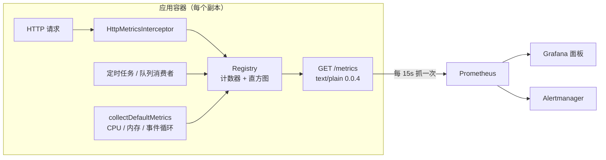

# 11.14 使用Prometheus实现Node性能监控

「接口变慢了」这句话，没有数据之前只是感觉。Prometheus 是把这种感觉变成数字的最常用方案：应用暴露一个 `/metrics` 文本端点，Prometheus 定期来抓，Grafana 画图，Alertmanager 告警。

这一节讲 Node/Nest 侧要做什么：装哪个包、记哪些指标、标签怎么设计、`/metrics` 怎么暴露才安全，以及最容易把监控系统搞挂的「标签基数爆炸」。

## 一、先摆正位置：metrics 不是日志

| 类型 | 回答的问题 | 成本 | 代表工具 |
| --- | --- | --- | --- |
| Metrics | 「整体怎么样」——QPS、P95、错误率、内存 | 低（聚合后存储） | Prometheus + Grafana |
| Logs | 「这一次发生了什么」——某条请求的细节 | 高 | Loki / ELK |
| Traces | 「这一次为什么慢」——链路每一段耗时 | 中 | Jaeger / Tempo |

Prometheus 是**拉模型**：它按 `scrape_interval` 主动来抓你的 `/metrics`，你不需要推送。好处是「应用挂了 Prometheus 立刻知道」，坏处是短生命周期任务（批处理脚本）抓不到——那种要用 Pushgateway。



注意图里没有「应用主动推送」这条线。很多人第一反应是「让应用定时 POST 指标给服务端」，那会带来一批额外问题：目标列表要自己维护、应用挂了没人知道、重试可能重复计数。拉模型把「谁活着」这件事交给 Prometheus 的 target 状态管理，省掉一整类代码。

Prometheus 侧的抓取配置长这样（`prometheus.yml`）：

```yaml
scrape_configs:
  - job_name: meeting-booking-api
    scrape_interval: 15s
    metrics_path: /metrics
    static_configs:
      - targets: ['10.0.0.11:3000', '10.0.0.12:3000']
    # 如果 /metrics 需要认证
    basic_auth:
      username: prometheus
      password_file: /etc/prometheus/metrics-password

rule_files:
  - /etc/prometheus/rules/*.yml
```

`scrape_interval: 15s` 意味着 PromQL 里 `rate(...[1m])` 只有 4 个采样点，抖动会比较明显；想看更平滑的曲线就缩短抓取间隔或拉长 `rate` 窗口。反过来，抓取太频繁会让「序列数 × 频率」变成存储压力，15–30 秒是常见折中。

## 二、装哪个包：注意改名

2026 年的一个关键变化：**`prom-client` 已改名为 `@prometheus-io/client`**。

- `prom-client@15.1.3` 是旧包名的最后一版，官方 README 已明确「This package was previously published as `prom-client`」；
- 新包 `@prometheus-io/client@0.16.1`（2026-08-27 发布）由 Prometheus 官方组织维护，`engines` 要求 `^22 || ^24 || >=26`；
- API 基本同名：`Registry`、`register`、`Counter`、`Gauge`、`Histogram`、`Summary`、`collectDefaultMetrics`、`linearBuckets`/`exponentialBuckets`。

```bash
pnpm add @prometheus-io/client
```

社区封装 `@willsoto/nestjs-prometheus@7.0.0` 的 peerDependencies 也已经切到 `@prometheus-io/client`——如果你在旧教程里看到 `pnpm add prom-client`，那是过时写法。

## 三、默认指标：先拿到「白送的」

`collectDefaultMetrics()` 会注册一批运行时指标，覆盖 CPU、内存、事件循环、GC、文件描述符：

```ts
import { collectDefaultMetrics, register } from '@prometheus-io/client';

collectDefaultMetrics({ prefix: 'meeting_booking_' });
// 之后 registry.metrics() 里会出现：
// meeting_booking_process_cpu_seconds_total
// meeting_booking_process_resident_memory_bytes
// meeting_booking_nodejs_heap_size_used_bytes
// meeting_booking_nodejs_heap_size_total_bytes
// meeting_booking_nodejs_eventloop_lag_seconds（含 _p50/_p90/_p99）
// meeting_booking_nodejs_gc_duration_seconds（按 gc 类型分标签）
// meeting_booking_nodejs_active_handles / _requests（按类型分标签）
// meeting_booking_process_open_fds / process_max_fds
```

`prefix` 让同一套 Grafana 面板能区分多个服务。`collectDefaultMetrics` 还可以传 `register`（自定义 registry）、`gcDurationBuckets`、`eventLoopUtilization*` 这些细项。

**事件循环延迟**是 Node 最该盯的指标：它涨到几十毫秒，说明有同步阻塞——这种问题 CPU 使用率不一定高，但用户会觉得「卡」。常见成因按出现频率排：

| 成因 | 现象 | 查法 |
| --- | --- | --- |
| 同步 JSON 序列化大对象 | 延迟尖刺，和响应体大小相关 | 看接口耗时分布是否双峰 |
| 正则回溯 | 特定输入下卡死几秒 | 用 `--prof` 或火焰图找 |
| 同步加密/哈希（`bcrypt` 轮数太高、大文件 `createHash`） | CPU 打满、lag 线性上升 | 改成异步版本或 worker |
| 大数组排序/深拷贝 | 与数据量相关 | 抓一次 CPU profile |
| 一次性同步读大文件 | 启动期尖刺 | 换流式读取 |

如果是容器里跑，别忘了 `node --max-old-space-size` 要和容器内存上限对齐（取 75%–80%），否则 V8 以为自己还能涨，容器先被 OOM Killer 干掉——那种「进程突然消失」在指标上表现为 `process_resident_memory_bytes` 一路爬到顶然后序列中断。

## 四、四类指标怎么选

| 类型 | 语义 | 典型用法 |
| --- | --- | --- |
| Counter | 只增不减 | 请求总数、错误总数、发出的邮件数 |
| Gauge | 可增可减 | 当前连接数、队列长度、内存占用 |
| Histogram | 分桶统计 | 请求耗时、响应体大小（可算分位数） |
| Summary | 客户端算分位 | 一般不用，分位数无法跨实例聚合 |

新手最常见的错误是「用 Gauge 记请求数」——重启归零、也没法 `rate()`。另一类错误是「用 Counter 记当前连接数」——它减不回去。判断方法：**这个值会不会变小？会就用 Gauge。**

分位数一定用 Histogram，不要用 Summary：Summary 在应用内算好 P95，多副本时没法合并（P95 不能求平均），Prometheus 里查不出全局 P95。

## 五、HTTP 的 RED 指标

RED = Rate、Errors、Duration。一个 interceptor 就能覆盖：

```ts
// src/metrics/http-metrics.interceptor.ts
import { CallHandler, ExecutionContext, Injectable, NestInterceptor } from '@nestjs/common';
import { Counter, Histogram } from '@prometheus-io/client';
import type { Request, Response } from 'express';
import { Observable, tap } from 'rxjs';

const httpRequests = new Counter({
  name: 'http_requests_total',
  help: 'HTTP requests',
  labelNames: ['method', 'route', 'status'] as const,
});

const httpDuration = new Histogram({
  name: 'http_request_duration_seconds',
  help: 'HTTP request duration',
  labelNames: ['method', 'route', 'status'] as const,
  buckets: [0.01, 0.025, 0.05, 0.1, 0.25, 0.5, 1, 2.5, 5],
});

@Injectable()
export class HttpMetricsInterceptor implements NestInterceptor {
  intercept(ctx: ExecutionContext, next: CallHandler): Observable<unknown> {
    const req = ctx.switchToHttp().getRequest<Request>();
    const res = ctx.switchToHttp().getResponse<Response>();
    // 关键：用路由模板，不是真实 URL
    const route = (req.route?.path as string) ?? 'unmatched';
    const labels = { method: req.method, route };
    const end = httpDuration.startTimer(labels);

    return next.handle().pipe(
      tap({
        next: () => this.finish(end, labels, res.statusCode),
        error: () => this.finish(end, labels, 500),
      }),
    );
  }

  private finish(end: (l?: never) => number, labels: Record<string, string>, status: number) {
    end();
    httpRequests.inc({ ...labels, status: String(status) });
  }
}
```

两个细节决定这套指标能不能用：

**1. `route` 必须是路由模板。** `req.route?.path` 在 Express 里是 `/bookings/:id`，而不是 `/bookings/8f3a...`。如果用真实路径，每个订单 id 都会创建一条时间序列——这就是标签基数爆炸，Prometheus 内存几小时内被吃光。

**2. 状态码分桶。** 把 `status` 做成 `2xx/4xx/5xx` 三类或保留精确值都行，但精确值只有几十种，可控；不要用 status + 错误信息做标签。

## 六、暴露 `/metrics`

```ts
// src/metrics/metrics.controller.ts
import { Controller, Get, Header } from '@nestjs/common';
import { register } from '@prometheus-io/client';

@Controller('metrics')
export class MetricsController {
  @Get()
  @Header('Content-Type', register.contentType)
  async metrics(): Promise<string> {
    return register.metrics();
  }
}
```

`register.contentType` 是 `text/plain; version=0.0.4; charset=utf-8`，别自己写字符串。

安全上要收口：

- **不要挂在公网入口**。Prometheus 抓取走内网端口，或者 Nginx 上 `allow 10.0.0.0/8; deny all;`；
- 如果必须走认证，用 Basic Auth（Prometheus 的 `scrape_config` 支持 `basic_auth`），别用 JWT——抓取端不会帮你刷新 token；
- 注意 Nest 的全局前缀：`setGlobalPrefix('api')` 会把 `/metrics` 变成 `/api/metrics`，要么给它单独的 `@Controller({ path: 'metrics' })` 并 `exclude` 前缀，要么在 Nginx 里 rewrite。

## 七、PromQL 三个查询与告警

```promql
# QPS（近 5 分钟）
sum(rate(http_requests_total[5m]))

# P95 耗时（按路由）
histogram_quantile(0.95,
  sum by (le, route) (rate(http_request_duration_seconds_bucket[5m]))
)

# 5xx 比例
sum(rate(http_requests_total{status=~"5.."}[5m]))
  / sum(rate(http_requests_total[5m]))
```

告警规则（`rules.yml`）：

```yaml
groups:
  - name: api
    rules:
      - alert: HighErrorRate
        expr: |
          sum(rate(http_requests_total{status=~"5.."}[5m]))
            / sum(rate(http_requests_total[5m])) > 0.02
        for: 10m
        labels: { severity: critical }
        annotations:
          summary: "5xx 比例超过 2%（当前 {{ $value | humanizePercentage }}）"

      - alert: SlowP95
        expr: |
          histogram_quantile(0.95,
            sum by (le) (rate(http_request_duration_seconds_bucket[5m]))) > 1
        for: 10m

      - alert: EventLoopLag
        expr: nodejs_eventloop_lag_p99_seconds > 0.1
        for: 5m
```

`for` 是关键：不加 `for` 的话，一次抖动就告警，值班会被吵到关通知。

**分位数是插值算出来的，不是精确值。** `histogram_quantile(0.95, ...)` 先累积桶计数，再在「包含第 95 百分位的那个桶」里做线性插值。所以它的误差上限约等于该桶的宽度：如果桶是 `[0.5, 1, 2.5]`，P95 落在 `(1, 2.5]` 区间，报出来的 1.4s 可能真实值在 1.0–2.5s 之间。

这意味着**桶要按 SLO 设计**，不能随便抄一组：SLO 是「P95 < 800ms」，就得在 500ms、750ms、1000ms 附近放桶边；如果桶是 `[0.1, 1, 10]`，P95 只能给你「大概 1 到 10 秒之间」，等于没有。常用的起点是 `[0.01, 0.025, 0.05, 0.1, 0.25, 0.5, 1, 2.5, 5]`，再根据真实分布加密目标区间。

另外两个容易踩的查询坑：

- `rate()` 至少要有两个采样点，`rate(x[30s])` 在 15s 抓取下经常算出空值或抖动——窗口至少是抓取间隔的 4 倍；
- `sum(rate(...))` 之后再 `histogram_quantile` 是对的（先按 `le` 聚合再算分位），反过来先算分位再求平均是错的。

## 八、标签设计：基数是你最大的敌人

一条时间序列 = 指标名 + 所有标签值的组合。**标签值的「种类数」乘起来，就是序列数。**

| 标签 | 种类数 | 风险 |
| --- | --- | --- |
| `method` | 5 | 安全 |
| `route`（模板） | 50 | 安全 |
| `status` | 10 | 安全 |
| `userId` | 100 万 | **灾难** |
| `orderId` | 1000 万 | **灾难** |

经验规则：**任何「用户输入」或「业务主键」都不许当标签**。需要关联到具体请求时，用 **exemplar**——`@prometheus-io/client` 的 `observe` 支持传 exemplar，把 traceId 带进直方图，Grafana 里能从慢请求直接跳到 Trace：

```ts
httpDuration.observe({ labels, value: seconds, exemplars: { traceId } });
```

算一下基数预算，就知道为什么这条纪律是硬的：

```
序列数 ≈ 指标数 × 标签组合数
http_request_duration_seconds_bucket：
  5 method × 50 route × 10 status × 10 bucket = 25,000 条序列
  每个采样点约 2 字节 → 15s 一次 → 每天约 288MB 原始数据
```

这还在可接受范围。但如果把 `userId` 加进去，假设 10 万用户，同一时刻的序列数直接到 25 万 × 10 万——Prometheus 不是「慢一点」，而是内存打满、抓取超时、整个监控栈雪崩。**监控系统被业务流量拖垮，通常就是这一步做错的。**

还有一条更隐蔽：`route` 用了真实 URL 后，序列数会随流量增长。上线第一天 200 条，一周后 20 万条，问题不是「立刻崩」，而是「慢慢变慢到所有人都以为是 Prometheus 不行了」。

另一个纪律：**指标名和标签名一旦上线就别改**。改名字等于所有 Grafana 面板和告警都要同步改，成本远高于当初多想五分钟。

## 九、多副本与短生命周期任务

每个副本都暴露自己的 `/metrics`，Prometheus 配置多个 target 分别抓，查询时用 `sum by (...)` 聚合——这是标准做法，不需要应用自己做聚合。

如果确实需要「一个端口拿到所有副本的汇总」，`@prometheus-io/client` 提供了 `AggregatorRegistry`/`ClusterRegistry`，但那是给「单机多进程 cluster」用的，和你用 Docker 起三个副本是两回事，别混。

短生命周期任务（迁移脚本、批处理）抓不到，用 `Pushgateway` 推完就走；注意 Pushgateway 不会自动清理，推完要 `DELETE`，否则旧值永远挂在那里。

## 十、业务指标比技术指标更有用

技术指标告诉你「服务是不是健康」，业务指标告诉你「生意有没有问题」。每个核心链路至少加一条：

```ts
const bookingsCreated = new Counter({
  name: 'bookings_created_total',
  help: 'Bookings created',
  labelNames: ['result'] as const, // success | conflict | invalid
});

const queueDepth = new Gauge({
  name: 'views_flush_pending_fields',
  help: 'Pending view-count fields waiting to be flushed',
});
```

`queueDepth` 这类「积压量」指标，比 CPU 更能提前预警——积压持续上涨，说明消费者跟不上，迟早雪崩。

业务指标还有一个常被忽略的用途：**给告警定阈值**。技术指标涨多少算异常，往往说不清；业务指标可以直接说「下单成功率低于 99.5% 就告警」，这个数和业务方对得上，也就不用半夜争论「内存 80% 该不该打电话」。

如果某些 PromQL 每次刷新面板都要算一遍（比如按路由的 P95），用**记录规则**预先算成新指标：

```yaml
groups:
  - name: api-recording
    interval: 30s
    rules:
      - record: api:http_request_duration_seconds:p95
        expr: |
          histogram_quantile(0.95,
            sum by (le, route) (rate(http_request_duration_seconds_bucket[5m])))
```

面板和告警都查 `api:http_request_duration_seconds:p95`，查询会快很多，也避免每个面板重复做同样的聚合。

## 十一、和 `@nestjs/observe`、OpenTelemetry 的关系

Nest 12 官方出了 `@nestjs/observe`（0.3.27，2026-11-19 更新），定位是「traces + 运行时指标 + 自定义指标」的 APM agent，用 `NestFactory.create(AppModule, { instrument: ObserveInstrument })` 接入。

两者的关系可以这样理解：

| | Prometheus 方案 | `@nestjs/observe` |
| --- | --- | --- |
| 数据模型 | 拉模型指标 | 指标 + trace |
| 依赖 | 自建 Prometheus + Grafana | 官方 agent（可对接自己的后端） |
| 灵活度 | 高，PromQL 随便写 | 开箱即用，深度定制受限 |
| 适合 | 已有监控体系 | 从零开始、想少搭一套 |

实践中最常见的是**两者并存**：observe 出 trace 和开箱指标，业务指标仍用 Prometheus 暴露给现有 Grafana。别为了「统一」把已经跑通的面板推倒重来。

## 十二、Checkpoint

```bash
# 1) 抓一次 /metrics，确认有默认指标和自定义指标
curl -s localhost:3000/metrics | grep -E '^(http_requests_total|nodejs_eventloop_lag_p99_seconds)'

# 2) 检查 content-type
curl -sI localhost:3000/metrics | grep -i content-type

# 3) 打几次接口，看计数器是否增长
for i in $(seq 1 5); do curl -s -o /dev/null localhost:3000/api/rooms; done
curl -s localhost:3000/metrics | grep 'http_requests_total{method="GET"'

# 4) 校验告警规则语法（本地装了 promtool 的话）
promtool check rules rules.yml
```

判断监控是否真的在工作，看三件事：**计数器在涨、直方图有分桶、标签种类数没有异常增长**。第三条可以在 Prometheus 里查：

```promql
count by (__name__)({__name__=~"http_requests_total|http_request_duration_seconds.*"})
```

## 十三、坑表

| 写法 | 后果 |
| --- | --- |
| 用真实 URL 当 `route` 标签 | 序列数爆炸，Prometheus 内存打满 |
| 用户 id / 订单 id 当标签 | 同上，而且几小时就能把监控搞挂 |
| 用 Gauge 记请求总数 | 重启归零，`rate()` 算不出来 |
| 用 Summary 算全局 P95 | 多副本无法聚合，结果失真 |
| `/metrics` 挂公网 | 内部拓扑、路由、流量全暴露 |
| 忘了全局前缀 | 抓取 404，Prometheus 报 target down |
| 改指标名 | 面板、告警、历史数据全断 |
| 不加 `for` 就告警 | 抖一下响一次，值班直接静音 |
| 只记技术指标 | 故障时看不出「用户到底受影响了没有」 |
| 用 `prom-client` 装新项目 | 包已改名 `@prometheus-io/client`，新特性不再跟进 |

<!-- chapter-nav:start -->
---

← [11.13 Nest的REPL模式](11.13-Nest的REPL模式.md) · [本章目录](_chapter.md)
<!-- chapter-nav:end -->
