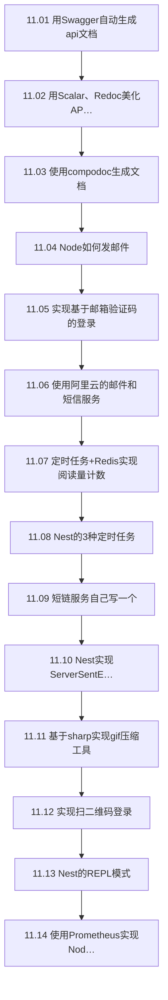

# 第 11 章 工程化设施

> 第 2 部 · 14 节 · 约 17 学时 · 已写 8 节

## 这一章解决什么问题

把仓库、CI、API 文档、代码质量与容器镜像这些“团队基础设施”搭起来。

## 知识地图

## 验收清单

- [ ] 能配置私有镜像仓库、CI 流水线、Scalar/Swagger 文档与提交门禁。
- [ ] 能不看笔记复述本章核心机制与取舍
- [ ] 本章的命令/示例能独立跑通，并留下自己的验证记录

## 节清单

- ✅ [11.01 用Swagger自动生成api文档](11.01-用Swagger自动生成api文档.md)
- ✅ [11.02 用Scalar、Redoc美化API文档与契约交付](11.02-用Scalar、Redoc美化API文档与契约交付.md)
- ✅ [11.03 使用compodoc生成文档](11.03-使用compodoc生成文档.md)
- ✅ [11.04 Node如何发邮件](11.04-Node如何发邮件.md)
- ✅ [11.05 实现基于邮箱验证码的登录](11.05-实现基于邮箱验证码的登录.md)
- ✅ [11.06 使用阿里云的邮件和短信服务](11.06-使用阿里云的邮件和短信服务.md)
- ✅ [11.07 定时任务+Redis实现阅读量计数](11.07-定时任务+Redis实现阅读量计数.md)
- ✅ [11.08 Nest的3种定时任务](11.08-Nest的3种定时任务.md)
- ⬜ 11.09 短链服务自己写一个（待写）
- ⬜ 11.10 Nest实现ServerSentEvent数据推送（待写）
- ⬜ 11.11 基于sharp实现gif压缩工具（待写）
- ⬜ 11.12 实现扫二维码登录（待写）
- ⬜ 11.13 Nest的REPL模式（待写）
- ⬜ 11.14 使用Prometheus实现Node性能监控（待写）

---

[← 第 10 章 配置、Compose 与 Nginx](../ch-10-配置与部署/_chapter.md) · [返回教程目录](../../README.md) · [第 12 章 项目一：会议室预订系统 →](../ch-12-项目一会议室/_chapter.md)
