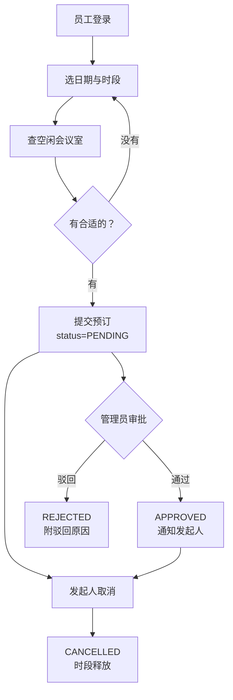

# 12.01 需求分析与原型

到这里，前面十一章讲的是「零件」：模块、管道、过滤器、Prisma、Redis、Nginx、监控。这一章开始把它们装成一台机器——会议室预订系统。

第 12 章要交付的是**一套能上线的系统**：需求文档、数据库设计、骨架、用户/会议室/预订/统计四个模块、部署与验收。如果你跟着 chapter 写到最后，仓库里应该有一个能 `docker compose up` 起来、能被同事真的用来订会议室的服务。

这一节只做两件事：**把需求写清楚，把原型画出来**。听起来不像写代码，但它决定了后面七节会不会返工。

## 一、需求通常是这样进来的

需求几乎不会以文档形式出现。常见的形态是：负责人在群里说一句「我们订会议室太乱了，你做个系统吧」，然后补一句「简单点，能订就行」。

「简单点」是需求里最贵的三个字。它意味着两件事：**范围没定**，以及**后面每加一个功能都是「你不是说简单吗」**。所以第一步不是打开编辑器，而是把这句话翻译成四张表：

1. 谁在用（角色）；
2. 他们要完成什么（用户故事）；
3. 什么算做完（验收标准）；
4. 哪些明确不做（范围外）。

四张表写不满一页纸，但能把 80% 的返工挡在开工之前。

## 二、角色与边界

| 角色 | 能做什么 | 不能做什么 |
| --- | --- | --- |
| 员工（USER） | 查会议室、查空闲、订自己的会议、取消自己的预订、看自己的预订列表 | 建会议室、审批别人的预订、看全公司统计 |
| 管理员（ADMIN） | 管理会议室、审批/驳回预订、取消任意预订、看统计报表、管理用户角色 | 改别人的密码（只能重置）、删历史预订记录 |

角色只有两个，这是刻意的：**每多一个角色，权限矩阵的格子数就翻倍**。真实公司可能有「部门管理员」「行政」「前台」，那些是第三、四期的事，MVP 只有 USER 和 ADMIN。

范围外清单（写下来，避免后面扯皮）：

- 不做支付/发票/报销；
- 不做访客预约、门禁联动、会议室设备控制；
- 不做多租户（一套部署服务一家公司）；
- 不做移动端 App（响应式网页即可）；
- 不做日历双向同步（先只读导出 `.ics`，二期再说）。

## 三、用户故事与验收标准

用户故事用一句话写「谁、要什么、为什么」，验收标准用 Given/When/Then 写「怎么算完成」。

| 编号 | 用户故事 | 验收标准 |
| --- | --- | --- |
| US-01 | 作为员工，我要按时间查空闲会议室，以便挑一间开会 | 给定 3 间会议室和 1 条 10:00–11:00 的预订，查 10:30–11:30 时该会议室不出现 |
| US-02 | 作为员工，我要预订会议室，以便占住时段 | 提交成功后返回 201、状态 `PENDING`；同一会议室同时段第二个人预订返回 409 |
| US-03 | 作为员工，我要取消自己的预订 | 取消后状态 `CANCELLED`，时段重新可订 |
| US-04 | 作为管理员，我要审批预订 | `PATCH :id/approve` 后状态 `APPROVED`；驳回需填原因 |
| US-05 | 作为管理员，我要看使用率 | 统计接口返回按会议室、按天的预订数与使用率 |
| US-06 | 作为员工，我要看自己的预订 | 列表只返回自己的，不泄露他人手机号等信息 |

几条写作纪律：

- **每条都带数字或状态**。「查询要快」不是验收标准，「P95 < 300ms」才是；
- **冲突必须定义到毫秒级边界**：10:00–11:00 和 11:00–12:00 算不算冲突？我们的规则是**左闭右开**，`[start, end)`，所以不算。这条不定，后面 SQL 条件一定写错；
- **状态机先画出来**：`PENDING → APPROVED / REJECTED`，`PENDING|APPROVED → CANCELLED`，终态不可再变。状态机是 12.06 的骨架。

## 四、核心流程



流程里有两个容易被漏掉的点：

**冲突检查发生在哪一步。** 提交时检查（E 之前）和审批时再检查（F 之前）都要做——提交到审批之间可能隔几小时，期间别人可能已经订走了。只在提交时检查，会出现「两个人都被批准了同一间会议室」。

**取消要不要审批。** MVP 不审批，但保留 `cancelledBy` 和 `cancelReason` 字段，为以后的「行政强制取消」留痕。

## 五、领域名词表

这份表是 12.02 数据建模的输入。名词不一致，表结构一定歪。

| 名词 | 定义 | 注意 |
| --- | --- | --- |
| 会议室（Room） | 物理房间，有名称、容纳人数、位置、设备 | 设备用数组存（投影/白板/视频），不建关联表 |
| 时段（Slot） | 一次预订占用的连续时间区间，`[startTime, endTime)` | 统一存 UTC，展示时转 `Asia/Shanghai` |
| 预订（Booking） | 一条「谁在什么时段占哪间房」的记录 | 状态机见上；同一时段最多一条有效记录 |
| 冲突（Conflict） | 同一会议室两条有效预订的时段相交 | 判断用 `start < other.end AND end > other.start` |
| 有效预订 | `PENDING` 或 `APPROVED` | `REJECTED`/`CANCELLED` 不占时段 |

`[start, end)` + 「左闭右开」 + 「时段相交」这三条，就是整个系统最核心的不变量。后面无论用 SQL 查冲突、用排他约束兜底，还是用 Redis 做缓存，都是围绕它。

把它翻译成 SQL，冲突判断就是一句话（12.02 会展开）：

```sql
SELECT count(*) FROM bookings
WHERE room_id = $1
  AND status IN ('PENDING', 'APPROVED')
  AND start_time < $3   -- 新预订的 end
  AND end_time   > $2;  -- 新预订的 start
```

注意两个不等号都是**严格**的：`start_time < new_end` 而不是 `<=`，这样 11:00 结束、11:00 开始的预订不会被判成冲突。状态过滤也必须在 SQL 里，不能查出来再用代码过滤——并发时「查出来还没过滤」的窗口就是脏数据的来源。

状态机也提前用代码写死，避免每个接口各写一套判断：

```ts
export const BookingStatus = {
  PENDING: 'PENDING',
  APPROVED: 'APPROVED',
  REJECTED: 'REJECTED',
  CANCELLED: 'CANCELLED',
} as const;

// 允许的迁移：from -> 可去的 to
export const TRANSITIONS: Record<string, string[]> = {
  PENDING: ['APPROVED', 'REJECTED', 'CANCELLED'],
  APPROVED: ['CANCELLED'],
  REJECTED: [],
  CANCELLED: [],
};

export function canTransition(from: string, to: string): boolean {
  return TRANSITIONS[from]?.includes(to) ?? false;
}
```

这张表会成为 12.06 状态机接口的唯一裁判：任何 `PATCH :id/xxx` 进来，先 `canTransition(current, next)`，不合法直接 409。

## 六、容量与并发估算

不做估算就不知道要不要上缓存、要不要分库。给一组真实量级：

```
公司规模：200 人
每个工作日预订量：约 40 条
早高峰：9:00–9:30，约 20 条提交
QPS：20 / 1800s ≈ 0.01 —— 几乎没有压力
读请求：每人每天看 5 次列表 ≈ 1000 次/天 ≈ 0.01 QPS
```

结论很明确：**这个系统的瓶颈不是并发，是冲突和数据正确性**。所以：

- 不需要缓存会议室列表（200 行数据，PostgreSQL 每秒能扫几百次）；
- 不需要读写分离、分库分表；
- 需要的是**事务 + 排他约束**，保证同一时段不会出现两条有效预订；
- 统计接口可以慢（几秒都行），但要用索引兜住，别全表扫。

估算的意义不是算准，而是**排除掉不必要的工作**。省下来的时间用在冲突处理、权限、部署上，这些才是真正会出事的地方。

## 七、非功能需求

| 维度 | 目标 | 落地手段 |
| --- | --- | --- |
| 可用性 | 工作日 99.9% | 单机 + 健康检查 + PM2/Docker 重启策略 |
| 响应时间 | 读接口 P95 < 300ms，写接口 < 500ms | 索引 + 连接池 |
| 数据正确 | 同一会议室同时段无两条有效预订 | 事务 + 冲突检查 + 排他约束 |
| 安全 | 密码 bcrypt、JWT、越权返回 404 | 12.04/后续鉴权章 |
| 可观测 | 能看到 QPS/错误率/P95 | 11.14 的 `/metrics` |
| 审计 | 谁在什么时候改了什么 | `created_at`/`updated_at` + 审批人字段 |
| 时区 | 存 UTC，展示 UTC+8 | 全局统一，不混用本地时间 |

「可用性 99.9%」意味着一个月停机不超过 43 分钟。单机做到这一点靠的是：**进程挂了自动重启、数据库有备份、发布不断流**——正好对应第 10 章的 PM2/Docker/Nginx 和第 12.08 的部署验收。

## 八、原型与页面清单

原型不需要高保真，能回答「有几个页面、每个页面调哪个接口」就够了。

| 页面 | 路径 | 主要接口 | 说明 |
| --- | --- | --- | --- |
| 登录 | `/login` | `POST /api/auth/login` | 邮箱 + 密码 |
| 会议室列表 | `/rooms` | `GET /api/rooms` | 卡片式，显示容量/设备 |
| 空闲查询 | `/rooms/availability` | `GET /api/rooms/availability?date=&start=&end=` | 时间选择器 |
| 我的预订 | `/bookings` | `GET /api/bookings/mine` | 列表 + 取消按钮 |
| 预订详情 | `/bookings/:id` | `GET /api/bookings/:id` | 含审批记录 |
| 管理后台-预订审批 | `/admin/bookings` | `GET /api/bookings?status=PENDING`、`PATCH /api/bookings/:id/approve` | 表格 + 批量操作 |
| 管理后台-会议室 | `/admin/rooms` | `POST/PATCH/DELETE /api/rooms` | 增删改 |
| 管理后台-统计 | `/admin/stats` | `GET /api/stats/overview`、`/rooms/usage`、`/bookings/trend` | 三个图 |

首页线框（`/rooms`）：顶部是日期与时段选择器，主体是会议室卡片网格，卡片右下角按钮在「已订满」时置灰。这个页面 80% 的价值在于**让用户三秒内知道有没有空**，而不是好看。

```text
┌──────────────────────────────────────────────────────────────┐
│ 会议室预订            [我的预订]  [管理后台]   alice ▾        │
├──────────────────────────────────────────────────────────────┤
│ 日期 [2026-11-25 ▾]   时段 [10:00 ▾] — [11:00 ▾]   [查询]    │
├──────────────────────────────────────────────────────────────┤
│ ┌──────────────┐ ┌──────────────┐ ┌──────────────┐          │
│ │ 3F-黄河      │ │ 3F-长江      │ │ 5F-多功能厅  │          │
│ │ 12 人 · 3F东 │ │ 8 人 · 3F西  │ │ 30 人 · 5F   │          │
│ │ 投影 白板    │ │ 白板         │ │ 投影 视频    │          │
│ │ [ 预订 ]     │ │ [ 已订满 ]   │ │ [ 预订 ]     │          │
│ └──────────────┘ └──────────────┘ └──────────────┘          │
└──────────────────────────────────────────────────────────────┘
```

线框里每个元素都要能对应到一条接口或一个字段：日期/时段 → `availability` 的 query 参数；卡片 → `Room` 的字段；「已订满」→ 该时段冲突查询的结果。**对不上的元素就是没想清楚的需求。**

## 九、接口清单（与参考实现对齐）

参考实现 `example/` 一共 25 条路由，正好覆盖 MVP。表里标 ★ 的是 12.04–12.07 会写的核心接口。

| 模块 | 接口 | 说明 |
| --- | --- | --- |
| 认证 | `POST /api/auth/register`、`/login`、`/refresh`、`/logout` | 4 条，★ 12.04 |
| 用户 | `GET /api/users/me`、`PATCH /api/users/me` | 个人资料 |
| 用户（管理员） | `GET /api/users`、`GET /api/users/:id`、`PATCH /api/users/:id` | 角色管理 |
| 会议室 | `GET /api/rooms`、`GET /api/rooms/:id` | 公开读 |
| 会议室（管理员） | `POST /api/rooms`、`PATCH /api/rooms/:id`、`DELETE /api/rooms/:id` | ★ 12.05 |
| 预订 | `POST /api/bookings`、`GET /api/bookings`、`GET /api/bookings/:id` | ★ 12.06 |
| 预订（动作） | `PATCH /api/bookings/:id/approve`、`/:id/reject`、`/:id/cancel` | 状态机三个动作 |
| 统计 | `GET /api/stats/overview`、`/rooms/usage`、`/bookings/trend` | ★ 12.07 |
| 运维 | `GET /api`、`GET /api/health` | 健康检查 |

一个决策要提前定：**列表接口分页**。MVP 数据量小，但接口形状一旦定成裸数组，后面加分页就是破坏性变更。所以从第一天起就用 `{ data: [...], meta: { page, pageSize, total } }` 的信封格式——这也和前面章节里 `ResponseInterceptor` 的输出对齐。

```json
{
  "data": [
    {
      "id": "6f1a2e40-8f1b-4c4e-9a3e-2f2f8f1c1a11",
      "name": "3F-黄河",
      "capacity": 12,
      "location": "3F 东侧",
      "equipment": ["投影", "白板"],
      "status": "AVAILABLE"
    }
  ],
  "meta": { "page": 1, "pageSize": 20, "total": 3 }
}
```

为什么信封格式值得在需求阶段就定：它同时解决了四件事——分页、统一错误结构、未来加 `meta.extra`、以及前端不用为每个接口写不同解析逻辑。代价是每层多一层 `data`，在列表很大的时候稍微多几个字节。

## 十、范围与排期

本章 8 节，对应 MVP 的 8 个交付物：

| 节 | 交付物 | 依赖 |
| --- | --- | --- |
| 12.01 | 需求、原型、接口清单 | — |
| 12.02 | 技术方案、数据库 DDL、冲突方案 | 12.01 |
| 12.03 | 骨架、配置、错误处理、日志、健康检查 | 12.02 |
| 12.04 | 用户模块（注册/登录/资料/角色） | 12.03 |
| 12.05 | 会议室模块（CRUD/筛选） | 12.03 |
| 12.06 | 预订模块（冲突/状态机/审批） | 12.04、12.05 |
| 12.07 | 统计模块（三个报表） | 12.06 |
| 12.08 | 部署、验收、复盘 | 全部 |

排期建议按「两天一节」估：需求与原型半天，数据库半天，骨架一天，四个模块各 1.5 天，部署与验收 1 天，总共 8–9 个工作日。**估时永远偏乐观，所以每节结束都要能跑起来**——这是对进度最好的保护。

## 十一、验收清单

上线前逐条打勾，全部通过才算「做完」：

- [ ] 员工能注册、登录、改自己的昵称；
- [ ] 员工能按日期+时段查到空闲会议室；
- [ ] 同一会议室同时段第二次预订返回 409，不产生脏数据；
- [ ] 管理员能审批/驳回，驳回必须带原因；
- [ ] 员工只能看到和取消自己的预订，越权访问返回 404；
- [ ] 统计三个接口有数据、有索引、P95 < 1s；
- [ ] `/api/health` 在数据库断开时返回 503；
- [ ] 容器重启后数据不丢，进程自动拉起；
- [ ] 日志里有 requestId，能串起一次请求；
- [ ] 接口文档 `/api/docs` 可访问，且与实际接口一致。

## 十二、Checkpoint

需求阶段的产出不是代码，是四份文件：

```text
docs/requirements.md      # 角色、用户故事、验收标准、范围外
docs/domain.md            # 名词表、状态机、不变量
docs/api.md              # 接口清单（后面可直接生成 OpenAPI 初稿）
docs/prototype.md        # 页面清单 + 线框 + 接口映射
```

判断需求是否真的写完，用三个问题自检：

1. 随便挑一条用户故事，能不能说出「怎么算做完」？
2. 两个人同时订同一间会议室同一时段，系统行为是什么？（答不出就是没定义冲突）
3. 领导说「加个审批流」，你能立刻回答「在哪一步加、影响哪些接口」吗？

三个都能答，就可以进 12.02 建模了。

需求阶段的验收也可以直接跑两三条 curl——它们现在会 404，等 12.05/12.06 写完就应该是下面这样：

```bash
# 登录拿 token（12.04 之后可用）
TOKEN=$(curl -s -X POST localhost:3000/api/auth/login \
  -H 'content-type: application/json' \
  -d '{"email":"alice@example.com","password":"Passw0rd!"}' \
  | jq -r '.data.accessToken')

# 查 2026-11-25 10:00–11:00 的空闲会议室（12.05 之后可用）
curl -s "localhost:3000/api/rooms/availability?date=2026-11-25&start=10:00&end=11:00" \
  -H "authorization: Bearer $TOKEN" | jq '.data | length'

# 造一条预订（12.06 之后可用），拿它的 id
curl -s -X POST localhost:3000/api/bookings \
  -H "authorization: Bearer $TOKEN" -H 'content-type: application/json' \
  -d '{"roomId":"<room-id>","startTime":"2026-11-25T10:00:00+08:00","endTime":"2026-11-25T11:00:00+08:00","remark":"周会"}' \
  | jq -r '.data.id'
```

把这三条命令存进 `docs/acceptance.sh`，每节写完跑一次。**「接口能按文档返回」比「我觉得写完了」可靠得多。**

## 十三、坑表

| 做法 | 后果 |
| --- | --- |
| 把「简单点，能订就行」当需求 | 范围无限扩张，每加功能都被质问 |
| 不写范围外清单 | 「顺手加个支付」变成你的锅 |
| 时段边界不定左闭右开 | 10:00–11:00 与 11:00–12:00 被判冲突或漏判 |
| 只在提交时检查冲突 | 审批期间被抢订，出现双批准 |
| 只定义角色不定义动作 | 权限代码写成 `if (user.role === 'ADMIN')` 满天飞 |
| 接口直接返回数组 | 后面加分页就是破坏性变更 |
| 不做容量估算 | 要么过度设计（上分库分表），要么漏掉真正的瓶颈（冲突） |
| 估时不设检查点 | 做到 12.06 才发现数据库设计错了，全部返工 |
| 原型画得太细 | 时间花在配色上，需求反而没定清 |
| 需求文档只写在一处 | 实现与文档分叉，最后没人看文档 |

<!-- chapter-nav:start -->
---

← [11.14 使用Prometheus实现Node性能监控](../ch-11-工程化/11.14-使用Prometheus实现Node性能监控.md) · [本章目录](_chapter.md) · [12.02 技术方案与数据库设计](12.02-技术方案与数据库设计.md) →
<!-- chapter-nav:end -->
