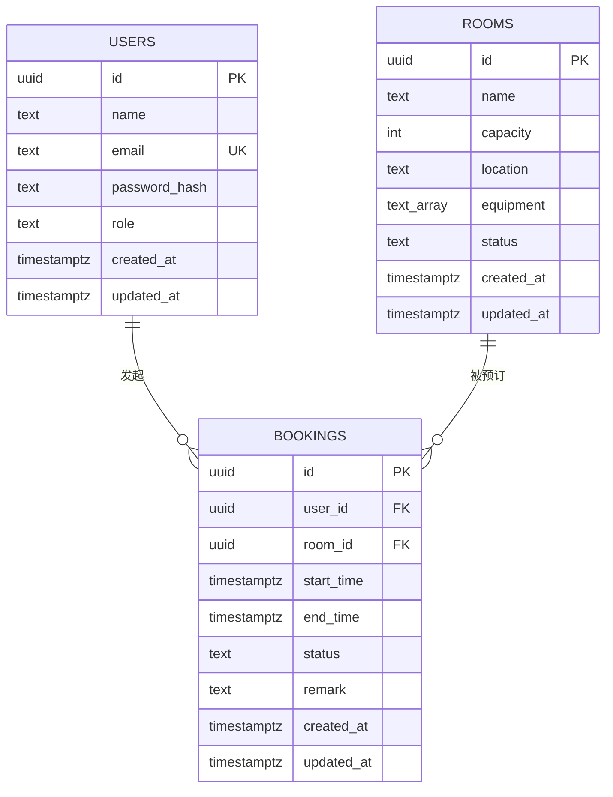

# 12.02 技术方案与数据库设计

12.01 把需求写成了表、图和清单。这一节把它们变成两个东西：**一份技术方案**（选型、模块划分、错误与日志约定）和 **一套数据库结构**（DDL、索引、约束）。

这一节结束时，你应该能回答三个问题：

1. 为什么用 Prisma 8 而不是别的 ORM，为什么预订冲突不能只靠「先查后写」；
2. 每张表每个字段为什么长这样，索引为什么是这几个；
3. 后面六个模块分别落在哪一层、依赖谁。

## 一、技术方案：一张选型表说清

| 关注点 | 选择 | 备选 | 为什么是它 |
| --- | --- | --- | --- |
| 运行时 | Node 24 LTS | 22 / 26 | 22 已进入维护期，26 太新；24 是当前稳妥的 LTS |
| 框架 | Nest 12.6.x | — | 全书基线，ESM-first |
| 语言 | TypeScript 6.0.x | 7.0.x | `@nestjs/graphql` 等包的 peer 仍限 `^5.5 \|\| ^6`，升 7 会冲突 |
| 数据库 | PostgreSQL 17 | MySQL 8.4 | 需要 `tstzrange`、排他约束、`EXCLUDE`——MySQL 没有等价物 |
| ORM | Prisma 8（contract 模式） | TypeORM / Drizzle | 契约即 schema、生成类型、chain API；RC 版本锁死配对 |
| 缓存 | Redis 8 | — | 会话、限流、热点数据都在用 |
| 认证 | JWT（短 access + 长 refresh） | Session | 无状态、便于多副本；会话方案见第 9 章对比 |
| 日志 | JSON 到 stdout + requestId | Winston 文件 | 容器里日志就该交给采集器，不落盘 |
| 部署 | Docker Compose + Nginx | K8s | 单机 6C6G 用 Compose 足够，K8s 是二期 |
| 文档 | Swagger 12 + Scalar | — | 接口契约与 UI 分离，见第 11 章 |

技术方案里最该写下来的不是「用了什么」，而是**为什么不用另一个**。上表第三列就是干这个的：半年后有人问「为什么不上 K8s」，你能翻出「单机 6C6G、日均 40 次预订、没有多租户——K8s 的调度和自愈能力用不上，运维成本反而更高」。

## 二、模块划分

```
src/
  main.ts                 # 启动：全局管道、过滤器、前缀、Swagger
  app.module.ts           # 根模块：Config / Database / Redis / Throttler
  common/                 # 跨模块基础设施
    filters/              # 全局异常过滤器
    interceptors/         # 响应信封、超时
    guards/               # JwtAuthGuard、RolesGuard
    decorators/           # @Public、@CurrentUser、@Roles
    dto/                  # 分页、通用响应
  database/               # Prisma 8 Database provider（连接池、生命周期）
  config/                 # env 校验、configuration()
  modules/
    auth/                 # 注册、登录、刷新、登出
    users/                # 个人资料、管理员用户管理
    rooms/                # 会议室 CRUD、空闲查询
    bookings/             # 预订、冲突、状态机
    stats/                # 三个报表
    health/               # /health（或 app.controller）
  redis/                  # Redis 客户端封装
```

依赖方向只有一条：`modules/* → common/* → database|config`。反过来不允许——`common` 里不许 import 具体业务模块，否则循环依赖迟早出现（第 2 章讲过怎么排查，但最好的排查是不制造）。

每个模块的固定四件套：`*.module.ts`、`*.controller.ts`、`*.service.ts`、`dto/`。参考实现里就是这四个文件加一个 `*.service.spec.ts`（本书不写测试，但目录留好）。

## 三、分层职责：controller 只做三件事

```ts
@Post()
async create(@CurrentUser() user: AuthUser, @Body() dto: CreateBookingDto) {
  // 1. 组装入参（DTO 已校验）
  // 2. 调 service
  const booking = await this.bookings.create(user.id, dto);
  // 3. 转响应（序列化交给拦截器/映射函数）
  return toBookingResponse(booking);
}
```

controller 里不该出现：Prisma 查询、`try/catch` 业务异常（全局过滤器接）、权限判断（守卫做）、事务（service 做）。判断标准很简单：**把 controller 的方法体抄到另一个框架里，还能不能跑？** 能，说明职责是对的。

service 负责业务不变量：冲突、状态机、事务边界。所以 service 是唯一能看到 `Database`/`tx` 的地方，controller 和 DTO 都碰不到。

## 四、数据库设计：三张核心表



三张表之外，后面还会加 `users.role` 的角色扩展（第 9 章的 ACL/RBAC 两套表），但 MVP 先只有 `role` 枚举——**能不加表就不加**，加了就要维护迁移和回滚。

DDL（Prisma 8 生成的等价 SQL）。注意枚举在契约里用 `@@type("pg/text@1")` 声明，落到库里就是 **text 列**，不是 PG 的 enum 类型：

```sql
CREATE TABLE users (
  id            uuid PRIMARY KEY DEFAULT gen_random_uuid(),
  name          text NOT NULL,
  email         text NOT NULL UNIQUE,
  password_hash text NOT NULL,
  role          text NOT NULL DEFAULT 'USER'
                CHECK (role IN ('ADMIN', 'USER')),
  avatar_url    text,
  created_at    timestamptz NOT NULL DEFAULT now(),
  updated_at    timestamptz NOT NULL
);

CREATE TABLE rooms (
  id         uuid PRIMARY KEY DEFAULT gen_random_uuid(),
  name       text NOT NULL,
  capacity   integer NOT NULL CHECK (capacity > 0),
  location   text NOT NULL,
  equipment  text[] NOT NULL DEFAULT '{}',
  status     text NOT NULL DEFAULT 'AVAILABLE'
             CHECK (status IN ('AVAILABLE', 'MAINTENANCE')),
  created_at timestamptz NOT NULL DEFAULT now(),
  updated_at timestamptz NOT NULL
);
CREATE INDEX idx_rooms_status ON rooms (status);

CREATE TABLE bookings (
  id         uuid PRIMARY KEY DEFAULT gen_random_uuid(),
  user_id    uuid NOT NULL REFERENCES users (id) ON DELETE CASCADE,
  room_id    uuid NOT NULL REFERENCES rooms (id) ON DELETE RESTRICT,
  start_time timestamptz NOT NULL,
  end_time   timestamptz NOT NULL,
  status     text NOT NULL DEFAULT 'PENDING'
             CHECK (status IN ('PENDING', 'APPROVED', 'REJECTED', 'CANCELLED')),
  remark     text,
  created_at timestamptz NOT NULL DEFAULT now(),
  updated_at timestamptz NOT NULL,
  CONSTRAINT chk_bookings_time CHECK (end_time > start_time)
);
CREATE INDEX idx_bookings_room_time ON bookings (room_id, start_time, end_time);
CREATE INDEX idx_bookings_user      ON bookings (user_id);
```

几个设计决定值得单独说：

**枚举为什么是 text 而不是 PG enum。** 契约里每个枚举都写了 `@@type("pg/text@1")`，生成出来就是 text 列。好处是加枚举值不用 `ALTER TYPE`（PG 里加值虽然可以，但删值、改名都很难）；代价是**数据库不帮你校验枚举合法性**，所以上面手写了 `CHECK (status IN (...))` 作为兜底。这两条要一起看：只写 text 不加 CHECK，脏数据能直接写进去。

**为什么 `start_time < end_time` 要作为 CHECK。** 这是唯一一条「不管代码怎么写都不可能违反」的约束。业务代码写错的概率不低（尤其时区转换），数据库兜住一次就省一次线上事故。

**为什么 `equipment` 用 `text[]` 而不是关联表。** 设备清单是「展示用的小集合」，不需要按设备反查会议室。建关联表会让「查会议室列表」从一次查询变成 join，收益为零。**什么时候该改**：需要按设备组合筛选、需要统计「投影仪使用率」时再拆。

**为什么 `room_id` 是 `ON DELETE RESTRICT` 而不是级联。** 删会议室不该顺手删掉历史预订——那是审计记录。要删得先把预订归档或拒绝删除。

**为什么时间用 `timestamptz` 不是 `timestamp`。** 前者存的是绝对时刻，后者存的是「墙上时间」，跨时区一定出事。API 层收 ISO 8601 带偏移（`2026-11-25T10:00:00+08:00`），数据库统一存 UTC，展示再转。

## 五、Prisma 8 的契约写法

Prisma 8 和 7 的写法完全不同：没有 `PrismaClient`，没有 `@prisma/client`，schema 改成「契约」（contract），运行时用 `@prisma/orm-postgres` 的 `postgres()`。参考实现的 `prisma/contract.prisma`：

```prisma
// use prisma-8

model Booking {
  id        Uuid            @id @onCreate(uuid())
  userId    Uuid            @map("user_id")
  roomId    Uuid            @map("room_id")
  startTime TimestamptzString @map("start_time")
  endTime   TimestamptzString @map("end_time")
  status    BookingStatus   @default(PENDING)

  user User @relation(fields: [userId], references: [id], onDelete: Cascade)
  room Room @relation(fields: [roomId], references: [id], onDelete: Restrict)

  @@index([roomId, startTime, endTime], map: "idx_bookings_room_time")
  @@map("bookings")
}

enum BookingStatus {
  PENDING
  APPROVED
  REJECTED
  CANCELLED

  @@type("pg/text@1")
}
```

三个容易错的点：

- 第一行 `// use prisma-8` 不能少，它是 contract 模式开关；
- 枚举要显式标 `@@type("pg/text@1")`，让它按 text 存储（加值不用 `ALTER TYPE`，也便于和前端枚举字符串对齐）；
- `updated_at` 用 `temporal.UpdatedAtString`，由 Prisma 8 维护，不要自己写 `@updatedAt`（那是 7 的写法）。

改完契约的固定流程：

```bash
pnpm db:emit                 # 生成 contract.json / contract.d.ts
pnpm db:plan --name add-booking-index
pnpm db:migrate              # 应用到数据库
```

`db:emit` 是编译期的一件事，失败信息通常指向类型不匹配（比如 `Uuid` 字段给了 `string | null`）。**契约产物要提交进仓库**，否则不同机器生成的运行时类型可能不一致。

## 六、冲突：为什么「先查后写」不够

这是整个项目最核心的技术决策。先看朴素写法的问题：

```ts
// 反面教材：先查后写，且不在事务里
const conflict = await db.orm.public.Booking.where((row, { fns }) =>
  fns.and(
    row.roomId.eq(roomId),
    row.status.in(['PENDING', 'APPROVED']),
    row.startTime.lt(end.toISOString()),
    row.endTime.gt(start.toISOString()),
  ),
).first();

if (conflict) throw new ConflictException('时段已被占用');

await db.orm.public.Booking.create({ ... });  // ← 到这里冲突可能已经发生
```

两个请求同时进来，都查到「没冲突」，然后都插入——**检查与写入之间的窗口就是脏数据的入口**。这不是「概率很低」，早高峰 20 个请求里有 2–3 个是同一间会议室同一时段，撞上只是时间问题。

三种堵法，按成本从低到高：

| 方案 | 做法 | 优点 | 代价 |
| --- | --- | --- | --- |
| 行锁 | 事务里对 `rooms` 那一行 `FOR UPDATE` | 简单、只锁同房间的写入 | 同一房间串行，吞吐降低 |
| 建议锁 | `pg_advisory_xact_lock(hashtext(roomId))` | 不锁真实业务行 | 要自己记约定，需手写 SQL |
| 排他约束 | `EXCLUDE USING gist` | 数据库级兜底，代码写错也拦得住 | 需要手写 SQL（契约表达不了） |

MVP 用「事务 + 行锁 + 冲突查询」三件套，排他约束作为二期加固。`forUpdate()` 在 Prisma 8 的查询链上是真实存在的：渲染 `FOR UPDATE`，锁持续到事务结束。

```ts
async create(dto: CreateBookingDto, user: AuthUser) {
  const start = new Date(dto.startTime);
  const end = new Date(dto.endTime);

  return this.db.transaction(async (tx) => {
    // 锁住会议室这一行：同一房间的预订被串行化，不同房间互不影响
    const room = await tx.orm.public.Room.where({ id: dto.roomId }).forUpdate().first();
    if (!room) throw new NotFoundException('会议室不存在');
    if (room.status !== 'AVAILABLE') throw new ConflictException('会议室正在维护，暂不可预订');

    const conflict = await tx.orm.public.Booking.where((row, { fns }) =>
      fns.and(
        row.roomId.eq(dto.roomId),
        row.status.in(['PENDING', 'APPROVED']),
        row.startTime.lt(end.toISOString()),
        row.endTime.gt(start.toISOString()),
      ),
    ).first();

    if (conflict) throw new ConflictException('该时间段与已有预订冲突，请选择其他时间');

    return tx.orm.public.Booking.create({
      userId: user.id,
      roomId: dto.roomId,
      startTime: start.toISOString(),
      endTime: end.toISOString(),
      status: 'PENDING',
      remark: dto.remark ?? null,
    });
  });
}
```

三个关键点：

- 锁必须在**事务内**，出事务自动释放；不在事务里调 `forUpdate()` 等于没锁；
- 锁的是 `rooms` 行而不是 `bookings`，因为「同一房间的写入」才是需要串行的粒度；锁 `bookings` 的某一行没有意义——冲突的那一行还不存在；
- 冲突查询的状态过滤要在 SQL 里，不能查出来再用代码过滤。

如果不想锁业务行（比如 `rooms` 行更新很频繁），用建议锁：

```sql
-- 在同一个事务里先执行
SELECT pg_advisory_xact_lock(hashtext($1));
```

`pg_advisory_xact_lock` 在事务结束时自动释放，不需要手写 unlock，也不会因为异常泄漏锁——这是它比 `pg_advisory_lock` 更适合请求内场景的原因。代价是它不会体现在 `EXPLAIN` 或锁视图的「行」上，排查问题时要记得它的存在。

如果要做排他约束，DDL 是：

```sql
ALTER TABLE bookings
  ADD CONSTRAINT no_overlapping_bookings
  EXCLUDE USING gist (
    room_id WITH =,
    tstzrange(start_time, end_time) WITH &&
  )
  WHERE (status IN ('PENDING', 'APPROVED'));
```

它要求 `btree_gist` 扩展（`CREATE EXTENSION IF NOT EXISTS btree_gist;`），并且 `status` 是 text 时 WHERE 谓词要写成文本比较。这条约束上了之后，任何绕过应用层的写入（手抖的 SQL、导入脚本）也会被拦住。

## 七、索引：三个查询决定三个索引

不要凭感觉加索引，先列出「有哪些查询」：

| 查询 | 频率 | 需要的索引 |
| --- | --- | --- |
| 某房间某时段是否有冲突 | 每次写预订 | `(room_id, start_time, end_time)` |
| 我的预订列表（按时间倒序分页） | 每次进「我的预订」 | `(user_id, start_time DESC)` |
| 待审批列表（管理员） | 每次进管理后台 | `(status, created_at DESC)` |
| 某天某房间的预订（日历/统计） | 每次查空闲 | 复用第一个 |
| 会议室的启停状态过滤 | 低 | `(status)` |

```sql
CREATE INDEX idx_bookings_user_time ON bookings (user_id, start_time DESC);
CREATE INDEX idx_bookings_status_created ON bookings (status, created_at DESC);
```

三条纪律：

- **索引列顺序有讲究。** 等值条件在前、范围条件在后。`(status, created_at)` 能服务「status = ? ORDER BY created_at」，反过来不行；
- **不要给低基数列单独建索引。** `status` 只有 4 个值，单独建索引效果差；但作为复合索引的前缀就有用；
- **写多读少的表不要加太多索引。** `bookings` 每次写入都要维护 4 个索引，插入会慢几毫秒——对 40 条/天完全无所谓，但要知道这个代价存在。

验证方式永远只有一种：

```sql
EXPLAIN (ANALYZE, BUFFERS)
SELECT * FROM bookings
WHERE room_id = '...' AND status IN ('PENDING','APPROVED')
  AND start_time < '2026-11-25 11:00+08' AND end_time > '2026-11-25 10:00+08';
```

看有没有走 `Index Scan`、`rows` 估算和实际差多少、有没有 `Buffers: shared read` 很高但 `hit` 很低。第 6 章讲过的 EXPLAIN 三件套，在这里第一次派上正用场。

## 八、事务边界与隔离级别

预订创建需要事务，但不是所有操作都需要。

| 操作 | 需要事务？ | 说明 |
| --- | --- | --- |
| 创建预订（锁 + 查冲突 + 插入） | 要 | 三步必须原子 |
| 审批/驳回 | 要 | 状态机校验 + 更新 + 写审计 |
| 取消 | 要 | 同上 |
| 查列表 | 不要 | 单条 SQL，读到中间状态也能接受 |
| 会议室增删改 | 可以不要 | 单表单行写入 |
| 统计查询 | 不要 | 只读，用一致的快照就够 |

隔离级别用默认的 `READ COMMITTED` 就够——因为冲突已经用行锁串行化了，不需要 `SERIALIZABLE` 的额外开销。**什么时候需要提高隔离级别**：当你不加锁、想让数据库帮你检测冲突时。但 `SERIALIZABLE` 会带来序列化失败重试，代码复杂度上升一个量级，不值得。

Prisma 8 的事务里同样能拿到 `tx`，写法见上面那段——注意 `tx.orm.public.X` 和 `db.orm.public.X` 是同一套 API，区别只是前者绑在事务上。

## 九、统一错误与响应格式

接口返回形状在 12.01 已经定成信封格式，这里把它实现为「全局拦截器 + 全局过滤器」：

```ts
// 成功
{ "data": { ... }, "meta": { ... } }

// 失败
{
  "error": {
    "code": "BOOKING_CONFLICT",
    "message": "该时间段与已有预订冲突，请选择其他时间",
    "requestId": "0f9a2b7c-..."
  }
}
```

`code` 是给前端和监控用的稳定标识，`message` 是给人看的。**不要把 `code` 写成中文、也不要把 `message` 当 code 判断**——文案会改，code 不能改。错误码表在 `docs/errors.md` 里维护，新增错误码时同步更新，前端才能据此做差异化处理（比如 `BOOKING_CONFLICT` 展示「换一间」，`UNAUTHORIZED` 跳登录）。

`requestId` 贯穿日志、响应、错误——这是排查线上问题的第一把钥匙。生成方式：入口中间件 `crypto.randomUUID()` 放进 `AsyncLocalStorage`，日志格式化时带上。

## 十、非功能落点：把 12.01 的目标变成配置

| 目标 | 具体实现 | 在哪个文件 |
| --- | --- | --- |
| P95 < 300ms | 连接池 + 索引 + 无 N+1 | `database.module.ts`、索引 DDL |
| 冲突为 0 | 事务 + 行锁 | `bookings.service.ts` |
| 可用性 99.9% | healthcheck + restart policy | `Dockerfile`、`compose.yml` |
| 可观测 | `/metrics` + 结构化日志 | `metrics`、`logger` |
| 安全 | helmet + 限流 + 越权 404 | `main.ts`、守卫 |

写方案时把这些「逐条挂到文件上」，评审时就能问「这条落在哪」——答不出来的目标等于没写。

## 十一、风险清单

| 风险 | 影响 | 应对 |
| --- | --- | --- |
| Prisma 8 仍是 RC，rc.34/rc.24 配对不能乱升 | 升级即崩 | 锁死版本，`package.json` 写精确版本 |
| 时区处理不一致 | 预订时间错位几小时 | 全链路 UTC + 只在展示层转 |
| 排他约束未上，代码有漏 | 双订 | 行锁兜底 + 二期加 EXCLUDE |
| 统计接口全表扫 | 数据涨了之后变慢 | 现在就用索引 + 时间范围过滤 |
| 单机部署 | 宕机即不可用 | 备份 + 快速重建脚本 + 监控告警 |

风险清单的作用不是「显得专业」，而是**让评审有东西可吵**。比如「Prisma 8 RC 要不要换 Prisma 7」这个问题，现在讨论清楚，比上线后发现 bug 再讨论便宜十倍。

## 十二、Checkpoint

这一节的产出是四份文件，写完再进 12.03：

```text
docs/tech-design.md        # 选型表 + 模块划分 + 分层职责
docs/database.md           # ER 图 + DDL + 索引说明 + 冲突方案
docs/errors.md             # 错误码表
prisma/contract.prisma     # 契约（与 DDL 一致）
```

自检三条：

1. `pnpm db:emit` 能生成产物，`pnpm db:plan` 能生成迁移计划；
2. 在 psql 里手写一次冲突查询，`EXPLAIN` 走索引；
3. 随便指一条接口，能说出它经过 controller/service/repository 哪几层、事务边界在哪。

## 十三、坑表

| 做法 | 后果 |
| --- | --- |
| 先查后写、不加锁 | 并发双订，数据永久脏 |
| 用 `SERIALIZABLE` 代替锁设计 | 序列化失败要重试，代码复杂度翻倍 |
| 时间用 `timestamp` | 跨时区错几小时，且很难发现 |
| 索引建在低基数列上 | 写了没用，还拖慢插入 |
| 复合索引列序反了 | 查询走不了索引，`EXPLAIN` 里是 Seq Scan |
| 契约产物不提交 | 不同机器类型不一致，CI 与本地行为不同 |
| `code` 用中文或直接复用 message | 前端没法做分支处理，改文案就破 |
| 错误码表不维护 | 前端猜 code，联调靠吼 |
| 方案只写「用了什么」 | 半年后没人知道为什么这么选 |
| 所有操作都套事务 | 连接被长时间占用，吞吐下降 |

<!-- chapter-nav:start -->
---

← [12.01 需求分析与原型](12.01-需求分析与原型.md) · [本章目录](_chapter.md)
<!-- chapter-nav:end -->
