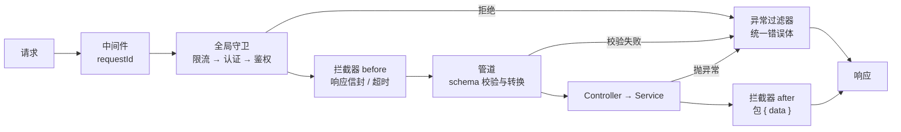

# 12.03 项目骨架与工程约定

12.02 定了表和方案，这一节把它们变成**一个能跑起来的空壳**：启动即通过环境变量校验、连上数据库、全局管道和过滤器就位、日志带 requestId、`/api/health` 能探活、Swagger 能打开。

骨架写完，后面四个模块就是「往里填业务」，而不是边写业务边补基础设施——这是本节唯一的目标。

## 一、生成骨架

```bash
# 1. 生成骨架
pnpm dlx @nestjs/cli@12 new meeting-booking \
  --package-manager pnpm \
  --type esm \
  --no-observe \
  --skip-tests

# 2. 生成之后先跑一遍
cd meeting-booking
cp .env.example .env        # 参考实现里的 .env.example 已对齐 PostgreSQL 17
pnpm install
pnpm start:dev
```

三个参数都值得解释：

- `--type esm`：Nest 12 的 ESM 模板，配 Vitest 和 oxlint。不加会进交互问你要 ESM 还是 CJS；
- `--no-observe`：不接入 `@nestjs/observe`。这个包在做全链路 trace 时很有用，但会在启动时注册 Instrumentation，初学阶段多一层黑盒不如先不接；
- `--skip-tests`：本书不写测试，跳过 `*.spec.ts` 和 `vitest.config.ts`。注意这只是**不生成**，不是禁用——以后想让脚手架恢复测试，去掉这个参数重新生成即可。

模板自带的 `ValidationPipe` 那一段先别急着留：本书从这一节起统一用 schema 校验，12.03 的第五节会把它换成 `StandardSchemaValidationPipe`。

## 二、目录与依赖方向

```text
meeting-booking/
├── prisma/
│   └── contract.prisma          # Prisma 8 契约（12.02）
├── src/
│   ├── main.ts                  # 启动编排
│   ├── app.module.ts            # 根模块
│   ├── app.controller.ts        # /api、/api/health
│   ├── common/
│   │   ├── decorators/          # @Public、@CurrentUser、@Roles
│   │   ├── dto/                 # 分页/通用响应的 schema
│   │   ├── filters/             # 全局异常过滤器
│   │   ├── guards/              # JwtAuthGuard、RolesGuard
│   │   ├── interceptors/        # 响应信封、超时
│   │   ├── middleware/          # requestId
│   │   └── types/               # AuthUser、RequestWithId
│   ├── config/                  # env 校验、configuration()
│   ├── database/                # Database provider
│   ├── redis/                   # Redis provider
│   ├── generated/prisma8/       # db:emit 产物（提交进仓库）
│   └── modules/                 # 业务模块
└── package.json

# 依赖方向只有一条，违反了就是设计问题：
modules/*  →  common/*  →  database | config | redis
```

`common` 里不许 import 任何 `modules/` 下的东西。一旦出现，说明某个「通用」组件其实带业务语义，应该下沉到那个模块里。这条规则不是洁癖：`common` 被所有模块 import，它反向依赖业务模块就是循环依赖的种子。

`dto/` 下放的是 schema 文件，不是 DTO 类：通用的在 `common/dto/pagination.schema.ts`，各模块自己的在 `modules/<模块>/dto/`。参数类型由 `z.infer` 推出来，所以这个目录里不会出现第二份「长得一样」的类型声明。

## 三、配置：三件套

第 10 章讲过配置的三层优先级和陷阱，这里只落文件。三个文件各管一件事：

| 文件 | 职责 |
| --- | --- |
| `src/config/env.validation.ts` | 用 zod 校验 `process.env`，缺关键项直接启动失败 |
| `src/config/configuration.ts` | 把扁平 env 组装成命名空间对象，供 `ConfigService` 类型化读取 |
| `src/config/load-env.ts` | 给 Prisma CLI 等非 Nest 进程手动载入 `.env` |

`env.validation.ts` 的关键是**敏感项不给默认值 + 生产禁止开发默认值**：

```ts
const envSchema = z.object({
  NODE_ENV: z.enum(['development', 'test', 'production']).default('development'),
  PORT: z.coerce.number().int().min(1).max(65535).default(3000),
  DATABASE_URL: z
    .string()
    .refine((v) => v.startsWith('postgres://') || v.startsWith('postgresql://'), {
      message: 'DATABASE_URL 必须是 postgres:// 或 postgresql:// 开头的连接串',
    }),
  DIRECT_URL: z.string().url().optional(),
  REDIS_URL: z.string().url().optional(),
  JWT_ACCESS_SECRET: z.string().min(16),
  JWT_REFRESH_SECRET: z.string().min(16),
  THROTTLE_TTL: z.coerce.number().int().min(1000).default(60_000),
  THROTTLE_LIMIT: z.coerce.number().int().min(1).default(100),
});
```

体检一下这些行的作用：`DATABASE_URL` 的 `refine` 把「MySQL 连接串贴错」这种低级错误挡在启动阶段；`JWT_*_SECRET` 的 `min(16)` 挡住空密钥；`THROTTLE_TTL` 的 `min(1000)` 挡住「填了 60 以为单位是秒」——这些都是真实踩过的坑，不是假想。

`configuration.ts` 只做组装，不做校验：

```ts
export const configuration = () => ({
  environment: process.env.NODE_ENV ?? 'development',
  port: Number(process.env.PORT ?? 3000),
  database: {
    url: process.env.DATABASE_URL!,
    directUrl: process.env.DIRECT_URL,
  },
  jwt: {
    accessSecret: process.env.JWT_ACCESS_SECRET!,
    accessExpiresIn: process.env.JWT_ACCESS_EXPIRES_IN ?? '15m',
    refreshSecret: process.env.JWT_REFRESH_SECRET!,
    refreshExpiresIn: process.env.JWT_REFRESH_EXPIRES_IN ?? '7d',
  },
  throttle: {
    ttl: Number(process.env.THROTTLE_TTL ?? 60_000),
    limit: Number(process.env.THROTTLE_LIMIT ?? 100),
  },
});

export type AppConfig = ReturnType<typeof configuration>;
```

**校验和组装分离**是这两年的共识做法：校验失败要能一次性报出所有问题（zod 的 `safeParse` 收集全部错误），组装只负责形状。混在一起写，第一个错误就抛了，用户得改一次跑一次。

三套环境的差异，最好现在就摊开写进 `.env.example` 的注释里，而不是等部署时靠记忆：

| 配置项 | 开发 | 测试/预发 | 生产 |
| --- | --- | --- | --- |
| `DATABASE_URL` | 本机 compose 的 5432 | 独立库，允许清空 | 独立库，禁止手工改数据 |
| `JWT_ACCESS_SECRET` | `.env` 里的 dev 值 | 随机生成，注入 | 密钥管理服务，禁止入库 |
| `CORS_ORIGINS` | `localhost:5173` | 预发域名 | 正式域名，白名单 |
| Swagger | 开 | 开 | 关，或加 Basic Auth |
| 日志级别 | 含 `debug` | `log` | `warn`/`log`，输出 JSON |
| 限流 | 宽松 | 生产值 | 生产值，按 IP + 用户双维度 |

差异表的价值在于：它逼你回答「生产到底和开发有什么不一样」。答不出来的项，通常就是上线时踩的坑。比如 Swagger 在生产开着，等于把全部接口和字段规则公开；日志级别在生产还是 `debug`，一天几百 GB 且带敏感参数。

## 四、数据库接线

`database/prisma.ts` 做三件事：载入契约、创建客户端、惰性单例。

```ts
import postgres from '@prisma/orm-postgres/runtime';
import { contractFromJson } from '@prisma/orm-postgres/static';
import type { Contract } from '../generated/prisma8/contract.js';
import contractJson from '../generated/prisma8/contract.json' with { type: 'json' };

export const contract = contractFromJson<Contract>(contractJson);
export const createDatabase = (url: string) => postgres({ contract, url });
export type Database = ReturnType<typeof createDatabase>;

let singleton: Database | null = null;

export const getDb = (): Database => {
  if (!singleton) {
    const url = process.env.DATABASE_URL;
    if (!url) throw new Error('缺少 DATABASE_URL：请先 cp .env.example .env');
    singleton = createDatabase(url);
  }
  return singleton;
};
```

三个细节：

- `import contractJson from '...contract.json' with { type: 'json' }`——ESM 导入 JSON 必须带 `with { type: 'json' }`，Node 24 已经强制；
- `postgres()` **只做惰性初始化**，不会在 import 阶段连库。所以 `pnpm build`/`pnpm typecheck` 在没有数据库的机器上也能过；
- 单例放在模块作用域，而不是每次 `new`。连接池是有成本的，每个请求建一个客户端等于把数据库打满。

注册成 Nest 的全局 provider：

```ts
@Global()
@Module({
  providers: [{ provide: PRISMA, useValue: db }],
  exports: [PRISMA],
})
export class DatabaseModule {}
```

`useValue` 而不是 `useFactory` 是刻意的简化：这里没有真正的异步初始化，惰性 Proxy 已经能工作。**什么时候必须换成 `useFactory`**：需要启动时探活、需要注入 `ConfigService`、需要注册 `onModuleDestroy` 关闭连接池。这三件事在 12.08 的部署验收里会补——那时要在 shutdown 时 `await db.close()`，否则容器停止时会等连接超时。

## 五、全局管道

12.03 前半段用 zod 校验环境变量，这里用同一套东西校验请求——schema 的消费方从启动脚本换成了管道，写法不变。

```ts
// src/main.ts
import { StandardSchemaValidationPipe } from '@nestjs/common';

app.useGlobalPipes(new StandardSchemaValidationPipe());
```

三个口径，正好对上旧写法的三个选项：

**未知键默认剥掉，不需要 `whitelist`。** `z.object({...})` 的默认行为就是 strip：请求体里多出来的 `role: 'ADMIN'`（提权试探）在解析结果里根本不存在，handler 拿不到它。旧写法要开 `whitelist: true` 才等价，忘开一次，多余字段就直接交给 service 了。

**没有 `transform` 开关。** schema 解析出来的就是 handler 收到的值：`z.infer` 得到的 `Input` 里 `page` 已经是 `number`，因为 schema 那一行写的是 `z.coerce.number()`。旧写法要 `transform: true` 和 `@Type(() => Number)` 两处配合，少一处，query 里的数字就一直是字符串。

**类型和校验同源。** `QueryUsersInput = z.infer<typeof queryUsersSchema>`，规则改完类型跟着改，不存在「schema 改了、类型忘了」。旧写法里装饰器和 TS 字段是两份声明，只能靠人保证一致。

管道只负责执行，schema 挂在参数装饰器上：`@Body({ schema: createRoomSchema })`、`@Query({ schema: paginationSchema })`、`@Param('id', { schema: z.uuid() })`——前两个 schema 分别在 12.05 和 12.04 里定义，这里先看清挂法。没挂 schema 的参数（比如 `@CurrentUser()`）不校验，这是全局只注册一次、不用按模块配置的原因。

命名和位置先定死，12.04 起全部照这个来：通用 schema 放 `src/common/dto/`，业务 schema 放 `src/modules/<模块>/dto/<资源>.schema.ts`，每个文件导出「schema 常量 + `z.infer` 出来的 Input 类型」。要不要更严格（多一个键就 400）由 `z.strictObject` 决定，03.05 里展开讲过；项目里的接口默认用 `z.object`，静默剥键。

Swagger 侧不用额外配置：参数上的 schema 会被默认的 `standardSchemaConverter` 转成 requestBody 和 parameters，`@ApiProperty` 这类装饰器也就省了。

## 六、统一响应：拦截器

```ts
@Injectable()
export class ResponseInterceptor implements NestInterceptor {
  intercept(_ctx: ExecutionContext, next: CallHandler): Observable<ApiResponse<unknown>> {
    return next.handle().pipe(
      map((payload) => {
        if (isPaginatedPayload(payload)) {
          return { data: payload.items, meta: payload.meta };
        }
        return { data: payload };
      }),
    );
  }
}
```

`isPaginatedPayload` 判断 `{ items, meta }` 的形状——service 返回分页结果时自动展开成 `{ data, meta }`，普通返回值直接包 `data`。这样 controller 不用关心信封，`return booking` 就够了。

拦截器有个必须知道的副作用：**它对文件流、SSE 也会生效**。`StreamableFile` 会被包成 `{ data: StreamableFile }`，`@Sse` 的 Observable 更糟。所以后面做上传和 SSE 时，要么在拦截器里判断跳过，要么用 `@Res()` 自己写响应。这是「全局拦截器」的代价，别等到 12.05 传文件时才发现。

## 七、统一错误：过滤器

```ts
@Catch()
export class AllExceptionsFilter implements ExceptionFilter {
  catch(exception: unknown, host: ArgumentsHost): void {
    const res = host.switchToHttp().getResponse<Response>();
    const req = host.switchToHttp().getRequest<RequestWithId>();

    const status = exception instanceof HttpException
      ? exception.getStatus()
      : HttpStatus.INTERNAL_SERVER_ERROR;

    // 5xx 记完整栈，但不把细节返回给客户端
    if (status >= 500) {
      this.logger.error(`${req.method} ${req.originalUrl} -> ${status}`, (exception as Error)?.stack);
    }

    res.status(status).json({
      statusCode: status,
      message: status >= 500 ? STATUS_CODES[status] : extractMessage(exception),
      error: STATUS_CODES[status] ?? 'Error',
      requestId: req.id ?? 'unknown',
    });
  }
}
```

两个关键决定：

**5xx 不返回内部错误信息。** SQL 报错、堆栈、表名都可能是攻击者需要的信息；对外统一 `Internal Server Error`，细节只进日志。

**schema 校验错误要原样返回数组。** `StandardSchemaValidationPipe` 抛的 `BadRequestException` 的 `message` 是 `string[]`，每条形如 `name: Too small: expected string to have >=2 characters`：前面是字段路径，后面是原因，前端能直接定位到输入框。过滤器里判断 `Array.isArray`，不要 `String(message)` 拼成一坨，否则前端只拿到一句 `"a,b"`，还得自己按逗号切。

## 八、requestId 与日志

```ts
export const requestIdMiddleware = (req: Request, res: Response, next: NextFunction): void => {
  const incoming = req.header('x-request-id');
  const requestId = incoming && incoming.length <= 128 ? incoming : randomUUID();

  (req as RequestWithId).id = requestId;
  res.setHeader('x-request-id', requestId);
  next();
};
```

长度限制 128 是防日志注入：无限长的 header 会把日志行撑爆，也可能带换行符伪造日志。**优先复用上游的 requestId** 是为了跨服务串联——Nginx 或网关生成一次，后面所有服务都带着它。

Nest 12 的 `ConsoleLogger` 支持结构化日志（对象参数会归到 `params`），但默认输出还是人读格式。生产上一般换成 JSON：

```ts
const app = await NestFactory.create(AppModule, {
  logger: process.env.NODE_ENV === 'production'
    ? ['error', 'warn', 'log']
    : ['error', 'warn', 'log', 'debug', 'verbose'],
});
```

`logger: false` 关掉全部日志是另一个常见错误——排障时你什么都没有。日志级别用环境变量控制，不要用代码分支。

## 九、main.ts 的顺序

顺序错了会出现「Swagger 少了前缀」「CORS 不生效」这类难查的问题。参考实现的顺序：

```ts
const app = await NestFactory.create(AppModule);
const config = app.get(ConfigService);

app.setGlobalPrefix('api');                    // 1. 前缀
app.use(helmet({ contentSecurityPolicy: false })); // 2. 安全头（Swagger UI 需要放宽 CSP）
app.use(requestIdMiddleware);                  // 3. requestId
app.enableCors({ origin: corsOrigins, credentials: true }); // 4. CORS
app.useGlobalPipes(new StandardSchemaValidationPipe()); // 5. 全局管道
app.enableShutdownHooks();                     // 6. 优雅关闭

const document = SwaggerModule.createDocument(app, swaggerConfig);
SwaggerModule.setup('api/docs', app, document); // 7. 文档

await app.listen(config.get('port') ?? 3000);  // 8. 监听
```

几个注意点：

- `setGlobalPrefix('api')` 之后，controller 里写 `@Controller('rooms')` 就是 `/api/rooms`；Swagger 的 `setup('api/docs')` 是**绝对路径**，不受前缀影响；
- `helmet` 的 CSP 必须放宽，否则 Swagger UI 的内联脚本被拦，页面白屏。放宽的只是 CSP，其余头保留；
- `enableShutdownHooks()` 要在 `listen` 之前调用，否则收到 SIGTERM 时钩子不生效；
- ESM 模板的 `main.ts` 用 **顶层 await**：`await bootstrap()`，不是 `.then()`。

### 请求进来之后的顺序

启动顺序定了「谁来处理」，请求生命周期定了「按什么顺序处理」。一次 `/api/bookings` 请求经过的完整链路：



顺序是硬规则，调换会出问题：

- **守卫在管道之前。** 未登录用户带着非法 body 请求，应该先 401 而不是先 400——否则接口变成了「校验器」，没登录也能试探字段规则；
- **管道在 handler 之前。** service 拿到的永远是 schema 解析后的值（未声明的键已剥掉、数字已转换），所以 service 里不用再写 `if (!input.x)` 这种防御；
- **拦截器分前后两段。** `next.handle()` 之前是 before（打点、开事务上下文），之后是 after（包信封、记录耗时）；
- **过滤器兜所有层。** 守卫抛的 `ForbiddenException`、管道抛的 `BadRequestException`、service 抛的 `ConflictException` 都走同一个过滤器，所以前端永远只需处理一种错误形状。

这也是为什么 12.02 里说「controller 里不写 try/catch」——兜底在过滤器，业务只需要在 service 里抛对的异常类。

## 十、健康检查：浅探活与深探活

骨架里先给一个浅的：

```ts
@Public()
@Get('health')
health() {
  return { status: 'ok', timestamp: new Date().toISOString(), uptime: Math.round(process.uptime()) };
}
```

**浅探活只能证明进程活着，不能证明它能干活。** 数据库连不上时它照样返回 200，负载均衡就会把流量继续打进来。真正的健康检查要查数据库：

```ts
@Public()
@Get('health')
async health() {
  const startedAt = Date.now();
  try {
    await this.db.orm.public.Room.where({ status: 'AVAILABLE' }).first();
    return {
      status: 'ok',
      database: { status: 'up', latencyMs: Date.now() - startedAt },
      uptime: Math.round(process.uptime()),
    };
  } catch {
    throw new ServiceUnavailableException('数据库不可用');
  }
}
```

为什么查 `rooms` 而不是 `SELECT 1`：`SELECT 1` 只能证明「连接能建」，证明不了「表还在、迁移没坏」。查一张小表的一行，两个都验了，代价是一次索引扫描。

探活分两种，别混：

| 类型 | 失败后果 | 该查什么 |
| --- | --- | --- |
| liveness | 重启容器 | 只查进程本身，**不要查依赖** |
| readiness | 从负载均衡摘掉 | 查数据库/Redis 等关键依赖 |

如果 liveness 里查数据库，数据库一抖动，K8s 会把所有 Pod 全部重启——把「依赖故障」放大成「服务雪崩」。所以 `/health` 用作 readiness，另给一个 `/health/live` 只返回进程状态。

## 十一、scripts 与提交前检查

```json
{
  "scripts": {
    "build": "nest build",
    "start": "nest start",
    "start:dev": "nest start --watch",
    "start:prod": "node dist/main",
    "typecheck": "tsc --noEmit -p tsconfig.json",
    "db:emit": "prisma contract emit",
    "db:plan": "prisma migration plan",
    "db:migrate": "prisma db migrate --advance-ref db",
    "db:init": "prisma db init",
    "db:seed": "tsx prisma/seed.ts"
  }
}
```

`start:prod` 用 `node dist/main` 而不是 `nest start`：生产环境不该带 CLI 和 ts-node。

提交前至少跑这些；`pnpm lint` 是 ESM 模板自带的 oxlint，也挂到提交钩子上（Husky 或 `simple-git-hooks` 都行）：

```bash
pnpm typecheck && pnpm build && pnpm db:emit
pnpm lint          # oxlint --type-aware src/ test/
```

## 十二、骨架验收

起服务后逐个验证：

```bash
# 1. 服务信息
curl -s localhost:3000/api | jq

# 2. 浅健康检查
curl -s localhost:3000/api/health | jq

# 3. 文档能打开（返回 HTML 即通过）
curl -s -o /dev/null -w '%{http_code}\n' localhost:3000/api/docs

# 4. 错误体形状：访问不存在的路由
curl -s localhost:3000/api/nope | jq

# 5. 校验错误：故意发个坏字段
curl -s -X POST localhost:3000/api/auth/login \
  -H 'content-type: application/json' -d '{"email":"not-an-email"}' | jq
```

第 4 步应该返回 `{ statusCode: 404, message, error, requestId }`；第 5 步应该返回 400，`message` 是数组，每条带字段路径前缀（`email: ...`）。**形状不对就是过滤器或管道没接上**，别等业务写完才发现——这一步顺带证明了 auth 的登录 schema 已经挂上，是骨架阶段最便宜的一次烟测。

## 十三、Checkpoint

骨架完成的定义：

```text
[ ] pnpm start:dev 启动无报错，日志打印三个地址
[ ] /api 返回服务信息
[ ] /api/health 返回 status: ok
[ ] /api/docs 返回 200 且能渲染
[ ] 乱传字段返回 400 且 message 是数组（每条带字段路径）
[ ] 访问不存在路由返回 { statusCode, message, error, requestId }
[ ] 响应头里有 x-request-id
[ ] 断开数据库后 /api/health 返回 503（深探活版本）
[ ] pnpm typecheck && pnpm build 通过
```

九条全过，骨架就算完了。少一条都别往下写业务——这四个模块都会踩在骨架上。

还有一条容易被忽略的约定：**`.env` 不进仓库，`.env.example` 必须全**。`.env.example` 是新人上手的唯一路径，缺一个变量，他就要花半小时问人。提交前用这条命令自查：

```bash
# .env 里出现、但 .env.example 没写的键
comm -23 <(grep -oE '^[A-Z_]+' .env | sort -u) <(grep -oE '^[A-Z_]+' .env.example | sort -u)
```

输出应为空。这个检查也可以放进 CI，和 `pnpm typecheck` 一起跑。

## 十四、坑表

| 做法 | 后果 |
| --- | --- |
| `enableShutdownHooks()` 放在 `listen` 之后 | SIGTERM 不触发钩子，容器停止时丢请求 |
| helmet 开着默认 CSP 又挂 Swagger | 文档页白屏，控制台一堆 CSP 报错 |
| 拦截器不排除文件/SSE | 文件下载变成 `{ data: <object> }` |
| 过滤器把 5xx 的 `message` 原样返回 | SQL 报错、表名泄露给攻击者 |
| schema 校验错误 `String(message)` | 前端拿到 `"a,b"` 没法逐条显示 |
| 只注册管道、参数上不挂 `{ schema }` | 该参数完全不校验，规则写了等于没写 |
| 以为 schema 会自动让多余键报 400 | 默认是静默剥键，要 400 得用 `z.strictObject` |
| 健康检查不查数据库 | 数据库挂了仍返回 200，流量继续打进来 |
| liveness 里查数据库 | 数据库抖动导致全部容器重启，雪崩 |
| 每个请求 `new` 数据库客户端 | 连接池爆炸，数据库拒绝连接 |
| `import` JSON 不带 `with { type: 'json' }` | Node 24 直接报语法/解析错误 |
| `logger: false` 上线 | 出问题后没有任何日志，只能靠复现 |

<!-- chapter-nav:start -->
---

← [12.02 技术方案与数据库设计](12.02-技术方案与数据库设计.md) · [本章目录](_chapter.md) · [12.04 用户管理模块](12.04-用户管理模块.md) →
<!-- chapter-nav:end -->
