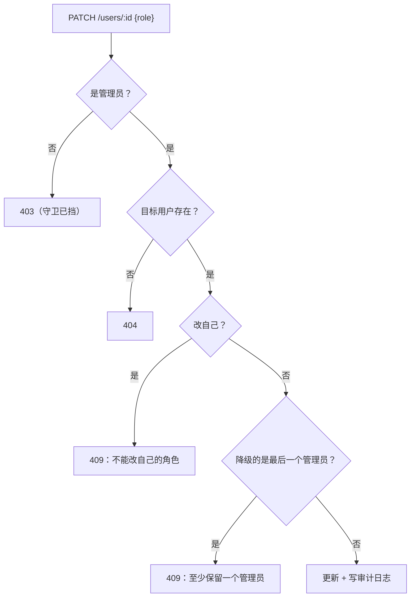

# 12.04 用户管理模块

骨架跑起来之后，第一个业务模块是用户。它看起来最简单——查自己、改自己、管理员管别人——但它是**权限模型的地基**：后面所有「谁能不能看这条数据」的判断，都从这里开始。

这一节写五个接口，全部落在参考实现的 `src/modules/users/` 里：

| 接口 | 权限 | 作用 |
| --- | --- | --- |
| `GET /api/users/me` | 登录 | 当前用户资料 |
| `PATCH /api/users/me` | 登录 | 改自己的昵称/头像 |
| `GET /api/users` | ADMIN | 用户列表（分页、角色过滤、关键字） |
| `GET /api/users/:id` | ADMIN | 用户详情 |
| `PATCH /api/users/:id` | ADMIN | 改用户（含角色） |

## 一、模块骨架

```ts
@Module({
  controllers: [UsersController],
  providers: [UsersService],
  exports: [UsersService],
})
export class UsersModule {}
```

`exports` 是必须的：`AuthModule` 要注入 `UsersService` 做登录校验，`BookingsModule` 要拿用户名回填。**模块边界靠 exports 控制**，不 export 的 provider 外部注入不到——这是 Nest 模块化最容易被忽略的一条。

依赖方向：`AuthModule → UsersModule`，反过来不行。如果哪天 `UsersService` 需要 `AuthService`，说明该拆出一个独立的 `TokenModule`，而不是互相 import（第 2 章的循环依赖会立刻找上门）。

## 二、Service：查询只用白名单字段

```ts
export interface UserRow {
  id: string;
  name: string;
  email: string;
  role: Role;
  avatarUrl: string | null;
  createdAt: string;
  updatedAt: string;
}

const USER_PUBLIC_FIELDS = [
  'id', 'name', 'email', 'role', 'avatarUrl', 'createdAt', 'updatedAt',
] as const;

@Injectable()
export class UsersService {
  constructor(@Inject(PRISMA) private readonly db: Database) {}

  findById(id: string): Promise<UserRow | null> {
    return this.db.orm.public.User.where({ id }).select(...USER_PUBLIC_FIELDS).first();
  }

  async findByIdOrFail(id: string): Promise<UserRow> {
    const user = await this.findById(id);
    if (!user) throw new NotFoundException('用户不存在');
    return user;
  }
}
```

**`select` 白名单是这里最重要的设计。** 不写 `select` 就是 `SELECT *`，`password_hash` 会一路流到 controller、拦截器、响应体。哪怕控制器「只是」返回用户对象，也可能被某个 `console.log` 或错误日志带出去。

白名单 vs 黑名单的差别在执行层面：黑名单（`omit: ['passwordHash']`）要求你记得每个新敏感字段都要加；白名单要求每个对外字段都要显式列出。**前者会漏，后者不会。** 新增字段时忘了加，结果是「少返回一个字段」，而不是「多泄露一个字段」。

登录需要密码哈希，单独开一个方法，命名要刺眼：

```ts
/** 登录专用：显式带出 password_hash，其他地方禁止调用。 */
findByEmailWithPassword(email: string): Promise<(UserRow & { passwordHash: string }) | null> {
  return this.db.orm.public.User.where({ email })
    .select(...USER_PUBLIC_FIELDS, 'passwordHash')
    .first();
}
```

## 三、分页：一个 helper 管所有列表

分页不是每个模块各写一遍，`common/dto/paginated.dto.ts` 里统一定义：

```ts
export interface PageMeta {
  page: number;
  pageSize: number;
  total: number;
  totalPages: number;
}

export interface PaginatedResult<T> {
  items: T[];
  meta: PageMeta;
}

export const paginate = <T>(items: T[], total: number, page: number, pageSize: number): PaginatedResult<T> => ({
  items,
  meta: { page, pageSize, total, totalPages: pageSize > 0 ? Math.ceil(total / pageSize) : 0 },
});
```

约定是：service 返回 `{ items, meta }`，响应拦截器（12.03）看到这个形状就展开成 `{ data: items, meta }`。controller 一行都不用写。

`totalPages` 看起来冗余（前端能自己算），但它把「pageSize 为 0 时除零」这类边界挡在了一处。四个人各算一遍，总有一个忘了判 0。

查询参数的 DTO 继承通用分页：

```ts
export class QueryUsersDto extends PaginationQueryDto {
  @ApiPropertyOptional({ enum: Role })
  @IsOptional()
  @IsEnum(Role)
  role?: Role;

  @ApiPropertyOptional({ maxLength: 50 })
  @IsOptional()
  @IsString()
  @MaxLength(50)
  keyword?: string;
}
```

`PaginationQueryDto` 里 `page`/`pageSize` 都带 `@Type(() => Number)`——因为 query 参数永远是字符串，没有 `@Type` 就算开了 `transform: true` 也转不成数字。`@Max(100)` 是必须的：不限制的话 `?pageSize=100000` 会让一次查询把内存打满。

## 四、列表查询：过滤、搜索、排序、计数

```ts
async findAll(query: QueryUsersDto): Promise<PaginatedResult<UserRow>> {
  const page = query.page ?? 1;
  const pageSize = query.pageSize ?? 10;
  const keyword = query.keyword?.trim();

  const filtered = this.db.orm.public.User.where((user, { fns }) =>
    fns.and(
      query.role ? user.role.eq(query.role) : all(),
      keyword
        ? fns.or(user.name.ilike(`%${keyword}%`), user.email.ilike(`%${keyword}%`))
        : all(),
    ),
  );

  const [items, totals] = await Promise.all([
    filtered
      .select(...USER_PUBLIC_FIELDS)
      .orderBy((user) => user.createdAt.desc())
      .limit(pageSize)
      .offset((page - 1) * pageSize)
      .all(),
    filtered.aggregate((aggregate) => ({ total: aggregate.count() })),
  ]);

  return paginate(items, totals.total, page, pageSize);
}
```

四个细节：

**`all()` 是「无条件」占位符。** 条件式 `and` 需要每个位置都有表达式，`query.role` 不存在时不能传 `undefined`，所以用 `all()` 表示恒真。`fns.or(...)` 组搜索条件，`ilike` 是不区分大小写的模糊匹配——用 `like` 的话，用户搜 `Alice` 找不到 `alice@example.com`。

**`Promise.all` 并行两条查询。** 串行会让分页接口的耗时变成「列表 + 计数」两倍。两条查询之间没有依赖，可以并行。

**`offset` 是 `(page - 1) * pageSize`。** 这是唯一正确写法，别用 `page * pageSize`——那样第一页会跳过前 10 条。

**深分页要提前想。** `OFFSET 100000` 在 PostgreSQL 里要先扫过 10 万行再丢掉，越翻越慢。用户量到几万时改成游标分页：`WHERE created_at < $last ORDER BY created_at DESC LIMIT 20`。现在不急，但要在 `docs/tech-design.md` 里记一笔。

## 五、更新：本人和管理员只差一个字段

```ts
async update(id: string, dto: UpdateUserDto | UpdateProfileDto): Promise<UserRow> {
  await this.findByIdOrFail(id);

  const payload: { name?: string; avatarUrl?: string | null; role?: Role } = {};
  if (dto.name !== undefined) payload.name = dto.name;
  if (dto.avatarUrl !== undefined) payload.avatarUrl = dto.avatarUrl;
  if ('role' in dto && dto.role !== undefined) payload.role = dto.role;

  if (Object.keys(payload).length === 0) {
    return this.findByIdOrFail(id);
  }

  return this.db.orm.public.User.select(...USER_PUBLIC_FIELDS).update({ ...payload })
    .where({ id })  // Prisma 8 的 update 需要显式 where
    .first();
}
```

三个决定：

**用 `!== undefined` 判断，不用 `if (dto.name)`。** 后者会把空字符串也当成「没传」，用户想清空昵称就永远清不掉。

**空 payload 直接返回。** `update({})` 在 Prisma 8 里是没有意义的调用（有些 ORM 会报错），提前短路省一次数据库往返。

**`'role' in dto` 做类型收窄。** 本人更新走 `UpdateProfileDto`（没有 `role`），管理员走 `UpdateUserDto`（继承前者多一个 `role`）。用 `in` 判断，运行时不会把管理员 DTO 的 `role` 丢掉，也不会让本人偷偷改角色。

DTO 的继承关系就是权限边界的表达：

```ts
export class UpdateProfileDto {
  @IsOptional() @IsString() @MinLength(1) @MaxLength(20)
  name?: string;

  @IsOptional() @IsString() @MaxLength(500)
  avatarUrl?: string | null;
}

export class UpdateUserDto extends UpdateProfileDto {
  @IsOptional() @IsEnum(Role)
  role?: Role;
}
```

本人路由（`PATCH /users/me`）只接 `UpdateProfileDto`，所以请求里带 `"role": "ADMIN"` 会被 `whitelist: true` 丢掉——**权限不是靠 service 里判断，是靠 DTO 形状挡在门外**。这就是第 5 章说的「用类型表达约束」。

## 六、控制器：路由、守卫、参数解析

```ts
@ApiTags('users')
@ApiBearerAuth('access-token')
@Controller('users')
export class UsersController {
  constructor(private readonly usersService: UsersService) {}

  @Get('me')
  me(@CurrentUser() user: AuthUser) {
    return this.usersService.findByIdOrFail(user.id);
  }

  @Patch('me')
  updateMe(@CurrentUser() user: AuthUser, @Body() dto: UpdateProfileDto) {
    return this.usersService.update(user.id, dto);
  }

  @Get()
  @Roles(Role.ADMIN)
  findAll(@Query() query: QueryUsersDto) {
    return this.usersService.findAll(query);
  }

  @Get(':id')
  @Roles(Role.ADMIN)
  findOne(@Param('id', ParseUUIDPipe) id: string) {
    return this.usersService.findByIdOrFail(id);
  }

  @Patch(':id')
  @Roles(Role.ADMIN)
  update(@Param('id', ParseUUIDPipe) id: string, @Body() dto: UpdateUserDto) {
    return this.usersService.update(id, dto);
  }
}
```

几个点：

- **`me` 放在 `:id` 之前**。路由匹配是按注册顺序，`GET /users/me` 如果写在 `GET /users/:id` 后面，会被后者匹配到、然后 `ParseUUIDPipe` 报 400；
- **`ParseUUIDPipe`** 让 `/users/abc` 返回 400 而不是进入 service 后拼一条非法 SQL。所有对外 id 参数都该有它；
- **`@Roles(Role.ADMIN)` 在方法上**，配合 12.03 里全局注册的 `RolesGuard`。守卫读的是 `reflector.getAllAndOverride(ROLES_KEY, [handler, class])`，所以方法级会覆盖类级；
- **controller 不判断「是不是本人」**。本人路由用 `user.id` 作为目标 id，天然不可能改别人；管理员路由由 `@Roles` 挡住。不需要在 controller 里写 `if (id !== user.id)` 这种判断。

## 七、改角色的两个业务规则

改角色是最容易出事的一个操作。三条规则必须写进 service：



```ts
async changeRole(actorId: string, targetId: string, role: Role): Promise<UserRow> {
  if (actorId === targetId) {
    throw new ConflictException('不能修改自己的角色');
  }

  const target = await this.findByIdOrFail(targetId);

  if (target.role === Role.ADMIN && role !== Role.ADMIN) {
    const admins = await this.db.orm.public.User
      .where({ role: Role.ADMIN })
      .aggregate((a) => ({ total: a.count() }));
    if (admins.total <= 1) {
      throw new ConflictException('至少保留一个管理员');
    }
  }

  this.logger.log(`role change: actor=${actorId} target=${targetId} ${target.role} -> ${role}`);
  return this.update(targetId, { role });
}
```

三条规则的理由：

**不能改自己的角色。** 管理员手滑把自己降成 USER，如果他是唯一管理员，系统就没人能管了。禁止之后，要降自己得让另一个管理员来操作，多一道确认。

**至少保留一个管理员。** 这条比上一条更根本：即使不是自己，两个人互相降级也能把系统降成「无管理员」。用 `count()` 兜底，代价是一次 indexed 查询。

**审计日志必须打。** 角色变更不是普通写操作，出了事要能回答「谁在什么时候把谁提成了管理员」。日志里带 `actor`/`target`/`from`/`to` 四要素，不要只打一句「role updated」。

## 八、几个容易被忽略的边界

**删除用户不做。** 用户表被 `bookings.user_id` 外键引用（`ON DELETE CASCADE`），删用户会连带删预订——历史记录就没了。正确做法是「禁用」：加 `disabled` 字段，登录时拒绝，数据保留。参考实现没有删用户的接口，这是有意为之。

**邮箱不能通过这个模块改。** 改邮箱要走「验证新邮箱」流程（11.05 的验证码），不能 `PATCH` 直接写。否则别人拿到一次会话就能把账号邮箱改成自己的，再走「忘记密码」接管账号。

**头像 URL 要校验协议。** `avatarUrl` 只允许 `https://`，不允许 `javascript:` 或 `data:`——前者是 XSS，后者能塞超大 payload。`@IsUrl({ protocols: ['https'], require_protocol: true })` 一行解决。

**返回体里不要带 `passwordHash`，也不带内部自增 id。** 白名单字段已经保证了；但如果有人绕过 service 直接 `db.orm.public.User.first()` 返回，就破了。纪律是：**只有 service 能碰 db**。

## 九、修改密码：三个必须的步骤

改密码不在上面五个接口里，但属于用户模块，而且是最容易写漏的一处。要求是「原密码 + 新密码」两个字段：

```ts
async changePassword(userId: string, dto: ChangePasswordDto): Promise<{ success: true }> {
  const user = await this.db.orm.public.User.where({ id: userId })
    .select('id', 'passwordHash')
    .first();
  if (!user) throw new NotFoundException('用户不存在');

  const ok = await bcrypt.compare(dto.currentPassword, user.passwordHash);
  if (!ok) throw new UnauthorizedException('原密码不正确');

  if (await bcrypt.compare(dto.newPassword, user.passwordHash)) {
    throw new BadRequestException('新密码不能与原密码相同');
  }

  await this.db.orm.public.User
    .update({ passwordHash: await bcrypt.hash(dto.newPassword, BCRYPT_ROUNDS) })
    .where({ id: userId });

  await this.authService.revokeAllSessions(userId);  // 关键
  return { success: true };
}
```

三个必须的步骤，少一个都算 bug：

**先校验原密码。** 不能只凭「已登录」就允许改密码。攻击者拿到一次会话（比如共享电脑没退出）就能永久接管账号；校验原密码要求他知道当前密码。

**拒绝「新旧相同」。** 用户改密码的动机是「怀疑泄露」，改成同一个等于没改，还白写一次库。`bcrypt.compare` 一次即可判断，成本很低。

**改完吊销所有会话。** 这一步最常被漏掉。密码改了，但旧的 refresh token 还在有效期内——如果密码是因为泄露才改的，攻击者手里的 token 依然能用 7 天。`revokeAllSessions` 的做法是删掉该用户的 refresh token 索引（第 9 章写过 `sess:user:<id>` / jti 标记），让所有设备下次刷新时失败，强制重新登录。

`ChangePasswordDto` 的约束要写全：`@Length(8, 72)`、`@Matches(/[A-Za-z]/)` 与 `@Matches(/\d/)` 之类。上限 72 是 bcrypt 的字节上限（第 9 章解释过为什么不是「字符」）。

## 十、禁用用户：比删除更安全的「软下线」

前面说了不提供删用户接口。那管理员要「封掉一个账号」怎么办？加一个 `disabled` 字段：

```ts
async setDisabled(actorId: string, targetId: string, disabled: boolean): Promise<UserRow> {
  if (actorId === targetId) throw new ConflictException('不能禁用自己');
  const target = await this.findByIdOrFail(targetId);

  if (disabled && target.role === Role.ADMIN) {
    const admins = await this.db.orm.public.User
      .where((user, { fns }) => fns.and(user.role.eq(Role.ADMIN), user.disabled.eq(false)))
      .aggregate((a) => ({ total: a.count() }));
    if (admins.total <= 1) throw new ConflictException('至少保留一个可用管理员');
  }

  return this.update(targetId, { disabled });
}
```

`disabled` 的生效点有两个：登录时（`if (user.disabled) throw new UnauthorizedException('账号已禁用')`）和鉴权时（`JwtStrategy.validate` 里查库后判断）。两处都要有——只挡登录的话，已签发的 access token 还能用 15 分钟；只挡 jwt 的话，禁用的用户还能重新登录。

为什么不用删除：`bookings.user_id` 是 `ON DELETE CASCADE`，删用户会连带删掉他的全部预订记录，统计报表和审计链路全断。禁用保留数据，只看不了、登不上，需要时可恢复。这也是绝大多数后台系统的做法——「删除」在业务上通常意味着「不可见」，而不是「物理抹掉」。

## 十一、第一个管理员从哪来

新库是空的，而 `/users` 列表和改角色都要求 ADMIN——鸡生蛋问题。答案在 `prisma/seed.ts`：

```ts
const email = process.env.SEED_ADMIN_EMAIL ?? 'admin@example.com';
const password = process.env.SEED_ADMIN_PASSWORD;

if (!password || password.length < 12) {
  throw new Error('请通过 SEED_ADMIN_PASSWORD 提供至少 12 位的初始管理员密码');
}

await db.orm.public.User.create({
  name: '系统管理员',
  email,
  passwordHash: await bcrypt.hash(password, BCRYPT_ROUNDS),
  role: Role.ADMIN,
});
```

三条纪律：

**密码必须从环境变量来，不能写死在代码里。** 写死等于把默认管理员密码公开在仓库里，上线后第一件事就是被人登进后台。这里直接 `throw`，宁可 seed 失败也不生成一个弱口令账号。

**`seed` 要幂等。** 已经存在同名邮箱就跳过（`where({email}).first()` 有值则 `return`），否则重复执行会撞唯一索引，CI 里一片红。

**上线后立刻改密码，或直接禁用这个初始账号、改用 OIDC/邀请制。** seed 出来的账号只用于「第一次登录，把第一个人提成管理员」，之后它就是攻击面。

## 十二、Checkpoint

```bash
# 1. 登录拿 token
TOKEN=$(curl -s -X POST localhost:3000/api/auth/login \
  -H 'content-type: application/json' \
  -d '{"email":"alice@example.com","password":"Passw0rd!"}' | jq -r '.data.accessToken')

# 2. 查自己：不应出现 passwordHash
curl -s localhost:3000/api/users/me -H "authorization: Bearer $TOKEN" | jq

# 3. 改昵称
curl -s -X PATCH localhost:3000/api/users/me -H "authorization: Bearer $TOKEN" \
  -H 'content-type: application/json' -d '{"name":"Alice"}' | jq '.data.name'

# 4. 普通用户访问列表：应 403
curl -s -o /dev/null -w '%{http_code}\n' localhost:3000/api/users -H "authorization: Bearer $TOKEN"

# 5. 普通用户尝试给自己加角色：role 应被丢弃
curl -s -X PATCH localhost:3000/api/users/me -H "authorization: Bearer $TOKEN" \
  -H 'content-type: application/json' -d '{"role":"ADMIN"}' | jq '.data.role'

# 6. 非法 id：应 400
curl -s -o /dev/null -w '%{http_code}\n' localhost:3000/api/users/abc -H "authorization: Bearer $ADMIN_TOKEN"
```

第 5 步是本节最关键的一条验收：**返回的 `role` 仍然是 `USER`**，说明 DTO 白名单在起作用。

## 十三、坑表

| 做法 | 后果 |
| --- | --- |
| 查询不写 `select` 白名单 | `password_hash` 随响应泄露 |
| 用黑名单 `omit` 排除敏感字段 | 新增字段忘了加，泄露概率随字段数上升 |
| `me` 路由写在 `:id` 之后 | `/users/me` 被当成非法 UUID，400 |
| 本人路由用管理员 DTO | 用户能自己提权成 ADMIN |
| `if (dto.name)` 代替 `!== undefined` | 清空昵称永远失败 |
| 分页不限制 `pageSize` | 一次请求拉全表，内存和带宽双爆 |
| `offset: page * pageSize` | 第一页跳过一整页数据 |
| 允许改自己的角色 | 唯一管理员手滑，系统失去管理能力 |
| 改角色不打审计日志 | 出事查不到谁干的 |
| 提供删用户接口 | 外键级联删掉历史预订，审计断链 |
| `select` 白名单漏了新字段 | 新敏感字段默认不外泄（失败方向安全） |
| 忘记 `revokeAllSessions` | 改完密码，攻击者旧 token 仍可用 7 天 |
| 只挡登录不挡 JWT | 禁用后旧 access token 还能用 15 分钟 |
| seed 密码写死在代码里 | 仓库公开 = 后台公开 |
| seed 不幂等 | 重复执行撞唯一索引，CI 必红 |

<!-- chapter-nav:start -->
---

← [12.03 项目骨架与工程约定](12.03-项目骨架与工程约定.md) · [本章目录](_chapter.md)
<!-- chapter-nav:end -->
