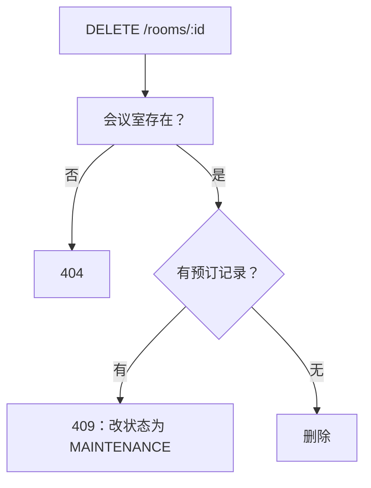

# 12.05 会议室管理模块

会议室是这套系统的「资源」。它比用户简单——没有密码、没有角色、没有会话——但它有两个别人没有的特点：**列表要对未登录用户开放**，以及**删除会牵动预订**。

五个接口：

| 接口 | 权限 | 作用 |
| --- | --- | --- |
| `GET /api/rooms` | 公开 | 列表（关键字、状态、最小容纳人数） |
| `GET /api/rooms/:id` | 公开 | 详情 |
| `POST /api/rooms` | ADMIN | 新建 |
| `PATCH /api/rooms/:id` | ADMIN | 修改 |
| `DELETE /api/rooms/:id` | ADMIN | 删除（有预订则拒绝） |

## 一、为什么允许公开访问

`@Public()` 让这两个 GET 绕过全局 `JwtAuthGuard`：

```ts
@Public()
@Get()
@ApiOperation({ summary: '会议室列表（登录前也可浏览）' })
findAll(@Query({ schema: queryRoomsSchema }) query: QueryRoomsInput) {
  return this.roomsService.findAll(query);
}
```

判断依据只有一条：**这份数据泄露出去会不会造成损失**。会议室的名字、位置、容纳人数是「公开资源信息」，和公司官网上的会议室介绍没区别。让它在登录前可看，带来两个实际好处：

- 前端可以在首页就展示「我们有哪些会议室」，不用先跳登录页；
- 第三方（比如企业内部的导航页）可以直接调接口做展示。

反例是预订记录——同样的表结构，但带人名和时间，必须登录。**「同一张表的不同接口权限可以不同」**是这个模块的第一课。

`@Public()` 的实现很薄：一个 `SetMetadata(IS_PUBLIC_KEY, true)`，`JwtAuthGuard.canActivate` 里 `reflector.getAllAndOverride(IS_PUBLIC_KEY, [handler, class])`。关键在于 `getAllAndOverride` 的顺序——handler 在前，所以方法级装饰器能覆盖类级。这也是可以整类 `@Public()`、再给个别方法加 `@Roles(ADMIN)` 的原因。

## 二、查询参数：三种过滤条件

```ts
// src/modules/rooms/dto/query-rooms.schema.ts
export const queryRoomsSchema = paginationSchema.extend({
  keyword: z.string().max(100).optional(),
  status: z.enum(RoomStatus).optional(),
  minCapacity: z.coerce.number().int().min(1).optional(),
});
export type QueryRoomsInput = z.infer<typeof queryRoomsSchema>;
```

`minCapacity` 必须用 `z.coerce.number()`。query 参数全是字符串，`?minCapacity=8` 到 handler 前还是 `"8"`；不转换的话 `capacity >= "8"` 在 PostgreSQL 里会走隐式转换，能跑但**索引失效**，而且 `?minCapacity=abc` 会变成 500 而不是 400。`z.coerce` 只做一次 `Number()`，`"8"` 变 8、`"abc"` 变 `NaN` 被 `.int()` 拒掉——它不猜意图，也不做静默截断。

service 里拼条件的方式和 12.04 一致，用 `all()` 占位：

```ts
const filtered = this.db.orm.public.Room.where((room, { fns }) =>
  fns.and(
    keyword
      ? fns.or(room.name.ilike(`%${keyword}%`), room.location.ilike(`%${keyword}%`))
      : all(),
    query.status ? room.status.eq(query.status) : all(),
    query.minCapacity ? room.capacity.gte(query.minCapacity) : all(),
  ),
);
```

排序用 `name.asc()`，因为会议室列表是人翻的，按名字找比按创建时间找直观。但要注意：**中文排序结果依赖数据库的 collation**，默认 `C`/`POSIX` 下是按字节序，`"A 座"` 会排在 `"星河"` 前面。要按拼音排，得在 DDL 里写 `COLLATE "zh-x-icu"`（需要 ICU），或者加一个 `sort_key` 列在写入时生成。这一点在 12.02 的 DDL 里没做，属于「知道但先不做」的取舍——会议室只有几十个，翻两页就找到了。

### 按设备筛选：数组列是另一套查询

`equipment` 是 `text[]`，用 `=` 或 `ilike` 都筛不了「有投影仪的会议室」。PostgreSQL 给数组列的运算符是 `@>`（包含）、`&&`（相交）、`<@`（被包含）：

```sql
-- 同时有投影仪和白板
SELECT id, name FROM rooms WHERE equipment @> ARRAY['投影仪','白板'];

-- 有投影仪或白板之一
SELECT id, name FROM rooms WHERE equipment && ARRAY['投影仪','白板'];
```

Prisma 8 的 ORM 客户端里对应 `.has()`、`.hasEvery()`、`.hasSome()` 一类方法（具体签名以你装的 RC 版本类型为准，`dist/orm-client.d.mts` 里搜 `HasSome`）。但要对读者诚实：**参考实现没做设备筛选**，`queryRoomsSchema` 里也没有这个字段。原因是「按设备筛」在这个产品里是低频需求——会议室只有几十间，用户看列表就记住了哪间有投影仪。

真要加，注意两件事：一是 `equipment && ARRAY[...]` 需要 GIN 索引才快，默认索引对数组无效：

```sql
CREATE INDEX idx_rooms_equipment ON rooms USING GIN (equipment);
```

二是不该让前端传 `equipment[]` 直接拼条件，而是约定几个固定标签（`["投影仪","白板","视频会议"]`），否则「投影」「投影仪」「投影机」会变成三个筛选维度，永远筛不全。

## 三、创建与更新：一份 schema 管两个接口

创建规则只写一遍，更新规则由它推出来：

```ts
// src/modules/rooms/dto/room.schema.ts
export const createRoomSchema = z.object({
  name: z.string().min(1).max(100),
  location: z.string().min(1).max(200),
  capacity: z.coerce.number().int().min(1).max(500),
  equipment: z.array(z.string()).max(20).optional(),
});
export type CreateRoomInput = z.infer<typeof createRoomSchema>;

// PATCH 允许只传一部分字段：全部变可选，约束不变
export const updateRoomSchema = createRoomSchema.partial();
export type UpdateRoomInput = z.infer<typeof updateRoomSchema>;
```

controller 上就是 `@Body({ schema: createRoomSchema }) input: CreateRoomInput` 和 `@Body({ schema: updateRoomSchema }) input: UpdateRoomInput`，没有别的接线。

`partial()` 只放松「这个字段必须出现」，不放松「出现时必须合法」：`PATCH` 里传 `capacity: 0` 照样 400。这是它和旧写法 `PartialType` 最实在的区别——旧写法要靠 `@nestjs/swagger` 的 `PartialType` 复制一遍元数据，还得记住别从 `@nestjs/mapped-types` 导入；`partial()` 是 schema 自己的方法，没有第二份声明，也就没有「文档和校验不一致」的缝。

`capacity` 用 `z.coerce.number()`，body 里 `"capacity": "12"` 也能收。为什么不干脆 `z.number()` 把字符串拒掉？因为前端表单 `<input>` 取出来的值永远是字符串，让每个页面各自 `Number()` 一次，迟早漏一个。宽容放在边界上做一次，比散在十个表单里稳。但 `"12abc"` 拿到的是 `NaN`，`.int()` 照样拒——`coerce` 不比旧 `@Type` 聪明，也不该指望它聪明。

`equipment` 是 PostgreSQL 的 `text[]`。三个细节：

- `.max(20)` 是必须的，否则有人提交一万个字符串撑爆一行；
- `z.array(z.string())` 本身校验每个元素都是字符串，不用再记「`each: true`」这种标志位；
- 数组元素没有去重，`["投影仪","投影仪"]` 会原样入库。真要干净，在 service 里 `[...new Set(input.equipment ?? [])]`。

## 四、删除保护：409 而不是级联删

```ts
async remove(id: string): Promise<{ id: string; deleted: true }> {
  await this.findById(id);

  const { total } = await this.db.orm.public.Booking
    .where({ roomId: id })
    .aggregate((aggregate) => ({ total: aggregate.count() }));

  if (total > 0) {
    throw new ConflictException('该会议室已有预订记录，不能删除，可将状态改为 MAINTENANCE');
  }

  await this.db.orm.public.Room.where({ id }).delete();
  return { id, deleted: true };
}
```

为什么不是 `ON DELETE CASCADE`：`bookings.room_id` 如果级联删，删一间会议室会把过去半年的预订记录一起删掉——统计报表少一块、审计查不到、用户历史消失。**资源可以被下线，历史不能被抹掉。**

所以设计成「先查再拒」，并给出替代操作（改成维修状态）。这里有个并发窗口：查的时候没有预订，删的瞬间有人创建了预订。严格做法是「事务里先 `SELECT ... FOR UPDATE` 锁住会议室行，再查预订，再删」；或者干脆用外键 `ON DELETE RESTRICT`，让数据库来兜底——插预订时如果会议室已删会直接报错，比应用层检查更可靠。

参考实现用的是应用层检查，够用但留下窗口。这是「教学实现 vs 生产实现」的典型差距，12.02 里提过这条。

删除还是改状态，可以画成一条判断链：



注意右侧那条分支的措辞：**拒绝的同时给出可行方案**。只返回「不能删除」，管理员的第一反应是「那我该怎么办」，然后去翻文档或者问人。把「改成维修状态」写进 message，等于把下一步交到操作者手里。

## 五、状态与预订的联动

`RoomStatus` 只有两个值：`AVAILABLE`、`MAINTENANCE`。**维修状态不能接新预订**，但已有的未来预订怎么办？三种策略：

| 策略 | 做法 | 代价 |
| --- | --- | --- |
| 硬拦 | 改状态时若有未来预订，拒绝并提示先取消 | 管理员要先手动取消，操作繁琐 |
| 软拦 | 允许改，创建预订时校验 `status !== MAINTENANCE` | 已有预订仍生效，需要人工通知 |
| 自动迁移 | 改状态时批量把未来预订标记为 `CANCELLED` 并通知 | 代码最复杂，但体验最好 |

参考实现用**软拦**：创建/审批预订时校验会议室状态。这样「改成维修」不会静默取消别人的会，但也意味着管理员需要自己处理已有预订——界面上给出「该会议室有 3 个未来预订」的提示就够了。

这是典型的业务取舍：**系统不该替用户做不可逆的决定。** 自动取消预订看起来贴心，实际是把「管理员改状态」和「用户会议被取消」两件事绑在一起，出了事谁也说不清是谁的责任。

`status` 上有索引（`@@index([status])`，12.02 的 DDL 里写了），因为列表默认会按状态过滤。`capacity` 没有索引：它的基数太低（几十间会议室、十几个容量值），全表扫 50 行比走索引再回表还快。**索引不是越多越好**，低基数列上的索引几乎不会被查询计划采纳，只会拖慢写入。

验证方式永远是同一条：`EXPLAIN ANALYZE` 看有没有 `Seq Scan`，行数是不是如你所料。

```sql
EXPLAIN ANALYZE SELECT * FROM rooms WHERE status = 'AVAILABLE' AND capacity >= 8 ORDER BY name;
```

如果看到 `Index Scan using idx_rooms_status` 后面跟了 `Filter: capacity >= 8`，说明状态索引起了作用、容量是过滤条件；如果只有 `Seq Scan` 且 `rows` 只有几十，那就对了——这个数据量下，全表扫就是最优计划。这时候纠结「为什么没用索引」是浪费时间。

## 六、并发更新：没有版本号的 lost update

两个管理员同时打开编辑页，A 把容纳人数改成 20，B 把位置改成「B 座 2 层」，各自保存。按现在的实现，后提交的会覆盖先提交的——A 的容纳人数被 `B` 的 payload 覆盖回 12 吗？不会，因为 `update` 的 payload 只带实际传的字段（`!== undefined` 判断），所以两条 UPDATE 各改各的列，**字段级不冲突**。

但如果两人都改 `capacity`，就真的丢了：A 改成 20，B 改成 15，最终 15，A 的修改无声消失。解决办法是乐观锁：加 `version` 列（或直接用 `updatedAt`），更新时带上 `WHERE id = $1 AND version = $2`，影响 0 行就返回 409 让前端刷新重试。

```sql
UPDATE rooms SET capacity = $1, version = version + 1
WHERE id = $2 AND version = $3;
```

要不要现在就加？会议室编辑频率极低（一周改一次），加上成本是所有写接口都要传 `version`。**先记录在技术方案的风险清单里，不实现。** 这是「知道边界，但不为低频问题付出高频成本」。

### 唯一性：同名会议室要不要拦

参考实现没有给 `rooms.name` 加唯一约束。业务上真的可以重名吗？「301 会议室」在 A 座和 B 座各有一个，是正常的；同一个位置下有两个「301」，就是数据错误。所以唯一键应该是 `(name, location)` 而不是 `name`：

```sql
ALTER TABLE rooms ADD CONSTRAINT rooms_name_location_key UNIQUE (name, location);
```

加了之后，`create` 撞约束要翻译成 409 而不是 500。判断方式和第 9 章注册撞邮箱一样——看 `sqlState`：

```ts
try {
  return await this.db.orm.public.Room.select(...ROOM_FIELDS).create({ ... });
} catch (error) {
  if (isUniqueViolation(error, 'rooms_name_location_key')) {
    throw new ConflictException('同一位置已存在同名会议室');
  }
  throw error;
}
```

`isUniqueViolation` 只认 `sqlState === '23505'` 且 `constraint` 匹配，别用 `error.message.includes('duplicate')`——错误信息会随驱动版本变，而约束名是你自己起的，稳定。

这里依然要说清取舍：**加约束的成本是「改名/换位置」时也要过唯一性检查**，如果两个房间互换名字，得在一个事务里先改成临时名再改回来（`UNIQUE` 默认是立即检查，不是延迟检查）。要支持互换，就把约束声明成 `DEFERRABLE INITIALLY IMMEDIATE`，在事务里 `SET CONSTRAINTS ALL DEFERRED`。这就是「唯一约束看起来简单，实际会牵出事务顺序」的地方。

## 七、列表接口的真实响应

```bash
curl -s 'localhost:3000/api/rooms?status=AVAILABLE&minCapacity=8&page=1&pageSize=5' | jq
```

```json
{
  "data": [
    { "id": "…", "name": "星河会议室", "capacity": 12, "location": "A 座 3 层 301", "equipment": ["投影仪", "白板"], "status": "AVAILABLE" }
  ],
  "meta": { "page": 1, "pageSize": 5, "total": 3, "totalPages": 1 }
}
```

`{data, meta}` 是响应拦截器的产出（12.03），service 返回的是 `{items, meta}`。约定一致，前端只需要认一种形状。

## 八、Checkpoint

```bash
# 1. 未登录也能看列表
curl -s 'localhost:3000/api/rooms?pageSize=3' | jq '.meta'

# 2. 未登录创建：应 401
curl -s -o /dev/null -w '%{http_code}\n' -X POST localhost:3000/api/rooms \
  -H 'content-type: application/json' -d '{"name":"测试","capacity":5,"location":"X"}'

# 3. 管理员创建
curl -s -X POST localhost:3000/api/rooms -H "authorization: Bearer $ADMIN" \
  -H 'content-type: application/json' \
  -d '{"name":"测试会议室","capacity":5,"location":"C 座 1 层"}' | jq '.data.id'

# 4. 非法 capacity：应 400
curl -s -o /dev/null -w '%{http_code}\n' -X POST localhost:3000/api/rooms -H "authorization: Bearer $ADMIN" \
  -H 'content-type: application/json' -d '{"name":"x","capacity":0,"location":"y"}'

# 5. 删除有预订的会议室：应 409
curl -s -X DELETE localhost:3000/api/rooms/$ROOM_WITH_BOOKING -H "authorization: Bearer $ADMIN" | jq '.message'
```

第 5 步的错误信息应该是「该会议室已有预订记录，不能删除，可将状态改为 MAINTENANCE」——**错误信息要给出下一步动作**，只写「删除失败」等于让用户猜。

## 九、坑表

| 做法 | 后果 |
| --- | --- |
| 列表接口要求登录 | 首页无法展示会议室，多一次跳转 |
| 详情接口带预订信息 | 公开接口泄露了别人的会议 |
| `minCapacity` 不用 `z.coerce.number()` | 字符串比较，索引失效、非法值 500 |
| 更新用的 schema 手写一遍可选字段 | 改 create 忘改 update，两份规则越走越远 |
| `equipment` 写成 `z.string()` | 数组永远校验失败，类型对不上 |
| 不限制 `equipment` 数量 | 一次提交能写满一行 |
| 删除会议室用级联 | 历史预订与统计一起消失 |
| 只做应用层「查询再删除」 | 并发下仍可能删掉正在被预订的会议室 |
| 改维修状态时静默取消预订 | 用户会议无声消失，责任不清 |
| 更新不带版本号 | 两人同改一列时后写覆盖先写 |

<!-- chapter-nav:start -->
---

← [12.04 用户管理模块](12.04-用户管理模块.md) · [本章目录](_chapter.md) · [12.06 预订管理模块](12.06-预订管理模块.md) →
<!-- chapter-nav:end -->
