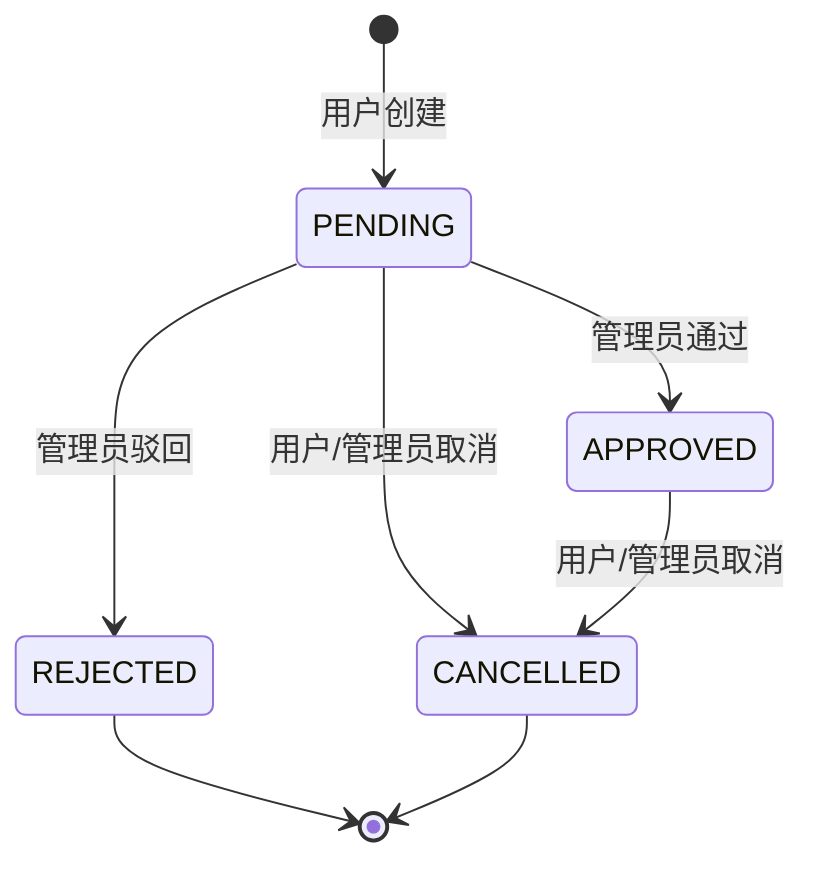
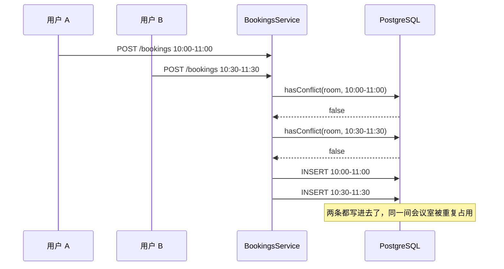

# 12.06 预订管理模块

前面两个模块是「增删改查」，这一节才出现真正的业务：**同一个会议室的同一段时间，不能被两个人占**。一条 `INSERT` 解决不了这件事，因为「有没有冲突」和「写入」之间隔着一次查询——那就是竞态的入口。

六个接口：

| 接口 | 权限 | 说明 |
| --- | --- | --- |
| `POST /api/bookings` | 登录 | 创建预订，创建即 PENDING |
| `GET /api/bookings` | 登录 | 列表；普通用户只能看自己的 |
| `GET /api/bookings/:id` | 登录 | 详情；本人或 ADMIN |
| `PATCH /api/bookings/:id/approve` | ADMIN | 审批通过，**再查一次冲突** |
| `PATCH /api/bookings/:id/reject` | ADMIN | 驳回，可带原因 |
| `PATCH /api/bookings/:id/cancel` | 本人或 ADMIN | 取消 |

## 一、状态机先定死



四条规则：

- **创建即待审批。** 不做「管理员自动通过」，否则管理员自己订会议要等自己，体验很怪；也不做「先通过后补审」，因为会议室是稀缺资源，先占后审会让未审批的预订事实上生效；
- **只有 PENDING 能通过或驳回。** 已通过的再点通过，应该是 409 而不是静默成功——重复点击必须能被识别；
- **PENDING 和 APPROVED 都能取消。** 驳回/取消后的记录不删，只改状态，保证审计链完整；
- **REJECTED / CANCELLED 是终态。** 不做「恢复」，要重新订就新建一条。

状态机写在代码里的样子，是每个操作开头的状态断言：

```ts
if (booking.status !== BookingStatus.PENDING) {
  throw new ConflictException('只有待审批的预订可以通过');
}
```

**不要用 `if (status === 'APPROVED') return booking` 这种幂等写法。** 状态流转不是幂等操作——「已经通过了」和「刚刚通过」在审计上是两件事，静默成功会让「谁点的通过」变得不可考。

## 二、时间窗口：四条校验缺一不可

```ts
private assertValidWindow(startTime: Date, endTime: Date): void {
  if (Number.isNaN(startTime.getTime()) || Number.isNaN(endTime.getTime())) {
    throw new BadRequestException('时间格式不正确');
  }
  if (endTime.getTime() <= startTime.getTime()) {
    throw new BadRequestException('结束时间必须晚于开始时间');
  }
  if (startTime.getTime() <= Date.now()) {
    throw new BadRequestException('开始时间必须晚于当前时间');
  }
  if (endTime.getTime() - startTime.getTime() > MAX_DURATION_MS) {
    throw new BadRequestException('单次预订时长不能超过 8 小时');
  }
}
```

四条分别挡四类问题：

**`NaN` 校验**——DTO 里 `@IsISO8601({ strict: true })` 已经挡了大部分，但 `new Date('2026-02-30')` 这类「格式对、日期不存在」的输入，`Date` 会给你 `Invalid Date`。不校验就往下走，最后是数据库报错或者存进 `NaN`。

**结束必须晚于开始**——反了就是负时长，冲突判定会全部失效（`existing.start < new.end` 恒真或恒假）。

**不能订过去**——不挡的话，用户能补录「上周的会议」，统计就乱了；更重要的是「过去的时间」和「当前时间」之间没有意义，占着资源却没人用。

**最长 8 小时**——这是业务规则，不是技术限制。没有上限的话，有人会订「明年 1 月 1 日到 12 月 31 日」，把整间会议室锁死一年。8 小时对应「一个工作日」，超过就拆成多段或走特殊申请。

`MAX_DURATION_MS = 8 * 60 * 60 * 1000` 写成常量放文件顶部，别散落在代码里。**业务阈值集中在一处**，改的时候只改一行。

## 三、冲突判定：半开区间与一行数学

两段会议「冲突」，当且仅当它们有交集。用半开区间 `[start, end)` 表示，重叠条件是：

```text
existing.start < new.end  AND  existing.end > new.start
```

这个式子值 40 个字，但值得推一遍，因为它是整个模块的核心：

- 如果 `existing.start >= new.end`，说明已有预订从新预订结束之后才开始——不重叠；
- 如果 `existing.end <= new.start`，说明已有预订在新预订开始之前就结束了——不重叠；
- 两个「不重叠」都不成立时，必然重叠。

用半开区间的好处是**相邻不冲突**：10:00–11:00 和 11:00–12:00，`existing.end (11:00) > new.start (11:00)` 为假，所以不冲突。如果写成闭区间 `[start, end]`，这两段会被判成冲突——早上连着开两个会就没法订了。

代码里四个条件与一个可选的排除：

```ts
const booking = await this.db.orm.public.Booking.where((row, { fns }) =>
  fns.and(
    row.roomId.eq(roomId),
    row.status.in(OCCUPYING_STATUSES),
    row.startTime.lt(endTime.toISOString()),
    row.endTime.gt(startTime.toISOString()),
    excludeBookingId ? row.id.neq(excludeBookingId) : all(),
  ),
).first();
```

两个细节：

**`OCCUPYING_STATUSES = [PENDING, APPROVED]`。** 被驳回和已取消的预订不占资源，否则「取消后同一时段订不上」会变成经典 bug。

**`excludeBookingId` 用在审批时。** 审批通过前要再查一次冲突，但「自己」当然和自己重叠，所以要排除。

## 四、「先查后写」的竞态



这就是参考实现当前的真实行为。`hasConflict` 和 `create` 是两条独立语句，中间没有任何锁，两个请求并行时都能查到「没有冲突」，然后都插入成功。

压力小的时候几乎不会发生——但「几乎不会」不是「不会」。早高峰 9:50 大家抢 10 点的会议室，就是最容易撞上的时刻。

三种修法，按代价从低到高：

**修法一：串行化事务，行锁住会议室。**

```ts
return this.db.transaction(async (tx) => {
  // 锁住会议室这一行，同一会议室的并发创建会在这里排队
  await tx.orm.public.Room.where({ id: dto.roomId }).forUpdate().first();

  const conflict = await /* 在 tx 上查 */;
  if (conflict) throw new ConflictException('该时间段与已有预订冲突');

  return tx.orm.public.Booking.create({ ... });
});
```

`forUpdate()` 渲染成 `SELECT ... FOR UPDATE`，锁持续到事务结束。第二个请求会阻塞在锁上，等第一个提交后再查，就能看见新插入的预订，正确返回 409。

代价：同一会议室的预订变成串行。这在这个场景里完全可接受（一个人一天订不了几次），而且**粒度足够细**——不同会议室互不影响。

**修法二：PostgreSQL 排他约束。**

```sql
CREATE EXTENSION IF NOT EXISTS btree_gist;

ALTER TABLE bookings ADD CONSTRAINT bookings_no_overlap
EXCLUDE USING gist (
  room_id WITH =,
  tstzrange(start_time, end_time, '[)') WITH &&
) WHERE (status IN ('PENDING', 'APPROVED'));
```

把「不允许重叠」变成数据库层的约束。任何并发的 INSERT/UPDATE 只要试图插入重叠区间，第二条会直接报 `23P01`（exclusion violation），应用层翻译成 409 即可。**这是唯一在数据库层根除竞态的方案**，也是 12.02 里为什么选 PostgreSQL 的一个理由——MySQL 没有 EXCLUDE 约束。

注意三点：`btree_gist` 扩展必须装；`WHERE` 子句让「已取消的预订」不参与约束（部分索引）；`tstzrange(..., '[)')` 的 `'[)'` 就是半开区间，和第三节的数学完全一致。

代价：约束是「硬」的，如果业务哪天允许「同一房间同一时间放两场（不同设备）」，约束就要撤。但那时候数据模型也变了。

**修法三：应用层建议锁。**

```sql
SELECT pg_try_advisory_xact_lock(hashtext('room:' || $1));
```

用会议室 id 的哈希做建议锁，拿不到就返回 409 让用户重试。适合不想加约束、又想避免串行的场景，但 `hashtext` 有碰撞概率，而且锁的语义全靠应用自觉——**能用约束就别用锁**。

参考实现用的是「先查后写」，这是教学取舍：先讲清判定逻辑，再把竞态留到这一节讨论。真上线时，**至少要做到修法一**。

## 五、审批为什么还要再查一次

```ts
// 审批时再查一次：等待审批期间可能有其他预订被通过。
const conflict = await this.hasConflict(
  booking.roomId,
  new Date(booking.startTime),
  new Date(booking.endTime),
  booking.id,
);
if (conflict) {
  throw new ConflictException('该时间段已有其他已通过的预订，无法审批');
}
```

创建时查过一次，为什么审批还要查？因为**中间隔了一段时间**，而状态在这段时间里可能被别人的审批改掉：

1. 用户 A 订 10:00–11:00（PENDING）；
2. 用户 B 订 10:30–11:30（PENDING）；
3. 两条在创建时都不冲突，因为 PENDING 也占用——所以第 2 步其实会冲突。

等等，这里有个逻辑要捋清：既然 PENDING 也占用资源，那么 B 创建时就会看到 A 的 PENDING 并返回 409。那审批时为什么还会冲突？

答案是**取消与重新创建**的组合：

1. A 订 10:00–11:00（PENDING）；
2. A 取消，状态变 CANCELLED，不再占用；
3. 管理员通过 B 的 10:30–11:30（PENDING → APPROVED）；
4. 有人把 A 的取消状态改回来？——状态机不允许，所以这条路径走不通。

更真实的场景是**并发审批**：同一会议室有两条 PENDING，时间段相近但不相邻；管理员在两个标签页里同时点「通过」。因为 PENDING 之间本来就互斥，这种情况同样会被创建时的检查挡住。

所以「审批时再查一次」在当前状态机下是**防御性代码**，不是必需逻辑。要不要留？**留。** 理由：它把「占用判定」收在一处，将来如果引入「PENDING 不占用」（比如改成先到先得、由管理员统一排期），这条检查就是唯一的正确性保证。防御性检查的成本是一次 indexed 查询，换的是「改状态机时不会静默出错」。

这类代码要在注释里写清楚「为什么现在不会触发」，否则下一任维护者会以为它是冗余删掉。

## 六、三处权限，三种粒度

预订模块的权限不是一句 `@Roles` 能覆盖的，三处各不相同：

**列表：普通用户只能看自己的。** 不是靠守卫，是靠 service 里改写查询条件：

```ts
user.role === Role.ADMIN
  ? query.userId ? row.userId.eq(query.userId) : all()
  : row.userId.eq(user.id),
```

注意普通用户传 `?userId=xxx` 时，代码走的是 `row.userId.eq(user.id)` 分支——**参数被忽略，不是报错**。这比「检测到越权参数就 403」更安全：攻击者拿不到任何信号，也不知道别人的 userId 是否有效。

**详情：本人或管理员。** 这里参考实现返回 403：

```ts
if (user.role !== Role.ADMIN && booking.userId !== user.id) {
  throw new ForbiddenException('无权查看他人的预订');
}
```

而第 9 章（ACL）讲的做法是 **404 而不是 403**，理由是「403 等于确认这个 id 存在」。两处不一致，怎么选？

- **403 更诚实**：调用者知道「东西在，但你没权限」，调试友好；
- **404 更安全**：不泄露资源是否存在，防枚举。

对预订这种「id 是 UUID」的资源，枚举成本极高（2^122 空间），403 的泄露风险几乎为零，所以参考实现选了 403。**如果 id 是自增或短码，就必须 404。** 这个判断标准比「统一用某个状态码」更值得记。

**取消：本人或管理员。** 与详情同构，但多一个状态检查（只能取消 PENDING/APPROVED）。

三处权限分别落在「查询条件」「异常」「状态机」三个位置，这就是为什么不能只依赖守卫——**守卫只能表达「这个路由谁能调」，表达不了「这条数据谁能看」**。

## 七、时间与时区：只存 UTC，只传偏移

`startTime` 在 DTO 里是 `string`，`@IsISO8601({ strict: true })` 要求带时区偏移（`2026-11-20T09:00:00+08:00`）。到了 service 先 `new Date(...)` 再 `.toISOString()` 存库，库里是 `timestamptz`。

三条规矩：

**数据库存 UTC，接口传带偏移的时间。** 不要接受 `2026-11-20T09:00:00` 这种「无时区」的字符串——它到底是北京 9 点还是 UTC 9 点？浏览器和服务器的默认时区不同，答案就不一样。

**比较只在 `Date` 或数据库里做，不在字符串上做。** `'2026-11-20T09:00:00+08:00' < '2026-11-20T02:00:00Z'` 在字符串比较下是错的（首字符 `0` vs `0`，第二字符 `2` vs `2`……最后靠偏移符号），必须先转 `Date`。

**展示时区由前端决定。** 后端返回 ISO 字符串（带 `Z`），前端用 `Intl.DateTimeFormat('zh-CN', { timeZone: 'Asia/Shanghai' })` 格式化。后端硬编码「+08:00」的展示格式，一旦有海外用户就全错。

```ts
// 返回给前端的形状（截断）
{
  "id": "…",
  "startTime": "2026-11-20T01:00:00.000Z",   // 北京 09:00
  "endTime": "2026-11-20T02:00:00.000Z",
  "status": "PENDING"
}
```

## 八、列表查询与关联加载

```ts
filtered
  .include('room')
  .include('user', (relation) => relation.select(...BOOKING_USER_FIELDS))
  .orderBy((row) => row.createdAt.desc())
  .limit(pageSize)
  .offset((page - 1) * pageSize)
  .all();
```

`include('room')` 取整间会议室（预订列表要显示会议室名字），`include('user', ...)` 只取用户的公开字段——**不要 `include('user')` 裸用**，否则 `password_hash` 又会跟着出来。这和 12.04 的白名单是同一条纪律，只是发生在关联查询上。

时间范围的过滤用 `from`/`to` 卡 `startTime`：

```ts
from ? row.startTime.gte(from) : all(),
to ? row.startTime.lte(to) : all(),
```

注意这是「开始时间落在区间内」，不是「与区间有交集」。前端要查「这周三有哪些会议」时，跨周的会议（周二 23:00–周三 01:00）会漏掉。正确做法是交集判断：`startTime < to AND endTime > from`。参考实现用的是简化版，够用但要记着这个边界。

`orderBy(createdAt.desc())` 是「最新申请的排前面」，符合管理员审批的工作流。用户视角更想看「即将开始的会议」，可以给普通用户换成 `startTime.asc()`——**同一个接口对不同角色用不同排序**是合理优化，但要在文档里写明。

## 九、Checkpoint

```bash
# 1. 创建预订（未来时间）
BOOKING=$(curl -s -X POST localhost:3000/api/bookings -H "authorization: Bearer $TOKEN" \
  -H 'content-type: application/json' \
  -d '{"roomId":"'$ROOM'","startTime":"2026-12-01T09:00:00+08:00","endTime":"2026-12-01T10:00:00+08:00","remark":"周会"}')
echo "$BOOKING" | jq '.data.status'    # "PENDING"

# 2. 同房间重叠时段：应 409
curl -s -o /dev/null -w '%{http_code}\n' -X POST localhost:3000/api/bookings -H "authorization: Bearer $TOKEN" \
  -H 'content-type: application/json' \
  -d '{"roomId":"'$ROOM'","startTime":"2026-12-01T09:30:00+08:00","endTime":"2026-12-01T10:30:00+08:00"}'

# 3. 相邻时段（10:00 开始）：应 201
curl -s -o /dev/null -w '%{http_code}\n' -X POST localhost:3000/api/bookings -H "authorization: Bearer $TOKEN" \
  -H 'content-type: application/json' \
  -d '{"roomId":"'$ROOM'","startTime":"2026-12-01T10:00:00+08:00","endTime":"2026-12-01T11:00:00+08:00"}'

# 4. 过去时间：应 400
curl -s -o /dev/null -w '%{http_code}\n' -X POST localhost:3000/api/bookings -H "authorization: Bearer $TOKEN" \
  -H 'content-type: application/json' \
  -d '{"roomId":"'$ROOM'","startTime":"2020-01-01T09:00:00+08:00","endTime":"2020-01-01T10:00:00+08:00"}'

# 5. 超过 8 小时：应 400
curl -s -o /dev/null -w '%{http_code}\n' -X POST localhost:3000/api/bookings -H "authorization: Bearer $TOKEN" \
  -H 'content-type: application/json' \
  -d '{"roomId":"'$ROOM'","startTime":"2026-12-02T08:00:00+08:00","endTime":"2026-12-02T20:00:00+08:00"}'

# 6. 管理员审批
curl -s -X PATCH localhost:3000/api/bookings/$ID/approve -H "authorization: Bearer $ADMIN" | jq '.data.status'

# 7. 再点一次通过：应 409
curl -s -o /dev/null -w '%{http_code}\n' -X PATCH localhost:3000/api/bookings/$ID/approve -H "authorization: Bearer $ADMIN"

# 8. 普通用户查别人的预订：应 403
curl -s -o /dev/null -w '%{http_code}\n' localhost:3000/api/bookings/$OTHER_ID -H "authorization: Bearer $TOKEN"
```

第 2、3 步是半开区间的验收：重叠 409、相邻 201。第 7 步验证状态机不可重复流转。

## 十、坑表

| 做法 | 后果 |
| --- | --- |
| 冲突判定用闭区间 | 相邻会议被判冲突，连着开会订不上 |
| 只判 `APPROVED` 占用 | 两条 PENDING 能订同一时段 |
| `hasConflict` 后用裸 `create` | 并发下双写成功，会议室被重复占用 |
| 审批时不排 `excludeBookingId` | 自己和自己冲突，永远审批不过 |
| 允许重复审批 | 「已通过」再点通过静默成功，审计失真 |
| 取消后不释放占用 | 取消的时段仍然订不上 |
| 不校验「不能订过去」 | 补录历史会议，统计与资源双失真 |
| 不限制单次时长 | 一次预订锁死整年 |
| 接受无时区的时间字符串 | 服务器时区一变，会议整体偏移 8 小时 |
| `include('user')` 不带 select | `password_hash` 随预订详情泄露 |
| 权限只靠守卫 | 普通用户能查别人的预订 |
| 深分页用 OFFSET | 预订量上去后翻页越来越慢 |

<!-- chapter-nav:start -->
---

← [12.05 会议室管理模块](12.05-会议室管理模块.md) · [本章目录](_chapter.md) · [12.07 统计管理模块](12.07-统计管理模块.md) →
<!-- chapter-nav:end -->
