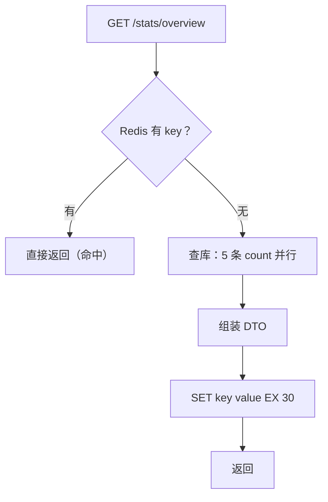

# 12.07 统计管理模块

统计模块看起来最无害：只读、不加锁、不改数据。但它有两个别的模块没有的问题——**聚合查询会随数据量线性变慢**，以及**「统计数字对不对」很难验证**。

三个接口，都是 ADMIN：

| 接口 | 作用 | 缓存 |
| --- | --- | --- |
| `GET /api/stats/overview` | 总用户/会议室/预订数、待审批数 | 30 秒 |
| `GET /api/stats/rooms/usage` | 区间内各会议室使用率 | 60 秒 |
| `GET /api/stats/bookings/trend` | 最近 N 天预订趋势 | 60 秒 |

## 一、先问三个问题

写统计之前先回答：

**给谁看？** 管理员。他关心「现在有几条待审批」「哪间会议室最热」「最近预订是不是在涨」。普通用户不需要看全局统计，所以整个 controller 挂 `@Roles(Role.ADMIN)`。

**多久变一次？** 待审批数应该是实时的（管理员要立刻处理），但「最近 14 天趋势」每分钟变一次完全够用。**不同指标的时效要求不同，缓存 TTL 就该不同**——参考实现给 overview 30 秒（近似实时），另外两个 60 秒。

**错了会怎样？** 统计错了不会让人订错会议室，也不会泄露数据，最坏结果是「管理员决策依据偏差」。这意味着**可以接受短暂的不一致**，也就可以大胆用缓存。反过来，如果这是财务报表，就不能这么设计。

这三个问题的答案决定了：ADMIN 权限、分级缓存、允许「缓存时间点」的语义（`generatedAt` 返回的是缓存写入时刻，不是当前时刻，DTO 注释里写明了）。

## 二、缓存是这张图的形状



这就是 cache-aside：**读时先查缓存，未命中再查库并回填**。三步要点：

**并行发出多条 count。** overview 要 5 个数（用户、会议室、总预订、待审批、已通过），`Promise.all` 一次发 5 条，总耗时取决于最慢那条，而不是 5 条相加。

**写完缓存再返回。** 顺序反了（先返回后写缓存）在进程崩溃时会丢缓存，问题不大；但如果写缓存失败抛异常，用户会拿到 500——所以正确写法是「写缓存失败只记日志，不影响返回」：

```ts
try {
  await this.redis.setJson(cacheKey, result, OVERVIEW_CACHE_TTL);
} catch (error) {
  this.logger.warn(`stats cache write failed: ${(error as Error).message}`);
}
return result;
```

**key 里带参数。** 区间统计的 key 是 `stats:room-usage:<from>:<to>`，否则不同区间的结果会互相污染。趋势的 key 带 `days` 和「起始日期」，因为「最近 14 天」每天都会变，起始日期一变 key 就变。

## 三、会议室使用率的定义

```ts
const minutes = (end - start) / 60_000;                    // 单条预订时长
const totalMinutes = (to.getTime() - from.getTime()) / 60_000;  // 区间总时长
const utilizationRate = totalMinutes > 0
  ? Math.min(100, Math.round((bookedMinutes / totalMinutes) * 1000) / 10)
  : 0;
```

「使用率 = 已通过预订总时长 / 区间总时长」——这个定义简单，但**分母选什么决定了这个数字有没有意义**。

按「自然时间」算：7 天 = 10,080 分钟，一间会议室每周被用 20 小时（1,200 分钟），使用率 11.9%。管理员看了会以为「会议室大量闲置」，可实际上它只在 9:00–18:00 可用，20 小时占了可用时间的 37%。**分母用「可用工时」才有决策价值**：

```ts
// 只统计工作日 9:00-18:00 的可用分钟数
const availableMinutes = countWorkMinutes(from, to);  // 9 小时 × 工作日数
```

更细的版本还要按容量加权（大会议室优先给大会议），但那需要「需求 vs 供给」的对齐数据，超出这个项目的范围。**先明确当前算法的分母是自然时间，并在页面上写清「使用率按自然时间计算」**——一个定义模糊的指标比没有指标更危险。

`Math.min(100, ...)` 是防御：如果预订允许跨区间边界（下午 5 点订到晚上 8 点，区间是到 6 点），`bookedMinutes` 可能超过 `totalMinutes`，使用率会出现 120%。这里有两层问题：一是区间过滤用了 `startTime >= from AND endTime <= to`（完全包含），跨越边界的预订被丢掉了；二是即便只算完全包含的，也可能因为时区或计算误差略微超过。所以既要有 `min(100, ...)`，也要在文档里说明「只统计完全落在区间内的预订」。

## 四、趋势：按天分桶的时区陷阱

```ts
const date = new Date(booking.createdAt).toISOString().slice(0, 10);
counts.set(date, (counts.get(date) ?? 0) + 1);
```

`toISOString()` 是 UTC 时间。北京时间 11 月 20 日 07:00 创建的预订，`toISOString()` 是 `2026-11-19T23:00:00Z`，会被分到 **11 月 19 日**。于是「今天的预订数」在早上 8 点前会一直显示成 0，管理员以为没人下单。

修法一：按业务时区分桶。

```ts
const formatter = new Intl.DateTimeFormat('sv-SE', { timeZone: 'Asia/Shanghai' });
const date = formatter.format(new Date(booking.createdAt)); // "2026-11-20"
```

`sv-SE`（瑞典语）的输出恰好是 `YYYY-MM-DD`，这是业界常用的取巧写法，比手写 `getFullYear()` 拼字符串可靠（不受运行时区影响）。

修法二：让数据库来分桶。数据量大了应该这么做：

```sql
SELECT date_trunc('day', created_at AT TIME ZONE 'Asia/Shanghai')::date AS day,
       COUNT(*) AS count
FROM bookings
WHERE created_at >= $1
GROUP BY 1
ORDER BY 1;
```

`AT TIME ZONE` 把 `timestamptz` 转成指定时区的本地时间，再 `date_trunc('day')`。注意 `AT TIME ZONE 'Asia/Shanghai'` 返回的是 `timestamp`（无时区），这是正确的——你要的就是「北京时间的哪一天」。

空桶也要补零：某天没有预订，SQL 的 `GROUP BY` 不会返回那一行，前端画折线图时点数会缺。参考实现在应用层用 `Array.from({length: days})` 生成完整日期序列再查表填充，这个思路对——**补齐空桶是查询的一部分，不是前端的事**。

## 五、应用层聚合 vs SQL 聚合

参考实现把预订全查出来，在 JS 里 `for` 循环累加：

```ts
const bookings = await this.db.orm.public.Booking.where(...)
  .select('id', 'roomId', 'startTime', 'endTime')
  .all();
for (const booking of bookings) { /* 累加到 Map */ }
```

**数据量小的时候这是对的**：一次简单查询、没有 JOIN、逻辑一目了然、调试容易。2 万条预订（一年量级）读进内存也就几 MB，耗时几十毫秒。

数据量上去后必须改成 SQL：

```sql
SELECT room_id,
       COUNT(*) AS booking_count,
       SUM(EXTRACT(EPOCH FROM (end_time - start_time)) / 60) AS booked_minutes
FROM bookings
WHERE status = 'APPROVED' AND start_time >= $1 AND end_time <= $2
GROUP BY room_id;
```

判断标准不是「数据量多少」，而是**「一次查询要不要把结果集搬到应用进程」**。如果只是为了求几个 SUM，却要把 50 万行从数据库传到 Node，网络和内存都是浪费。数据库就是干这个的。

区分「够用」和「过度设计」：现在是教学项目，2 万条以内应用层聚合没问题，**但要在注释里写明「数据量到百万级时改成 SQL GROUP BY」**，让读者知道边界在哪。参考实现的注释就是这个作用。

## 六、索引：统计查询最容易被忽略的成本

`roomUsage` 的查询条件是：

```text
status = 'APPROVED' AND start_time >= from AND end_time <= to
```

而 12.02 的 DDL 只建了 `idx_bookings_room_time (room_id, start_time, end_time)` 和 `idx_bookings_user`。这两个索引都帮不上——因为没有 `status` 前缀，也没有只按 `start_time` 的索引。

数据量小的时候无所谓（全表扫 2 万行几毫秒）。但这是**典型的「线上突然变慢」场景**：统计页面一开始很快，半年后打开要 3 秒，因为表涨到了 200 万行。

提前建索引：

```sql
CREATE INDEX idx_bookings_status_start ON bookings (status, start_time);
```

复合索引的顺序按「等值条件在前、范围条件在后」：`status` 是等值，`start_time` 是范围，所以 `(status, start_time)` 能让 PostgreSQL 先定位 `APPROVED` 段，再在范围内扫。`end_time` 放不进同一个索引的过滤（它是另一个范围条件），只能作为回表后的 Filter。

验证方式还是 `EXPLAIN ANALYZE`：看 `Index Scan using idx_bookings_status_start` + `Filter: end_time <= ...`，而不是 `Seq Scan`。

## 七、缓存的三个坑

**坑一：key 过期瞬间的击穿。** 60 秒 TTL 到期时，如果正好有 50 个管理员同时刷新页面，50 个请求会同时查库。会议室预订系统只有几个管理员，无所谓；如果这是首页统计，就要加「单飞」（single-flight）：第一个请求去查库，其余请求等结果。

**坑二：缓存与库不一致。** 用户刚提交预订，管理员看到的 overview 还是 30 秒前的（`pendingBookings` 少 1）。这是缓存的固有代价。两个应对：一是页面标注「数据更新于 xx:xx」（`generatedAt` 就是干这个的）；二是在写路径上主动删缓存——但统计是「聚合」，删缓存后重建代价高，而且写路径分散在 bookings 模块里，耦合会变重。

**取舍：统计用短 TTL，不做主动失效。** 30 秒的不一致对「看板」完全可以接受，主动失效带来的耦合不值得。

**坑三：Redis 挂了怎么办。** `redis.getJson` 抛异常的话，整个统计接口 500——本来只是「慢一点」，变成了「不可用」。正确做法是**缓存失败降级到查库**：

```ts
let cached: StatsOverviewDto | null = null;
try {
  cached = await this.redis.getJson<StatsOverviewDto>(cacheKey);
} catch { /* 缓存不可用，直接查库 */ }
if (cached) return cached;
```

这条原则在 11.07（阅读量）也出现过：**缓存是优化，不是依赖**。

### 数据再大一点：预聚合

缓存和索引解决的是「重复查询」和「单次查询变慢」。当表到千万级、且要求「任意区间秒开」时，两条路：

**物化视图**——把聚合结果存成表，定时 `REFRESH MATERIALIZED VIEW CONCURRENTLY`：

```sql
CREATE MATERIALIZED VIEW room_usage_daily AS
SELECT room_id,
       date_trunc('day', start_time AT TIME ZONE 'Asia/Shanghai')::date AS day,
       SUM(EXTRACT(EPOCH FROM (end_time - start_time)) / 60)::int AS booked_minutes,
       COUNT(*)::int AS booking_count
FROM bookings
WHERE status = 'APPROVED'
GROUP BY 1, 2;
```

查询时 `SUM(booked_minutes)` 按天累加即可，代价是**数据最多滞后一个刷新周期**。这又回到第一节的问题：统计能容忍多旧？能容忍 5 分钟，物化视图就是最优解。

**预聚合表**——写入预订时同步更新 `room_usage_daily`，用 `INSERT ... ON CONFLICT DO UPDATE` 累加。实时性最好，代价是写路径变重、且取消预订时要反向扣减，容易算错。**除非业务明确要求实时，否则不要走这条。**

这条路线要写进技术方案，但不要现在实现——**过度设计和技术债一样有害**。会议室预订系统一年几万条数据，缓存 + 索引足够用到产品下线。

## 八、接口形状与并发

三个接口的响应都直接返回 DTO，不经过分页信封——`roomUsage` 返回 `{range, totalRooms, rooms}`，`bookingTrend` 返回 `{days, items}`。响应拦截器（12.03）会把它们包成 `{data: ...}`。

为什么不统一成 `{data, meta}`？因为 `meta` 是给分页用的（`page/pageSize/total/totalPages`），非分页接口没有这些字段。**信封只包一层，内部结构按业务需要定**，硬套统一格式反而会让前端多写一层解包。

`overview` 里 5 条 count 用 `Promise.all` 并发，代价是 5 个连接同时被占。连接池只有 10 个时，5 个并发请求就能把池占满——这就是 11.07 里说的「连接池 × 副本数」要算清楚的原因。统计接口频次低，问题不大；但要在监控里看 `pg_stat_activity` 的等待数。

## 九、Checkpoint

```bash
# 1. 普通用户访问统计：应 403
curl -s -o /dev/null -w '%{http_code}\n' localhost:3000/api/stats/overview -H "authorization: Bearer $TOKEN"

# 2. 管理员总览
curl -s localhost:3000/api/stats/overview -H "authorization: Bearer $ADMIN" | jq

# 3. 再请求一次：generatedAt 不变（命中缓存）
curl -s localhost:3000/api/stats/overview -H "authorization: Bearer $ADMIN" | jq '.data.generatedAt'

# 4. 会议室使用率（默认 7 天）
curl -s localhost:3000/api/stats/rooms/usage -H "authorization: Bearer $ADMIN" \
  | jq '.data.rooms[] | {name, bookingCount, utilizationRate}'

# 5. 超过 90 天：应 400
curl -s -o /dev/null -w '%{http_code}\n' \
  "localhost:3000/api/stats/rooms/usage?from=2025-01-01T00:00:00Z&to=2026-01-01T00:00:00Z" \
  -H "authorization: Bearer $ADMIN"

# 6. 趋势 7 天，应为 7 个点（含空桶）
curl -s 'localhost:3000/api/stats/bookings/trend?days=7' -H "authorization: Bearer $ADMIN" | jq '.data.items | length'

# 7. 验证缓存键
redis-cli --scan --pattern 'stats:*'
```

第 3 步是缓存生效的直接证据：两次请求的 `generatedAt` 相同，说明第二次没查库。第 6 步验证空桶补齐——哪怕 7 天一条预订都没有，也应该是 7 个点。

## 十、坑表

| 做法 | 后果 |
| --- | --- |
| 统计接口不设 ADMIN | 全局数据对普通用户可见 |
| 所有指标共用一个 TTL | 要么太旧影响决策，要么缓存形同虚设 |
| 缓存 key 不带查询参数 | 不同区间互相污染 |
| 缓存写失败就抛 500 | 优化项变成可用性问题 |
| 使用率分母用自然时间 | 数字永远偏低，误导扩容决策 |
| 不写清使用率定义 | 同一个数两种算法，开会吵不起来 |
| 按 UTC 日切分桶 | 北京时间早上 8 点前「今天」是空的 |
| SQL GROUP BY 不补空桶 | 折线图缺点、低谷被抹平 |
| 全表扫 + 应用层 SUM | 半年后统计页从 50ms 变 3s |
| 缓存挂了直接 500 | 读接口因缓存故障整体不可用 |
| `generatedAt` 当实时时间用 | 以为数据是刚刚的，实际是 30 秒前 |

<!-- chapter-nav:start -->
---

← [12.06 预订管理模块](12.06-预订管理模块.md) · [本章目录](_chapter.md)
<!-- chapter-nav:end -->
