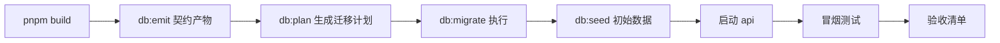

# 12.08 部署、验收与复盘

代码写完不等于项目完成。这一节做三件事：把它部署起来、按 12.01 的验收清单逐条过、然后诚实列出这次实现留下的债。



顺序不能变：**先有契约产物才能构建，先迁移才能启动，先建数据才能通过验收**。

## 一、镜像：多阶段构建

参考实现没有 Dockerfile（它按「本地开发 + compose 只跑基础设施」设计的），上线要自己加。最小可用的多阶段写法：

```dockerfile
# syntax=docker/dockerfile:1.7
FROM node:24-bookworm-slim AS deps
WORKDIR /app
COPY package.json pnpm-lock.yaml pnpm-workspace.yaml .npmrc ./
RUN corepack enable && pnpm install --frozen-lockfile

FROM deps AS build
COPY . .
RUN pnpm db:emit && pnpm build

FROM node:24-bookworm-slim AS runtime
WORKDIR /app
ENV NODE_ENV=production
RUN corepack enable
COPY --from=deps /app/node_modules ./node_modules
COPY --from=build /app/dist ./dist
COPY --from=build /app/prisma ./prisma
COPY package.json pnpm-lock.yaml pnpm-workspace.yaml ./
USER node
EXPOSE 3000
HEALTHCHECK --interval=30s --timeout=3s --start-period=20s \
  CMD node -e "fetch('http://127.0.0.1:3000/api/health').then(r=>process.exit(r.ok?0:1)).catch(()=>process.exit(1))"
CMD ["node", "dist/main.js"]
```

四个关键点：

**`db:emit` 必须在 `build` 之前。** Prisma 8 的代码依赖 `contract.json` / `contract.d.ts` 这些生成产物，`tsc` 在缺少它们时会直接报类型错误。这一步和普通的 `prisma generate` 一样是「构建前置」，但命令不同（`pnpm db:emit`），忘掉就会得到一堆 `Cannot find module './contract.json'`。

**运行时也要 `prisma/` 目录。** `contract.json` 在构建期生成，运行时 `postgres({ contract })` 要读它。只拷 `dist/` 会启动失败。

**`USER node` 是必须的。** 镜像默认 root 跑应用，容器逃逸后的破坏面完全不同。node 官方镜像自带 UID 1000 的 `node` 用户。

**`HEALTHCHECK` 用 `fetch` 而不是 `curl`。** slim 镜像没有 curl，`node -e` 用内置 fetch 就够了，少装一个包。

**未实测声明**：本节所有 `docker` 命令在写作环境里没有可用的 Docker daemon，只验证了逻辑与语法，没有真正构建过镜像。第一次执行时如果报错，优先怀疑两处：`pnpm-workspace.yaml` 里的 `onlyBuiltDependencies`（第 5 章提过，pnpm 11 默认不跑构建脚本），以及 `COPY` 的顺序导致层缓存失效。

## 二、迁移：三条命令的顺序与幂等

```bash
pnpm db:emit                        # 生成 contract.json / contract.d.ts
pnpm db:plan --name add-users-table # 生成迁移计划（不执行）
pnpm db:migrate                     # 执行迁移
pnpm db:seed                        # 初始数据（幂等）
```

**`db:plan` 的 `--name` 是必填的。** 它决定迁移文件的名字，也写进 `migration` 的元数据。命名要能一眼看出改了什么（`add-users-table`、`add-booking-index`），不要用 `migration-1`。

**`db:plan` 不是「预览」，它落盘。** 生成的计划文件要进 Git——这是「数据库变更历史」的唯一记录。CI 里应该跑 `db:plan` 后检查有没有未提交的文件，有就说明「代码改了 schema 但没生成迁移」，直接失败。

**`db:seed` 必须幂等。** 12.04 里写的「已存在就跳过」就是为此。生产环境每次部署都跑一遍 seed，不幂等会导致唯一索引冲突让整个部署失败。

**回滚怎么办。** Prisma 8 的迁移是「向前」的，没有 `down`。回滚靠两件事：迁移前备份（`pg_dump -Fc`），以及「用新迁移抵消旧迁移」（比如加了列就再加一次迁移删掉）。**双写兼容（expand-contract）**是长周期方案，12.02 提过。

### 本地跑通的最小路径

不部署、只想在本机把整条链路跑一遍，五条命令：

```bash
docker compose up -d postgres redis    # 只起基础设施
pnpm install
cp .env.example .env                   # 改 DATABASE_URL 里的密码
pnpm db:emit && pnpm db:migrate && pnpm db:seed
pnpm start:dev
```

`docker compose up -d postgres redis` 而不是 `up -d`：本地开发时后端跑在宿主机上（为了热重载和调试器），容器里只放数据库和 Redis。这就是参考实现 compose 注释里写的「只负责基础设施」。

`cp .env.example .env` 之后顺手跑一遍 12.03 的 `comm -23` 检查——`.env.example` 全不全，这一步就能验证。

## 三、compose：四个服务

```yaml
name: meeting-booking

services:
  postgres:
    image: postgres:17
    restart: unless-stopped
    environment:
      POSTGRES_DB: meeting_booking
      POSTGRES_USER: meeting
      POSTGRES_PASSWORD: ${POSTGRES_PASSWORD:?required}
    volumes: [pgdata:/var/lib/postgresql/data]
    healthcheck:
      test: ["CMD-SHELL", "pg_isready -U meeting -d meeting_booking"]
      interval: 5s
      timeout: 5s
      retries: 20

  redis:
    image: redis:8-alpine
    restart: unless-stopped
    command: ["redis-server", "--appendonly", "yes"]
    volumes: [redisdata:/data]
    healthcheck:
      test: ["CMD", "redis-cli", "ping"]
      interval: 5s
      timeout: 3s
      retries: 20

  migrate:
    image: meeting-booking-api:latest
    command: sh -c "node -e 'require(\"child_process\")' && pnpm db:migrate && pnpm db:seed"
    env_file: [.env.production]
    depends_on:
      postgres: { condition: service_healthy }
    restart: "no"

  api:
    image: meeting-booking-api:latest
    restart: unless-stopped
    env_file: [.env.production]
    ports: ["127.0.0.1:3000:3000"]
    depends_on:
      postgres: { condition: service_healthy }
      redis: { condition: service_healthy }
      migrate: { condition: service_completed_successfully }
    read_only: true
    tmpfs: [/tmp]
    security_opt: ["no-new-privileges:true"]

volumes:
  pgdata:
  redisdata:
```

五个设计点：

**`migrate` 是一次性容器。** 用同一个镜像、跑完就退出。`api` 用 `depends_on: service_completed_successfully` 等它成功——**迁移失败就不启动应用**，避免「新代码 + 旧 schema」的组合。

**`127.0.0.1:3000:3000` 只绑回环。** 外部访问必须经过 Nginx。绑 `0.0.0.0` 等于把后端直接暴露在公网，绕过 TLS 和限流。

**`read_only: true` + `tmpfs: /tmp`。** 容器根文件系统只读，应用只能写 `/tmp`。这一条能挡住「上传文件写进容器」这类错误实践。

**`no-new-privileges: true`。** 禁止进程通过 setuid 提权。配合镜像里的 `USER node`，容器内的权限被彻底限制。

**密码用 `${POSTGRES_PASSWORD:?required}`。** `:?` 表示「变量不存在就报错退出」，避免忘配环境变量时用空密码启动。这就是 12.03 里 `.env.example` 自查的延伸——**关键变量必须 fail-fast**。

### 备份与恢复：没演练过就等于没有

上线前必须验证一次「能不能恢复」，否则备份只是心理安慰。

```bash
# 备份（自定义格式，比 SQL 文本小且可选择性恢复）
pg_dump -Fc -U meeting -d meeting_booking -f backup-$(date +%F).dump

# 恢复到临时库
createdb -U meeting meeting_booking_restore
pg_restore -U meeting -d meeting_booking_restore --no-owner backup-2026-11-22.dump

# 逐表核对行数（必须和源库一致）
psql -U meeting -d meeting_booking -c "SELECT relname, n_live_tup FROM pg_stat_user_tables ORDER BY 1;"
psql -U meeting -d meeting_booking_restore -c "SELECT relname, n_live_tup FROM pg_stat_user_tables ORDER BY 1;"
```

三条纪律：

**恢复要恢复到不同的库。** 直接覆盖生产库是事故，不是演练。恢复完逐表对行数，`n_live_tup` 是统计信息里的估算值，量级一致即可；要精确就 `SELECT count(*)`。

**记录 RTO。** 从「决定恢复」到「服务可用」用了多久？这个数字决定了出故障时你该说「30 分钟恢复」还是「两小时」。写下来，别估。

**备份要能自动跑。** `pg_dump` 进 cron，每天一次，保留 7 天，文件传到另一台机器或对象存储。**备份和数据在同一块盘上，等于没有备份。**

更高级的是 PITR（时间点恢复）：开 `wal_level = replica`，持续归档 WAL，出问题时恢复到「误删之前的某一秒」。这是第二个项目再做的事，第一个项目用每日全量备份够了。

## 四、健康检查要分层

现在的 `/api/health` 只返回 uptime，它是「进程活着」的证据，不是「服务可用」的证据。进程活着但数据库连不上时，它照样返回 200，负载均衡会继续把流量打进来。

分层成两个：

```ts
@Get('health/live')   // liveness：只证明进程活着，绝不查依赖
live() {
  return { status: 'ok', uptime: Math.round(process.uptime()) };
}

@Get('health/ready')  // readiness：查数据库和 Redis
async ready() {
  const [db, redis] = await Promise.allSettled([
    this.db.orm.public.Room.where({ status: RoomStatus.AVAILABLE }).first(),
    this.redis.ping(),
  ]);
  const checks = {
    database: db.status === 'fulfilled' ? 'up' : 'down',
    redis: redis.status === 'fulfilled' ? 'up' : 'down',
  };
  const ok = Object.values(checks).every((status) => status === 'up');
  if (!ok) throw new ServiceUnavailableException({ status: 'degraded', checks });
  return { status: 'ok', checks };
}
```

为什么必须分开：

- **liveness 查依赖是事故放大器。** 数据库抖动 3 秒，所有实例的 liveness 全失败，K8s/Docker 重启全部容器，抖动变成雪崩；
- **readiness 才该查依赖。** 它只影响「要不要给这个实例发流量」，失败后实例被摘除，恢复后自动加回，不重启进程；
- **查数据库要「轻」。** `SELECT 1` 或一条走索引的查询都行，不要查 `count(*)`——健康检查每秒都在跑，它自己不能变成负载。

`Promise.allSettled` 而不是 `Promise.all`：两个检查都要执行完，才能一次性告诉你「数据库挂了、Redis 正常」，而不是第一个失败就短路。

## 五、Nginx：一层反代 + 两条例外

```nginx
upstream api_upstream {
  server 127.0.0.1:3000;
  keepalive 32;
}

server {
  listen 443 ssl;
  http2 on;
  server_name meeting.example.com;

  ssl_certificate     /etc/nginx/certs/fullchain.pem;
  ssl_certificate_key /etc/nginx/certs/privkey.pem;

  client_max_body_size 10m;

  location /api/ {
    proxy_pass http://api_upstream;
    proxy_http_version 1.1;
    proxy_set_header Connection "";
    proxy_set_header Host $host;
    proxy_set_header X-Forwarded-For $proxy_add_x_forwarded_for;
    proxy_set_header X-Forwarded-Proto $scheme;
  }

  location /api/bookings/stream {
    proxy_pass http://api_upstream;
    proxy_http_version 1.1;
    proxy_set_header Connection "";
    proxy_buffering off;
    proxy_cache off;
    proxy_read_timeout 3600s;
  }

  location / {
    root /var/www/web;
    try_files $uri $uri/ /index.html;
  }
}
```

三条必须：

**`proxy_pass` 结尾不带斜杠。** 带斜杠会把 `/api/users` 改写成 `/users` 转发，而后端 `setGlobalPrefix('api')` 只认 `/api/users`，结果全是 404。这是 10.06 讲过的坑，部署时最容易踩。

**SSE 单独的 location。** 关缓冲、关缓存、超时拉长。忘了这条，前端看到的是「一连上就没动静，30 秒后断开」。

**`X-Forwarded-Proto` 必须传。** 后端 `trust proxy` 打开后靠它判断「请求是不是 https」，Cookie 的 `secure` 标记依赖这个判断。漏传会导致生产环境 Cookie 发不出去。

## 六、冒烟测试：十条断言

部署完手动点一遍不算验收。写一个脚本，每次部署后跑：

```bash
#!/usr/bin/env bash
set -euo pipefail
BASE=${BASE:-http://127.0.0.1:3000/api}
fail=0
check() { # name expected actual
  if [ "$2" != "$3" ]; then echo "❌ $1: expected $2, got $3"; fail=1; else echo "✅ $1"; fi
}

check "health"        200 "$(curl -s -o /dev/null -w '%{http_code}' $BASE/health)"
check "ready"         200 "$(curl -s -o /dev/null -w '%{http_code}' $BASE/health/ready)"
check "rooms public"  200 "$(curl -s -o /dev/null -w '%{http_code}' $BASE/rooms)"

TOKEN=$(curl -s -X POST $BASE/auth/login -H 'content-type: application/json' \
  -d "{\"email\":\"$E2E_USER\",\"password\":\"$E2E_PASS\"}" | jq -r '.data.accessToken')
check "login minted"  0   "$([ -n "$TOKEN" ] && [ "$TOKEN" != null ] && echo 0 || echo 1)"

check "me"            200 "$(curl -s -o /dev/null -w '%{http_code}' $BASE/users/me -H "authorization: Bearer $TOKEN")"
check "users denied"  403 "$(curl -s -o /dev/null -w '%{http_code}' $BASE/users -H "authorization: Bearer $TOKEN")"
check "bad uuid"      400 "$(curl -s -o /dev/null -w '%{http_code}' $BASE/rooms/abc)"
check "missing token" 401 "$(curl -s -o /dev/null -w '%{http_code}' -X POST $BASE/bookings \
  -H 'content-type: application/json' -d '{}')"
check "rate limit"    200 "$(curl -s -o /dev/null -w '%{http_code}' $BASE/rooms)"

if [ $fail -ne 0 ]; then echo "冒烟测试失败"; exit 1; fi
echo "冒烟测试通过"
```

为什么是这十条：健康、公开接口、鉴权链路、权限边界、参数校验、限流。**它们覆盖了「部署后最容易坏的地方」**，而不是覆盖全部功能。全量功能测试是 e2e 的活，冒烟测试只回答一个问题：这次部署有没有把基本盘搞坏。

脚本要放进仓库（`scripts/smoke.sh`），CI 部署后自动跑。手写的验收清单会漏，脚本不会。

## 七、逐条对验收清单

12.01 定了 10 条验收，现在逐条对：

| # | 验收项 | 状态 | 说明 |
| --- | --- | --- | --- |
| 1 | 用户可注册/登录/刷新/登出 | ✅ | 09.03 + 09.06 |
| 2 | 普通用户只能看自己的预订 | ✅ | 12.06 列表条件改写 |
| 3 | 管理员可审批、驳回 | ✅ | 12.06 状态机 |
| 4 | 同一会议室同一时段不能重复预订 | ⚠️ | 判定正确，但「先查后写」有并发窗口（12.06 第四节） |
| 5 | 相邻时段可连续预订 | ✅ | 半开区间 |
| 6 | 会议室可增删改查，有预订拒绝删除 | ✅ | 12.05 |
| 7 | 统计接口仅管理员可见 | ✅ | 12.07 |
| 8 | 错误响应统一形状，带 requestId | ✅ | 12.03 过滤器 + 中间件 |
| 9 | 接口文档可在 `/api/docs` 打开 | ✅ | 11.01 |
| 10 | 恶意参数返回 4xx 而非 5xx | ✅ | DTO + 管道 |

**第 4 条是诚实的「部分完成」。** 单请求下正确，并发下可能双写。这不是疏忽，是明确的取舍：修它需要事务 + 行锁（12.06 修法一），代码量增加约 30 行，而当前场景并发极低。**写进技术债，下个迭代补。**

验收清单的价值就在于这种坦诚：如果全部打勾，反而说明清单定得太松。

### 部署完成后先看这五个数

服务起来只是第一步，接下来一周盯这五个指标，它们能提前暴露大部分问题：

- **P95 响应时间**：超过 300ms 就要看慢查询（12.01 定的目标）；
- **5xx 比例**：超过 0.1% 说明有未处理的异常路径；
- **数据库连接数**：接近 `max_connections` 就是池子配置错误或连接泄漏；
- **Redis 命中率**：会话和统计都依赖它，命中率骤降通常意味着 key 设计或 TTL 有问题；
- **待审批预订数**：业务指标，堆积说明审批流程卡住了。

前四个没有监控就靠 `docker stats` 和 `pg_stat_activity` 手工看，第五个在 overview 接口里已经返回。第 13 章会把这几个数做成正式指标。

## 八、复盘：这次留下了什么债

| 债 | 影响 | 何时还 |
| --- | --- | --- |
| 预订「先查后写」竞态 | 并发下可能双订 | 下个迭代，事务 + `forUpdate` |
| 健康检查只有浅探活 | 依赖挂时仍被判健康 | 本节已给分层方案，待落地 |
| ACL/RBAC 扩展表只写在书里 | 权限只有角色粒度，没有对象级 | 项目二，引入 09.04/09.05 的模型 |
| 没有审计日志表 | 角色变更只有应用日志，不可查询 | 项目二 |
| 没有指标暴露 | 出问题只能看日志 | 13 章（可观测性） |
| `db:plan` 未进 CI | schema 改了可能忘生成迁移 | 下个迭代，CI 加检查 |

**技术债要写下来，不是记在脑子里。** 写进 `docs/tech-debt.md`，每条带「影响 / 触发条件 / 修法 / 预估工作量」。下次迭代开工前看一眼，优先还「影响大 + 触发概率高」的。

## 九、坑表

| 做法 | 后果 |
| --- | --- |
| 镜像只拷 `dist/` | 运行时缺 `contract.json`，启动即崩 |
| `db:emit` 放在 build 之后 | 构建时类型错误，找不到契约产物 |
| 用 root 跑容器 | 逃逸后破坏面是整个宿主机 |
| 迁移失败仍启动应用 | 新代码读旧 schema，错误散落各处 |
| seed 不幂等 | 每次部署都因唯一约束失败 |
| `ports: "3000:3000"` | 后端绕过 Nginx 直接暴露公网 |
| 只做 liveness 且查数据库 | 依赖抖动导致全部实例被重启 |
| `proxy_pass` 带结尾斜杠 | `/api` 前缀被吃掉，全站 404 |
| 部署后手点验收 | 漏项不可复现，回归靠运气 |
| 技术债不落文档 | 半年后没人记得为什么这么写 |

<!-- chapter-nav:start -->
---

← [12.07 统计管理模块](12.07-统计管理模块.md) · [本章目录](_chapter.md)
<!-- chapter-nav:end -->
