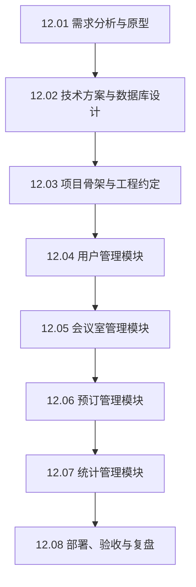

# 第 12 章 项目一：会议室预订系统

> 第 3 部 · 8 节 · 约 9.5 学时 · 已写 0 节

## 这一章解决什么问题

把前两部的知识串成一个能上线的小系统：需求 → 设计 → 模块 → 部署。

## 知识地图

## 验收清单

- [ ] 交付一个带鉴权、权限、预订冲突检测与部署脚本的完整项目。
- [ ] 能不看笔记复述本章核心机制与取舍
- [ ] 本章的命令/示例能独立跑通，并留下自己的验证记录

## 节清单

- ⬜ 12.01 需求分析与原型（待写）
- ⬜ 12.02 技术方案与数据库设计（待写）
- ⬜ 12.03 项目骨架与工程约定（待写）
- ⬜ 12.04 用户管理模块（待写）
- ⬜ 12.05 会议室管理模块（待写）
- ⬜ 12.06 预订管理模块（待写）
- ⬜ 12.07 统计管理模块（待写）
- ⬜ 12.08 部署、验收与复盘（待写）

---

[← 第 11 章 工程化设施](../ch-11-工程化/_chapter.md) · [返回教程目录](../../README.md) · [第 13 章 项目二/三：电商与大众点评 →](../ch-13-项目二三/_chapter.md)
