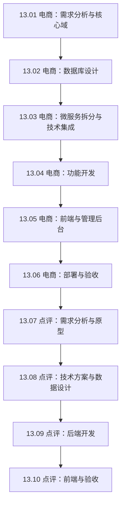

# 第 13 章 项目二/三：电商与大众点评

> 第 3 部 · 10 节 · 约 12 学时 · 已写 0 节

## 这一章解决什么问题

用两个不同形态的项目练“拆服务”和“快速交付”。

## 知识地图

## 验收清单

- [ ] 能独立完成电商订单域与本地生活点评域的核心链路。
- [ ] 能不看笔记复述本章核心机制与取舍
- [ ] 本章的命令/示例能独立跑通，并留下自己的验证记录

## 节清单

- ⬜ 13.01 电商：需求分析与核心域（待写）
- ⬜ 13.02 电商：数据库设计（待写）
- ⬜ 13.03 电商：微服务拆分与技术集成（待写）
- ⬜ 13.04 电商：功能开发（待写）
- ⬜ 13.05 电商：前端与管理后台（待写）
- ⬜ 13.06 电商：部署与验收（待写）
- ⬜ 13.07 点评：需求分析与原型（待写）
- ⬜ 13.08 点评：技术方案与数据设计（待写）
- ⬜ 13.09 点评：后端开发（待写）
- ⬜ 13.10 点评：前端与验收（待写）

---

[← 第 12 章 项目一：会议室预订系统](../ch-12-项目一会议室/_chapter.md) · [返回教程目录](../../README.md) · [第 14 章 项目四/五：聊天室、教育平台与博客 →](../ch-14-项目四五/_chapter.md)
