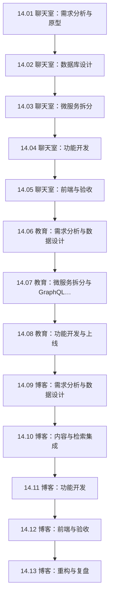

# 第 14 章 项目四/五：聊天室、教育平台与博客

> 第 3 部 · 13 节 · 约 15.5 学时 · 已写 0 节

## 这一章解决什么问题

练实时通信、GraphQL 与内容型系统的完整交付。

## 知识地图

## 验收清单

- [ ] 能交付 WebSocket 聊天室、GraphQL 教育平台与带检索的博客。
- [ ] 能不看笔记复述本章核心机制与取舍
- [ ] 本章的命令/示例能独立跑通，并留下自己的验证记录

## 节清单

- ⬜ 14.01 聊天室：需求分析与原型（待写）
- ⬜ 14.02 聊天室：数据库设计（待写）
- ⬜ 14.03 聊天室：微服务拆分（待写）
- ⬜ 14.04 聊天室：功能开发（待写）
- ⬜ 14.05 聊天室：前端与验收（待写）
- ⬜ 14.06 教育：需求分析与数据设计（待写）
- ⬜ 14.07 教育：微服务拆分与 GraphQL 层（待写）
- ⬜ 14.08 教育：功能开发与上线（待写）
- ⬜ 14.09 博客：需求分析与数据设计（待写）
- ⬜ 14.10 博客：内容与检索集成（待写）
- ⬜ 14.11 博客：功能开发（待写）
- ⬜ 14.12 博客：前端与验收（待写）
- ⬜ 14.13 博客：重构与复盘（待写）

---

[← 第 13 章 项目二/三：电商与大众点评](../ch-13-项目二三/_chapter.md) · [返回教程目录](../../README.md) · [第 15 章 微服务与分布式架构 →](../ch-15-微服务/_chapter.md)
