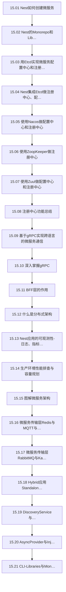

# 第 15 章 微服务与分布式架构

> 第 4 部 · 21 节 · 约 25 学时 · 已写 0 节

## 这一章解决什么问题

从单体现在能讲到微服务：传输层、注册发现、网关、分布式事务。

## 知识地图

## 验收清单

- [ ] 能解释并实现 gRPC/消息驱动的服务拆分，以及一次跨服务事务的补偿。
- [ ] 能不看笔记复述本章核心机制与取舍
- [ ] 本章的命令/示例能独立跑通，并留下自己的验证记录

## 节清单

- ⬜ 15.01 Nest如何创建微服务（待写）
- ⬜ 15.02 Nest的Monorepo和Library（待写）
- ⬜ 15.03 用Etcd实现微服务配置中心和注册中心（待写）
- ⬜ 15.04 Nest集成Etcd做注册中心、配置中心（待写）
- ⬜ 15.05 使用Nacos做配置中心和注册中心（待写）
- ⬜ 15.06 使用ZoopKeeper做注册中心（待写）
- ⬜ 15.07 使用Zuul做配置中心和注册中心（待写）
- ⬜ 15.08 注册中心功能总结（待写）
- ⬜ 15.09 基于gRPC实现跨语言的微服务通信（待写）
- ⬜ 15.10 深入掌握gRPC（待写）
- ⬜ 15.11 BFF层的作用（待写）
- ⬜ 15.12 什么是分布式架构（待写）
- ⬜ 15.13 Nest应用的可观测性-日志、指标与链路追踪（待写）
- ⬜ 15.14 生产环境性能排查与容量规划（待写）
- ⬜ 15.15 图解微服务架构（待写）
- ⬜ 15.16 微服务传输层Redis与MQTT与NATS（待写）
- ⬜ 15.17 微服务传输层RabbitMQ与Kafka与自定义（待写）
- ⬜ 15.18 Hybrid应用Standalone与Serverless（待写）
- ⬜ 15.19 DiscoveryService与LazyModule（待写）
- ⬜ 15.20 AsyncProvider与InjectionScope（待写）
- ⬜ 15.21 CLI-Libraries与Monorepo进阶（待写）

---

[← 第 14 章 项目四/五：聊天室、教育平台与博客](../ch-14-项目四五/_chapter.md) · [返回教程目录](../../README.md) · [第 16 章 实时通信、GraphQL 与全文检索 →](../ch-16-实时通信与GraphQL/_chapter.md)
