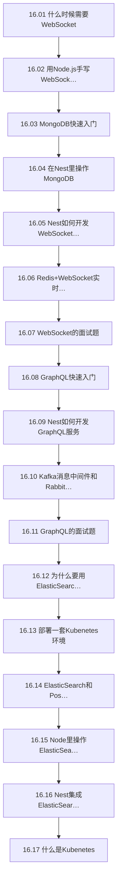

# 第 16 章 实时通信、GraphQL 与全文检索

> 第 4 部 · 17 节 · 约 20.5 学时 · 已写 0 节

## 这一章解决什么问题

补齐三种“非 REST”的接口形态：WebSocket、GraphQL、全文检索。

## 知识地图

## 验收清单

- [ ] 能按场景选型并写出最小可用实现。
- [ ] 能不看笔记复述本章核心机制与取舍
- [ ] 本章的命令/示例能独立跑通，并留下自己的验证记录

## 节清单

- ⬜ 16.01 什么时候需要WebSocket（待写）
- ⬜ 16.02 用Node.js手写WebSocket协议（待写）
- ⬜ 16.03 MongoDB快速入门（待写）
- ⬜ 16.04 在Nest里操作MongoDB（待写）
- ⬜ 16.05 Nest如何开发WebSocket服务（待写）
- ⬜ 16.06 Redis+WebSocket实时外卖员距离（待写）
- ⬜ 16.07 WebSocket的面试题（待写）
- ⬜ 16.08 GraphQL快速入门（待写）
- ⬜ 16.09 Nest如何开发GraphQL服务（待写）
- ⬜ 16.10 Kafka消息中间件和RabbitMQ有什么区别（待写）
- ⬜ 16.11 GraphQL的面试题（待写）
- ⬜ 16.12 为什么要用ElasticSearch做全文检索（待写）
- ⬜ 16.13 部署一套Kubenetes环境（待写）
- ⬜ 16.14 ElasticSearch和PostgreSQL如何配合（待写）
- ⬜ 16.15 Node里操作ElasticSearch（待写）
- ⬜ 16.16 Nest集成ElasticSearch（待写）
- ⬜ 16.17 什么是Kubenetes（待写）

---

[← 第 15 章 微服务与分布式架构](../ch-15-微服务/_chapter.md) · [返回教程目录](../../README.md) · [第 17 章 可靠性工程 →](../ch-17-可靠性工程/_chapter.md)
