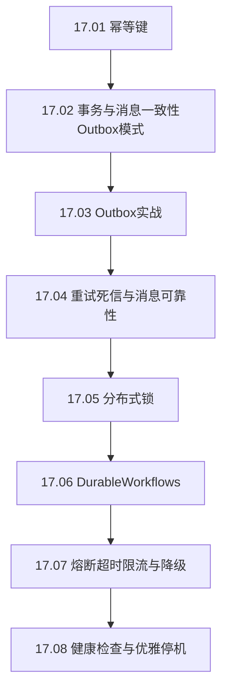

# 第 17 章 可靠性工程

> 第 4 部 · 8 节 · 约 9.5 学时 · 已写 0 节

## 这一章解决什么问题

把“偶发故障”当成设计对象：幂等、锁、outbox、重试、健康检查、工作流。

## 知识地图

## 验收清单

- [ ] 能为关键写路径设计幂等与补偿，并接上健康检查与告警。
- [ ] 能不看笔记复述本章核心机制与取舍
- [ ] 本章的命令/示例能独立跑通，并留下自己的验证记录

## 节清单

- ⬜ 17.01 幂等键（待写）
- ⬜ 17.02 事务与消息一致性Outbox模式（待写）
- ⬜ 17.03 Outbox实战（待写）
- ⬜ 17.04 重试死信与消息可靠性（待写）
- ⬜ 17.05 分布式锁（待写）
- ⬜ 17.06 DurableWorkflows（待写）
- ⬜ 17.07 熔断超时限流与降级（待写）
- ⬜ 17.08 健康检查与优雅停机（待写）

---

[← 第 16 章 实时通信、GraphQL 与全文检索](../ch-16-实时通信与GraphQL/_chapter.md) · [返回教程目录](../../README.md) · [第 18 章 可观测性 →](../ch-18-可观测性/_chapter.md)
