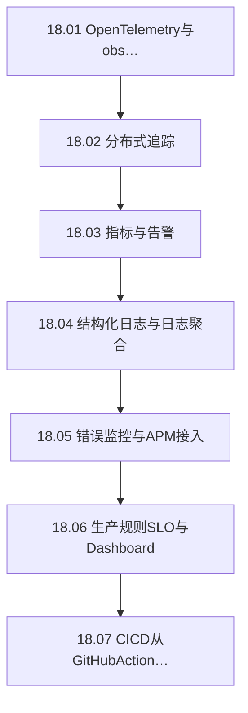

# 第 18 章 可观测性

> 第 4 部 · 7 节 · 约 8.5 学时 · 已写 0 节

## 这一章解决什么问题

会用日志、指标、追踪三件套定位线上问题。

## 知识地图

## 验收清单

- [ ] 能接入 OpenTelemetry/Prometheus 并在一次故障演练里用 traceId 定位根因。
- [ ] 能不看笔记复述本章核心机制与取舍
- [ ] 本章的命令/示例能独立跑通，并留下自己的验证记录

## 节清单

- ⬜ 18.01 OpenTelemetry与observability-SDK（待写）
- ⬜ 18.02 分布式追踪（待写）
- ⬜ 18.03 指标与告警（待写）
- ⬜ 18.04 结构化日志与日志聚合（待写）
- ⬜ 18.05 错误监控与APM接入（待写）
- ⬜ 18.06 生产规则SLO与Dashboard（待写）
- ⬜ 18.07 CICD从GitHubActions到发布（待写）

---

[← 第 17 章 可靠性工程](../ch-17-可靠性工程/_chapter.md) · [返回教程目录](../../README.md) · [第 19 章 HTTP、任务、事件与全栈交付 →](../ch-19-HTTP与全栈交付/_chapter.md)
