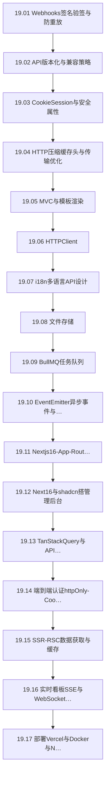

# 第 19 章 HTTP、任务、事件与全栈交付

> 第 4 部 · 17 节 · 约 20.5 学时 · 已写 0 节

## 这一章解决什么问题

补齐 HTTP 协议细节、定时任务与事件驱动，并走通前后端交付。

## 知识地图

## 验收清单

- [ ] 能设计缓存/压缩/SSE，能用 cron 与事件解耦，并能交付 Next.js 前端。
- [ ] 能不看笔记复述本章核心机制与取舍
- [ ] 本章的命令/示例能独立跑通，并留下自己的验证记录

## 节清单

- ⬜ 19.01 Webhooks签名验签与防重放（待写）
- ⬜ 19.02 API版本化与兼容策略（待写）
- ⬜ 19.03 CookieSession与安全属性（待写）
- ⬜ 19.04 HTTP压缩缓存头与传输优化（待写）
- ⬜ 19.05 MVC与模板渲染（待写）
- ⬜ 19.06 HTTPClient（待写）
- ⬜ 19.07 i18n多语言API设计（待写）
- ⬜ 19.08 文件存储（待写）
- ⬜ 19.09 BullMQ任务队列（待写）
- ⬜ 19.10 EventEmitter异步事件与AsyncLocalStorage（待写）
- ⬜ 19.11 Nextjs16-App-Router与RSC（待写）
- ⬜ 19.12 Next16与shadcn搭管理后台（待写）
- ⬜ 19.13 TanStackQuery与API客户端（待写）
- ⬜ 19.14 端到端认证httpOnly-Cookie与JWT（待写）
- ⬜ 19.15 SSR-RSC数据获取与缓存（待写）
- ⬜ 19.16 实时看板SSE与WebSocket联调（待写）
- ⬜ 19.17 部署Vercel与Docker与Nginx（待写）

---

[← 第 18 章 可观测性](../ch-18-可观测性/_chapter.md) · [返回教程目录](../../README.md) · [第 20 章 框架原理与 AI 工程 →](../ch-20-原理与AI/_chapter.md)
