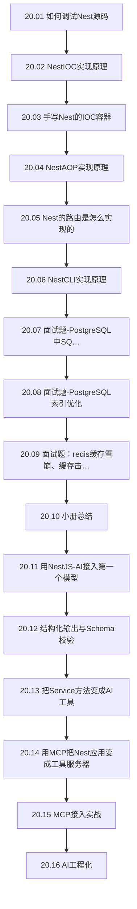

# 第 20 章 框架原理与 AI 工程

> 第 4 部 · 16 节 · 约 19 学时 · 已写 0 节

## 这一章解决什么问题

读 Nest 源码理解容器与路由，并把 AI/MCP 能力接进服务。

## 知识地图

## 验收清单

- [ ] 能讲清一次请求的框架内部路径，能写一个 MCP server 与 AI 功能。
- [ ] 能不看笔记复述本章核心机制与取舍
- [ ] 本章的命令/示例能独立跑通，并留下自己的验证记录

## 节清单

- ⬜ 20.01 如何调试Nest源码（待写）
- ⬜ 20.02 NestIOC实现原理（待写）
- ⬜ 20.03 手写Nest的IOC容器（待写）
- ⬜ 20.04 NestAOP实现原理（待写）
- ⬜ 20.05 Nest的路由是怎么实现的（待写）
- ⬜ 20.06 NestCLI实现原理（待写）
- ⬜ 20.07 面试题-PostgreSQL中SQL的执行流程（待写）
- ⬜ 20.08 面试题-PostgreSQL索引优化（待写）
- ⬜ 20.09 面试题：redis缓存雪崩、缓存击穿、缓存穿透（待写）
- ⬜ 20.10 小册总结（待写）
- ⬜ 20.11 用NestJS-AI接入第一个模型（待写）
- ⬜ 20.12 结构化输出与Schema校验（待写）
- ⬜ 20.13 把Service方法变成AI工具（待写）
- ⬜ 20.14 用MCP把Nest应用变成工具服务器（待写）
- ⬜ 20.15 MCP接入实战（待写）
- ⬜ 20.16 AI工程化（待写）

---

[← 第 19 章 HTTP、任务、事件与全栈交付](../ch-19-HTTP与全栈交付/_chapter.md) · [返回教程目录](../../README.md) · [第 21 章 求职冲刺与实战补遗 →](../ch-21-求职与补遗/_chapter.md)
