# 第 21 章 求职冲刺与实战补遗

> 第 4 部 · 25 节 · 约 30 学时 · 已写 0 节

## 这一章解决什么问题

把前面所有内容压缩成面试表达与若干“补齐型”实战。

## 知识地图

```mermaid
flowchart TD
  s1["21.01 pgvector与RAG"]
  s2["21.02 GraphQL联邦"]
  s3["21.03 CQRS与事件溯源"]
  s4["21.04 系统设计与高并发面试"]
  s5["21.05 NestNode与TypeScri…"]
  s6["21.06 数据库Redis与消息队列专项"]
  s7["21.07 项目包装简历与作品集"]
  s8["21.08 模拟面试与12周学习计划"]
  s9["21.09 MinIO与OSS-自建存储与前端…"]
  s10["21.10 大文件流式下载与Range断点续传"]
  s11["21.11 Excel导入导出"]
  s12["21.12 用代码动态生成PPT"]
  s13["21.13 服务器资源监控接口"]
  s14["21.14 GitHub与Google三方登录"]
  s15["21.15 单token无限续期与无感刷新"]
  s16["21.16 灵活DTO与class-valid…"]
  s17["21.17 Entity序列化与VO取舍"]
  s18["21.18 图书管理系统拆解-旧版全栈复盘"]
  s19["21.19 考试系统拆解-微服务与自动判卷"]
  s20["21.20 聊天室拆解-Socketio与全链路"]
  s21["21.21 请求日志审计日志与脱敏"]
  s22["21.22 部署到阿里云-前后端上线清单"]
  s23["21.23 200版与205版差异复盘与学习路线"]
  s24["21.24 286主题覆盖清单与查漏补缺"]
  s25["21.25 Nest12迁移与ESM踩坑合集"]
  s1 --> s2
  s2 --> s3
  s3 --> s4
  s4 --> s5
  s5 --> s6
  s6 --> s7
  s7 --> s8
  s8 --> s9
  s9 --> s10
  s10 --> s11
  s11 --> s12
  s12 --> s13
  s13 --> s14
  s14 --> s15
  s15 --> s16
  s16 --> s17
  s17 --> s18
  s18 --> s19
  s19 --> s20
  s20 --> s21
  s21 --> s22
  s22 --> s23
  s23 --> s24
  s24 --> s25
```

## 验收清单

- [ ] 能用自己的项目讲清架构取舍，并补齐大规模数据、性能与常见坑。
- [ ] 能不看笔记复述本章核心机制与取舍
- [ ] 本章的命令/示例能独立跑通，并留下自己的验证记录

## 节清单

- ⬜ 21.01 pgvector与RAG（待写）
- ⬜ 21.02 GraphQL联邦（待写）
- ⬜ 21.03 CQRS与事件溯源（待写）
- ⬜ 21.04 系统设计与高并发面试（待写）
- ⬜ 21.05 NestNode与TypeScript高频题（待写）
- ⬜ 21.06 数据库Redis与消息队列专项（待写）
- ⬜ 21.07 项目包装简历与作品集（待写）
- ⬜ 21.08 模拟面试与12周学习计划（待写）
- ⬜ 21.09 MinIO与OSS-自建存储与前端直传（待写）
- ⬜ 21.10 大文件流式下载与Range断点续传（待写）
- ⬜ 21.11 Excel导入导出（待写）
- ⬜ 21.12 用代码动态生成PPT（待写）
- ⬜ 21.13 服务器资源监控接口（待写）
- ⬜ 21.14 GitHub与Google三方登录（待写）
- ⬜ 21.15 单token无限续期与无感刷新（待写）
- ⬜ 21.16 灵活DTO与class-validator自定义装饰器（待写）
- ⬜ 21.17 Entity序列化与VO取舍（待写）
- ⬜ 21.18 图书管理系统拆解-旧版全栈复盘（待写）
- ⬜ 21.19 考试系统拆解-微服务与自动判卷（待写）
- ⬜ 21.20 聊天室拆解-Socketio与全链路（待写）
- ⬜ 21.21 请求日志审计日志与脱敏（待写）
- ⬜ 21.22 部署到阿里云-前后端上线清单（待写）
- ⬜ 21.23 200版与205版差异复盘与学习路线（待写）
- ⬜ 21.24 286主题覆盖清单与查漏补缺（待写）
- ⬜ 21.25 Nest12迁移与ESM踩坑合集（待写）

---

[← 第 20 章 框架原理与 AI 工程](../ch-20-原理与AI/_chapter.md) · [返回教程目录](../../README.md)
